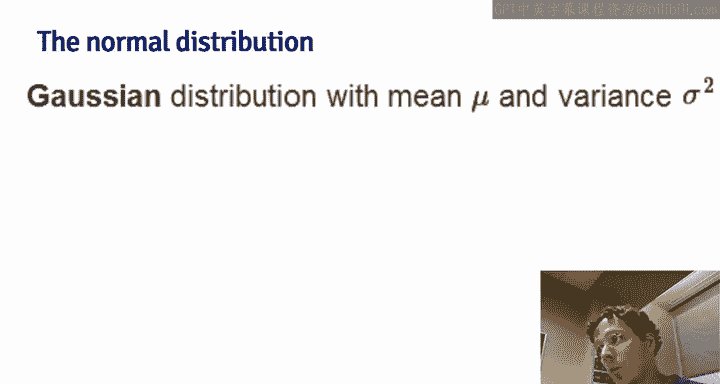
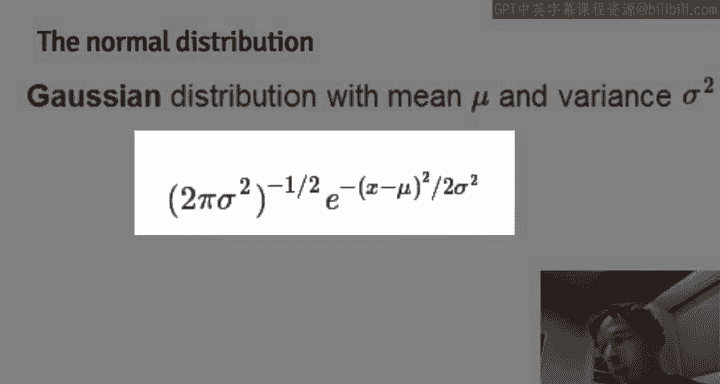
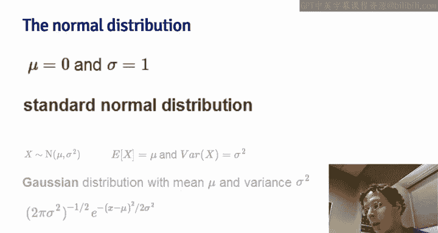
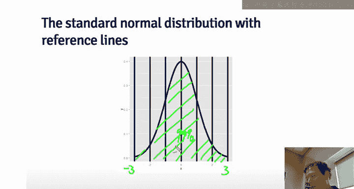
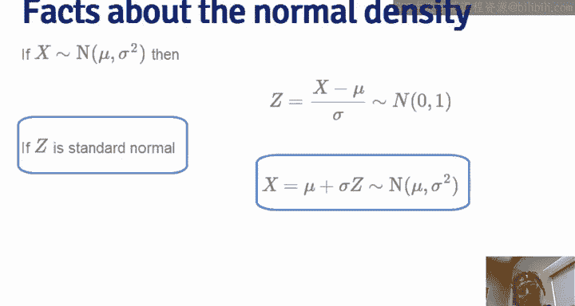
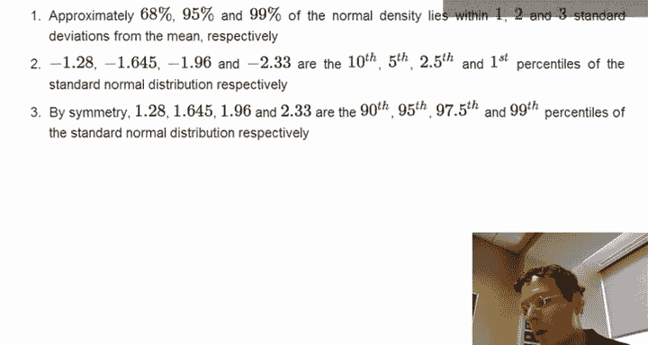
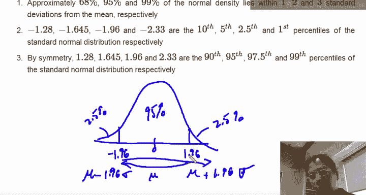
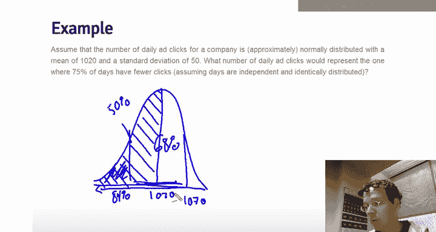
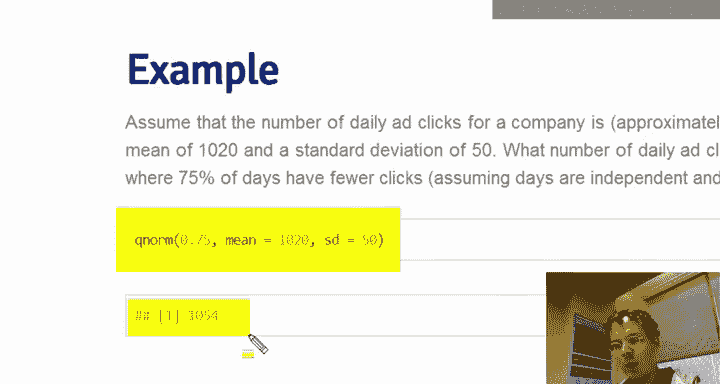

# 约翰霍普金斯大学《数据科学：统计和机器学习｜Data Science： Statistics and Machine Learning》中英字幕 - P16：15_06 02 正态分布.zh_en - GPT中英字幕课程资源 - BV1jsAAeNE3k

Probabilities。Definitely the most important distribution to know is the normal distribution we'll see in the next lecture why it's so important or one of the reasons why it's so important。

 but nonetheless， if all the distributions were to get together and elect a leader。

 it would for sure be the normal distribution。So when you read a random variable is said to follow a normal or Gaussian distribution with mean mu and variance sigma squared。

 if it associated density is this function here the bell curve， which we'll show in a minute。

If x is a random variable with this density， then the expected value of x is mu and its variance is sigma squared。

 and we simply write this in shorthand as x with a little tilde here， normal mu sigma squared。

When mu equals  zero and sigma equals 1， the resulting distribution is called the standard normal distribution。

And standard normal random variables are often labeled Z。

Here I draw the standard normal density function， the famous bell curve that you've probably seen before。

Remember that for the standard normal distribution。

 its mean is 0 and its standard deviation and variance are 1 Here I've drawn one standard deviation above and below the mean。

 two standard deviations above and below the mean， and three standard deviations above and below the mean。

The units of the standard normal can be thought of as just standard deviation units， for example。

 if you go one in this direction， you've gone one standard deviation unit。

And I would note that for non standardard normals， it makes a lot of sense and I think statisticians just kind of get used to reverting back to the standard normal by virtue of talking about standard deviations from the mean。

So if you want to know the probability that a。Non standard normal is between mu plus1 sigma where mu and sigma are from its distribution and mu minus1 sigma。

 so that would be the area between one standard deviation。From the mean for the nonstandard normal。

 well that is exactly the same probability area for for between1 and plus one on the standard normal。

 So basically all normal distributions look identical。

 the only thing that changes is the units along the axis。

 and then if you revert when you're talking about normal probabilities to talking about standard deviations from the mean。

 all the probabilities and everything revert back to the standard normal calculations will'll go through some examples。

 but that's the intuition。Let me go through some basic reference probabilities on the standardmin or normal distribution and draw on there。

 maybe this will help us remember them。So if we talk about one standard deviation from the mean。

In the standard normal distribution。Or any normal distribution。

 one standard deviation from the it mean。Then about 34% should lie here and 34% of the ma should lie here so that this total area within one standard deviation right here is 68%。

Let's now look at two standard deviations， so this magenta area。Here。

So if we go from minus 2 to plus2， and this is on any normal distribution。

 the probability of being a normal distribution being within two standard deviations of the mean。

The probability mass associated with that is 95%。 that leaves 2。5%。In either tale。

We'll use that frequently when we talk about confidence intervals。

Now let's look at three standard deviations from the mean。That area。Is about 99% of the mass。

It's hard to read， but it's about 99% of the mass。

So these reference probabilities you should just commit to memory。

 let's go over some simple rules for moving between standard and non standard normals。

So if x is normal with mean mu and variance sigma squared。

 then if we convert the units of x to standard deviations from the mean， In other words。

 subtract of the mean mu and divide by the standard deviation sigma。

 the resulting random variable Z is a standard normal。Conversely。

 if we have a standard normal and we convert back to the units of the original data， in other words。

 we multiply time sigma and add the mean。The resulting random variable X is non standard normal with mean mu invari sigma square。

 We've already discussed this first bullet point here that 68%。

95% in 99% of the normal distribution lies within 1。

2 and  three standard deviations from the mean respectively。

 Let's also talk about some standard normal quantiles that we should commit to memory。

I'm drawing a normal distribution right here and let me put the point minus1。28。The mean is。

 of course，0 for the standard normal distribution。That point is such that 10% of the density。

 this is， of course， is not drawn to a very good scale。10% of the density lies below it。

 and then 90% lies above it。Now for a not necessarily standard normal。This point is not negative 1。

28， it's mu minus 1。28 times sigma。And this point right here is mu。

But then that would follow the same rule。10% of this potentially non standard normal distribution lies below the point mu minus-1。

28 sigma。Byymmetry。This point right here。1。28 on the standard normal distribution is the quantile such that 10% lies。

Above it。For a potentially non standard normal， this point would be mu plus 1。28 times sigma。

So this point 1。28 on the standard normal and mu plus 1。

28 times sigma on the potentially non standard normal。

Would be the point such that 10% lies above it and 90% lies below it。Let's do one more。

One of the more important quantiles that we have to remember is 1。96 or close enough to two。

 we often round it up to two。Negative 1。96 is the point such that 2。

5% of the mass of the normal distribution lies below it， and positive 1。96 is the point such that 2。

5% of the mass lies above it。This would mean that 97。5% lie above this point right here and 97。

5 lies below that point right there so that 95% lies in between。

If we're dealing with a potentially non standard normal。Notice then it's mu-1。

96 times sigma and mu plus 1。96 times sigma。 Or again， the center。

 there would be mu and for the standard normal， the center would be 0。 Of course。

 notice this calculation。For the standard normal， when you plug in mu equal to 0 and sigma equal to 1。

 just of course gives you back the correct number 1。96 by itself。

Let's go through some quick calculations of increasing difficulty。So first。

 what is the 95th percentile of a normal mu sigma square distribution， So in other words。

 we want the point。X095 from a normal distribution having mean mu and variance sigma squared so that 95% lies below it。

We want that to be 95% and that to be 5%。So this is the value if we were to draw samples from this population。

 this would be the point such that 95% of the samples would be smaller than it if we were to draw a sufficiently large sample。

The easy answer is to use the Q qualifier for the density in R， in this case Q norm。

And the quantile that we want， 0。95 and make sure we plug in the mean mu and the standard deviation that we want。

 the square root of sigma squared， make sure you plug in the standard deviation and off the variance。

But there's another way to do this that's easy。Because we have our standard normal quantiles memorized。

So we know for the standard normal， which is centered at 0。

 and the units along the axis are standard deviation units from the mean that the 0。1。

645 standard deviations from the mean is the point such that 95% lies below it。And 5% lies above it。

So we know that for a non standard normal， the point that。Follow the same probability。

 the quantile that has the same 95% below it and 5% above it。Has to be exactly 1。

645 standard deviations from the mean， so we can simply take mu plus sigma times 1。645。

 and that will have to give us our answer。Let me answer a highly generic question and as we go through it。

 I think it will inform some of our next couple of questions where we put some context around it。

So what is the probability that a normal mu sigma squared is larger than x？

So take our normal distribution that's non standard。

 so it's centered at mu and the width is governed by the variable sigma squared。And take a point X。

We'd want to know， what's this area right here。So in R， we could just do P norm。X。Mean equals mu。

Standard deviation equals sigma。 of course， remember that you plug in the。Sigma value。

 not Sigma squared value， otherwise you'll get it very wrong。And then we want lower。Dot tail。

Equals false。To tell R that we want the upper tail rather than the lower tail。Or you could omit that。

You could omit that and do one minus that。Okay， that's the easy way。

But a conceptually easy way to do it in a way that we can kind of do these things in our head and get a sense of what the probabilities are like rather quickly is to convert。

X into how many standard deviations from the mean it is。To do that， we simply take X。

 subtract off the mean mu， and divide by the standard deviation sigma。This new。

Number here is simply x expressed in how many standard deviations from the mean it is。 So。

 for example， if this works out to be around two standard deviations from the mean。

 we know that that should be about 2。5%。So let's put some context around this by considering a specific example。

Assume the number of daily ad clicks for a company is approximately normally distributed with a mean of 1。

020 clicks per day and a standard deviation of 50 clicks per day。Let's assume that。

Days are sort of a random sample of days in that if we're talking about a specific day。

 it's a draw from this general distribution。What's the probability of getting more than 1060 clicks on a given day？

Well， 1，160 clicks is 2。8 standard deviations from the mean。

 so we know this probability has to be pretty low because it's about three almost three standard deviation from the mean we remember that three standard deviations is pretty far out into the tail of the normal。

 so we know that this probability has got to be fairly small。But let's work through it。

So it's not very likely。We can obtain that with P norm 1，160， mean equals 1020。

 standard deviation equals 50， and we put lower dot t because false because we want the probability of being larger than it and we get 0。

003 about。Just to illustrate that if we do this calculation directly using the standard normal distribution。

 where we've expressed 1160 as the number of standard deviations from the mean that it is that we get the same answer。

 I plug in P norm 2。8 and do lower dots false。 and， of course， it gives us the same number。

So we've done a probability calculation， let's do a quantile calculation that's similar。

Assume that the number of daily ad clicks for this company is approximately normally distributed with a mean of 1020 and a standard deviation of 50。

What number of daily ad clicks would represent the one where 75% have fewer clicks。 And again。

 we're going to assume that days are a random sample from a population of days。 They're an II sample。

 So we're not going to be concerned about whether one day being close to another day is going to be more correlated or whether weekend days have more clicks or fewer clicks than weekday days or any of these other intricacies that we'll learn later on in the class how to deal with better。

Let's do some just scratch work before we go to R and actually do the calculation。

Here's our normal distribution with 1020。Because 1020 is both the mean and the median of this specific normal distribution。

 we know that that point is the point we're about 50%。Lie below it， so whatever number we get。

 it has to be above 1020。Also consider one standard deviation above the mean。1070。That point。Recall。

Between one standard deviation， recall that was 68%。Well。

 that leaves out this little tail right here。 Let's see if we can think about that。 Well。

 if there's 68% between these two numbers that would put 32% outside of it and then 16% in either tail because the normal distribution is symmetric。

 so from 1070 below should be about 84%。So we know that whatever number we get has to be between 1020 and 1070。

And here's the command right here where we do Q norm 0。

75 mean equal to 1020 and standard deviation equal to 50。

 and of course we get a number between the two numbers that we were talking about before 1054。

