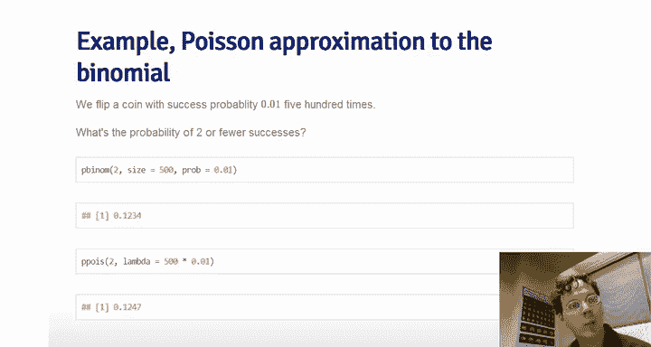
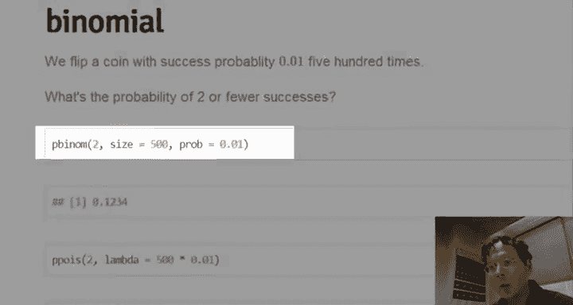
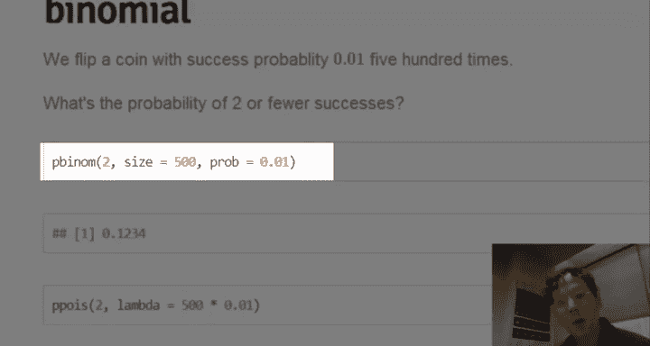
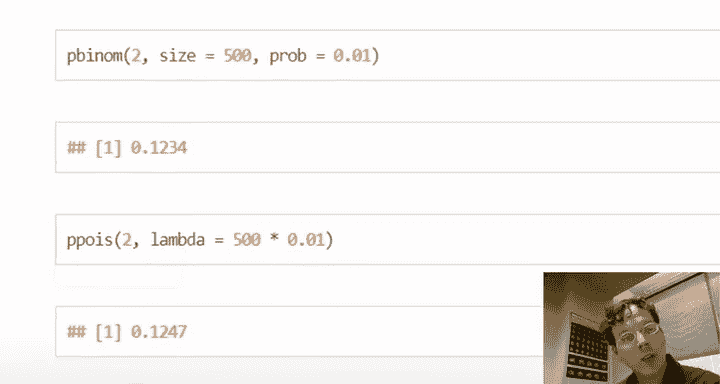
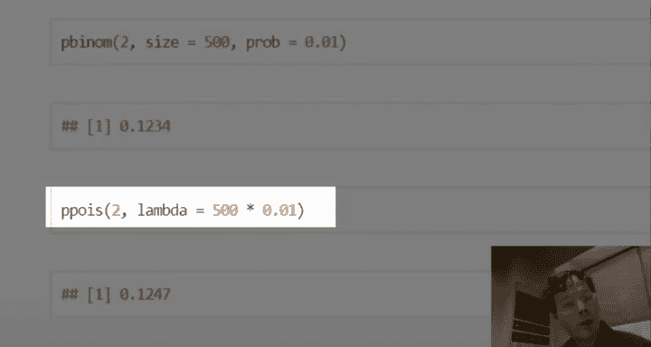
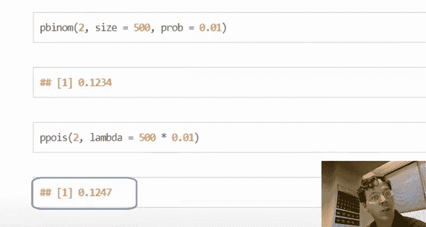

# 约翰霍普金斯大学《数据科学：统计和机器学习｜Data Science： Statistics and Machine Learning》中英字幕 - P17：16_06 03 泊松分布.zh_en - GPT中英字幕课程资源 - BV1jsAAeNE3k

If there were a competition for the most useful distribution， that's over。

 the normal distribution went in a landslide。However。

 we could have a pretty active discussion about what deserves second place。

 the Poson distribution would certainly be in the running。At any rate。

 the Po distribution is used to model counts。The Poson mass function is lambda to the x e to the negative lambda all over x factorial。

 where x is defined on the non negative integers，0， 1， 2， and so on。

The mean of a Poson random variable is lambda， this parameter here。

And the variance of this distribution is also lambda。

So that's an interesting thing to take into account when you model things as if theyre a Poson。

The mean and the variance have to be equal， which if you have repeated Poson data。

 this is a checkable assumption。I'd like to give some instances where we use the Poisson distribution。

Anytime you want to model count data， the Poson distribution is a candidate。

 especially if those counts are unbounded。There's also another set of data that's very common in the field of biostatistics。

 so called event time or survival data。So for example， in cancer trials。

 you might be trying out a new therapy， you would model the time until people have a recurrence of some symptoms。

Some people may not ever have that recurrence and some people may in the time of the study。

 you need special statistical techniques to deal with that problem of so- calledled censoring。

 and those techniques have a deep connection with the Poisson distribution。

Whenever you take a sample of people and you classify them according to some characteristic。

 for example， hair color and just look at the counts of the people of various hair colors that's called a contingency table。

 you can create a cross-classified contingency table， for example。

 you would count hair color by race in each cell would be the specific race， hair color combination。

 the count to the people in the sample that had that specific combination。

The Poisson distribution is the default distribution for modeling contingency table data。

 and it turns out that it has， again a deep connection with some of the other models you might think to use such as multinomials。

 binomials and Bnoles。A final instance where the Poisson is used and this is done so commonly。

 it's not even really stated as people are doing it is in instances where you have a binomial。

 but n is very large and P is very small， this for example happens very commonly in the field of epidemiology。

My friend Roger studies air pollution， and he looks at as air pollution rates rise and fall。

 the number of new cases of say respiratory diseases in large areas like cities， for example。

While the N is very large， the population of the city。

 but the number of events that he's looking at are often quite small。

 And so he models those as if they were Poson。And this is done so commonly in the field of epidemiology that people don't even really say when they're doing it。

 they just do it and everyone knows what they're talking about The Poson distribution is often used to model rates。

 so for example， let's let x be Poson Lada T。 It's important to note that lambmbda here has units It's the average number of events per unit time where T is expressed in that particular time units。

So Lambda is the expected count per unit time and t is the total monitoring time。

 so this is a very common use of the Poisson distribution for modeling rates。

So imagine if the number of people that show up to a bus stop is poson with a mean of 2。

5 people per hour。We watched the bus stop for four hours。

 What's the probability that three or four three or fewer people show up the whole time。

 so that's just the Poson probability of three，3，21 and zero。

And the rate we want at this point is not 2。5 because it's 2。5 events per hour。

 but we watched it for four hours so we want to put in a rate of 2。5 times4。

 and here we get the probability here of 1%。Let's talk about the poisson approximation to the binomial。

Particularly when n is large and P is small， the Poisson can be a quite accurate approximation of the binomial。

To tie down notation， let's let x be binomial N P and define lambda as n times P。But here。

 we're considering circumstances where n is very large and P is very small。

 Then the proposal is that the probability distribution governing X， which is binomial。

 can be well approximated by Poisson probabilities with this specific notation Lambda as n times P。

As our final example to discussing the Poisson distribution。

 let's go through a Poisson approximation to the binomial。

So imagine if we were to flip a coin with success probability 001500 times。

 What's the probability of two or fewer successes。 This is simply to illustrate that I have a setting that's a binomial probability with a large N 500。

And a small P001。 And now I want， but it's， it's still in the realm where the binomial calculations are possible。

 So here， when I do P byome。

For two， because the question asked for two or fewer successes， size equals 500，500 coin flips。

 probability equals 001， suggesting that the true success probably of the coin is 0。01。

 I get around 12%。

When I do the same calculation with Poisson。

2， and then now， instead of inputting the size and the probability。

 I put in Lada as n times P 500 times001。 I get  12。5%。 So fairly close。

