# 约翰霍普金斯大学《数据科学：统计和机器学习｜Data Science： Statistics and Machine Learning》中英字幕 - P20：19_07 03 渐近性和置信区间.zh_en - GPT中英字幕课程资源 - BV1jsAAeNE3k

So let's develop a more practical use of the central limit theorem。

Recall that the sample mean is approximately normally distributed with population mean equal to mu。

And standard deviation equal to the standard error of the main sigma over square root n。

In this distribution， mu plus2 standard errors is pretty far out in the tail， with only a 2。

5% chance of a normal being larger than two standard deviations into the tail。Similarly。

 mu minus2 standard errors is pretty far in the left tail with only a 2。

5% chance of a normal being smaller than two standard deviations into the left tail。

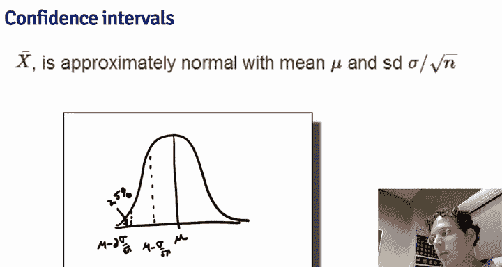

So the probability that x bar is bigger than mu plus2 standard errors or smaller than mu minus2 standard errors is 5%。

Or equivalently， the probability that mue is between these limits is 95%。

We can reverse the role of X bar and mu without changing the probability inequalities and get that the quantity X bar plus or minus-2 standard errors contains mu with probability 95%。

Remember here that we're treating the interval as random x bar plus or minus2 standard errors while mu is fixed。

 so we talk about the probability that the interval contains mu。

The actual interpretation of this is that if we were to repeatedly get samples of size N from this population。

 construct the confidence interval。 In each case， about 95% cent of the intervals we obtained would contain mu the parameter that we're trying to estimate。

I would note that I get the two by rounding up the 97。5th quantntile， which is closer to 1。96。

If you wanted a 90% interval， what you need is 5% in either tail。

 so you would replace the two with 1。645。

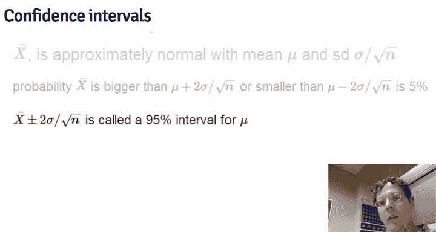

Let's go through a simple example。

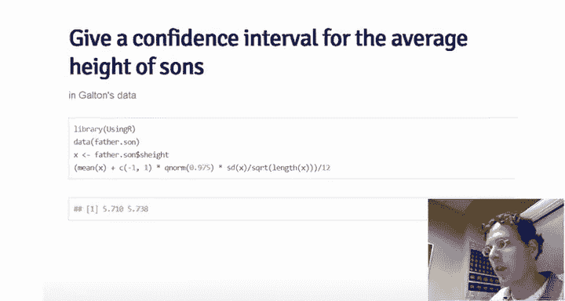

Consider the father dot son data from the using our package Def find x to be the sun's height。

 I'm simply going to take mean of x plus or minus the 0975th normal quantile times the standard error of the mean standard deviation of x divided by the square root of n。

 which is the length of the vector x。I divide it by 12 so that my confidence interval will be in feet rather than inches。

 and I get the confidence interval 5。710 to 5。738。So if we were willing to assume that the sons from this data were an IID draw from a population of interest。

Then the confidence interval for the average height to the suns would be 5。71 to 5。74。

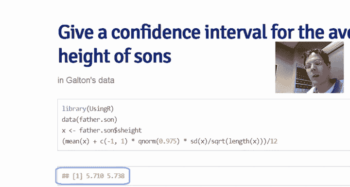

Let's consider coin flips and developing a confidence interval for the success probability of the coin。

So in this case， each observation Xi is a 0 or 1 with a common success probability P。

 and remember the variance of coin flip was p times 1 minus p。

 where again p is the true success probability of the coin。

Remember then the standard error of the mean is square root p times 1 minus p over n。

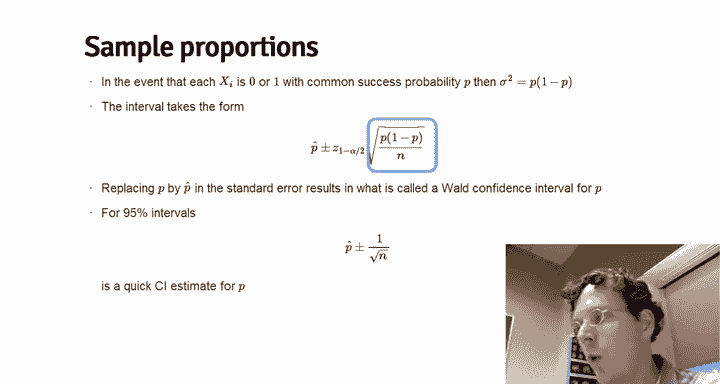

So the interval takes the form P hat plus or minus the normal conile times square root p times 1 minus P over n。

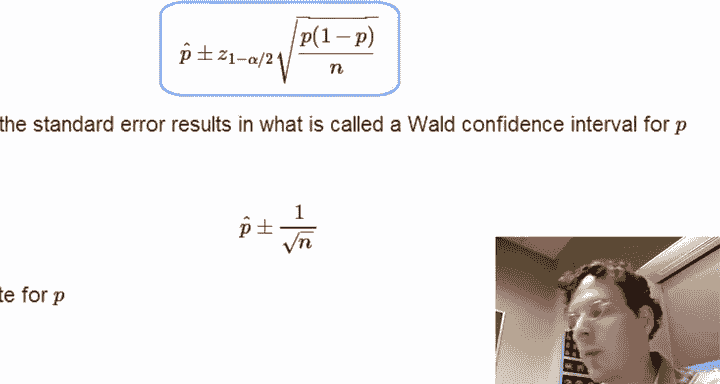

We don't know P， it's what we want to estimate。And so we don't have this standard error。

 but we would replace it by P hat。And this is a confidence interval that is called the Waled confidence interval named after the Great Statistician Waled。

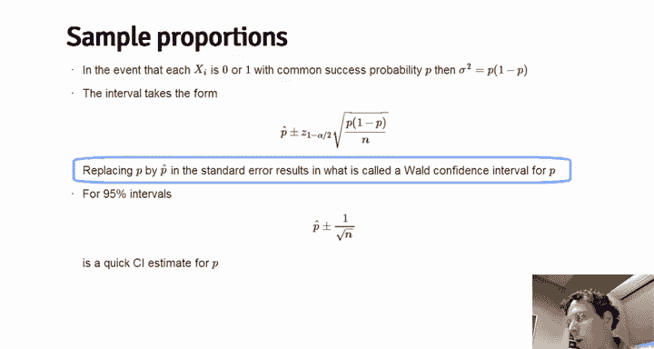

It turns out。P times 1 minus P is as large as it can be when p equals a2 so that square root p times 1 minus p is1 half and when we multiply at times the2 in the 95% interval those cancel out。

 and we get that for 95% intervals， P hat plus or minus1 over square root n is a very quick confidence interval estimate for P。

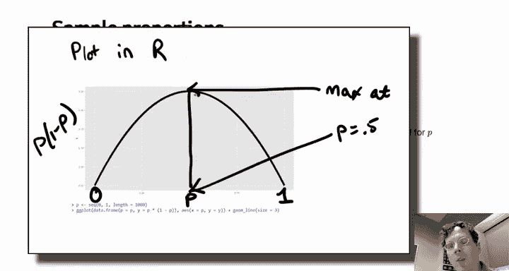

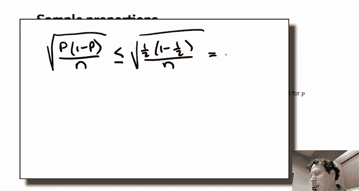

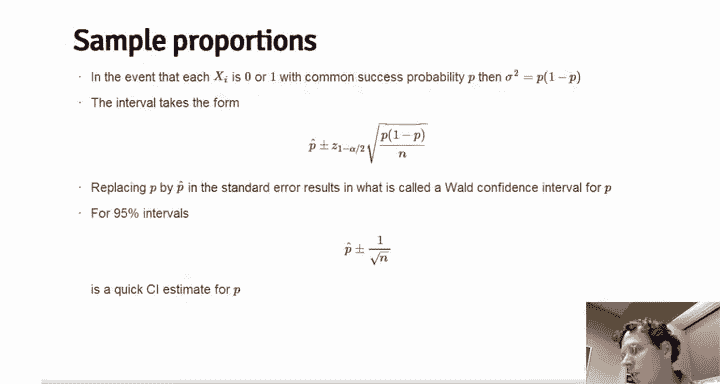

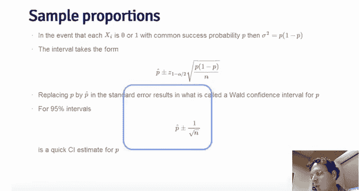

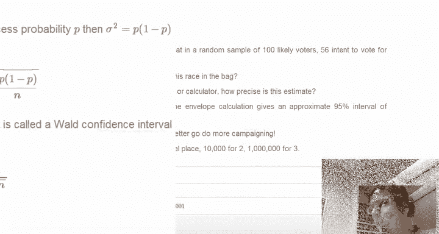

Imagine you were running for political office and your campaign advisor told you that in a random sample of 100 likely voters。

 56 intended to vote for you。Can you relax， Do you have this race in the bag。Is 0。

56 out of 100 sampled enough evidence to conclude that you will likely get more than 50% of the vote。

But you don't have access to a computer or calculator。

So what you do is you do one over square root 100 which yields 0。1。

 so the back of the envelope calculation gives an approximate 95% interval of 0。46 to 0。66。

The confidence interval says that we can't rule out possibilities below 0。5 with 95% confidence。

So not enough for you to relax and you better go do more campaigning。

So some general rough guidelines is that you need 100 for one decimal place in a binomial experiment。

 10，000 for2 and a million for three here I just give one over the square root of a bunch of powers of 10 just to illustrate that。

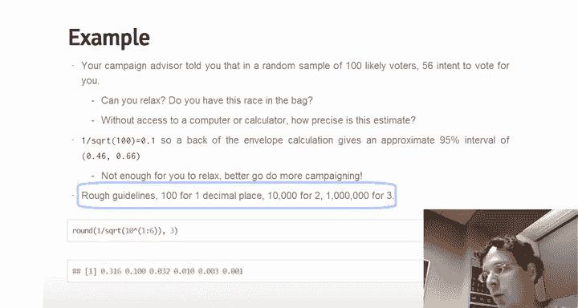

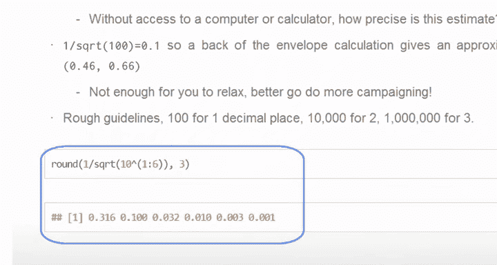

Here I just go through the calculation where I plug 0。56 directly into the standard error formula。

So we have 0。56 plus or minus the relevant standard normal quantile times square root 0。56 times 0。

44 over 100。 This yields the interval 0。46 to 0。66， just like before。

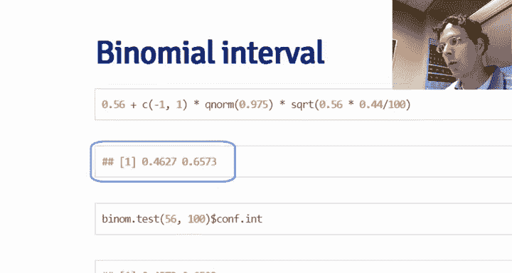

Also the function by Noome dot test with 56 successes out of 100 trials and grabbing the confidence interval component。

Yields a very similar interval， 0。46 to 0。66。The binome dot test function is exact in the sense that it yields 95% coverage or higher。

 regardless of the size。 and these so called exact procedures are a nice complement to large sample procedures。

 They tend to involve computations that cannot be done by hand and can be conservative。

 Ie have wider intervals， but nonetheless， they do not rely on the central limit theorem。

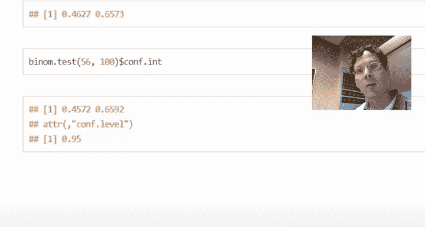

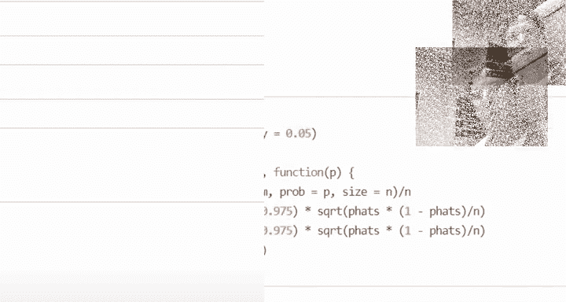

Let's consider a simulation。Here I'm going to do a simulation where I flip a coin with a given success probability over and over and over again and calculate the percentage of times my walled interval covers the true coin probability that we used to generate the data。

 So I'm going to say in each one of my simulations， I'm going to do 20 coin flips。The true values。

Of the success probably the coin that I'd like to look at vary between 0。1 and 0。

9 where I step through them by values 0。05。I'm going to do 1 thousand simulations。

And then I'm going to loop over these true success probabilities。

And for each true success probability， I'm going to generate 100。

Seets of 10 coin flips where I take the sample proportion in each case。

Then I'm going to calculate the lower limit of the confidence interval in each of those cases and the upper limit of the confidence interval in each of those cases。

 and I'm going to calculate the proportion of times that they can cover that true value of P that I use to simulate the data。

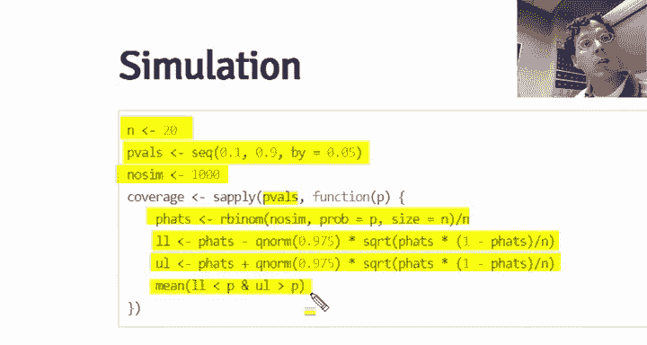

This will all be in this。

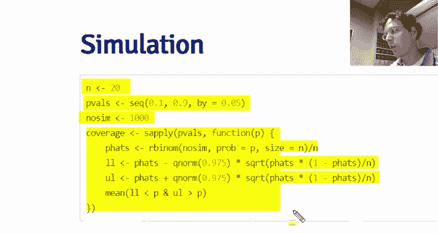

Variable that I'm calling coverage now what I'd like to do is plot coverage as a function of the true success probability I use to simulate the data。

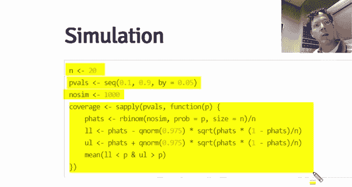

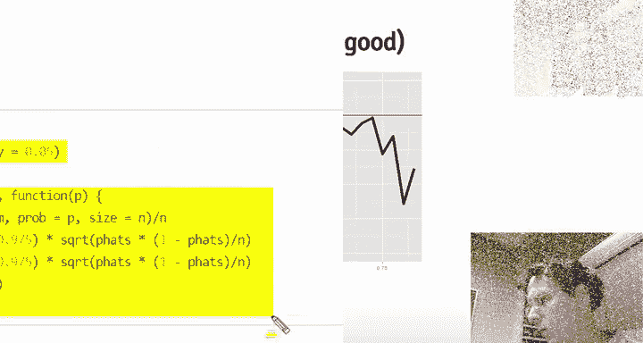

Here I show the plot of the coverage by the true values of P used for simulation。So for example。

At the value 05， I flipped the coin 10 times， took the sample proportion。

Found the confidence interval。And then gave it a one， if it covered the value 。5 or not。

 I did that a thousand times。 And in this case， over 95% of the time， it did， in fact。

 cover that probability。 So it's basically saying。If the true value of P was 0。

5 and I do a confidence interval， the coverage is actually better than 95% a little bit。

 there is some Monte Carlo error right in that I didn't do an infinite number of simulations。

 I only did 1 thousand00， but 1 thousand is pretty good right as we saw in a couple slides ago。

 it's giving us a little bit better than one decimal place accuracy。Now。Here。

It's pretty clear that I'm getting nowhere near 95% confidence level for the case where the P is around here around 12% or so。

Now， why is this the case， Why is it that a 95% confidence interval procedure is clearly giving us coverage less than 95%。

 and it's simply because the central limit theorem isn't as accurate as we need it to be for this specific value of N for coins with this specific true probability。

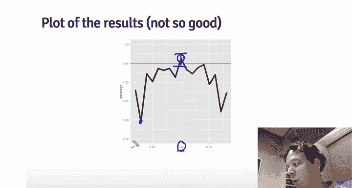

So I'll give you a quick fix to address this problem for smaller values of n。

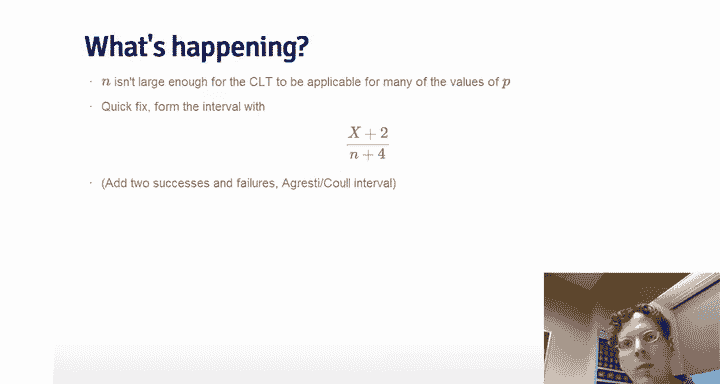

The quick fix is to simply take your number of successes X and add2 and your number of failures and also add2 so that your P hat is now x plus2 over n plus 4。

 so adding two successes and failures， then you just churn through the confidence interval procedure。

As normal， but with this new sample proportion that's been shrunk towards 0。5 a little bit。

 this is called the aggressivey cool interval and in a minute we'll show you how it performs a little bit better。

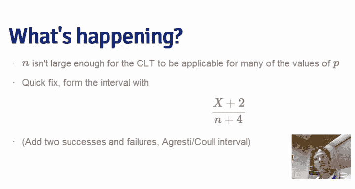

Before I show the results for adding two successes and adding two failures。

 I want to simply show that the performance is better when n is larger here I've done exactly the same simulation but turned n into 100 rather than 20。

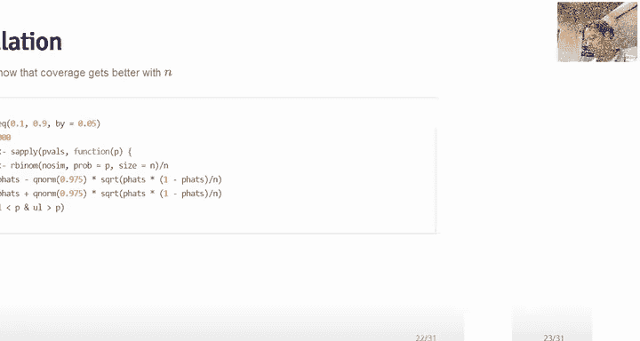

And here you see the coverage probability as a function of the different values of P。

 only now the only difference is that within each confidence interval that I simulated I used a greater number of coin flips。

 so in each case， take for example， this point right here for that specific true value of P。

I simulated 100 coin flips， took the sample proportion。

 created the confidence interval and saw if it contained this true value of P。

 And over 95% of the instances， that was the case。 You see here's the 95% line right here。

 And you see that the。The coverage probability is fairly close to it throughout。

 it never dips below 90 like it did in the 20 case。

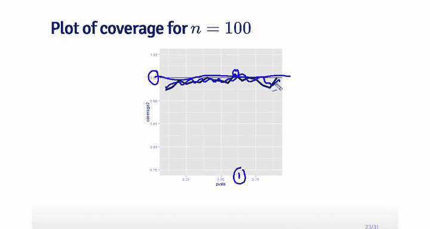

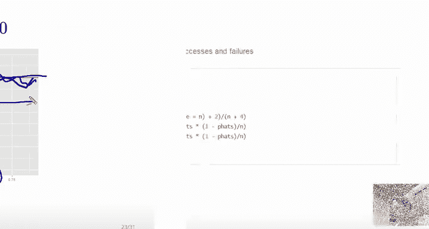

Now let's look back at the 20K again。So I'm setting n equal to 20。Okay。

But now when I calculate my confidence interval here， notice that I am。

Adding two successes and two failures。

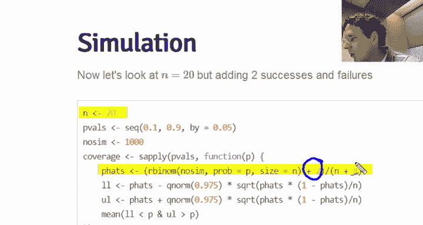

So let's see the performance of that。 and you can see that the add to successes and add to failures interval tends to cover。

The true success probability with a higher percentage of time than 95%。

This is a little bit better than the extremely poor coverage of the walled interval for certain values of the true probability。

 however， being too conservative， in other words， having too high of a coverage rate is also not necessarily a good thing。

 as it implies that the interval is probably too wide。Nonetheless。

 I've done some thinking about this specific problem and I can give a very categorical recommendation that the Add2 successes and Add2 failures interval should generally be used instead of the walled interval。

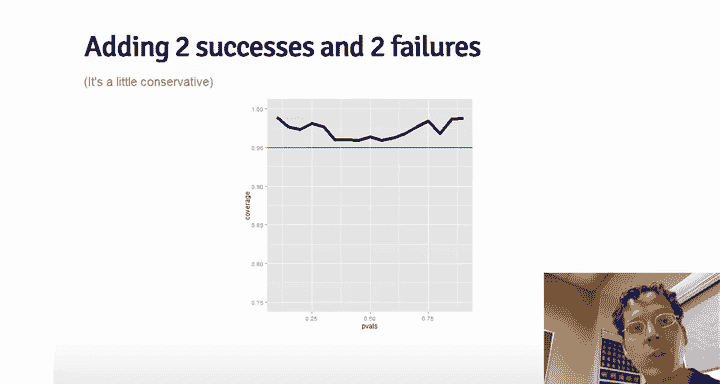

Let's create a Poson interval using the estimate plus or minus normal quantile standard error of an estimate formula。

This is based on the central limit theorem， though it's maybe a little less clear how the central limit theorem is applying in this case。

 I'll talk about that a little bit in a minute。So let's talk about a nuclear pump that failed five times out of 94。

32 days， given 95% confidence interval for the failure rate per day。

So I'm going to assume that my number of failures is poison。

With failure rate lambda and T being the number of days。

So my estimate of the failure rate is the number of failures divided by the total monitoring time。

The variance of this estimate turns out to be lambda over T。

 so that lambda hat over T is our empirical variance estimate。

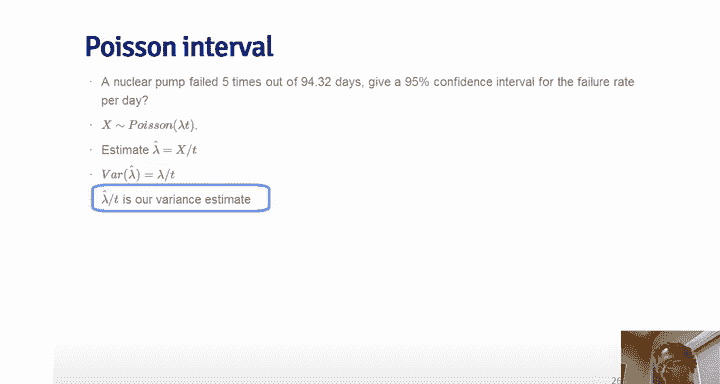

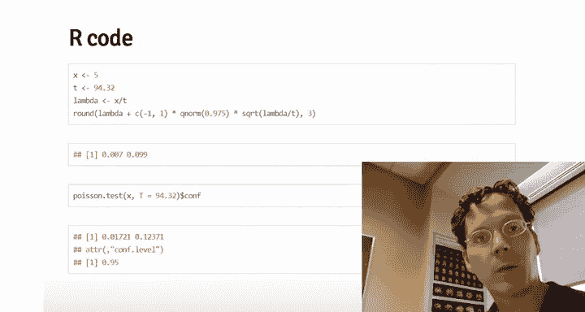

Here I just go through the calculations in R。 I define my number of events here as x being 5。

 The monitoring time is 94。32。 My estimate of the rate as x over t。

And my confidence interval estimate as the rate estimate plus or minus the relevant standard normal quantile。

Times the standard error， and then I round it so that I only get three decimal place accuracy。

 So here is my estimate for the rate， my 95% confidence interval estimate for the rate。

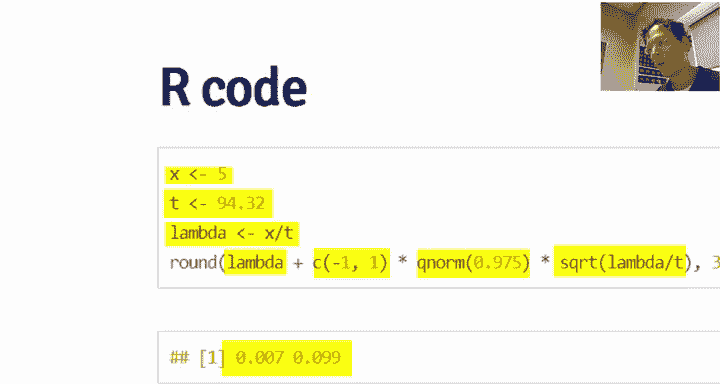

In addition to doing a large sample interval， we can do an exact Poson interval and R has a function for doing it。

 It's Poson do test， we give it the number of events。

and the monitoring time and then you can just grab the confidence interval part of it and there it gives the exact Poson interval What I mean by exact here again is that it guarantees the coverage。

 but that might be conservative， it might give you a wider interval。T necessary。

 but it will guarantee 95% coverage。

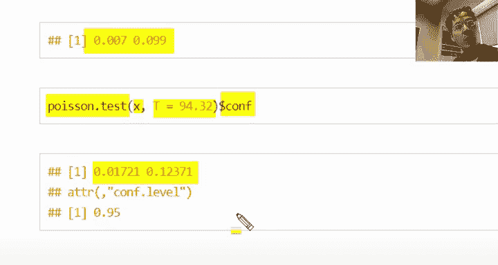

Just because we're very interested in seeing how confidence intervals perform on repeated sampling。

 since that defines our idea of what a confidence interval is。

 let's repeat the process that we did for the coin for the Poisson coverage rate。

 So let's pick a set of lambmbda values， Ki of near the ones from our example。

 Let's do 100 simulations。

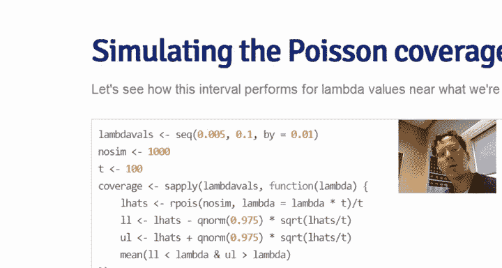

Let's say our monitoring time is 100 instead of 94 just to make it simple。

And then I'm going to define coverage in the same way。

 I'm going to simulate a bunch of Posonons with this particular rate。

And then I'm going to divide it by the monitoring time to get a vector of lambda hats over 1 thousand simulations。

 I'm then going to create my。95% confidence interval by constructing the lower limit where I subtract off the standard normal quantile times the standard error。

 and then a bunch of upper limits where I add。The standard normal quantile times the standard error。

 and then I'm going to take the percentage of times。

That my interval contains the true lambda used for simulation。

 and I'm going to do that over a series of lambda values and then in the next slide I'm going to show you the plot of the lambda values by the Monte Carlo estimated coverage。

So here's the plot of our Lambda values。By the coverage。

 So every point in this plot is an instance where we simulated and repeatedly generated Poson confidence intervals and took the percentage of time that those intervals contained the true lambda values used for the simulation。

 We can see as the lambda values get larger。The coverage gets closer to 95%。 There is， of course。

 some Monte Carlo error because we didn't do an infinite number of simulations， only 1000。

 we also see that as lambda as the true value of lambda gets smaller。

The coverage gets very poor and I don' you probably can't see this number terribly well here so I'll zoom in。

 that coverage is 50% right there， so your purported 95% interval is only giving you 50% actual coverage。

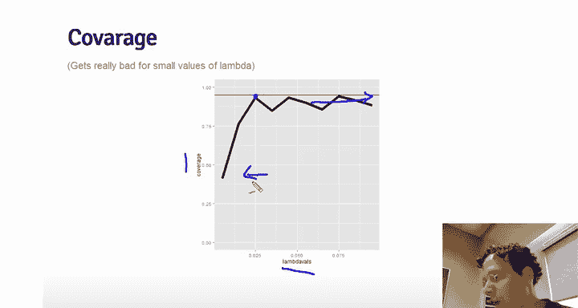

So our brief simulation here is suggesting that for very small values of lambda。

 which we have a good sense of if we could have relatively few events for a large amount of monitoring time。

 for relatively small values of lambda， we shouldn't be using this asymptotic interval。

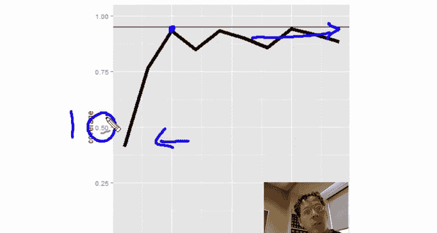

Since it's not immediately clear how the central limit theorem works in the Poson case。

 I just wanted to put up one simulation to show that what's going to infinity to make the Poisson case have very good approximations using the central limit theorem and basically as the monitoring time goes to infinity。

 the coverage will converge to 95%。 So in this simulation I change t from 100 to 1000 so that we're monitoring not for a total of 94。

32 days， but a total monitoring time of 1000 days。 And here we see that the coverage if we look at the reference line here at 95%。

 The coverage is much， much， much better for most values of lambda。

 there is some poor coverage down here near the smaller values of lambda。

 but we know that this interval has problems with small values of lambda。

 But remember in this case we do have the exact Poisson interval as an option。

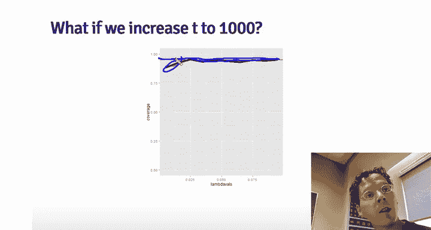

So congratulations on making it through this marathon lecture because there was so much content I'd like to summarize very briefly。

First of all， we cover the law of large numbers， and that simply states that averages of I random variables converges to the things that they're estimating。

 I would also add that it also shows that Poisson rates converge to the rates that they're imating。

 though it's may be a little less clear， how that works， but as the monitoring time goes to infinity。

 for example。The central limit theorem is also a theorem involving averages。

 and it states that averages are approximately normal with distributions centered at the population mean。

 which we knew regardless of the central limit theorem。

 and with standard deviations equal to the standard error of the mean。

 which we also already knew without the central limit theorem。

 however the central limit theorem also tells us that they are approximately normal。However。

 the central limit theorem doesn't give any guarantee that n is large enough for this approximation to be accurate。

 and we've seen some instances with confidence intervals。

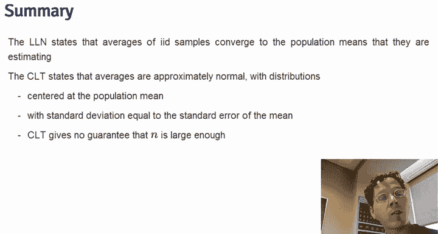

Where it's very accurate in instances where it's less accurate。Speaking of confidence intervals。

 taking the mean and adding them， subtracting the relevant normal quantile times the standard error。

Yields a confidence interval for the mean in this process of estimate plus or minus some sort of quantile times the standard error is our default way for creating confidence intervals。

 whether it's in this context or in our regression class or even when we're talking about generalized linear models and more complex subjects。

 we tend to use these so-called walled intervals。The specific case where we want a 95% confidence interval you can take two is the quantile or if you want to be a little bit more accurate。

 use 1。96。Now confidence intervals get wider as the coverage increases if you're staying within a single technique。

Now， why would this be the case？So imagine if someone were to put a gun to your head and say。

 unless this confidence interval contains the true parameter it' estimating。

 I'm going to pull the trigger。Which is a ridiculous circumstance， but humor me。

What would you do well， you certainly don't want them to。To pull the trigger， right。

 so what you would do is you'd make the confidence intervals as wide as you possibly could。

Because you want to be very sure that the interval contains the parameter。

So that's the same thing that the mathematics does。

 the more sure that you want to be that the interval contains the parameter。

 the wider the procedure makes the interval。If you don't care at all。

 if you want a 2% confidence interval， not only then you're going to have an interval that's very close to the mean itself。

Now the poisonson and binomial cases are discrete cases and we saw that the central limit theorem can sometimes not approximate their distributions well。

And in those cases， there are exact procedures， but we also saw a simple fix for the binomial case if you're creating conference intervals where if you add two successes and you add two failures。

 you get a much better conference interval without much extra thinking or having to resort to。

Something that requires a computer， so you can still do that calculation by hand if you happen to be or in your head。

 if you happen to be not around a computer。

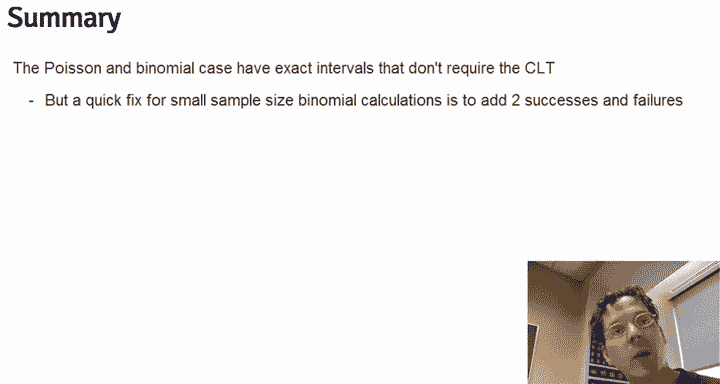