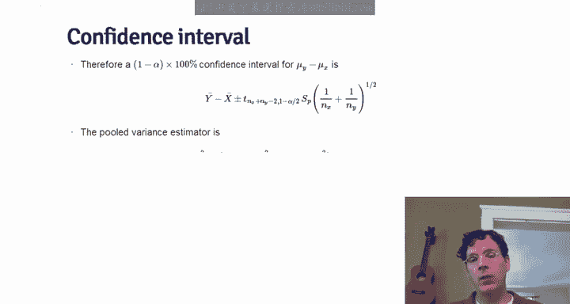
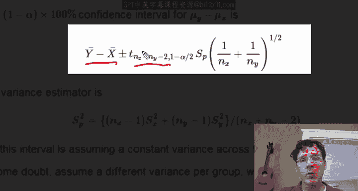
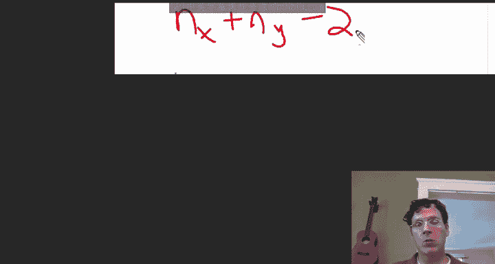
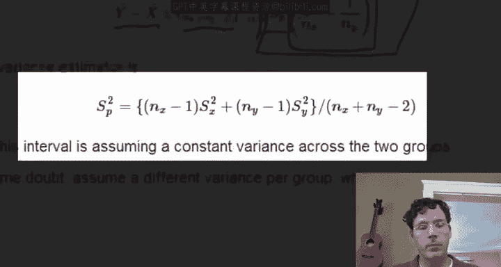
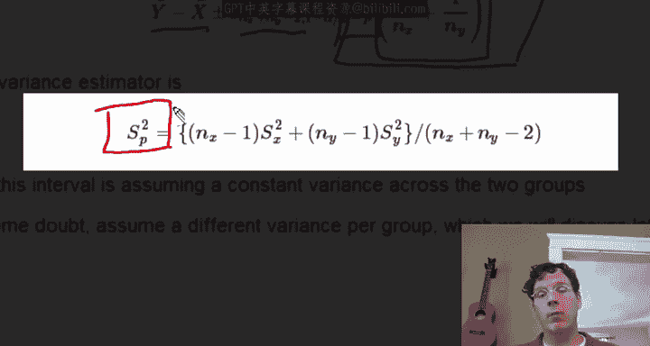
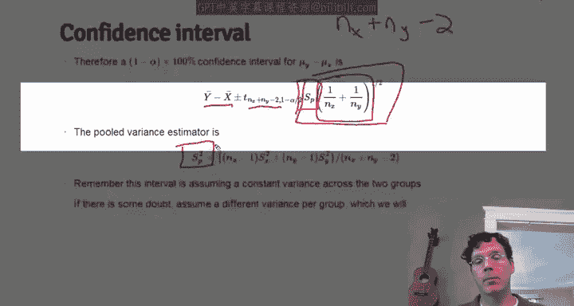
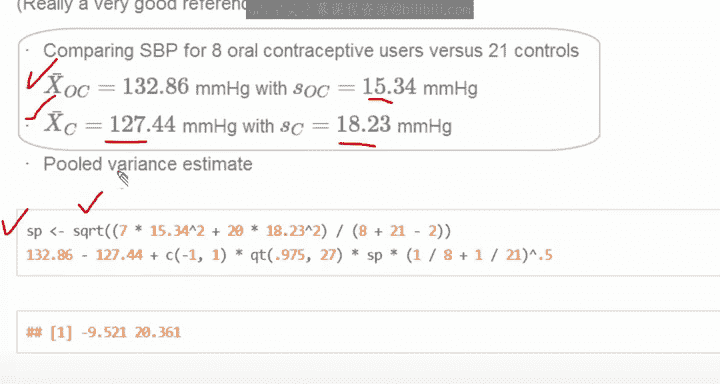
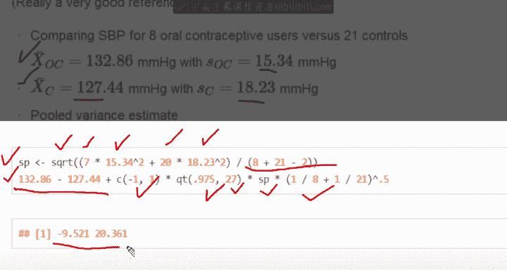
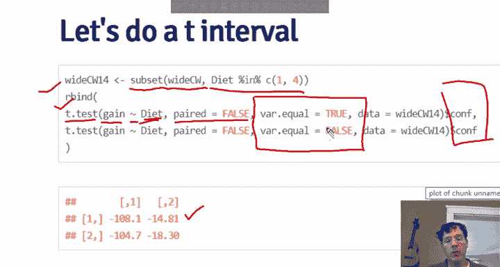

# 约翰霍普金斯大学《数据科学：统计和机器学习｜Data Science： Statistics and Machine Learning》中英字幕 - P23：22_08 03 独立组 t 区间.zh_en - GPT中英字幕课程资源 - BV1jsAAeNE3k

Suppose that we want to compare the mean blood pressure between two groups in a randomized trial。

 Those who received the treatment and those who received the placebo here。

 this is not unlike so called A B testing， which is probably the languages used most often in data science。

Here， whether in A B testing or in randomized trial。

 you are performing the randomization in order to balance unobserved covariates that may contaminate your results。

Because you've performed this randomization， it's reasonable to just compare the two groups with a T confidence interval or a T test。

 which we'll cover later on。But we can't use a paired tea test because there is no matching of the subjects between the two groups。

So we now present methods from comparing across independent groups。

The standard confidence interval in this case。

Is y bar minus x bar the average in one group minus the average in another group。

Times the relevant T quantile。We here the degrees of freedom are a little bit hard。

 the degrees of freedom are nx plus n minus2， where Nx is the number of observations going into the X group and y is the number of observations going into the Y group。

Here， this is the standard error of the difference。This S P right here， I'll talk about in a minute。

 but it is multiplied times this factor here，1 over Nx plus1 over N Y raised to the one half power。

You'll notice that as we collect more data，1 over Nx gets very small and one over Ny gets very small。

The S A P squared is the so called pooled standard deviation， or I'm sorry。

 S A P squared is the so called pooled variance。 Its square root is the pooled standard deviation。

If we're willing to assume that the variance is the same in the two groups。

Which would be reasonable if we have performed randomization。

Then our estimate of the variance should at some level be an average of the variance estimate from group 1 and the variance estimate from group 2。

However， if we have different sample sizes， we'd like to weight the variance estimate from group 1 more than we weight the variance estimate from group 2。

 And that is exactly what the pooled variance estimate does。 If， in fact。

 you have equal numbers of observations in both groups。 N X is equal to N， Y。

 then the pooled variance is the simple average of the variance from the X group and the variance from the Y group。

😊。

But remember， this interval assumes a constant variance across the two groups。

 If that assumption is violated， then this interval won't give you the proper coverage。

If there's some doubt， simply assume a different variance per group。

 which we'll cover later on in the lecture with a slightly different interval。

Here I go through an example from Rosner's fundamentalaals of Biosstatistics book。

 This is a very good reference book， I quite like it。However。

 you don't want to put it in your backpack because it's pretty heavy。

 it's a very thorough book about a couple hundred pages and weighing over five pounds。

 that is my guess。In one of the examples from this book。

 they're comparing eight oral contraceptive users to 21 controls with respect to blood pressure。

For the oral contraceptive users， they got a。Average systolic blood pressure of 133 mg of mercury with a standard deviation of 15。

 a control blood pressure of 127 with a standard deviation of 18。

 Let's go ahead and manually construct the independent group interval once just to turn to the calculation。

 When you tend to do this on your own。 You tend to use T dot test or something like that。

 because you have the raw data。So the pooled。Standard deviation estimate is going to be the square root。

Of the pooled variance estimate there we need to take 15。34。

 the standard deviation from the oral contraceptive users square it， 18。23。

 the standard deviation from the controls and square it and take their weighted average weighted by their sample sizes。

 so 7， which is 8-1 and 20， which is 21-1 from the two sample sizes -1 than divided by the sum of the sample sizes -2。

 that gives us a weighted average of the variances where the group。

 the control group with 21 gets more impact then the oral contraceptive users with 8。

Then I square root the whole thing because I want the standard deviation。

 then my interval is the difference in the means， and then you always。

 whenever you're doing an independent group interval。

 you always want to kind of mentally think which one is the first part of the subtraction。

In this case， my oil contraceptive users are the first part。

 so I want to just remember that because you don't want to look silly and suggest that controls。

Have a higher blood pressure than oral contraceptive users when the empirical averages are exactly the reverse just because you reverse the order in which you are subtracting things。

Then I want to add and subtract。The relevant T quantile， 27 degrees of freedom。

Which is 8 plus 21 minus2。The pooled standard deviation estimate。

Times 1 over n1 plus 1 over n2 raised to the 12 power I get about negative 10 to 20 In this case my interval contains zero so I cannot rule out zero as the possibility for the population difference between the two groups。

Let's move on to another example。Let's revisit the example。Where we were looking at the sleep。

Patients on the two drugs。 But let's pretend that the subjects weren't matched。 Okay。

 so I have N1 is from group 1。 N 2 is from group 2。 Remember， in this case。

 both of those would be 10。 I go through the construction of the pooled standard deviation estimate。

I get the mean difference， and I get the standard error of the mean difference。

 which is the pooled standard deviation estimate times square root1 over n1 plus 1 over n2。

Then I collect together my manual construction of the confidence interval。

 which takes the mean difference。And subtracts the t quantile times the standard error of the mean。

 And then I do t dot test。 and I give it the first vector and the second vector。

 I tell it pair equals false。 And then because I want the interval where I'm treating the variance in the two groups as equal。

 I do var equal equals true。And then I grab the confidence interval part。

 And then I want to compare it where the instance where paired equals true。

 just to remind us that ignoring pairing can can really mess things up。

 and I want to grab the confidence interval。 So here we get the interval and my manual calculation。

 of course， exactly agrees with the standard T calculation and you see that you get a very different interval。

 than when you do the paired。 If you take into account of the pairing actually the interval is entirely above 0。

 where if you disregard the pairing， the interval actually contains 0。

 And I think when you actually look at the plot， it seems quite clear to me why that's the case。

 If you're comparing this variation to that variation， that's a lot of variability in the two groups。

 However， when you're matching up the subjects and looking at the variability in the difference there's a lot of that variability explained by inter subjectubject variability。

Let's go through another example。The chickw data in R contains weights of chicks from birth。

To a couple of weeks later。So to get it， you can do library data sets， data checkwe。

And then I need to work with the data， and I highly recommend the package reshape too。

 and I'll go through a little bit about some of the reshape。Commands and what they're doing。

So the check weight data comes in a format that is。A long format。

 So it's the checks lined up in a long vector。So if you want to take that long vector and make it a wide vector so that there's one column say for each time point that we measure the check。

 then you want to do something like deccast， which is a function in the reshape package。

 so we want to deccast this check weight data frame and the variables diet。

And chick are the things that are staying the same。

 and the time variable is the one that's going to get sort of converted from a long format to a short vert format。

So and then I didn't like the names that it was giving it， so I renamed the latter couple of columns。

Then I wanted to create a。Specific variable that is simply total weight gain from time0。

 So I use the package D plier。Which then I take my data frame and I do the command mutate。

And I want to give it my data frame again， and I want to create a new variable， which is just the。

Final time point minus the baseline time point。 So the change in weight and the change in weight is what I'm going to analyze。

From here on out。But let's actually look at the data first before we run our test。

Here's the data for each of the four diets。Plootted as a so called spaghetti plot， and again。

 the command for this plot I use Gi G plot 2 I've been trying throughout the lectures to convert all the graphics to Gi G plotot 2 since we teach G G plot earlier on in the specialization。

Here we show each of the diets。From baseline here。To the final time point here for each case。

So you'll notice there are some things that are potentially suspect。

 though they're a little bit hard to ascertain because of the varying sample sizes。 For example。

 there appears to be a lot more end variation in the first diet than in the fourth diet。 though。

 again， there's a greater number of chicks in the first diet than in the fourth diet。

 So it's maybe a little bit hard to actually compare the variability。 I put a reference line here。

 That is the mean。For each of the groups， and I think at least。Without any formal statistical test。

 it does appear that the average weight gain for the first diet does appear to be a little bit slower than the average weight gain for the fourth diet。

Well， let's actually look at it。Using a formal confidence interval。

Here I just show rather than plotting the individual measurements。😡。

I show the end weight minus the baseline weight by each of the diets using a so called violin plot。

 We're going to look at diets，1 and 4。And so we're going to be comparing this。

Violin plot basically versus that violin plot。 So our assumption of equal variances appears suspect here。

In order to do the T test notation where you take an outcome variable like weight gain and use Tilde times the explanatory variable of interest for the T test function for that to work。

 it needs to only have two levels for the explanatory variable。

So that's what this subset command does is that I merely take those records for which diet is in the。

Variables 1 or4。 So omitting diets 2 and 3。 And again， when you repeat this analysis on your own。

 you might want to compare 1 to 2，1 to 3，1 to 4，2 to 3。

2 to 4 and 3 to 4 and do all possible comparisons。 If you were to do that， I might add。

 you would also want to account for multiplicity， which later on in the inference class。

 we're going to discuss how to do。Here I show the interval again。

Collecting the results with an ab statement， here I show the interval， I want parro equals false。

 which in this case， parro equal true isn't even an option because the variables of different the vectors are of different length。

But what I do compare here is assumption that the variances are equal versus the assumptions that the variances are unequal。

 and you do get different intervals， both cases I'm grabbing the confidence interval。

In the first one， I get negative 108 to negative 14， in the second I get negative 104 to negative 18。

 Both cases， the intervals are entirely below zero suggesting less weight gain on diet 1 than on diet 4。

 however， the specific interval does change， depending on whether or not you have the variances are equal in the variances are false。

 Now I don't know enough about the specific data set to ascertain whether that's a substantive change or not。

 but because it might be important， let's also cover the T interval where you assume that the variances are unequal。

