# 约翰霍普金斯大学《数据科学：统计和机器学习｜Data Science： Statistics and Machine Learning》中英字幕 - P25：24_09 01 假设检验.zh_en - GPT中英字幕课程资源 - BV1jsAAeNE3k

Hi and welcome to the lecture on Hypoth testing as part of the statistical In Coursera class。

 my name is Brian Kaffho and this class is co taughted by my co-instructors Jeff Lee and Roger Pang。

 we're all in the Department of Biostatistics at the Johns Hopkins Bloomberg School of Public Health。

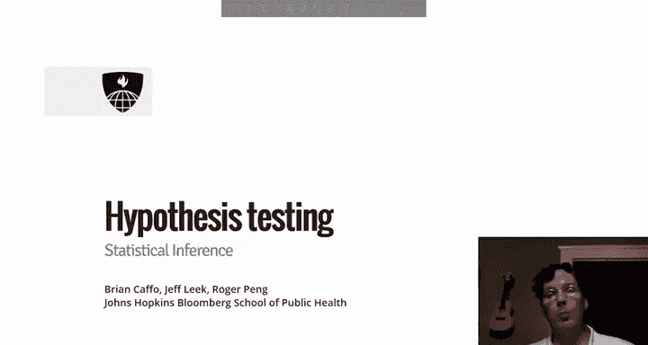

Given our existing work on confidence intervals， hypothesis testing will be relatively easy to develop。

Hypois testing is concerned with making decisions using data。Typically。

 hypothesis testing starts with a null hypothesis which is specified that represents the status quo。

 it's usually labeled H0 pronounced H0。The nu hypothesis age not is assumed to be true。

 and statistical evidence is required to reject it in favor of an alternative or so called research hypothesis。

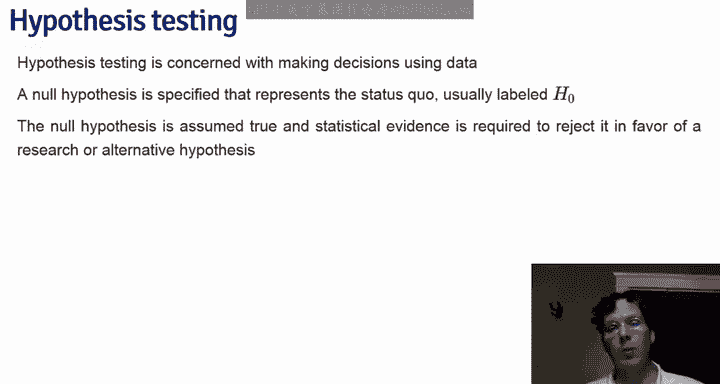

Let's motivate hypothesis testing with a straightforward example。

A respiratory disturbance index R D I of more than 30 events per hour is considered evidence of severe sleep disorder breathing。

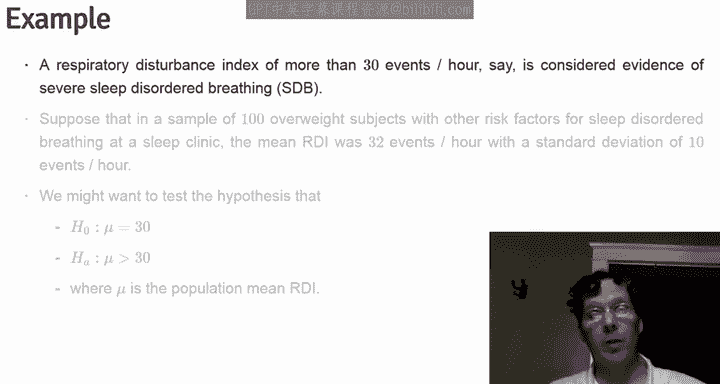

Suppose that in a sample of 100 overweight subjects with other risk factors for sleep disorder breathing in a sleep clinic。

 the mean R D I was 32 events per hour。 So the sample mean R D I was 32 events per hour。

 with a standard deviation of 10 events per hour。

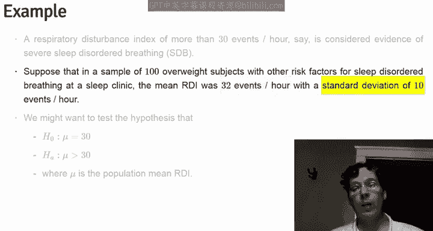

We'd like to test whether or not the population mean for this。

Population that we're drawing the sample from is equal to 30 our benchmark for severe sleep disorder breathing or whether or not it's larger than 30。

So we specify that as h not mu equal to 30， and the alternative hypothesis H is mu greater than 30。

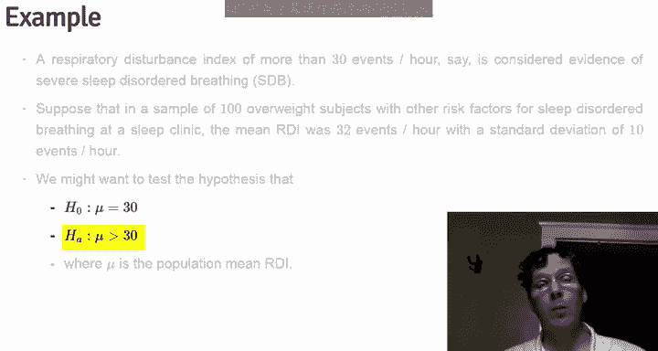

In our example， we specified H A that mu was greater than 30。 However。

 it could have been less than or not equal to， depending on the research hypothesis that we were interested in in that application。

 we're specifically interested in whether the respiratory disturbance index for this population was larger than 30。

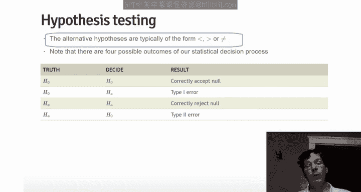

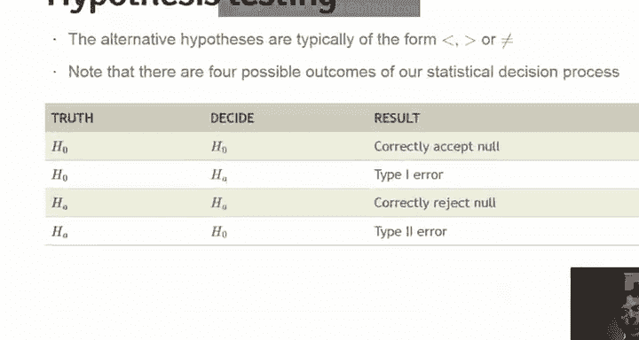

Notice that the truth is either that H not as true or HA is true。

And we could either decide H not or decide H A。Therefore， there's only four possibilities。

If the truth is H no and we decide HO， we' have simply correctly accepted no hypothesis。

If the truth is H， when we decide H A， the move made what is called a type 1 error。

In the version of hypothesis testing that we're going to present。

 we're going to control the probability of the type 1 error to be small。

If the truth is HA and we conclude HA， we reject an hypothesis， then we correctly rejected the null。

And if the truth is H and we decide H not， we've made what is called a type2 error。

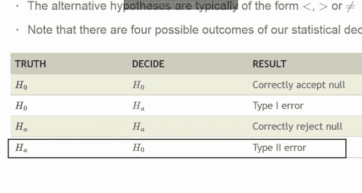

The typey 1 error rate and the type 2 error rate are related in the sense that as the typey 1 error rate increases。

 the type 2 error rate decreases in vice versa。We can illustrate this pretty easily by considering a court of law。

In most courts， the no hypothesis is that the defendant is innocent until proven guilty。Here。

Rejecting the no hypothesis is to convict the defendant。

We're going to require evidence and a standard on that evidence to reject the hypothesis。

If we set a very low standard。I。e。 we don't require much of evidence to convict people。

 then we're going to increase the percentage of innocent people convicted。

 type 1 errors in this case。

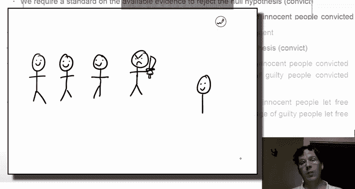

However， it would also increase the percentage of guilty people convicted。

 which would be correctly rejecting the non hypothesis。

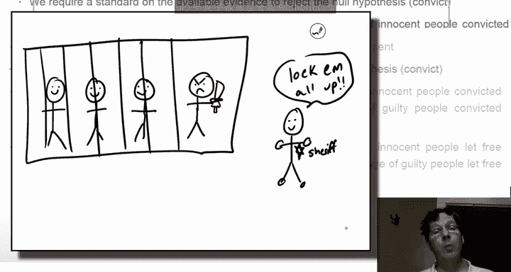

If we set a very high standard， basically a person has to have a smoking gun in their hand to convict them。

 then we would increase the percentage of innocent people let free a good thing。

 correctly accepting the null。

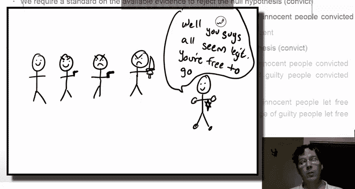

But it would also increase the percentage of guilty people let free or so called type 2 errors。

 and this illustrates how the two， the type 1 error and the type 2 error are related。Of course。

 ideally what you would like is to get better evidence for a given standard。

 and that's the idea of doing things like increasing the sample size。

 but before we discuss those sorts of issues， let's talk about how we conduct hypothesis tests。

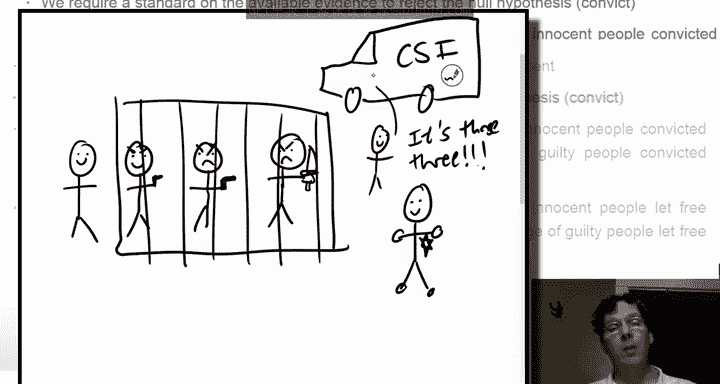