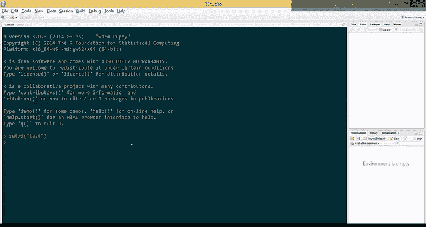
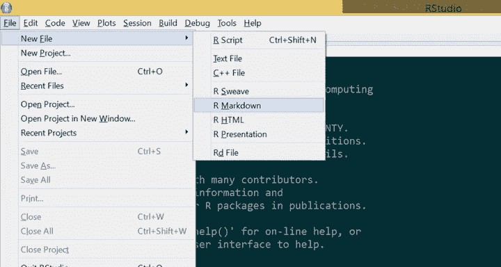
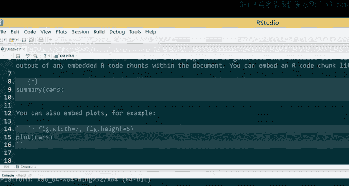
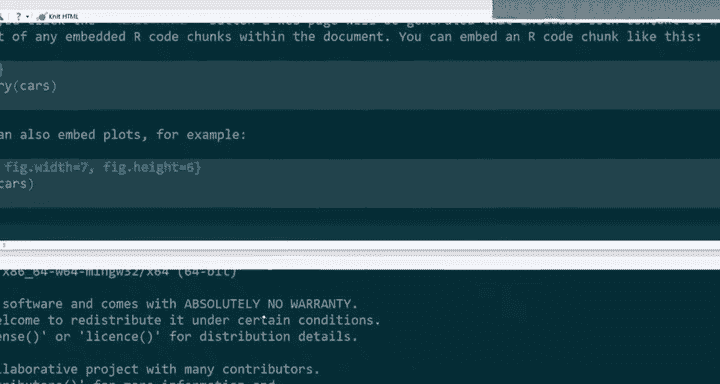
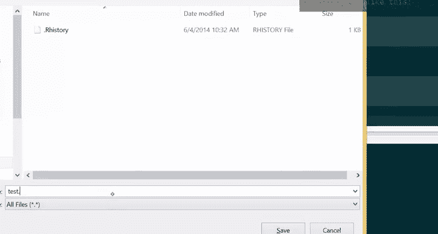
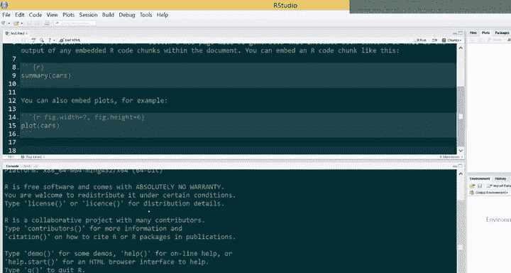
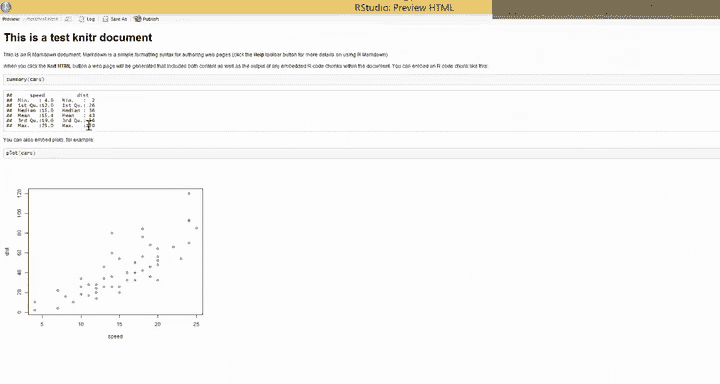
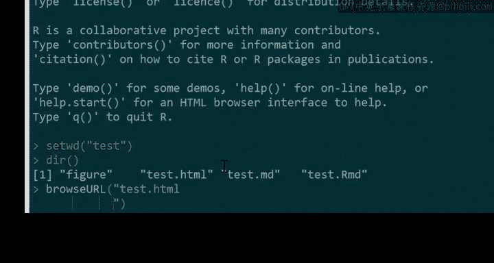
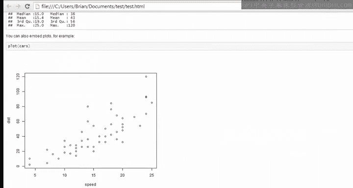

# 约翰霍普金斯大学《数据科学：统计和机器学习｜Data Science： Statistics and Machine Learning》中英字幕 - P31：30_完成项目所需的 knitr 知识.zh_en - GPT中英字幕课程资源 - BV1jsAAeNE3k

Hi， everyone。 This is a two minute tutorial on using knitter。

 You'll need a little bit of knitter to create your art project that you will hand in as part of the assignments。

 So let's， I've got our studio open here。 Hopefully you can see it。 and'm going to go file。 So alt F。

And new file。 And then as you look， there's all these different options here and probably。

I'm in our studio， by the way， and。There's all these different options here。

You want to go down to our markdown。

There we go， and it actually populates a。Simple knitter document， so。Let me edit the title。

 I just wanna say， this is a。Is a test knitter document。Okay， and then there's a bunch of text there。

 And then it shows you the R。Command our commands here。 So what you need is you need three little。

Forward。Hello I don't know if these are right tick marks here or right quotation marks。嗯。You know。

 once slanted from the upper left to the lower right。 So the key。

 least on my keyboard that's right below escape。And then， you need。If you put an r here。

In this little area， it will。Itll execute our code。

And a comma after the R will open up a bunch of options。 So there's a ton of knitter options。

 but cache tells R whether or not to keep it。嗯。Probably the most useful ones for me。

Eval tells whether or not it should evaluate the code。

 Sometimes you might just want to show code in your document。嗯。These are all figure things。

Result sels。 So the so you can have results as marked up， which shows syntax highlighting as is。

Hide will hide the results， and I find that most most useful。

 probably the other one that's most useful for me is echocho。

 so you have echo is true or false echo true shows the code and then also shows the results of the code。

 Echo false does not show the code。Okay， so any rate， so here is our。

Here's our examples here here it gives an example of a plot too， so the plot cars。

Okay， so let's save this。 But it I need to save it to something。 So let's call it test do RM D。

Okay。And then， I go。Conl well， so I need to make sure that。That knitder is， is loaded， but actually。

 there's little button right here that you can just do。 I'm on this tiny computer。

 so it's hard to see， but you can just actually click knit HTMLM right there and there and it'll knit it。

 And there you can see how kind of what it looks like。

Onm。And it， it creates an H Tm L document。 So if I were， for example， to do D in R。

 you can see that it's created this。Test dot H T M L document。 that that's a。

 that's just a standard H T M L document。 You could do browse do URL， browse URL， browse URL。

Test dot H T M， L， and I'll bring up。

It'll bring up a browser window within it in， within in。 Okay， so that's knitter in a nutshell。

