# 约翰霍普金斯大学《数据科学：统计和机器学习｜Data Science： Statistics and Machine Learning》中英字幕 - P33：32_11 02 计算功效.zh_en - GPT中英字幕课程资源 - BV1jsAAeNE3k

Assume that our sample mean X bar is exactly normally distributed。

 whether this is because we're willing to stomach that assumption because we have a large sample size and we're applying the central limit theorem or if we're willing to just assume that the underlying population is exactly normally distributed either way。

 for the sake of argument， let's assume that X bar is normally distributed， and that sigma。

 the standard deviation of the population is known。

Then we would reject if our Z statistic X bar minus 30 over its standard error is bigger than z1 minus alpha。

This is the same as just saying we're going to reject if x bar is bigger than 30 plus this z quantile times the standard error of the mean。

Now， notice under the no hypothesis X bar follows this distribution normal with a mean equal to mu n。

 in this case 30， and a variance equal to sigma squared root over R Under the alternative。

 it follows the same distribution。 The only difference is instead of mu n。

 we have mu A where mu A is the value under the alternative。

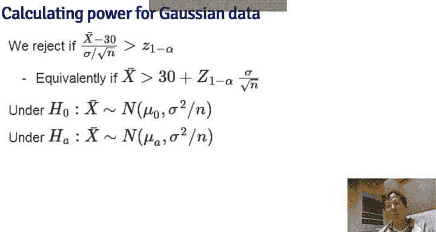

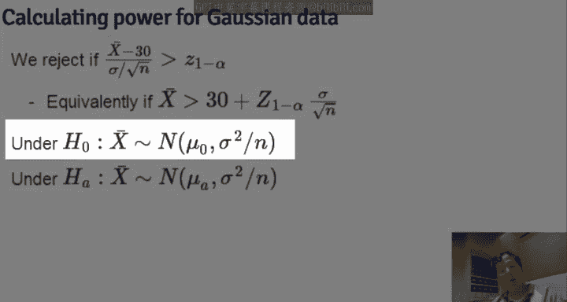

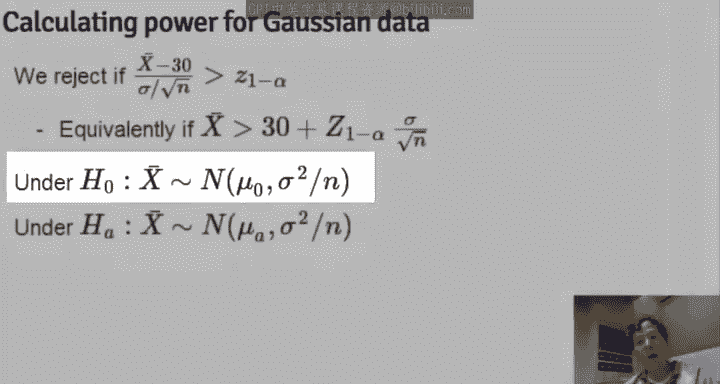

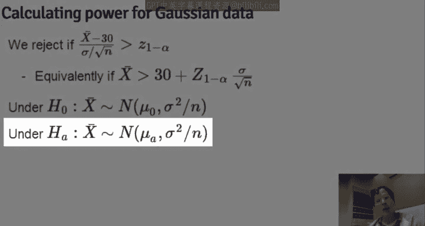

So it's very easy to write out in R what our power would be， we want to take P norm。

Of the in other words， the normal probability of getting a sample mean。

Mux n plus z times sigma over square root n or larger。

 where this probability is simply calculated with mu equal to mu A。

So here we have mean mu mean equal to mu A。 our standard deviation is the standard error of the mean。

 and I put lower do tail equals false so that I get the upper probability。 Now。

 notice if I were to plug in mu equal to mu not， then I should get alpha。

And now as I plug in as muA moves away from alpha， power should get larger and larger。

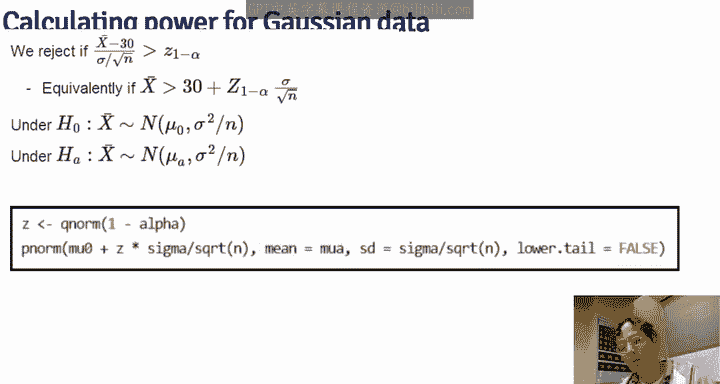

So let's try it。Suppose someone were to give me this information that they wanted to conduct this study。

 they wanted to test whether or not mu was 30 for this population or was larger than 30。

 so mu not equals 30。

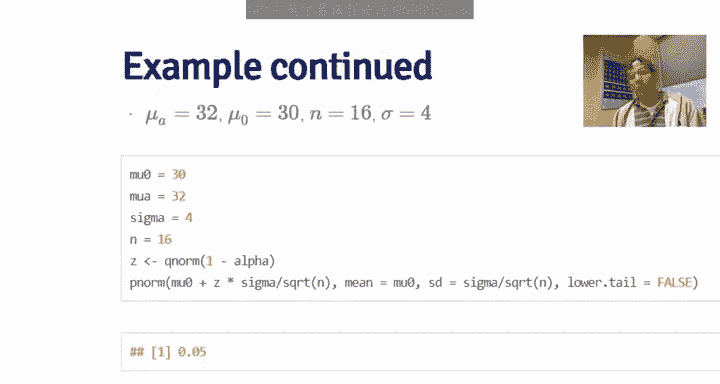

They were interested in detecting a difference as large as 32。Their end was 16。

That they were hoping to get。

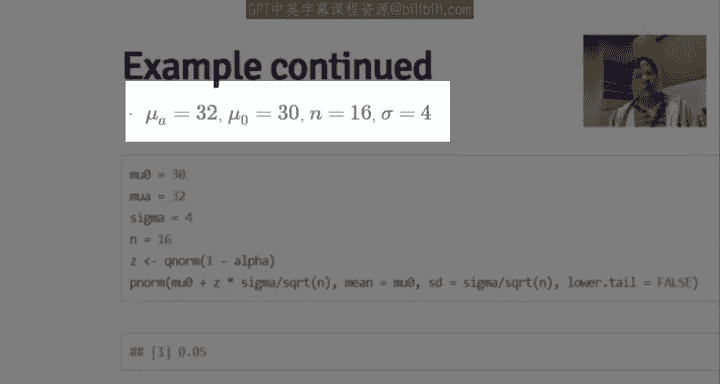

And they knew that sigma was around 4。 Okay so here I've plugged in the values。 mu not equals 30。

 mu a equals 32。 Sigma equals 4 and equals 16。 Here's my z is my normal quantile。

 And then first I want to show you if I plug in mu equal to mu n that it should give me 5%。

 So here I plug in mu equal to mu n， and I get 5%。 Now I'm plugging a mu equal to mu A 32。

 and you see that this jumps up to 64%。 So there's a 64% probability of detecting a mean as large as 32 or larger。

 if we conduct this experiment。

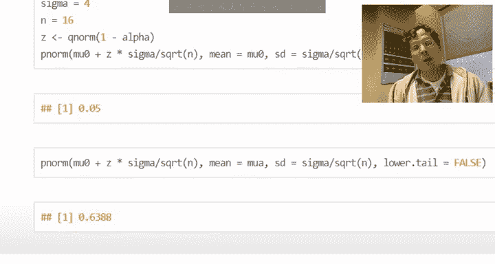

So here I'm plotting the power curves， which is the power as a function of muA。As。

N varies by color here。And as we head to the right on this plot， so as we head along this axis。

 that's muA getting bigger and this axis is power。Okay。

 so let's take a specific one of these lines and look at it so this line。Right here is the power。

When n equals8 and what you can see is all of the lines。

Is including this one that we're discussing right now， converge at 0。05。As mu approaches 30。

And then what you can see is that power increases。As Mua gets larger。Okay， and basically that means。

We're more likely to detect a difference。If the difference we want to detect is very big。

And that makes a lot of sense if something's a huge effect， we should be very probable。

 it should be very probable to detect it。And then the other thing I would note is that as we head up here。

 we're seeing sample sizes doubled with each line， I start out with n equal to 8。

 then I move to n equal to 16 right there and then 32 and then 64 and then 128 and what you can see is the curves all getting shoved up to higher and higher power earlier and earlier。

 and this makes a lot of sense as well， in other words， as we collect a lot more data。

 we should be more likely to detect the power of a specific for specific value of mu a。

And so that's why the n equal to 128 curve。Is uniformly above。The n equal to 64 curve and so on。

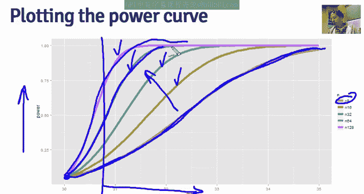

Let's use our studio's manipulate function to evaluate power as it relates to the two normal densities。

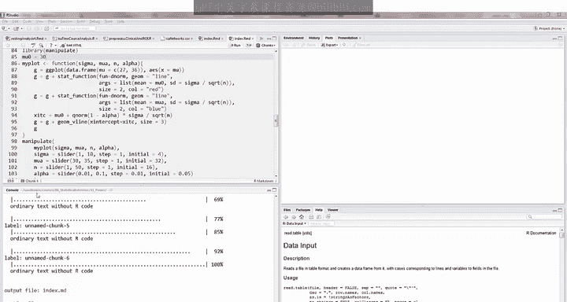

So here I'm going to do library manipulate， then I'm going to define mu not to be 30。

Then I'm going to define a plotting function that depends on the population， standard deviation。

The mean under the alternative， the sample size， and the type 1 error rate。Then it does GG plot。

So then it's going to execute。That plot。But it's going to give me a slider so that I can vary all these parameters。

Let me first describe these two plots before we start using a manipulate function。 Currently。

 the parameters are set at the values we used in the previous calculations。 Sigma was4。MuA was 32。

 and was 16 and alpha was 5%。So what this plot is saying is under the null hypothesis。

 here's the distribution of our sample mean， it's centered at 30。

 and it has a variance of sigma squared over n。Under the alternative。It's centered at 32。

 and it has a variance of sigma squared over n。We've set a critical value so that if we get a sample mean that's larger than a specific threshold。

 we reject the nu hypothesis。 That's this line。 We set this line such that the probability。

 if the red density is true。The null hypothesispo is true， this area。

 the probability of getting statistics larger than it is 5%。Now power。

Is nothing other than the probability of getting larger than this line。

 which is calibrated to have this area under the red curve is 5%。 The probability that we reject。 If。

 in fact， the blue curve is true。 That's the power。

 Here's one minus the power or the type 2 error rate。Okay。Now。

 let's start varying things and see what happens。 So if we move it so that it's all the way down at 1 per cent。

 that's just saying that this area right here under the red curve needs to be one calibrated to be 1%。

As we move it down， let me just reiterate this point， as we move it down。

 it's going to move to the right like that， but what's going to happen to power？

Power is going to go down， right？This area。Is going down。As that thing moves and what is this saying？

By moving alpha down， we're making harder to reject the no hypothesis hypothesis， we're making。

The requirement of having a lot more evidence before we conclude the alternative is true。

 that simply results in less power。Now it's also it's got a lower type 1 error rate。

 but a larger type 2 error rate and a lower power okay， conversely。

If we increase alpha to the highest level I set here， now we have a 10% type 1 error rate。

 but we have much better power， in other words， if we are willing to be a little bit looser in how much when we reject if you know we get smaller means and we're still rejecting。

 then we'll get better power， of course we do have a larger type 1 error rate。

10% in this case instead of 5%， so let's set it back to 5%。

Let's see what happens as we decrease Sigma。Sigma goes all the way down to one。 Okay。

 now our black line moves right， because these are not standard normal curves。

 These are so our rejection region isn't always so many standard errors from the from the mean。

 in that instead we've decided to plot this on the scale of the problem。

 So this black line then depends on sigma。 So as we move it。As we move sigma。

The black line moves with it。 Okay， so let's move sigma down to the lowest level allowing。

 which is sigma equal to1 in this case。 Okay， so our black line has moved down and it's still calibrated so that this area is 5 per。

 But what we've seen is we have so little variability in the sample mean that the probability of rejecting the probability of getting larger than the black line。

 If the blue distribution alternative distribution is true is almost 100 per。Okay。

 what happens if we move in the opposite direction， we make sigma larger？Well。

 here's sigma very large again， we're still calibrated。So that this area is 5 percent。

 but now power is much lower and that all this is s。

Is that if we have a lot more noise in our measurements。Then we're going to have lower power。

Let's try some more。Let's set this back to what it was at for the problem four。

How about the mean under the alternative， let's make it bigger。What happens， Well。

 it just moves along。Right it just moves along to the right， and now we get a lot more power。

And the black line doesn't depend on the mean under the alternative。 So it doesn't move。

 And then as it moves towards 30， you can see the power is getting lower and the lowest the power can be is if it lies right on top of the null distribution。

 and then the power will be exactly 0。05， then it'll get a little bit bigger as it moves further away and further away and further away until if we're at 35。

 we have almost 100% power。Okay， let's set this back to 32。

 the value that were using for the problem。 How about N。

So remember what happens as n increases our sample mean gets less variable。

 more observations go into our sample mean， it gets less variable， so let's see what happens。Okay。

 less variance。In our sample mean， so these densities are getting tighter and tighter。Okay。

 but the black line moves because remember， it's always got to be calibrated。

It's always got to be calibrated so that this area is 5%。

 but you can see now we have much better power when we have a sample size of 50。

If we move it down to a sample size。Very low and of four， again， the black line is moved。

Because it has to force this area to be 5 percent and now our power is quite low。

So I would highly recommend that you go through the code for this manipulate experiment to understand how power works in this particular setting。

 it's quite easy， but basically what you can see is power has a bunch of knobs and as you turn them the power changes in different ways and in the next slide will summarize the various aspects of power。

 but using the manipulate function like this， you can actually experiment with it yourself。

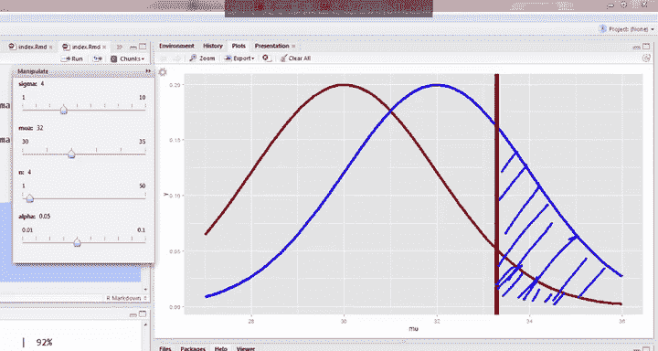