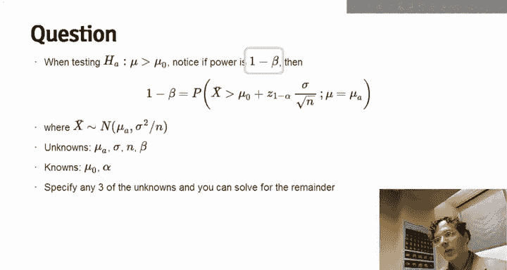
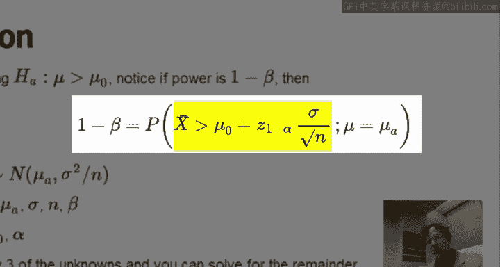
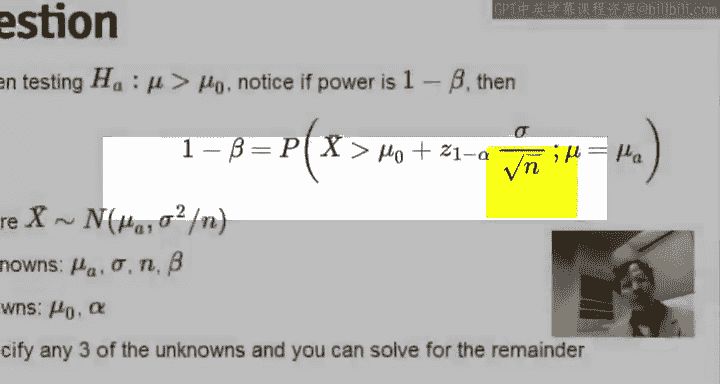
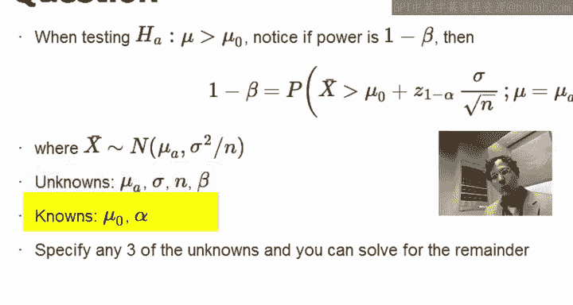
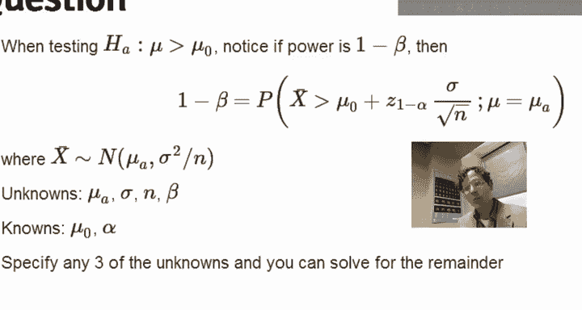
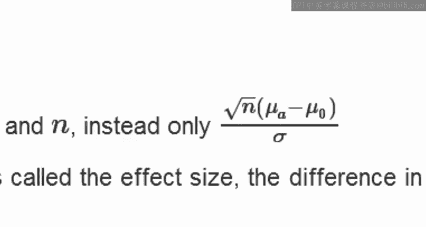
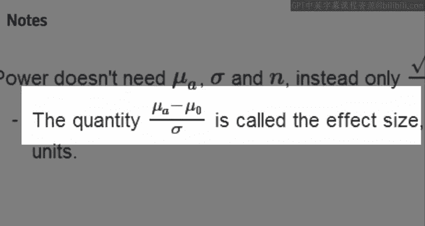
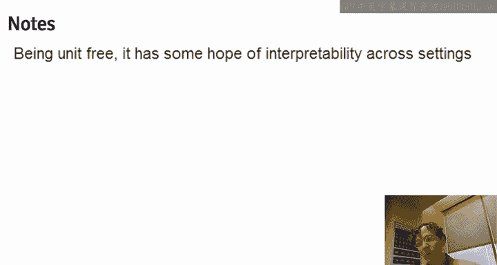

# 约翰霍普金斯大学《数据科学：统计和机器学习｜Data Science： Statistics and Machine Learning》中英字幕 - P34：33_11 03 关于功效的说明.zh_en - GPT中英字幕课程资源 - BV1jsAAeNE3k

So let's just reiterate when we're testing our alternative being that mu is greater than mu not。

And then I'm going to specify power in terms of1 minus beta。Where beta is the type 2 error rate。

Then we get this equation， our power。

Is equal to the probability that x bar is larger than mu n plus the standard normal quantile times the standard error。

 where this probability is calculated under the hypothesis that mu equal to mu a。

 and then I simply reiterate that point here on the next line。

 where I'm explicitly stating that x bar is normal with mean mu a and variant sigma squared over n。

So the point I'd like to make is that the unknowns in this equation are mu a。Sigma。

N and beta or equivalently to beta， the power that you want。The knownuns are a muot。

 and usually you know alpha， you know exactly which。Dam。Type1 error rate that you would like。

So given these four unknowns and our two knowns， this is simply an equation。

 if you specify any three， you can solve for the fourth。

So if you know the alternative mean that you'd like to detect。

This a sigma that you're willing to assume the end that you want。

 Then you can solve for power like we've done previously。 Otherwise。

 what you could do is you could say here's a power that I want。

 Here's a mean that I'd like to detect。 And here's a sigma that I can tolerate。

 And then I'd like to solve for the end that would allow me to have that power。

 maybe at the process of planning a trial。And this is how power calculations usually work。

 you are particularly concerned most of the time with either n or beta。

 you usually either want to figure out。For a particular power that I want。

 what n would I like to have or should I have， or I can only conduct a study of this size of size N。

 What is my power for doing that， Should I even waste my time？ So those are the two most common ways。

 But， of course， you could also solve from UA or sigma。

So I'm hoping。At this point in the class that you'll be able to take the work we've done for the greater than test and do it for the less than test。

H not mu less than mu not just by extending the arguments from the previous set of slides。

When you're testing not equal to just make sure you use the z1 minus alpha over2 instead of z1 minus alpha of that critical value so for example。

 for alpha equal to 005， you want to make sure you use 1。96 and not 1。

645 and then just do the one side of power for whatever direction muA is whether it's muA greater than muot or muA less than mu and this is only approximately right it omits a small component of power。

 but that component of power is only meaningful if muA and muot are close together。

So let's go through some basic rules about power。As alpha gets larger。Our power gets larger。

So the power of a one sided test is greater than the power of the associated two sided test。

 and we can see that by virtue of just dividing alpha by2 in this bullet point above。

The further muA gets from you not， the higher the power is。As n goes up。

 the sample mean has less variability， and so we have higher power。As sigma goes down。

 our sample mean has less variability， and so we're going to have。

Higher power Now here's an interesting fact。Power usually doesn't depend on all of these separate parameters。

 but on some function of those parameters， and in this particular case。

 that function is one dimensional， so you really only need to know one number to calculate power。

 and it's basically the difference between the null and alternative means divided by the standard error。

And power only depends on those things， or if you have power in this number then you can calculate then you can calculate n so this quantity。

 the difference in the means divided by sigma is called the effect size and what's nice about the effect size is it's unit free so when you subtract mu out and minus mu a and divided by sigma you get a unitfr quantity and that's why the effect size is very useful because it you know being unit free。

 it has some hope of being interpretable cross problems。

