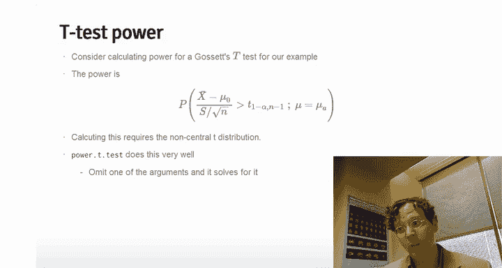
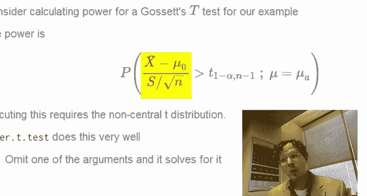
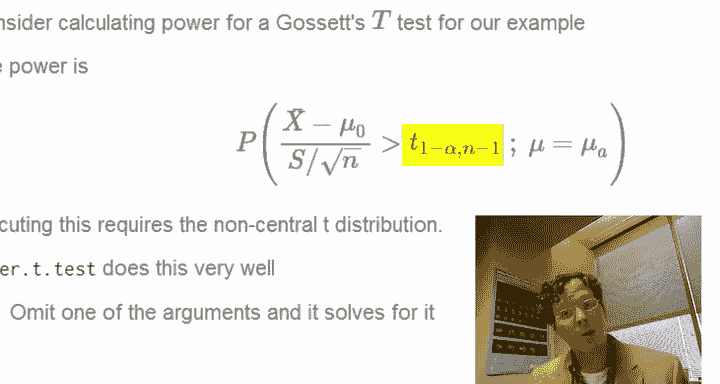
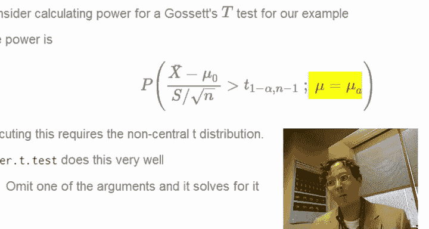
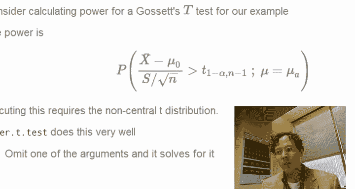
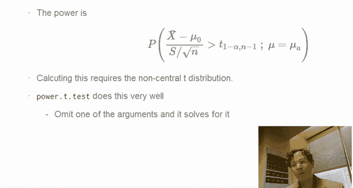
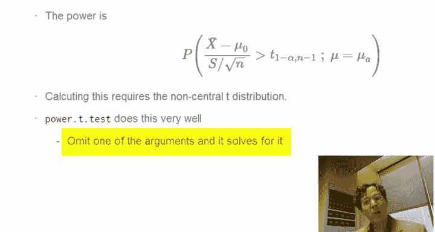
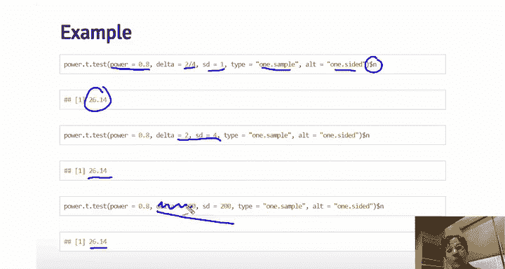

# 约翰霍普金斯大学《数据科学：统计和机器学习｜Data Science： Statistics and Machine Learning》中英字幕 - P35：34_11 04 t 检验功效.zh_en - GPT中英字幕课程资源 - BV1jsAAeNE3k

So we never actually calculate power in the way that I've described in the previous slides。

 that's for understanding the concepts and we assumed we knew Sigma and the data either Gaussian or that the sample mean could be believed to be Gaussian because of the central limit theorem。

I think for me personally， the most common function I use for calculating power is this function。

 power。t。t in R。So let's just talk a little bit about T test power before we talk about how you use power。

t。test。The argument is very similar to what we did in our normal distribution case。

We're going to reject if our test statistic in this case x bar minus mu n over the estimated standard error is now bigger than a T quantile rather than a Z quantile because we're talking about a T test。

Only because we're talking about power， this is going to be calculated not under the hypothesis that mu equal to mu not。

 but under the hypothesis that mu equal to mu A， the value under the alternative。

It turns out that the statistic x bar minus muot over the standard error。

Does not follow a T distribution if the true mean is not muot。

 if it's muA and muA is different from muot， it doesn't follow a T distribution。

 it follows something called the noncentral T distribution， which we're not going to cover。

Soalculating this power calculating power requires the ability to evaluate the non central T distribution。

 and that's what power。t。test does for you on your behalf。

What's nice about Power dot t。 test is just like before we have some parameters that we know mu not and alpha and some parameters that we don't know。

 mu A sigma。An N， for example， and if you omit。Omit one of them， but specify the remainder power。tt。

test will solve for the one that you've omitted， so let's go through some examples of using power。t。

test to either calculate power or calculate sample size or calculate the minimum detectable difference。

Okay， let's go through a couple examples and I'm going to point to this middle one here first。

 I'm doing power。t。t， so it's calculating。T test power， we're testing H。M equal to mu not versus H。

 And then the question is whether it's doing a one sided or two sided test， Well， in this case。

You can see here I've always specified alternate equals one sided。

 so that's mu greater than mu not is what it's testing。

 or equivalently mu less than mu not if you appropriately specify the difference in the means as negative。

So Delta here， this parameter is the difference in the means。If I specify n。

 I specify how different muA is from U not， and I give it a standard deviation of4。

 I'm telling it it's a one sample T test and I want one sided power and then I'm grabbing the power part of it。

Then it gives me my power， 60%。What I show here， you notice in all the other examples I've given here。

 it also gives 60% as the number and what I'm showing is that。That power。 t。 test。

 just like the normal power， only depends on the effect size。

 how different mu and muA are divided by this standard deviation。So here。I specify my Delta as 05。

And。Give it a standard deviation of one and notice so if I'm defining this numerator as as delta。

 notice this is the same。Effect size， as in this case， right here。Okay。

 and since everything's getting a little clouded， let me。Regrab my marker。So。

Delta divided by SD is equivalent between that Powert t test call and this Powert t test call。

 and that's why they give the same number， the same thing is true here okay。Where it's 100 and 200。

 and if you divide the two， you get 0。5， so it's also true there。

Let's go through a couple more examples of using Power dot T test now in all of these cases。

 I calculated power。While inputting n， delta and the standard deviation。

Now let's try to calculate sample size where I give power。t。t the power that I would like。Okay。

So now here。I'm going to again， show you in all three cases that it only depends on the effect size。

 So here I'm specifying delta of 0。5 and my standard deviation of 1。 So an effect size of 0。

5 divided by 1 or 0。5。 and I'm telling power not T do test。

 I'd like to know what is the relevant sample size if I wanted a power of 80%。 Then over here。

 you know again， I'm doing one sample and  one sided。Grabbbing N。

Okay and it gives me a sample size of 26 and then in these kinds of calculations。

 you always want to err on the side of conservatism so you bump it up to 27 whenever you get a fractional value。

 you always get a fractional value， you always want to bump it up to the nearest integer。

 so you need a sample of size 27。To have a power of 80% to detect an effect size as large as 0。5。

And what I'm showing here。Is that the calculation is the same when I。

As I specify an equivalent effect size of 0。5， whether it's delta of 2 over 4 or delta of 100 over 200。

 it's always giving me the same number。 Now， what I'll leave is an exercise for you guys。Is to。

 for example， omit delta and put in an n。And have Power dot T dot tests show you what's the minimum detectable delta in order to have 80% power for a specific sample size。

 and I think given the code that I've given you here， this shouldn't be too hard of extension。

I would say that I almost always use Powert T dot test as my first attack on a power calculation。

One of the main reasons behind this。Is that。Power has a lot as I think I've maybe explained throughout the lecture。

 power has kind of a lot of knobs and dials that you can turn and it's very easy to get tripped up on thinking that you have better power than you have or thinking that you need a smaller sample size and so when in doubt。

 try to make your power calculations as simple as possible so try to revert the question that you're asking down to a T test or a binomial test or something like that in order to calculate power。

In order to calculate power as simply as possible and thatll give you maybe a slightly conservative either power or sample size estimate。

 but on the other hand， you'll be able to understand it quite well。

From then you might want to move on to much more complex power calculations， but as a first pass。

 you always want to do the T test power or the normal calculation power or the basic power calculation in a binomial problem as the very first thing that you do。

