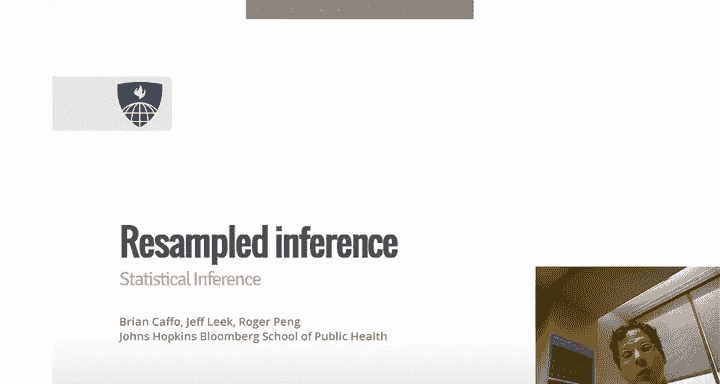
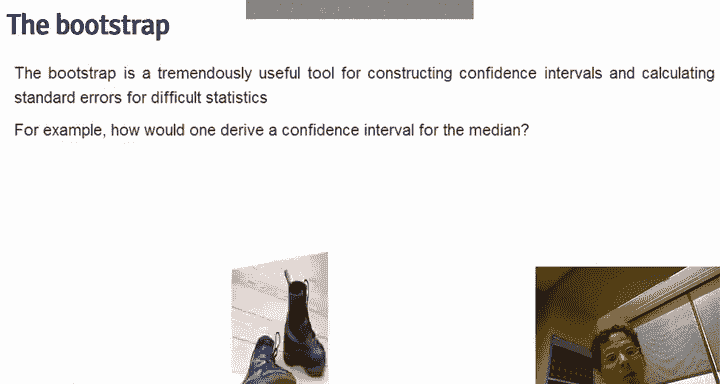
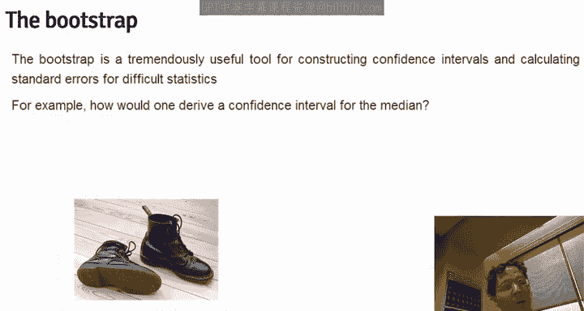
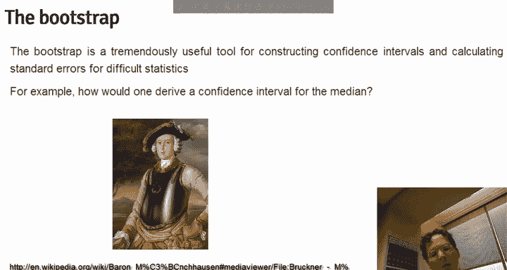
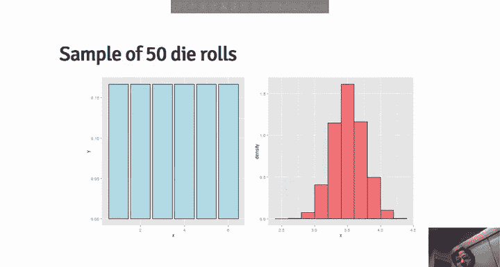
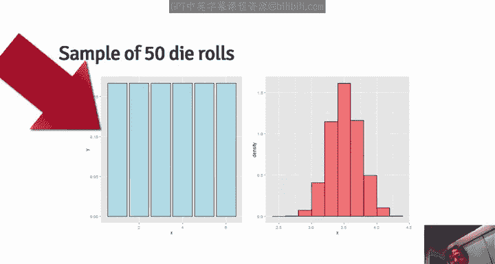
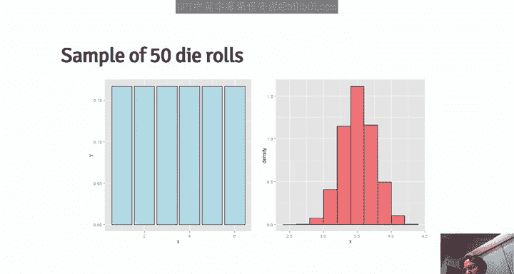
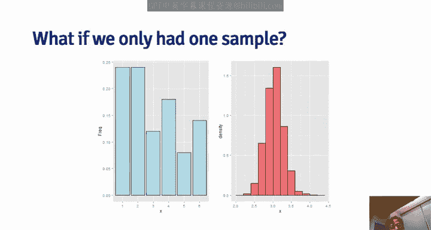
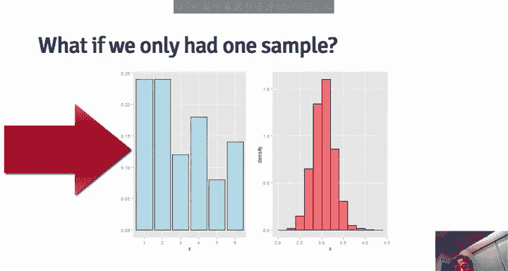
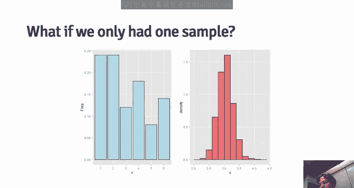

# 约翰霍普金斯大学《数据科学：统计和机器学习｜Data Science： Statistics and Machine Learning》中英字幕 - P37：36_13 01 自助法.zh_en - GPT中英字幕课程资源 - BV1jsAAeNE3k

Hi， my name is Brian Kall and welcome to the reampled inference lecture as part of the Coursera In class。

 which is part of our data science specialization。😊。

So the Boottrarap is a tremendously important and useful tool for constructing conference intervals in standard errors and basically performing inferences where it would otherwise be difficult。

 who was invented in 1979 by a famous statistician named Efron who's in the Stanford Statistics Department。

 easily one of the top statisticians in history。And I would say the bootstrap is one of the most important procedures that's been discovered the in the history of statistics and the reason being that it。

Really liberated。Data analyst from having to do a lot of mathematics in order to perform inferences。

So as just as a simple example， if you wanted to do a confidence interval for the median。

There are some kind of complicated asymptotics that you can appeal to。

 but it involves a lot of mathematics。On the other hand， you can just perform a bootstrap。

 and it gives you a confidence interval for the median without having to do all of that work。

 So it you know， maybe be， maybe dangerously so， but nonetheless， it liberated。

People from having to do a lot of complex mathematics to understand some distributional properties of statistics that they。

Calculated。The phrase bootsottrap comes from the name of the procedure bootsottrap comes from the phrase pullings one cells up from their own bootstrap。

 that phrase， I initially thought it came from the Baron Moonnchausen character， which by the way。

 if you haven't seen the Moni Python movie， you definitely should。

I thought it came from that， but I've since read that it maybe even existed earlier than that and the idea of pulling onese up from one's own bootstrap is the idea of doing something that's physically impossible and that's not。

A terribly appropriate name for what's going on in the statistical procedure of the bootstap because we can draw a direct line from the information that we're using to the inferences that we're making so it's not at all like pulling oneses up from one own's bootstrap it's quite possible and how it's working is pretty clear。

So。It's an important technique， it's very liberating。

 and I think it's also very much so in the spirit of data science。

So consider this example， imagine if we wanted to evaluate the behavior。

Of the average of 50 di rolls。 So our population distribution is this left hand distribution。

 the equally weighted bars at the values  one through 6。

And there's a couple of ways we might go about doing that。

 one is we could just try and mathematically figure out what the distribution of the average of 50 di rolls is with no simulation just doing the relevant algebraic calculations。

Another way to do it would be to roll a die。50 times get an average。

 and then repeat that process over and over and get lots of averages of 50 diols。

 But this is predicated on us knowing that the true population distribution is one6 at each number。

But it does seem to be an easy way to do things because it would be hard to sort of figure out exactly what's the probability of getting a 5。

5 right instead it's easier to just roll the dice 50 times。Take the average。

 repeat that over and over again and get a pretty good sense of it。 Now。

 a lot of these things for the average， we don't have to do because we know things about the distribution of the average。

We know that it's centered at the population mean， we know that its variance of sigma squared over n。

Several things like that， but I'm going to talk about it with respect to the average first and then you'll see hopefully how this extends to other statistics other than the average。

So let's consider a very similar problem。Imagine if you didn't know whether or not the die that was generating your data was fair。

 We didn't know that the probabilities it placed on 1，2，3，4，5， or 6。

So what we have is one sample of size 50。So we only have one average。

Not a distribution of average from from whatever the die was that was generating the data。

 so here on the left hand side， I'm showing you the histogram。

Of the various occurrences， one2，3，4，56 for one sample realization that we drew from this population。

Now I can't evaluate what's the behavior of averages of 50 die rolls from this population because I don't know what the population is。

 I don't know what die to roll from。To to execute the simulation exercise。

 So what bootstrapping says is， well， why don't we do the next best thing。

 Why don't we sample from our empirical distribution。Repeatedly sample。Collections of 50 die rolls。

 not from the true distribution， but from whatever our sample of size 50 estimates。 So in this case。

 I would sample from these blue bars。With height with the probabilities related to the heights。

And I would do that over and over again， and I would get averages， repeated averages。

Of 50 draws from this distribution， and that would tell me about the distribution of averages。

 even though I only get to observe one real true average from the real population。

And that's the process of bootstrapping mechanicalically what we're doing is taking each observation。

 each one， two， three，4， five， or six that we get and throwing them into a bag。

And then drawing out samples of size 50 where we're drawing with replacements so the same number the same data point might get taken out twice in this process。

Sampling from that bag， samples of size 50， taking the average and repeating that process over and over again。

 but the fundamental idea。The fundamental idea is to exactly replicate our simulation experiment that we。

Would have done if we could roll the true population die with the observed。

Distribution generated by the specific one realization of 50 di rolls that we got。

And so that's the basic bootstrap principle we use our data our observed data to construct an estimated population distribution。

 we simulate from that population distribution to figure out the distribution of a statistic that we're interested in。

And that's the basic idea。So we'll go through some examples now with less contrived settings than this diro example。

