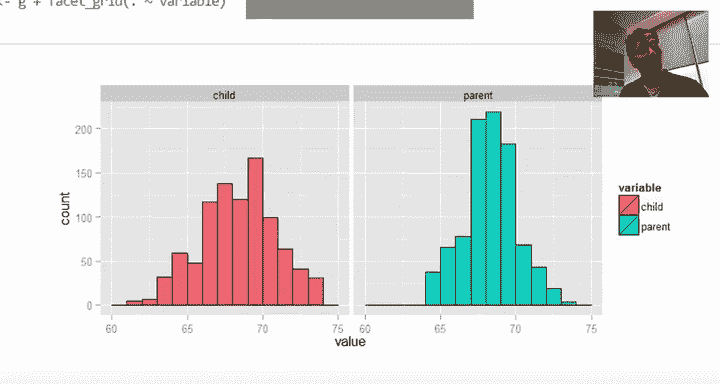
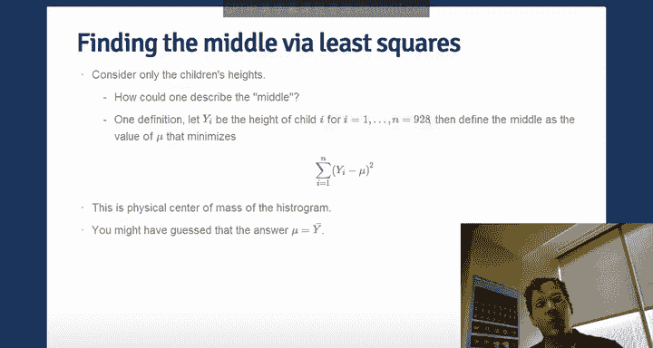
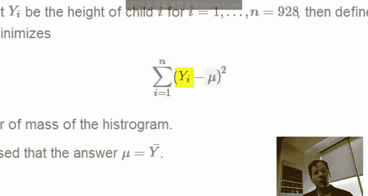
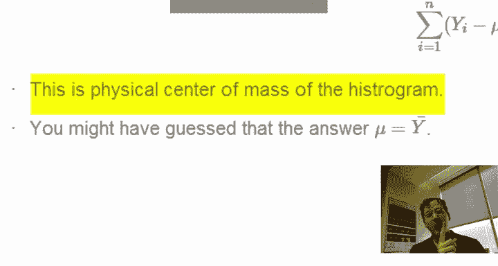
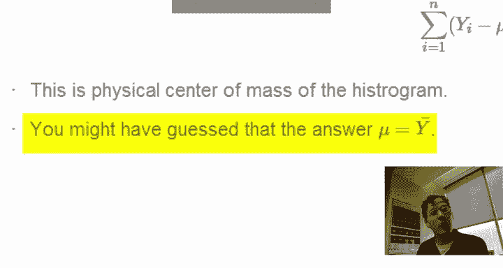
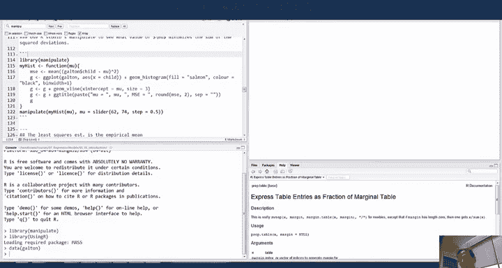
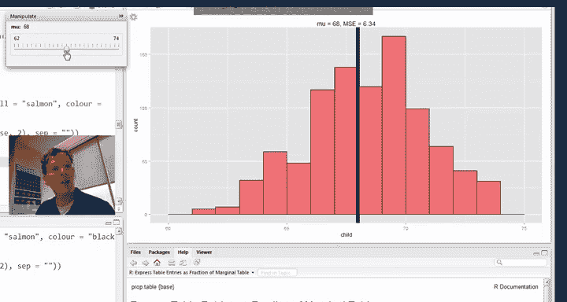
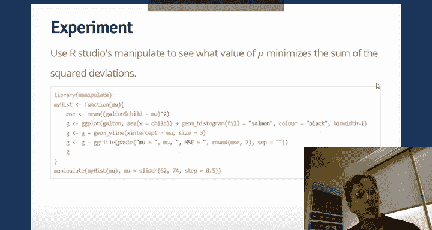
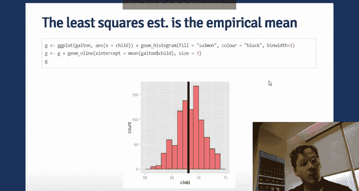

# 约翰霍普金斯大学《数据科学：统计和机器学习｜Data Science： Statistics and Machine Learning》中英字幕 - P42：1_基本最小二乘法介绍.zh_en - GPT中英字幕课程资源 - BV1jsAAeNE3k

Let's look at Francis Galton's data and I just want to note he first used this data in 1885 and that you should read up on Francis Galton。

 who's really an interesting character in history in general and definitely in the history of statistics had many quirky aspects to his personality and he invented a lot of really great things and some things that are not so great。

You need to run install packages using R here using R as the package for the book。

 using R for introductory statistics， this is a great book。

 and they very kindly package all these data sets together in a single R package so you need to use using R and then library using R to get a lot of the data sets that we're going to be talking about。

So let's first look at the marginal distribution of the parents， in other words。

 distribution of the parents disregarding children and the marginal distribution of the children disregarding parents。

 parent distribution is all heterosexual couples correcting for sex， I guess。

By multiplying the female heights by 1。08。Here I give my GGpl commands for creating the two histograms on the left I have the children's height。

 the X axis is in inches， the scale goes from 60 inches to 75。

 the Y axis is the count the number of children that fall in each bin of heights。

On the right in the more bluish teal color， I have the parents heights。

 I've broken the association by the children and the parents by not doing a scatter plot and only looking at the marginal distribution of the children and the marginal distribution of the parents by themselves。

I'd like to use these distributions to introduce these squares and then we'll build on the Bvariate Association after that。

So consider only the child's height， forget for the moment about using the parent height to predict the child's height。

 we just want to find maybe the best prediction of the child's heights without any information。

 any other information， well probably the best predictor would be the middle and how could one define the middle。

Well， let's give one specific definition， so I'm going to go through a little bit of the notational mathematics and if that isn't your thing。

 then wait just a minute and we'll go through a sort of physical experiment experiment to sort of explain it visually。

So for the mathematics， let's let Y I be the height for child I where y1 is the height for child1。

 Y2 is the height for child2 and so on My I index here goes from one to N and being 928 children in this particular data set。

So the middle will be the value of mu。

That minimizes the sum of the square distances between the observed data， the YI's and this value mu。

That's how we define the middle， it's also related to physics in the so-called physical center of mass of the。

 for example， of the histogram that we showed on the previous slide。

 if you thought of those bars as having being physical entities。

 having weight and trying to figure out where you would put your finger to balance it out。

 that would be the physical center of mass。

You might have guessed that the answer has to be the mean。

 right the center of the data has to be the mean and that does turn out to be the answer。

 we'll even go through the proof， though of course if that's not your thing then you don't have to worry about the proof。

Let's use our studio's manipulate function to experiment with trying to find that center of mass。

So I've already loaded manipulate， but maybe I can do it again。Loaded the data set Galton。

And I've just defined a histogram function here that executes the GG plot commands to draw my histogram。

And it takes as in。Argument knew the parameter that we're trying to find。

So let me try my manipulate command here。Don't have G plot2。Loaded。Let's try it again。There it is。

Okay。Now because we're using manipulate， I can move my slider around What I have up here is the value of mu and the mean squared error that is the sum of the squared distances between the observed data points and that particular value of mu。

And because I've added up n things， I might want the average value instead of the sum。

 so I divide it by n， and I get a mean squared error and then instead of the sum of the squared errors。

So I can move it around and notice as I get toward the center of the histogram。

The mean squared error is going down。And around there might be as the best I can do， 6。

34 now it's gone back up。And then notice if I move it way up。

 it gets up large again there it is at 14。And so what you can do is you can play around and try to find the place that actually minimizes。

The sum of the squared distances between the observed data points and mu。

 this would be the point that balanced out this histogram。

Now we know with the answer it has to be exactly at the average of the child's height。

 but you can actually experiment and see that it minimizes that function。

Here I just give the code again and I want to remind everyone that all the lecture nodes are in these R Markdown format where you can get the code it's embedded in the actual R Markdown file。

 so there should be a file called index。 RMD， you can go into the index。

 RMD file and get all of the R code for all of the lectures in the entire specialization。

Here I'm just reiterating that the least squares estimate is the empirical mean。

 and I'm showing exactly where that would be。And giving you the GG plot commands to create this same plot。

