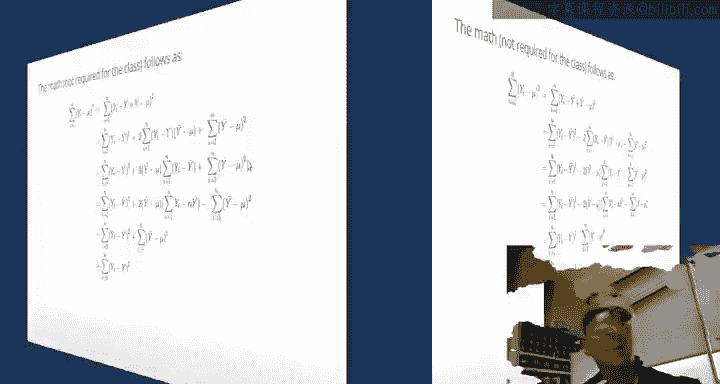
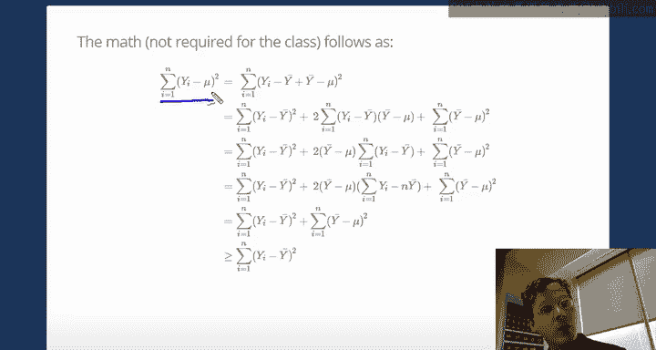
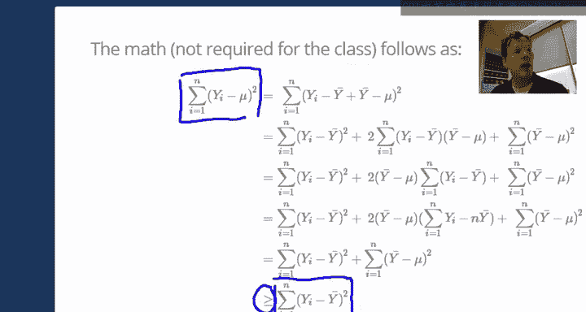

# 约翰霍普金斯大学《数据科学：统计和机器学习｜Data Science： Statistics and Machine Learning》中英字幕 - P43：2_技术细节（可选跳过）.zh_en - GPT中英字幕课程资源 - BV1jsAAeNE3k

Now I'm going to go through the proof that Y bar is the minimizer。

For this equation here as a function of mu。If these kinds of proofs aren't your thing。

 then just skip it and in the subsequent lectures the same thing。

 though I'll give the same caveat before each time I do something like this。

If you do intend to pay attention to the proof。You don't need to know either calculus or linear algebra。

 but ideally， you'll be very comfortable with mathematical notations。 So， for example。

 if you've had calculus in your past， you've forgotten the specifics of calculus。

 but you're pretty familiar with mathematical notation in working with mathematical notation。

 and that's all you need。 Okay， so let's go ahead and do it。

This。Is the quantity I'd like to minimize as a function of mu， My Y eyes are my observed data points。

I'm going to subtract and then add Y bar， so I've just added zero， changes nothing。

So I can have an equal sign there。I can expand this square out and I get this term。

Twice the cross product term。And then this term right here。Let's look at this term right here。

Notice this doesn't depend on I， so I can pull it outside of the sum out here。Then notice。

This guy right here， I can distribute the sum across it。 So I get summation Y I。

 And then if I add up Y bar， which doesn't depend on I if I add it up。N times I get NY bar。

But notice。I would define y bar as1 over n times the summation Y I。

Add up my observations and divide by n is the average。 So in other words。

ny bar is equal to the summation of Y I。 So this。Is zero， that whole term then is zero。

Moving on to the next line。I have summation Yi minus y bar squared， adding those up。

And summationium y bar minus mu squared。This quantity is the sum of a bunch of squared things。

 has to be positive， so if I throw it out， my equal sign gets turned into a greater than or equal sign。

 I've only gotten smaller by throwing out a bunch of positive things that I'm adding。Let's summarize。

This function for any value of mu。Is larger than or equal to the specific case when we plug in y bar。

 therefore y bar has to be the unique minimizer of that equation。

