# 约翰霍普金斯大学《数据科学：统计和机器学习｜Data Science： Statistics and Machine Learning》中英字幕 - P45：4_符号和背景.zh_en - GPT中英字幕课程资源 - BV1jsAAeNE3k

Hi and welcome to the lecture on some basic notation and background as part of the regression class in the Coursera Data Science specialization。

My name is Brian Kaffho， I'm a professor in the Department of Biosstatistics at the Bloomberg School of Public Health here at Johns Hopkins。

 the class is taught with my coinstructors and colleagues here， Jeff Leeake and Roger Pang。

In this lecture， we're just going to cover some basic definitions。

These are things you probably already saw in the prerequisite for this class and the statistical inference part of the Course data science specialization。

However， because they're so fundamental to regression。

 we're going to cover them again anyway so they're fresh in our minds。

I'm going to try and minimize the amount of mathematics that's required for this class。

 however for those that are interested with the appropriate caveats before starting to go through them。

 I'm going to cover some of the mathematics I'll also have some more advanced lectures that I'll put on YouTube and some other outlets for people who are interested in the very high levelve treatment of this。

Throughout the lectures we will neither require calculus nor linear algebra and when it does get a little bit more mathematical。

 I'll let you know when you can skip over those sections and I'll try to be clear about what will be needed for the evaluations Okay so let's go over some of the important notation relevant for this class。

So the biggest bit of notation that you're going to have to get used to is to index a variable with a set of subscripts to denote an ordered collection。

 so we might write x1 x2 up to XN to describe n data points。So as an example， consider the data 1，2。

5。Then x1 is 1， x2 is 2， x3 is 5， and n in this case is 3。

There's nothing in particular about the letter X， we could have just have easily described Y1 to yn。

The last bit of notation that's important is we're typically going to use Greek letters for things we don't know。

 population things we don't know， such as mu for a population mean。

And then we'll use non Greek letters or regular letters to denote things that we can observe。

 so X bar is something we can observe mu is something we can observe and would like to estimate。

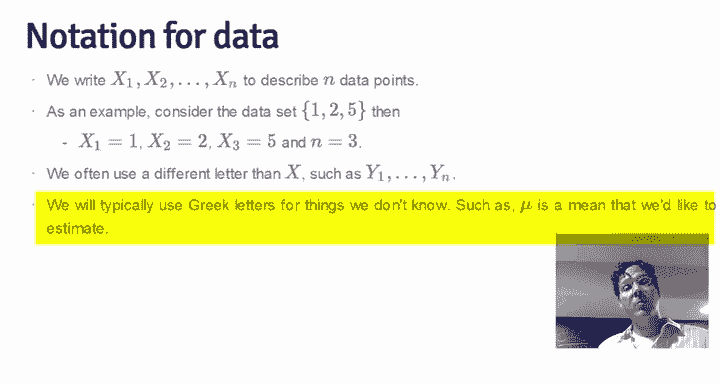

So let's make use of our new notation。Let's try to find the sample mean of a data set。

 where we all know what the sample mean is， we take our data， add them up。

 and divide by the number of observations。

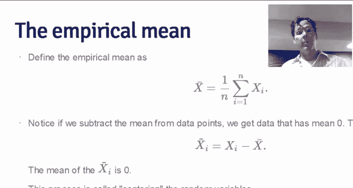

So we usually denote a sample mean by a letter with a bar over it。

 so x bar is the sample mean of my collection of x's。

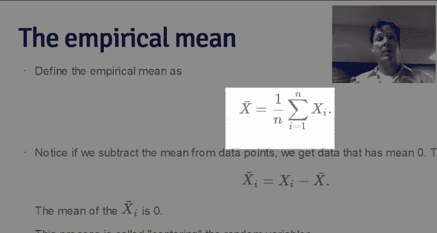

So that's just one over n times adding up all the X's notationally we write this as this sum man symbol where we index it from my one to N of the X's。

 and this is just simply notation for saying add up all the X's。

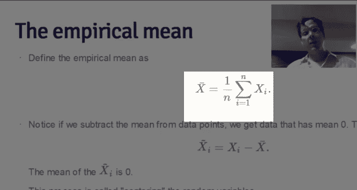

Notice。If we subtract the mean from every。Data point。

Then we wind up with a new data set with n observations， however。

 this new in this new data set has mean zero。

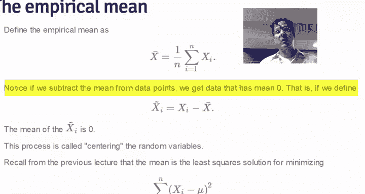

So notationally， if I define X tilde。

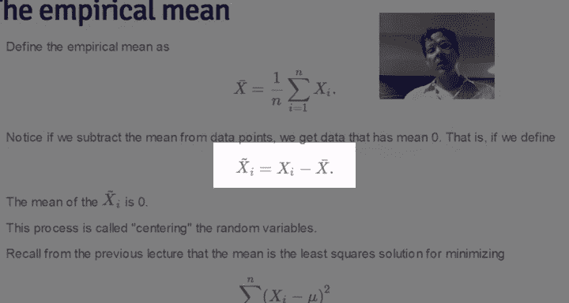

As each X point subtracting off the mean。

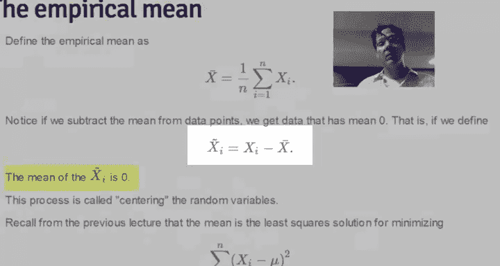

Then this new data set， the Xi t does have mean zero。

This process is called centering the random variables。

 and you can check it empirically by simply generating a bunch of vectors。

 subtracting the mean from each element of the vector and taking the mean of the new vector。

 And you'll see that it's always 0。

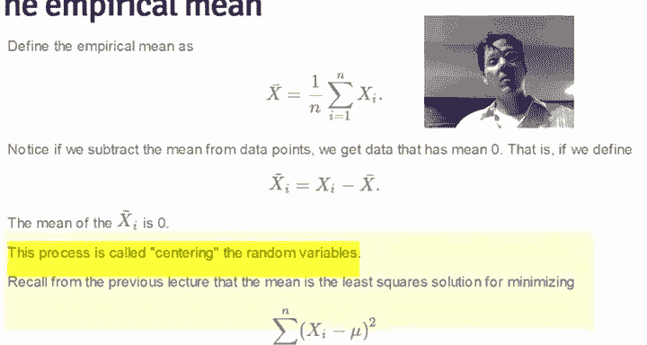

Also recall from the previous lecture that the sample mean is the least square solution。

 so if we want to find the value of mu that minimizes summation Xi minus mu squared。

Then that mu works out to be x bar since we talked about means， let's talk about variances。

 The variance is usually denoted by S squared， and I give the formula right here。1 over n minus1。

 summation X minus x bar quantity squared。This is nothing other than basically the average square deviation of the observations around the mean。

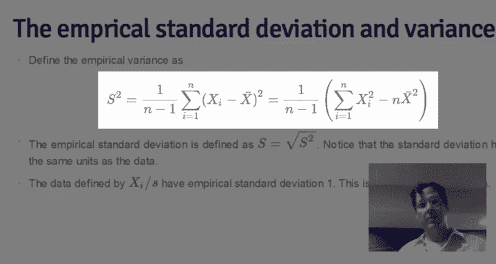

There's a shortcut formula which I give over here。

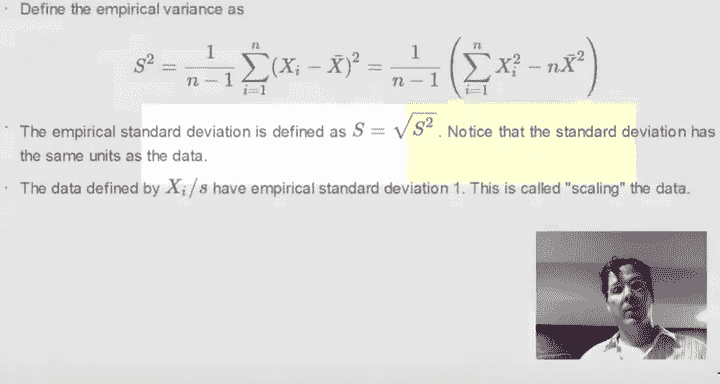

The empirical standard deviation is simply the square root of the variance。

And it's nice to work with standard deviations because the variance is expressed in whatever units x has squared。

 whereas the standard deviation is just expressed in the normal units of x。

Another interesting fact kind of related to not unlike centering， is scaling。

So if we subtract the mean off from every observation we get a resulting data set that has mean zero。

 if we divide every observation by the standard deviation。

 the resulting data will have standard deviation 1， this is called scaling the data。

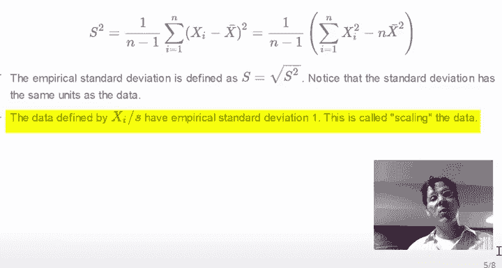

If we take our original data now and subtract off X bar。

 then take the resulting centered data and scale it by S， we get a new data set， let's call them ZI。

 and these have empirical mean0 and empirical standard deviation 1。

This process of centering and then scaling is called normalizing the data。

So normalized data are centered at0 and have units equal to standard deviations away from the mean。

So as an example。If something has a value2 from normalized data。

 that means that the data point was two standard deviations larger than the mean。

As its name would suggest， normalization is an attempt to make otherwise non comparable data sets comparable。

Now let's talk about the most central quantity in regression， the empirical covariance。

 and really the correlation， which is maybe a little bit better to think about。

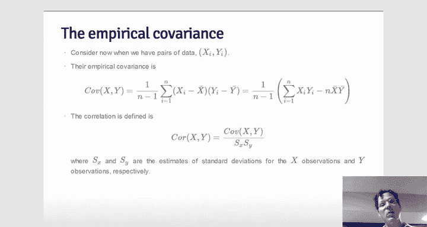

So imagine I have two vectors， x and Y and they're lined up。

 so x1 might be the BMI for subject 1 and y1 might be the blood pressure for subject 1。

 and x2 would be the BMI for subject 2 and Y2 would be the blood pressure for subject2 and so on。

 so you could meaningfully do a scatter plot。

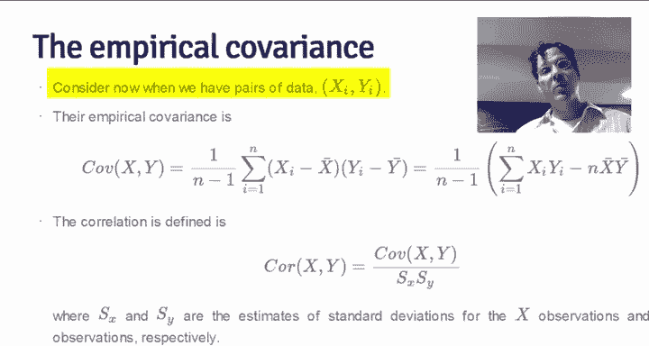

Then we just define the covariance between x and y as 1 over n minus1 sumation of the x x deviations around their mean times the y deviations around their mean。

 I give a shortcut formula over there。

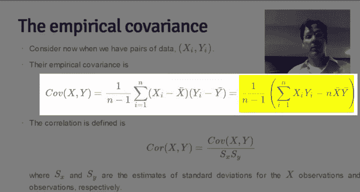

The correlation is simply the covariance then standardized into a unitless quantity。

 so the correlation is the covariance of x and Y， which has units。Basically。

 units of x times units of y， and then we divide by standard deviation of x and standard deviation of y。

 and we get a unit free quantity。

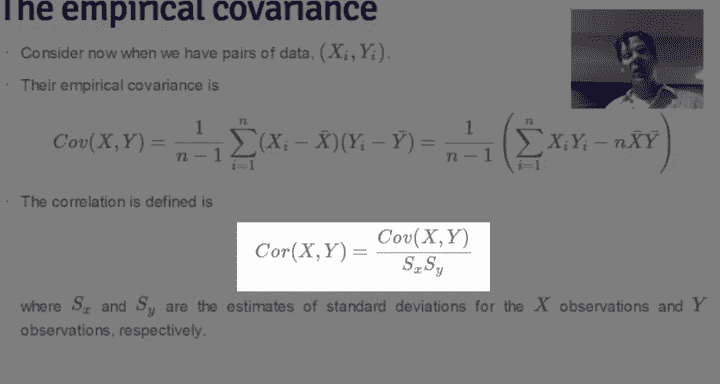

And we'll end our whirlwind tour of notation with some basic facts about correlation。

So the correlation has to be between minus1 and plus 1。And it's only going to achieve these bounds。

 minus1 or plus1 when the X and Y observations fall perfectly on a positively or negatively slopelod line。

 respectively， in other words， a positive line for a correlation of 1 and a negative line for a correlation of minus1。

The correlation measures the strength of the linear relationship between x and y。

 and will see it central in linear regression。The stronger we're estimating a stronger relationship。

 the closer the correlation is toward the extremes minus1 or plus1。

 and a correlation of zero implies no linear relationship。

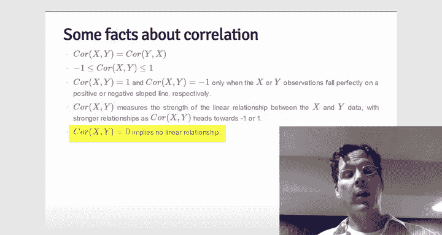