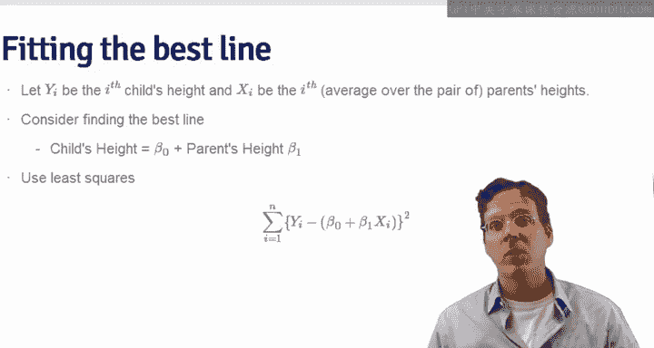
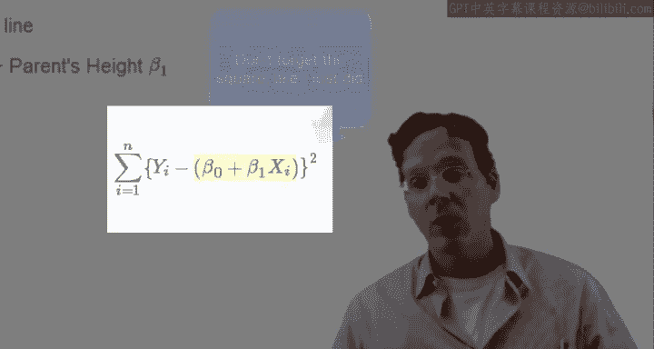
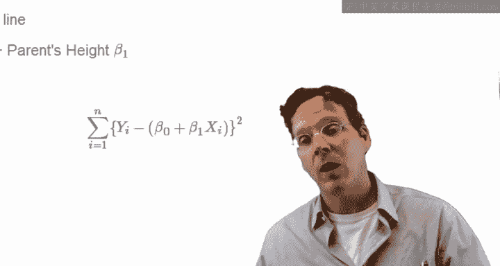
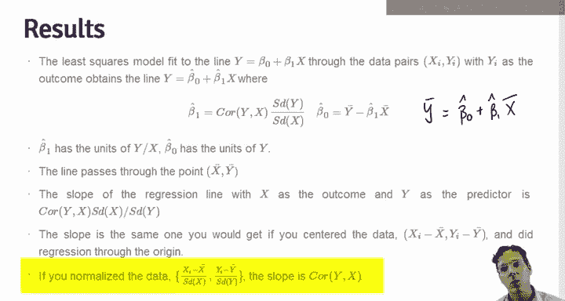

# 约翰霍普金斯大学《数据科学：统计和机器学习｜Data Science： Statistics and Machine Learning》中英字幕 - P46：5_线性最小二乘法.zh_en - GPT中英字幕课程资源 - BV1jsAAeNE3k

Hi and welcome to the Lee Squares estimations lecturec as part of the regression course in the data science specialization。

My name is Brian Kaffa and the courses co taught by myself， Jeff Lee and Roger Pang。

 and we're all in the Department of Biosstatistics at the Johns Hopkins Bloomberg School of Public Health。

Consider again， when we're looking at the scatter plot of the parent heights by the child's heights from the Galton data。

Here， remember， the size of the circle represents the frequency of that particular XY combination。

We'd like to use the parent heights to explain the child's height。

 and we're going to do it using linear regression。We're going to use our notation that we developed in our last lecture。

So let's let YI be the I child's height and Xi be the I's parent height。

Now we want to find the best line where we want the line to look like childd's height is an intercept which lets label beta n plus the parent' height times a slope which we're going to label beta 1。

 so beta n and beta 1 are parameters that we would like to know that we don't know。

When we need a criteria for the term best， we need to figure out what we mean by the best line that fits the data。

Well， one criteria is the famous least squares criteria。

And the basic gist of the equation is we want to minimize the sum of the squared vertical distances between the data points。

 the heights， the data points， the child heights。And the points on the line on the fitted line。

 and we can write this as summation。Y I， the child height， minus beta not plus beta1 X I。

Where that particular parent heights would put them on the fitted line。

We'll go through this a lot and hopefully you'll get the hang of it and then later on at the end of the lecture。

 I'll actually show you the math of how we can come up with the solution for those that are interested。

Let's talk about what our equations mean with a picture， here's a data set。

What are least squares criteria to find the best regression line is going to do？

Is it's going to take each point。 So， for example， take this point right here。 That's the point X 1。

 Y 1。 and this might be the point。X2， Y 2。 And this might be the point。X， N， Y， N。

It's going to take all these points。And fit a line through the data。Let's draw our line right here。

 it's going to fit a line through the data， and the way it's going to pick this line is it's going to take。

 for example， our x1 y1 point， it's going to calculate that distance and that distance is y1。

 the height， that height。Minus。The point on the line。 So this line， let's assume。

 has intercept beta n。 So beta n is the height on along the。Vertical access。

Has intercept beta n and slope beta 1 so's the。Line that we're interested in。

 So this point right there。Is。Beta not plus beta 1， x1。This distance then is subtracting the true。

And because that can be either positive or negative， it would be negative in this case。We square it。

 and then we do that for every point on the line and add them up， so each point on the line。

Contributes equally to the error between the line and the fitted points。

Then we try to minimize that error， and that's what the least squares criteria is doing for us。

So let's discuss what the answer is when you perform this model fit。So just to reiterate。

 we want the line y equal to beta n plus beta 1x， and we're going to fit it through a scatter plot of points。

 XYi， where Yi is the outcome。We put little hats over beta n and beta 1 to indicate the estimated values。

The solution works out to be beta 1 hat is the correlation between y and x times the standard deviation of y divided by the standard deviation of x。

The estimated intercept beta not hat is y bar minus beta 1 hat times x bar。

So let's go through a couple of consequences of this being the result。First of all。

 beta1 hat has the units of y divided by the units of x， that's its units。

 so we can see this because the correlation is a unitless quantity。

 standard deviation of y has the units of y， and standard deviation of x has the units of x。

So because the line remember is so because the slope of the line is change in y divided by change in x。

It has to have units of y divided by units of X units。😡。

Another important point is that the line always passes through the point x bar， Y bar。

 we can see that from the equation for the intercept。If we rearrange it。

 we simply get y bar equals beta not hat plus beta1 hat x bar。

 so if we plug in x bar into our equation for our fitted line， we get y bar out。

 which means that the line has to pass through the point x bar y bar。

If we reverse the role of y and x and treat y x is the outcome and y is the predictor。

 then we simply get the answer that the slope of this line is the correlation times the standard deviation of x divided by the standard deviation of y。

So you get a different answer， of course， when you fit x is the outcome and y is the predictor。

 then if you fit y is the outcome and x is the predictor。

The slope is the same if you were to center the data first。😡，In other words， take each。

X I and subtract off its average， take each Yi and subtract off its average so that now the origin is exactly the mean of the data。

 and if you were to do regression forcing the line through the origin， you get the same answer。

I would also note that if you normalize the data， don't just center it， but center it and scale it。

 the slope is exactly the correlation because the standard deviation of the x variable is1。

 the standard deviation of the y variable is one， and so we can see just from the correlation。

 just from the equation for the slope that it'll just be the correlation。

