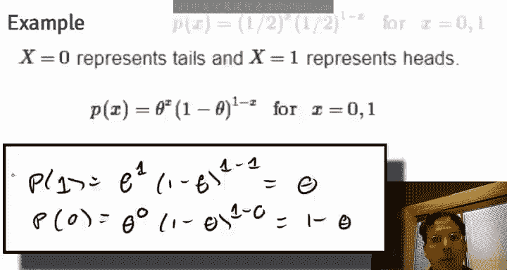
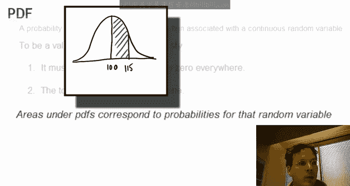
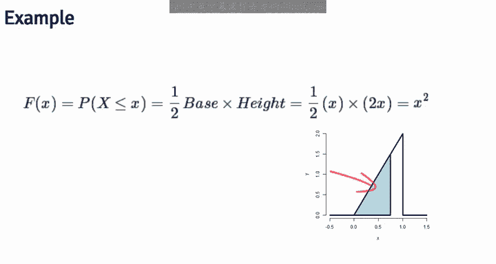
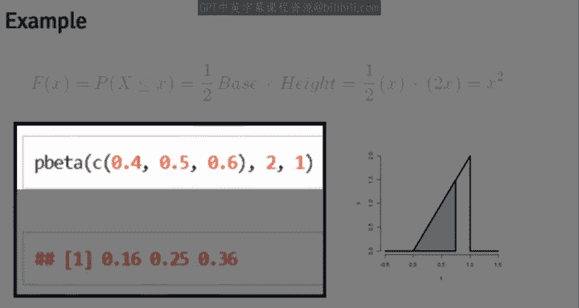
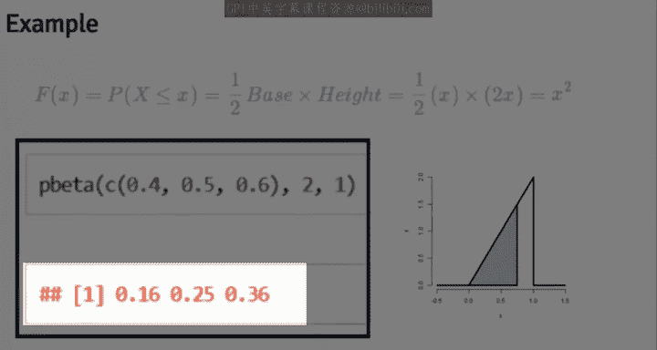
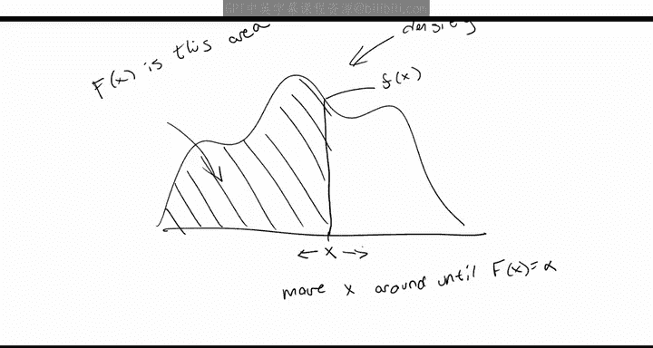
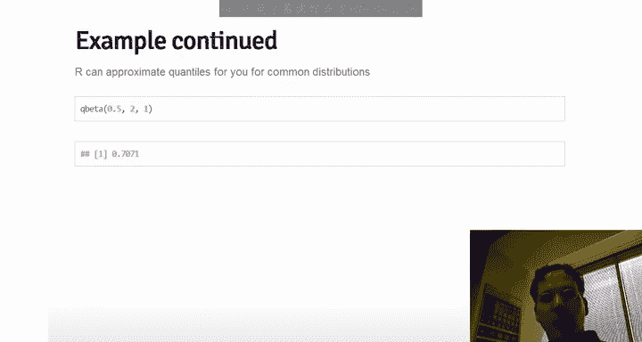
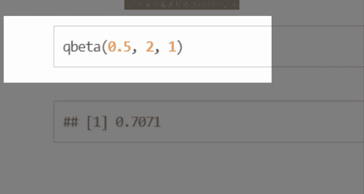
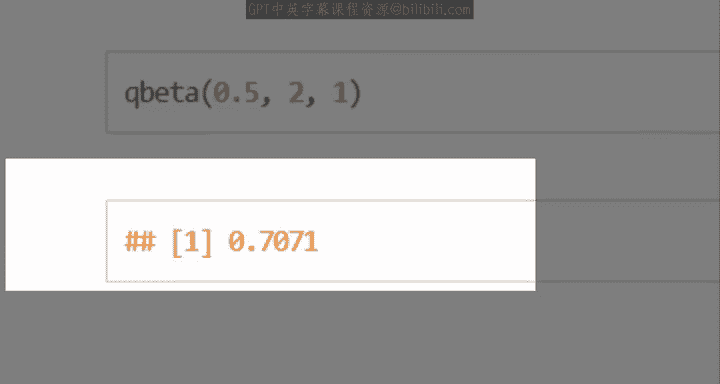
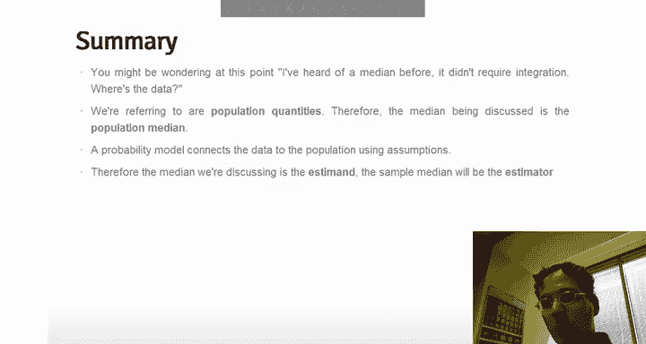

# 约翰霍普金斯大学《数据科学：统计和机器学习｜Data Science： Statistics and Machine Learning》中英字幕 - P4：3_02 03 概率密度函数.zh_en - GPT中英字幕课程资源 - BV1jsAAeNE3k

In contrast to the probability mass function， which assigns probabilities to specific values for discrete random variables。

 is the probability density function。Which is associated with continuous random variables。

Just like a probability mass function has specific rules that it has to follow。

 A probability density function has specific rules that it has to follow specifically to be a valid probability density function a function with satisfy being larger than or equal to 0 everywhere。

 And then the total area under it must be one。And then here is the basic rule of a probability density function。

 areasas under probability densities functions correspond to probabilities for that random variable。

So， for example， if I say intelligence quots are normally distributed with a mean of 100 and a standard deviation of 15 that implies that the population follows a specific bell shaped looking curve。

 and that I am assuming that the probability that I draw that the probability。

 if I were to draw a sample。The probability that a person from that sample has an IQ between 100 and say 115 is this area right here。

Note again， our probability density function is a statement about the population of intelligence quots in this case。

It's not a statement about the data itself。 Again， we're going to use the data to evaluate that assumption and to evaluate statements about the population probability。

 But inherently whenever you say the word probability， you are talking about a population quantity。

Interestingly， note， when we model continuous pro like this or probabilities for continuous random variables like this。

 the probability that it takes any specific value is in fact zero because the area of a line is zero。

This isn't a problem， this is just a quirk from modeling random variables as if they have infinite precision。

 but it doesn't gum up the works in any way at all。

It turns out that the bell shaped curve is a rather difficult density to work with。

At least until you learn how， which we're going to be doing in a separate lecture。

So let's work with a much simpler density right now。Specifically。

 one that looks just like a right triangle， So f of x equals2 x for x between 0 and1 and 0 otherwise。

 And let's give some context around it。 Let's say it's the proportion of help calls that get addressed in a random day by helpline is given by this。

So what does this mean， this means that the probability that between 20 and 60% of the calls get addressed that day is given by this area。

Let's ask the question， is this a mathematically valid density？I plotted the。

Probability density function right here。 It looks like a right triangle。

 Notice the R code is given here and is given in the lecture slides itself because the slides are created using the slideify format。

 So it's important to actually use Git to pull the course repository。

 and you can actually look in the RMD or R markdown file and get all of the code for all of the examples for all of the lectures。

So at any rate， we need to discuss whether or not this probability density function is a valid probability density function。

 Notice it's always bigger than or equal to 0。 And then secondly， let's calculate its area。 Well。

 that's not too hard because it's a right triangle。 one half the area of the base， right。

 which is one half times the height， which is 2， So one half times 2 is one。 So the area is one。

 So in fact， this is a valid probability density function。

Let's go through an example of working with this density。

 What's the probability that 75% or fewer calls get addressed in a randomly sampled day from this population。

Well， it turns out quite nice that this is just another right triangle that we need to figure out。

 So the height at this point is 1。5 because remember the function is just 2 times x。 So at the。75。

 the height is 1。5。 And then， of course， the value of the base is 075。 But then we divide it by 2。

 because it's  one half the area of the base times the height。

 And that works out to be 56% as shown right here。It turns out that this density is actually a special case of a known density called the beta distribution。

 and I give you the R code here for directly getting this probability from the beta distribution。

 Of course， we don't need it because it's just working with triangles。However。

 in more complicated settings， we're going to need these functions。 I want to add that the word。

 the letter P in front of。A function askeds for probability。

 So P beta is going to ask for the probability from a beta density。Of being less than 0。75 here。

 the two and the one are the specific parameters that turn it into the exact triangle that we're using right here。

 And you see that you get the same number 56%。Certain areas of the density are so useful。

 We give them names。 For example， the cumulative distribution function of a random variable X returns the probability that a random variable is less than or equal to the value X。

 So it returns the probability capital X is less than or equal to little x。

And this definition applies whether x is discrete or continuous。 So remember。

 in our beta distribution that we just looked at， the P beta function in R always returns whatever the first argument is。

 the probability of being less than or equal to that。 So， in fact。

 whenever you do P density name in R， it is actually just returning the cumulative distribution function。

The survival function is sometimes interesting to work with instead of the distribution function。

 and it's just one minus the distribution function。

 so instead of the probability of being less than it's the probability of being greater than。

So imagine if we wanted the cumulative distribution function of the density considered before。

 say for example， we wanted to know what's the probability that 40% or fewer of the calls get answered in a given day。

 what's the probability that 50% or fewer of the calls get answered in a given day and what's the probability that 60% or fewer of the calls get answered in a given day。

 given the particular model that we have right now。

 which is this right triangle as a population probability density function。Well。

 for any of those numbers， just looking at the picture， it's going to be very similar to 0。

7 how we figured it out for 0。75。 it's going to be a right triangle。

 so it's going to be1 half the of the base times the height。 That's always going to be1 half x。

 whatever x you're plugging in times 2 x， the height at that point， which works out to be x squared。

So the function x squared takes the number that you want to evaluate and gives the probability of that percent of calls or fewer getting answered on a randomly sampled day。

Okay， so we see that here when we plug in P beta， which is our cumulative distribution function in R for these three values。

 the two and the one make it so that we're evaluating this specific beta density。

 and that works out to be 16%， 25% and 36%。

So on 16， so。

The probability that 40% of the calls or fewer get answered on a given day is 16%。

 The probability that 50% of the calls or fewer get answered on a given day is 25%。

 And the probability that 60% of the calls or fewer on a given day get answered， is 36%。

 If you wanted the survivor function it's 1 minus the cumulative distribution function。

 So it's 1 minus x squared。In the future， we're going to work with more complicated density functions。

 but it'll actually be easier because we'll just be relying， for example。

 on the P norm and P beta function like this instead of directly figuring them out。

 you've already heard of sample quantiles。 For example， if you scored the 95th percentile。

 which is the 。95th quantile on an exam。 know that 95% of the students scored worse than you and 5% scored better。

These are the so called sample quantiles。 We're going to define their population analogs。

 So remember in the sample quantile， if you wanted to define the 95th percentile or the 。

95th quantile， what you would do is line the observations from least the greatest。

 and you would find the exam score or the point such that 95% of the observation lied below it。

The alpha quantile of a distribution function with distribution function f is the point x of alpha。

 such that f of x sub alpha equals alpha， that's quite a tongue twister。

 so let's see if we can draw a picture。If we to dry density。F of x。

 the distribution function evaluated at x is the area below the point X。

 which is the probability that a random variable from this population is less than or equal to x。

 So you might think of it as a population of test scores。 in its' a infinite population of students。

 And here， this would be the probability of getting a score for a randomly drawn student from this population of X or lower。

The alpha of quantile is we move this line around until we find the point X of alpha so that exactly alpha probability lies below it。

 That is exactly what we are doing with our data when we find an empirical quantile。

 we keep finding the data point such that， for example，95% of the test scores lie below it。

 that would be the sample 95th percentile Now we move the x point along until we find the point such the probability of line below it is 95% in this population distribution。

 Again， the percentile simply a quantile with alpha expressed as a percent instead of as a proportion and the median is the perhaps most wellknown quantile is the 50th percentile。

We're going to use quantiles a lot， so it's worth reinforcing this point。

So the 95th percentile of a population distribution is the point。

 such that the probability of random variable is drawn from that population is less than that value is 95%。

 and the probability that a random variable drawn from that population is more is 5%。

Let's work through our previous example。What is the median of the distribution that we were working with before？

Remember that the distribution looked like a right triangle and the distribution function。

 for example， if we wanted to find the probability that x proportion of calls got answered on a given day or less that F of x。

 that distribution function worked out to simply be x squared。

 where x has to be a value between 0 and 1 for it to make sense。In this case， we want to solve 0。

5 equals f of x， which is equal to x squared， resulting in the solution square root 0。5， This is 0。7。

So what this means is that on about 50% of the days。70% of the phone calls or fewer get answered。

And on about 50% of the days， about 70% of the phone calls or more get answered。

We work with quantiles a lot， especially quantiles from the normal distribution。

We almost never go through this process of working directly with the densities to calculate quantiles because the distributions we work with are common。

 and this has already been done for us。 In R， there's an easy trick。

Basically， Q in front of the function name function density name gives the quantiles。

 So in this case， we know that this is a beta density。 While， we don't know。

 I'm telling you that this is a beta density。 And so Q beta gives us the relevant quantile。 Here。

 we plug in 05。And remember， R takes the argument of the quantile as a proportion。

 so if you plug in 0。5， it will work， if you plug in 50 for 50%， it will not work。Okay。

 and the two and the one are the parameters that we haven't really fully described。

 but that you are going to have to just take my word for it that those are the parameters that yield the specific beta density that we're looking at and when we plug this in we get 07 0。

71 exactly like we got before。

You might be wondering at this point， I've heard of a medium before， but it wasn't this complicated。

 I just ordered my observations from least to greatests and took the middle or the average of the two middle observations if I had an even number of observations。

There you had a sample quantity。 It's an estimator in this class。

 we're going to build up not just estimators， but the targets of estimation or the estimate。

So in this case， your sample median is estimating your population median。So for example。

 a sample meaning from our previous example is if we were to sample a couple of days。

Calculate the percentage of calls that got answered on that of those days。

 line up those percentages and take the middle one that would be the median。

We would think of that as a target as an estimator of a population。

 sort of a true median percentage of calls that get answered。

And there's of course a lot of assumptions that we're going to need to make to connect that sample to the population。

 however， we're going to be wide eyed about those assumptions and we're going to formally develop them。

So at any rate in this class， to every estimator there will be an estimate。

 the sample mean will estimate the population mean。

 the sample median will estimate the population median。

 the sample standard deviation will estimate the population standard deviation and so on。

 This is the formal process of statistical inference， linking your sample to a population。

