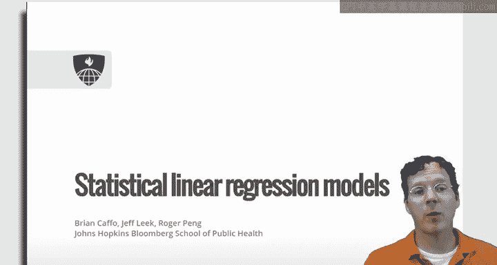
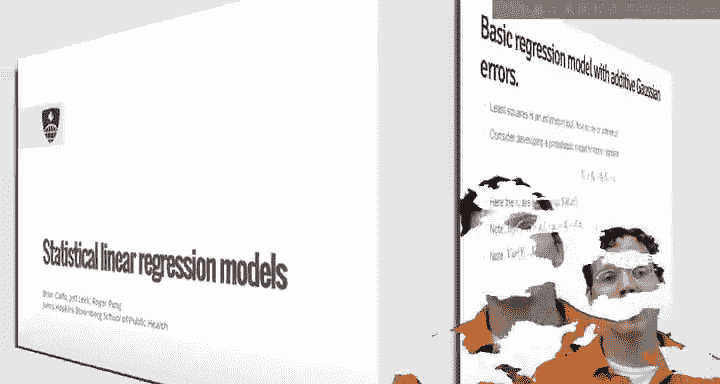
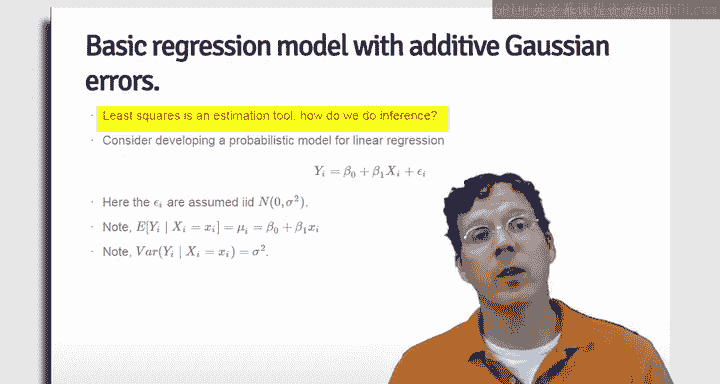
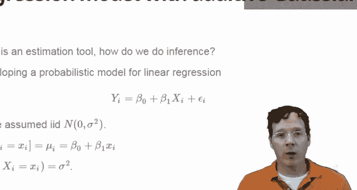
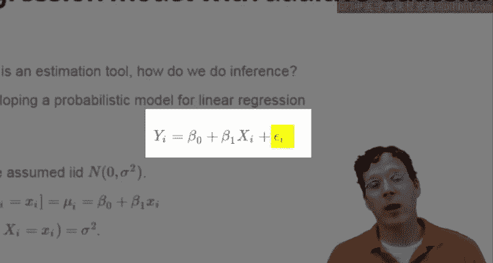
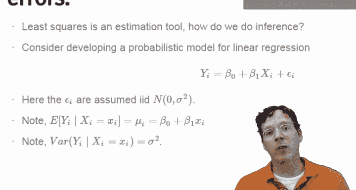

# 约翰霍普金斯大学《数据科学：统计和机器学习｜Data Science： Statistics and Machine Learning》中英字幕 - P50：9_统计线性回归模型.zh_en - GPT中英字幕课程资源 - BV1jsAAeNE3k

Hi and welcome to the lecture on Sta Line regression models as part of the regression model in Coursera course。

 which is part of our data science specialization。 My name is Brian Kaffho。

 and I'm a professor in the Department of Biosstatistics at Johns Hopkins。

 Bloomberg School of Public Health。 The class is co taught by my co instructorors and colleagues。

 Jeff Leeake and Roger Pang。😊。

Finding a good regression line using least squares is really simply a mathematical procedure。However。

 we'd like to do statistics， we'd like to draw inferences based on our data。

 in other words we'd like to generalize from our data to a population using statistical models and that's what we're going to talk about in the statistical linear regression lecture today。

So let's consider our probabilistic model for linear regression and we're going to start with one of the most simple ones。

Our response Yi is our line beta n plus beta 1 Xi where we don't know beta n or beta 1。

 these are the population parameters that we would like to estimate Xi is a collection of explanatory variables that we do know。

And then to make it a statistical model， we're going to add Gaussian IID Gaussian errors。

 which I'm going to denote epsilon I， so the epsilon I are going to be assumed to be normal mu sigma squared。

There's a lot of different ways to interpret these independent errors。

Perhaps one of the easier ones to think they're the accumulation of a lot of variables that you didn't model。

 but maybe should have that act together on the response in a way that can be modeled as if independent and identically distributed Gaussian errors。

However， let's put these kind of difficult interpretation issues aside for the time being and simply talk about how we mechanically work with statistical inference for regression。

I would note that the expected value of the response given a particular value of the regressor is simply the line at that regressor。

 beta n plus beta 1xii， and the variance of the response at any particular value of the regressor is sigma squared。

This latter point， let me elaborate just a little bit。

 this is the variance around the regression line， this is not the variance of the response。

 so it will be lower than the variance of the response by itself because you've explained away some of the variation。

With X by conditioning on x， I would also note that both the expected value and the variance are population quantities。

 They have sample analogs that will estimate， but right now these are population quantities。

 These are the estimatess that we would really like to know。

