# 约翰霍普金斯大学《数据科学：统计和机器学习｜Data Science： Statistics and Machine Learning》中英字幕 - P53：12_残差.zh_en - GPT中英字幕课程资源 - BV1jsAAeNE3k

Welcome to the lecture on residuals and residual Va。 My name is Brian Kafho。

 and I'm the instructor for the regression class as part of the data science Coursera specialization。

 Let's start by talking about our motivating example， using the diamond data set。

Remember， in this data set， the diamonds were diamond prices in Singapore dollars。And the diamond。

 the explanatory variable is the weight of the diamond and carrots。

We'd like to talk about how we can explain variation in diamond prices using their mass。

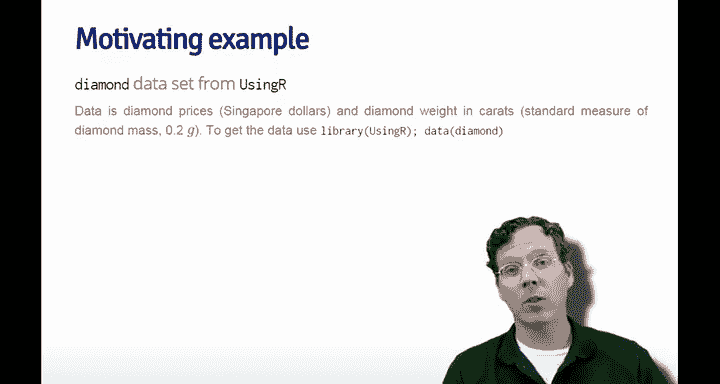

Let me generate a plot Last time I showed went through the commands for generating the plot so I won't do this again。

 but here's my GG plot and let me zoom out So what we're interested now。Is explaining。Price。

On the vertical axis， by mass， on the horizontal axis。If we had disregarded masss。

 we would have all these points。We would look at there。Sort of projection。Onto the vertical axis。

 and there would be a lot of variation if you were to disregard mass。

 there would be a lot of variation when we consider mass。

 there's much less variation because now we're talking about this variation around the regression line。

The variation around the regression line is residual variation。

 that variation that was left unexplained by having accounted for mass。

So we start out with a lot of variation， we've explained a substantial fraction of it by the linear relationship with mass。

 but there's some leftover variation we'll call that residual variation。

These distances that make up the residual variation are called the residuals。

 and that's the topic of today's lecture。The residuals are quite useful for diagnosing many things。

 including poor model fit。

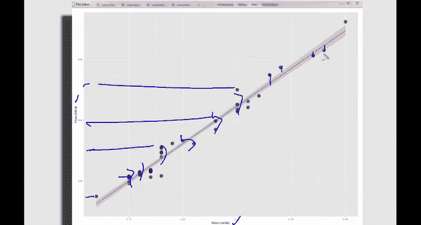

Let's remind ourselves of the model that we're considering。

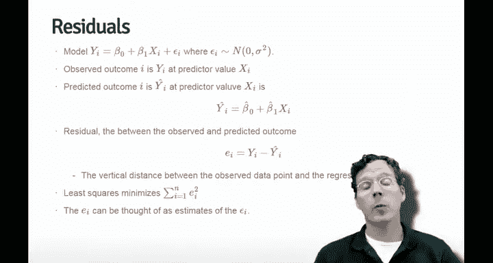

Our outcome and our example， which would be price is Y I， which we're assuming is a line。

 beta n plus beta 1 Xi， where Xi in this case is mass in our example。

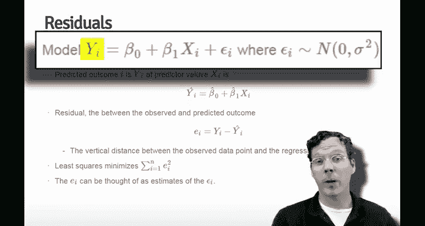

We're adding on some Gaussian error， Epsilon I， which we're assuming to be normally distributed with a mean of 0 and a variance of sigma squared。

 We haven't explicitly used this normal assumption yet， and that'll be coming later。

 later on in some subsequent lectures。

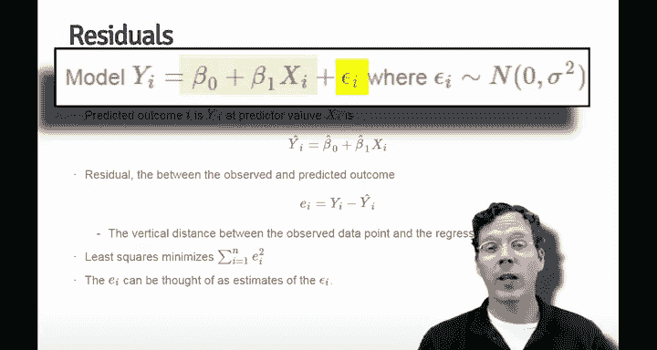

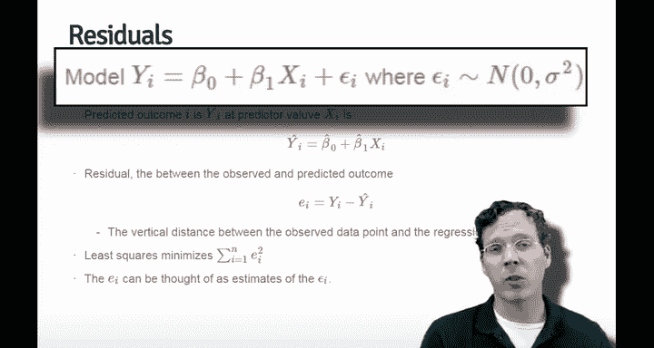

Remember， the outcome is Y I for predictor value X I at that specific index I。 So Y I is a price。

 X I is a mass。

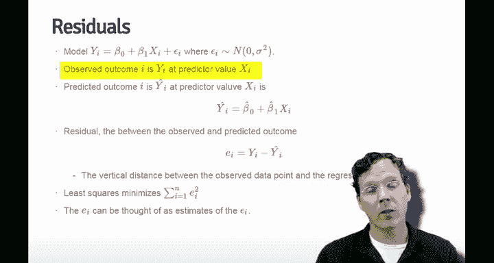

The point on the line corresponding to X I is why I hat。

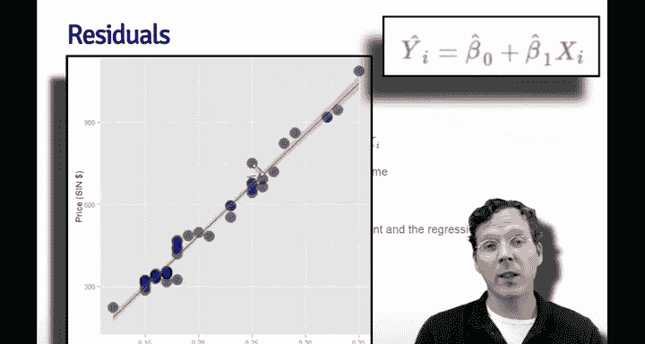

We can figure out why I had by just plugging in beta not hat plus beta1 hat times X I。

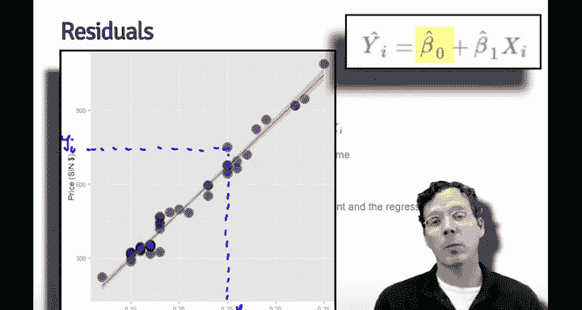

Well， our residual is nothing other than the vertical distance between the observed data point observed outcome Y I and the fitted value Y I hat。

 So E I is equal to Y I minus Y I hat。

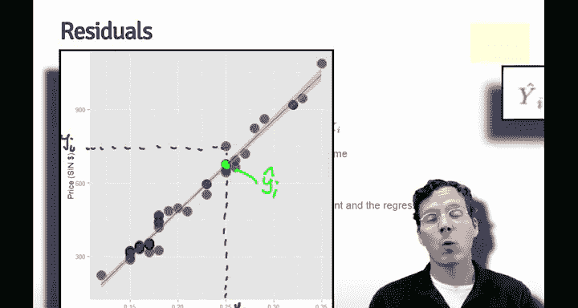

Remember， our least square criteria tried to minimize the sum of the squared vertical distances。

 so in essence it was minimizing the sum of the squared residual sum as EI squared。

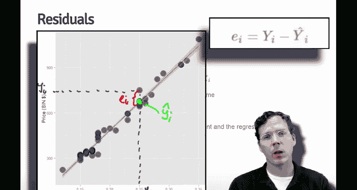

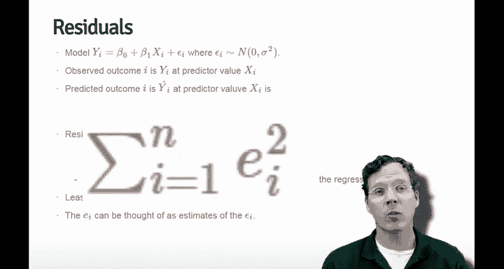

One way to think about the residuals are as an estimate of epsilon I。

 though you have to be careful with that， because as we'll see later on。

 we can decrease the residuals just by adding irrelevant regressors into the equation。

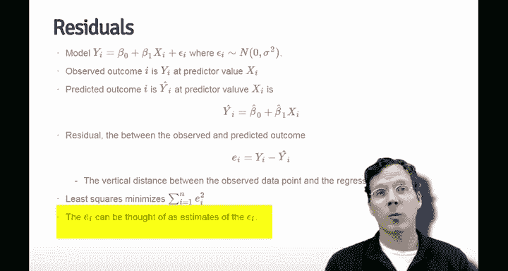

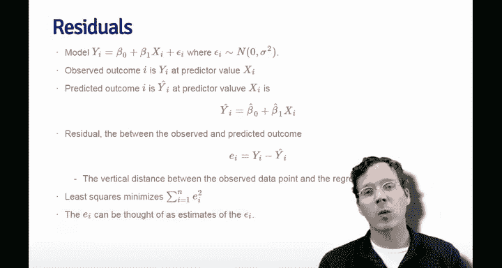

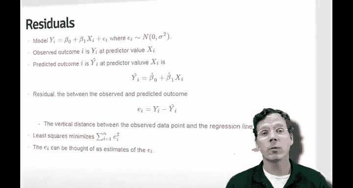

Let's talk about some aspects of residuals that will help us interpret them。 first of all。

 their population is expected value is zero。But also their some， their empirical some。

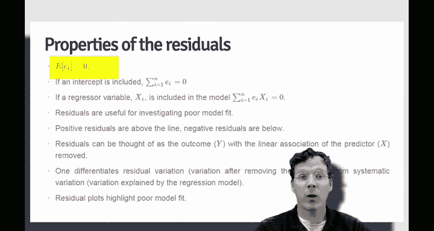

Hence， the empirical mean also is zero if you include an intercept。

 if you don't include an intercept， this property doesn't have to hold。

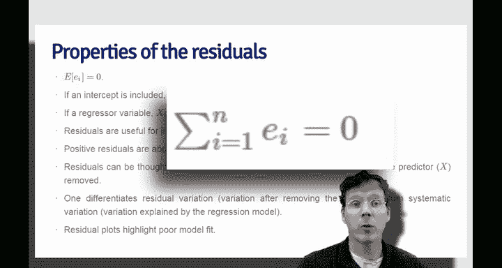

Well， the generalization of this property is if you include any regression term in linear regression in our generalization in linear models。

 the sum of the residuals times that regression variable has to be zero。

Residuals are very useful for diagnosing poor model fit and we can create plots that sort of highlight and zone in on the aspects of poor model fit。

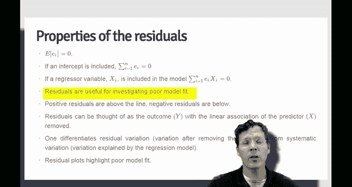

Another very common use of residuals is to think of them as the outcome Y with the linear influence of the predictor X having been removed。

 so， for example， if we wanted to in some subsequent model or some subsequent analysis analyze diamond prices。

 but。

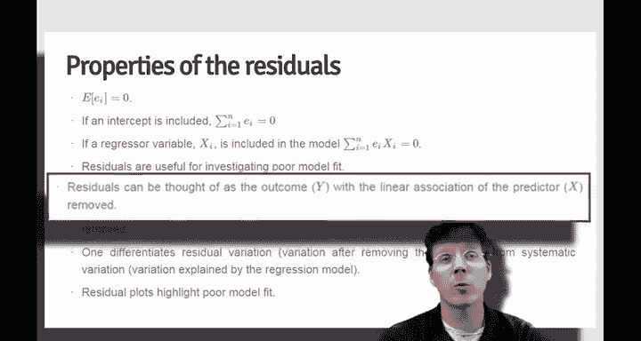

In a way that has already been adjusted for their weight。

 so calibrating all the diamond prices to sort of be on the same scale， regardless of their weight。

 we would take those residuals from the model fit that has diamond prices as the outcome and weight is the predictor。

 so it's very common to take residuals and carry them forward in a later analysis where you want to think of them as the new outcome having removed the predictor at that point。

But of course， remember only if you do linear regression。

 you're only removing the linear component of the predictor。

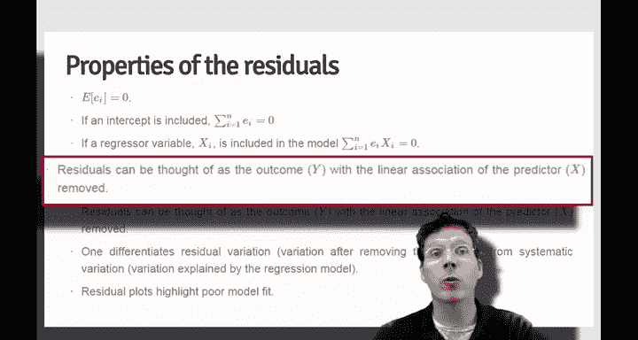

So one should differentiate between residual variation， which is variation that is left over after。

The explanatory variable has been accounted for in a linear fashion from systematic variation。

 which is variation is explained by the regression model。So again。

 residual plots can highlight poor model fit and we're going to go through some residual plots here in just a couple of slides。

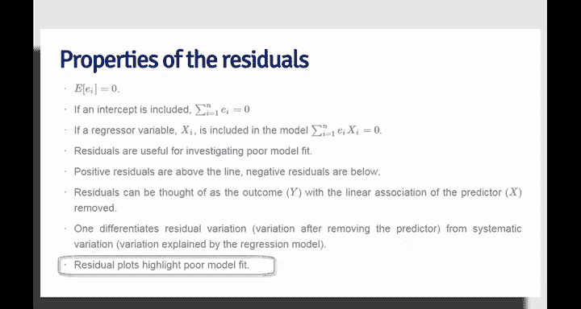