# 约翰霍普金斯大学《数据科学：统计和机器学习｜Data Science： Statistics and Machine Learning》中英字幕 - P55：14_残差方差.zh_en - GPT中英字幕课程资源 - BV1jsAAeNE3k

Let's talk about residual variation really quickly before we finish talking about our square。

Residial variation is the variation around the regression line。So remember。

 our residuals are the vertical distances between the outcomes。And the fitted regression line。

Remember， if we include an intercept， the residuals have to sum to zero。

 which means their mean is zero， so if we want to take the variance of the residuals。

 it's just the average of the squares。So the sum of the squared residuals times 1 over n is an estimate of sigma squared。

 the variation around the regression line， the true population variation around the regression line。

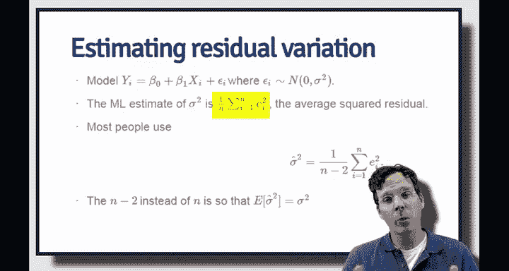

Now most people use n minus2 instead of n， so it's not the average squared residual。

 it's kind of like the average squared residual and for large n。

 the difference between one over n minus2 and1 over n is irrelevant。

 but for small n it can make a difference。

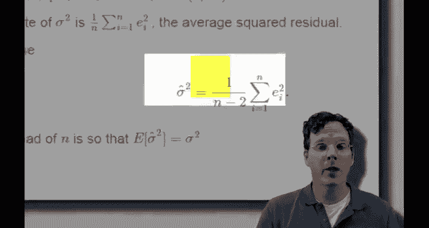

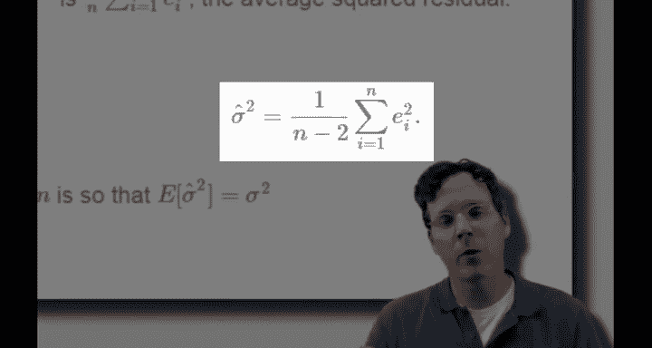

The way to think about that is remember， if we include the intercept the residuals after sum to 0。

 So that puts a constraint。 If you know n  one of them， then you know the n。 Well。

 if you have a line term in there， if you have a covariate in there。

 then that puts a second constraint on the residuals。 So you lose two degrees of freedom。

 If you put another regression variable in there。 you have another constraint。

 you lose three degrees of freedom。 So in essence， it's sort of like saying you really don't have n residuals。

 you have n -2 of them， because if you knew n -2 of them， you can figure out the last two。

 And that's why it's one over n -2。 So let me show you how you can grab the residual variation out of your Lm fit。

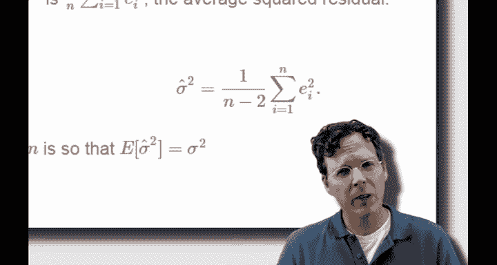

And assign it to a variable。This way， if you need to work with it in an R program。

 you can actually grab the number not just see it on the printout so here I've defined my Y and my X and I defined my fit as the regression model with Y is the outcome and x is the predictor。

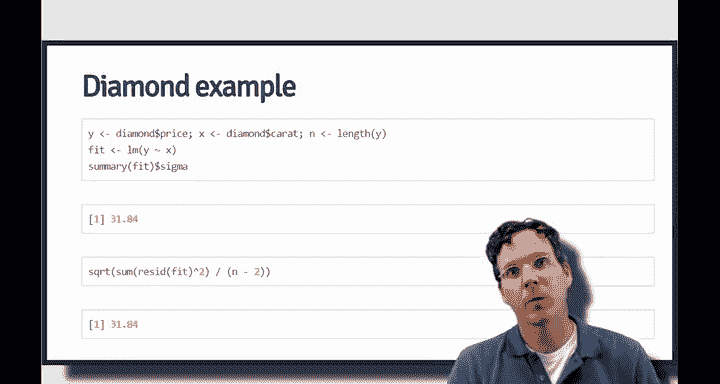

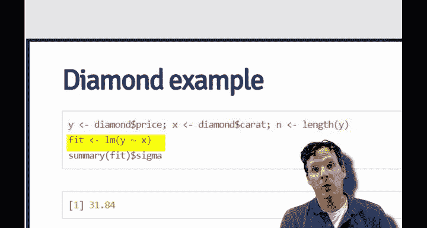

Well， if you just do summary of fit and you don't do anything else， you just hit return。

 it'll print out the summary of the regression model， intercepts， slopes。

 estimated values and so on and you'll see the residual standard deviation estimate among the elements of the printout。

 however， if you want to grab it as an object that you can assign to something。

 just put dollar sign sigma， then you can assign sigma to any other variable so if you're using it in a program in some other way。

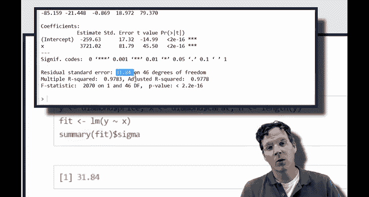

This works out in this particular example to be $31。84。

So here let's just confirm that I'm not lying to you and that the formula works。

 so if I do Reid fit that grabs the residuals， if I square it， it squares them， if I sum it。

 it adds up the squared values， if I divide by n minus2。

 it takes the average of the unique residuals， and then if I square root it at 31。84。

 so I wasn't lying。

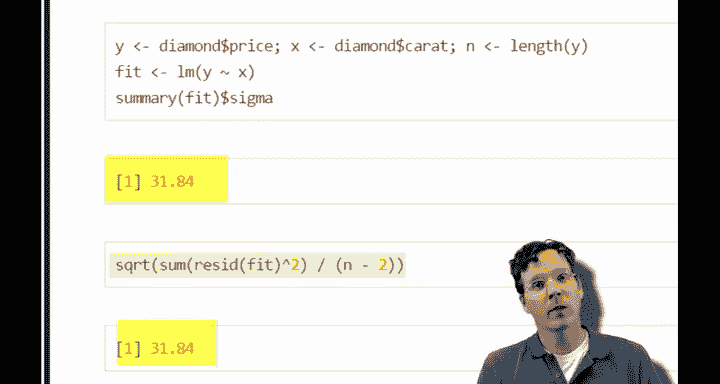

Now let's go back to this plot where we look at the total variability in diamond prices。

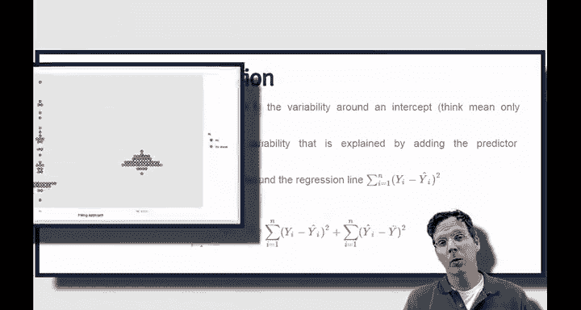

And then compare what happens to the variability when we explain some of that variability with the regression line。

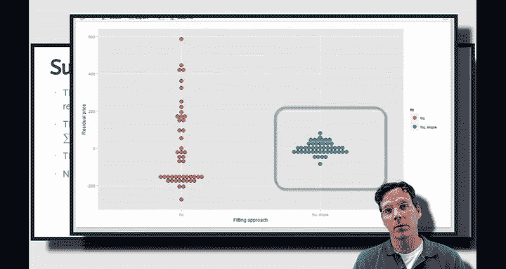

So the total variability is just the deviations of my data。

 the average squared deviation of my data around its mean， around the center。

 and just to make things easy， let's forget about the denominator and just talk about some of the squared deviations。

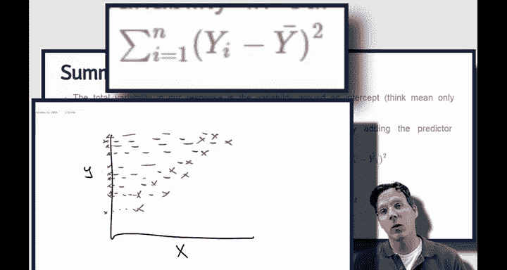

What we might call the regression variability as the component of that variability that then gets explained away by the regression line。

 so we would take the points on the regression line， the heights。

And that's the variability in the response that's simply explained by the regression line and let's take how much that deviates around the average。

 so that's the regression variability。Then everything that's left over is that variation around the regression line。

 and that's the residual variability。

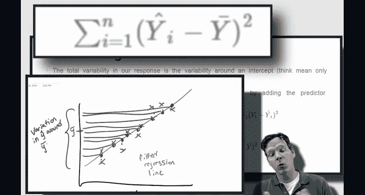

And the interesting identity， and it kind of makes sense that this would be the case。

 is that this total variability， the variability in diamond prices disregarding everything except for where they're centered at。

 is equal to the regression variability that is the variability explained by the model。

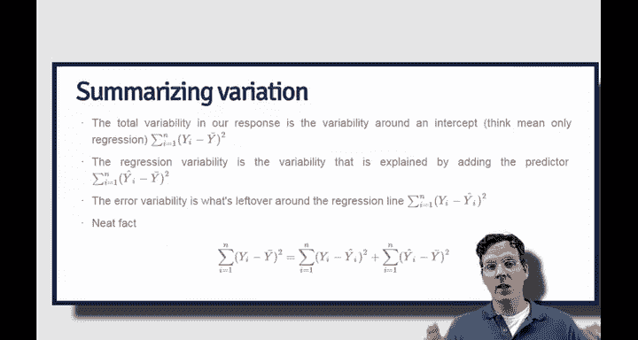

Plus， the residual variability， the variability leftover not explained by the model。

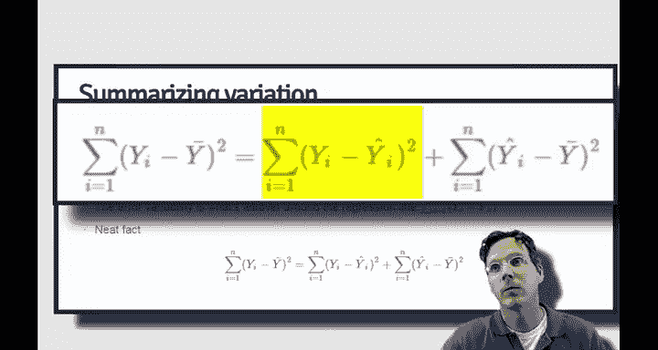

Because the residual variation in the regression model variation add up to the total variation。

 we can define a quantity that represents the percentage of the total variation that's represented by the model。

 Simply take the regression variation and divide it by the total variation。

 That quantity is called R square。 So R squared for our diamond example is the percentage of the variation in diamond price that is explained by the regression relationship with mass。

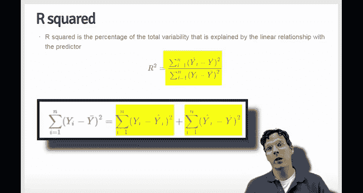

Some facts about r squared that you need to keep in mind。

Just to remind you r squared is the percentage of the variation in the response explained by the linear relationship with the predictor。

R squared has to be between zero and one because the。

Regression variability and the error variability the sum to squares add up to the total sum of squares and they're all positive。

 so that forces r squared to be between 0 and 1。If we define R as the sample correlation between the predictor and the outcome。

Then r squared is literally that sample correlation R squared。😡。

R squared can be a misleading summary of model fit， for example。

 if you have somewhat noisy data and delete all a lot of the points in the middle。

 you can get a much higher r squared， or if you just add arbitrary regression variables into a linear model fit。

 you increase R squared and you decrease mean squared error or the average squared residual variation。

 so these things have to be taken into mind if you're using them to assess model fit。

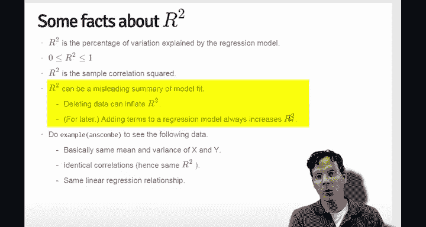

AnCOum created a particularly stark example of a bunch of dataset sets with equivalent R squared。

 equivalent mean and variances in the x's and the Y's， and identical regression relationships。

 But when you look at the scatterpls， you can see that the fit has very different meanings in each of the cases。

 So let's look at the outcome from the example An sc and see what it shows。 And here it is。

 the four data sets。 The first one is a nice regression line exactly sort of along the lines of what we think of when we think of as just a slightly noisy X Y relationship。

 The second one clearly there's a missing term in order to address some of this curvature in the data。

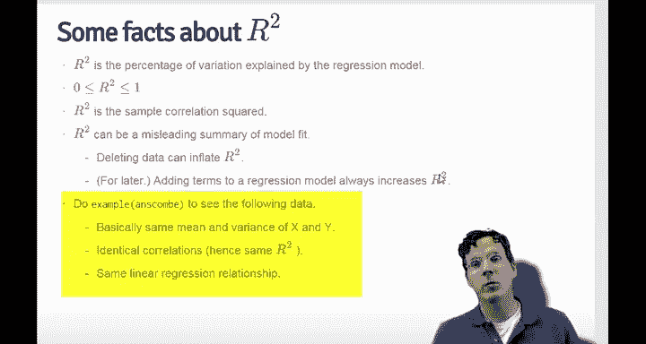

The third one， there's an outlier。And in the fourth one。

 all the data is stacked up at one particular location。

 and then there's one point way out at the end， so you can imagine getting this if you had the first example and you deleted a lot of the points in the middle。

So in all these cases you have an equivalent r squared。

 but the summary to the single number certainly has thrown out a lot of the important information that you get from a simple scatter plot。

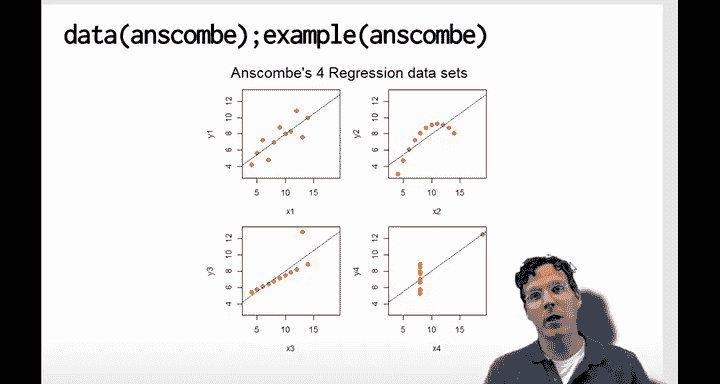