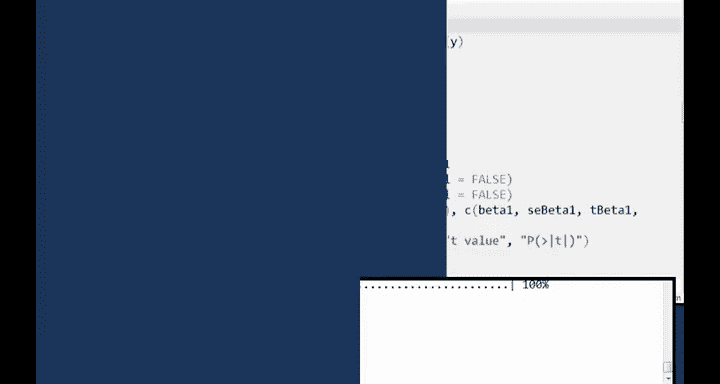
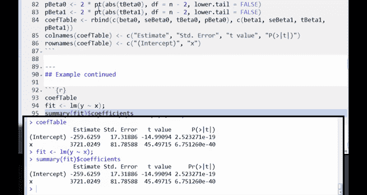
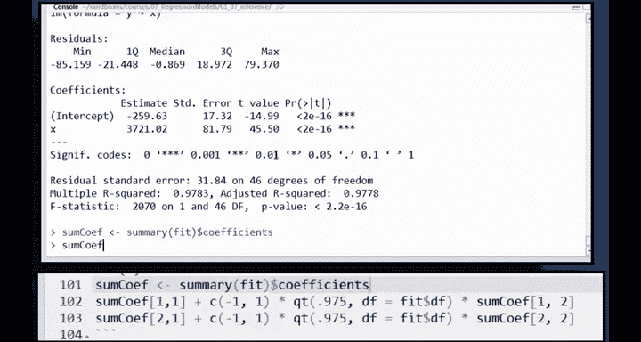

# 约翰霍普金斯大学《数据科学：统计和机器学习｜Data Science： Statistics and Machine Learning》中英字幕 - P57：16_编码示例.zh_en - GPT中英字幕课程资源 - BV1jsAAeNE3k

Okay， let's go through and just demonstrate that the formulas I'm giving are exactly the formulas that R is using when it performs its calculations。

So I'm going to use the diamond data set。And that's the using our library。

 so I'm going to load those。Define Y X and N， like I always do with this data set。

 I don't have to type so much。My beta 1 is the correlation between the y and the x times the standard deviation of y divided by the standard deviation of x。

And my beta n is the mean of the y's minus beta 1 times the mean of the x。My residuals。

My residuals are my response y minus the predicted values， beta n plus beta 1 x。

 so here I've just carried the subtraction through。There's my residuals。

My estimate of the standard deviation around the regression line。

 the variability around the regression line is the average of the residuals。

 except remember we're dividing by n minus2 instead of n and to get it to be a standard deviation rather than a variance。

 I'm going to square root it。There's my sigma， that's my estimate of sigma from the previous several pages。

My sums of my squares of x's is just the numerator of the variance calculation。

 but let's just do it directly， it's x minus its mean squared and some of the adding those up。

Let me get that。And then my standard error for my beta knot for my intercept。

 if I just simply plug into the formula there I've written it out。

And my standard error for my beta 1， which is I think the more useful and mentally important。

Formula to commit to memory is the sigma， the variance。

 the standard deviation around the regression line divided by some of the squares of the axis。

 some of the squared deviations of the x's around their means。There we go。

 there's the standard error for beta 1。I'm going to create the two T statistics。

Which if you're testing a hypothesis that beta 1 is0 or beta not is0。

 then that's just going to be the estimate。Here's my estimate divided by its standard error。

 and so we don't have to subtract off the true value because the true value is assumed to be zero under this hypothesis。

And so for my beta 1 hypothesis， it's going to be beta 1 divided by its standard error。

And then I'm going to calculate my 2p values again if you've taken the inference class and how you go from a T statistic to a P value should not be a great leap。

 but in this case it's going to be twice my T probability where in both these cases。

 the estimates are larger than zero， so I'm going to look at the probability of being this statistic are larger and I'm going to double those two T probabilities。

And then I'm going to create my coefficient table created manually by me without having done any。

LM or any built in higher level R function。And I'm going to give it its row names and its column names so that it looks like R's output。

 and then now I'm going to show you the easy way to do it。Okay， so here let me print it out。

 there it is printed out， and then now I'm just going to do fit Lm。

 my response Y is a linear relationship with my predictor X。

And then I'm going to get the summary of the coefficients you'll see everything is exactly the same。

 So if you didn't follow all this， it it's not too big of a deal。

I just wanted to show you for once that the formulas that I'm giving you are exactly the right formulas。

 and we verified them computationally by checking them out on a data。

 maybe check them out on another data just to verify for yourself。

Let's go through getting a conference interval。So my fit， the variable fit was the output of LM。

 Let's see what happens if I type summary fit， you get the full output from LM。

 so it gives you facts about the residuals， it gives you the coefficients。

 the estimated coefficients， the standard errors， the t values and the associated P values。

 these are all for test of whether or not the intercept is0 or the slope is0。 Now of course。

 a zero intercept may not be of interest， but almost always a test of a zero slope is of interest。

But it also gives you the residual standard deviation， the degrees of freedom， the r squared。

 the adjusted r squared， which we'll talk about later on in the class。Let's go ahead and generate。

Our confidence intervals。For。Our intercept and for our slope。 So now I've assigned。That summary。

The summary from the LM statement to an object in R， but I just wanted the table part。

 so I'm grabbing the just the coefficient， so right here see I'm just grabbing the coefficient table。

 so let me just print out that variable just to show you what it looks like。

 It's just the table part， just the estimates， the standard errors， the T values and the P values。

Okay， so our conference interval is just going to be estimate。So here's for the intercept estimate。

Plus， or minus。The 97。5 T quant with the degrees of freedom just to make sure I get the degrees of freedom right。

 so I don't even have to think at all， I'm grabbing fit dollar sign degrees of freedom。

 and then times the standard error。There I'm grabbing the standard error。

And then I'm doing it for the slope， which is in the。Second。Row of the first column。So the slope。

Estimate plus or minus the relevant t quantile times its standard error。

 which is in the 22 cell of this table here。And then the。Slope is going to be interpreted in。

Change in Singapore dollar price。Per one。Mass increase in carrots in carrot the unit for the X the predictor variable。

 But I might want it for a 。1 increase because as we mentioned earlier， looking at the data。

 a one caratt increase was kind of a big increase。 So why don't I divide my whole interval by 10。

 So let's run both of them。And particularly focus in on this latter one。

 the confidence interval for the slope， so it's saying with 95% confidence， we estimate that a 0。

1 carrot increase in diamond size is going to result in a 356 to 389 increase in price in Singapore。

