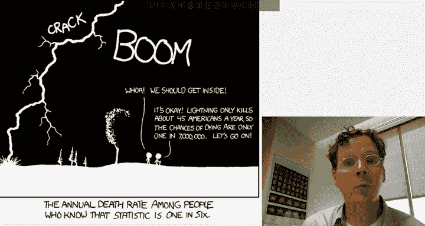
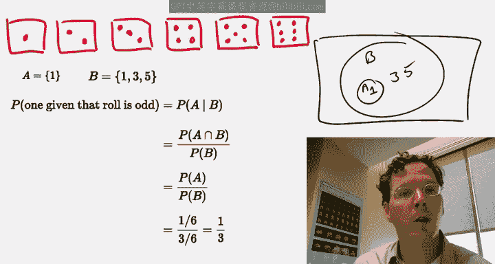

# 约翰霍普金斯大学《数据科学：统计和机器学习｜Data Science： Statistics and Machine Learning》中英字幕 - P5：4_03 01 条件概率.zh_en - GPT中英字幕课程资源 - BV1jsAAeNE3k

Hi and welcome to the conditional probability lecture as part of the statistical inference class in the Coursera Data Science specialization。

So conditioning is wonderfully illustrated by this XKCD comic here in this case。

 two people are standing out in a field right near a tree in the middle of a lightning storm and one of them says we should go inside the other one says。

 well， the chance of getting hit by lightning is only about one in seven million so we're fine and the tagline is that the death rate among people who know the statistic is one in six。

And what the comic is highlighting is that this person hasn't conditioned on what they know。

 right in this case， if you were to condition on the death rate for lightning strikes among people who were standing in fields in lightning storms near tree would be much higher than one in 7 million。

Let's go through another example， so a simple conceptual example。

 so the probability of getting a one when rolling a standard die is assumed to be 1/ sixth。

Suppose you were given the extra information that the die roll was an odd number， hence a 1，3 or 5。

 So someone rolled a die in a way that you couldn't see。 And they told you that a 1，3 or 5 occurred。

 Conitional on this new information。 You would not say the probability of a one is one。

 sixthth any more。 You would now say it's one third， equally likely between the one， the3 or the5。

 And that's what conditional probabilities are giving you。 And， of course， they have a definition。

So let's let B be be an event such that the probability of B is greater than zero。

And this is important because there's no sense in conditioning on an event that can't happen。

Then the conditional probability of an event A， given that B is occurred is written like this。

 the probability of a。Little horizontal line B。 So this is red probability of A。

 given the event that B has occurred is equal to the probability of the intersection divided by the probability of B。

And we haven't talked about independence yet， but in the event that A and B are unrelated or so-called statistically independent。

 which we'll define later， then the probability of A given B works out to just be the probability of A。

 so the new information that B has occurred has given you no information about the probability law governing the event。

So let's just check that conditional probability gives us the answer that we know to be true in the die rollinging case。

So in our case， B was the event 1，3，5。 A was the event 1。

 We want the probability of the event A conditional on the event1，3 or 5 having occurred。

 So in other words， we can say probability of getting a1。

 given that we know that the role is an odd number。 That's the probability of A given B。

 which is the probability of a intersect B over the probability of B。 in this case。

 A happens to lie entirely within B， so the probability of a intersect B is just the probability of a。

So that works out to be 1 sixth and then the probability of being in the denominator works out to be3 sixth。

 right，1， sixth for each of the three mutually exclusive possibilities。

 which works out to be one third， which is what we knew had to be the answer。

