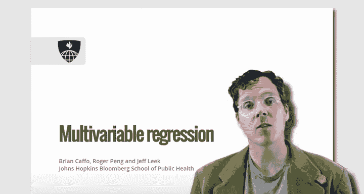
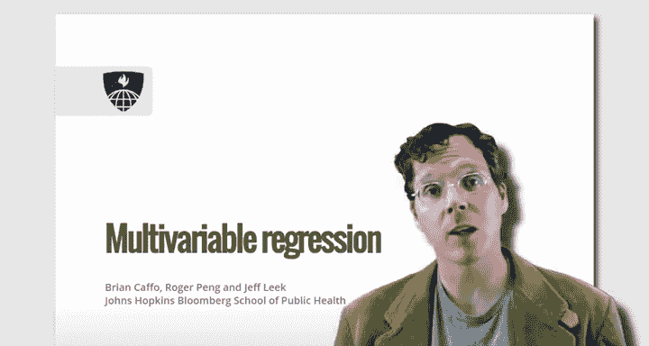
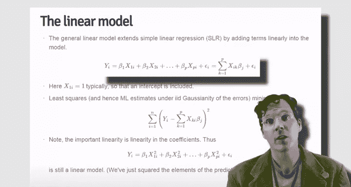
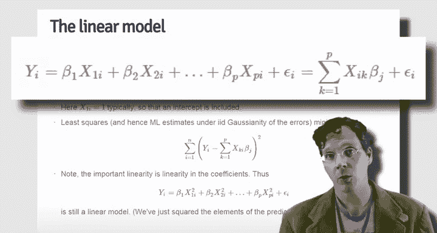
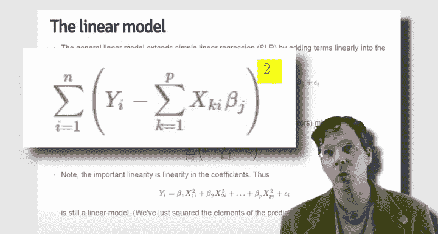

# 约翰霍普金斯大学《数据科学：统计和机器学习｜Data Science： Statistics and Machine Learning》中英字幕 - P60：19_多元回归 第1部分.zh_en - GPT中英字幕课程资源 - BV1jsAAeNE3k

Hi and welcome to the class on multivariable regression as part of our Coursera data science specialization In this lecture。

 we're going to talk about instances where we have lots of potential predictors for an outcome rather than just a single predictor and linear regression。

In any instance where you're using a predictor X to predict a response y。

 and you find a nice relationship。If that predictor hasn't been randomized to the subjects or units。

 whatever you're looking at。Then there's always a concern that there's another variable that you either know about or don't know about that might explain the relationship。

 and let me give you an example。Imagine if you had a friend that downloaded some data where they had all sorts of health information from people and also their dietary information。

And this person said， hey， I found something interesting。

Breathment usage has a significant regression relationship with forced exppiratory volume。

 a measure of lung function， pulmonary function。If you've ever gotten an asthma test。

 they'll measure your FEV。Well。You would be skeptical。 I mean。

 there's very little basis for a biological relationship there。 Brementss are just sugar。

 doesn't seem reasonable that they would impact lung function。But maybe。

But what you'd really be thinking is well， what other variables might be explaining this relationship and you might come up with two hypotheses。

 one is this person dug through lots and lots and lots of variables and just found the one that was significant and it' just a chance association and that's the problem of multiplicity。

Okay， so we'll talk about that and other aspects of this course in the inference course。

 but let's just assume that this person didn't do that。

 they looked only at a couple of variables and the multiplicity concerns weren't so bad。

Then what would you think， well likely you would think， well。

 probably the real problem is smokers tend to use more breathmentss。

And smoking has this long relationship with。Lung function。

 so it's well established that chronic exposure to smoke or even secondhand smoke might have has negative impacts on lung function。

 so it's probably that it probably has nothing to do with the breath mins it's an indirect effect of breath mins through smoking。

 not a direct effect of breath mins on lung function that would be your likely hypothesis。Well。

 how would you establish that there's a breathment effect beyond smoking Well。

 likely what you would ask your friend to do is well。

 consider smokers by themselves and see whether their lung function differs by their breathment usage and consider non-smokerrs by themselves and see whether their lung function differs。

B breath meat usage where you've sort of conditioned on smoking status so that you're comparing like with like。

Well， multivariate regression is sort of an automated way to do that in a linear fashion。

 it makes assumptions， which is fair enough， but it does that sort of in an automated way and we'll explain in this lecture in what way is it trying to sort of hold smoking status constant while looking at breathment usage and how it adjusts and we'll also talk a little bit about its limitations。

 but that's the fundamental idea of what multivariable regression is trying to do。

 it's trying to look at the relationship of a predictor on a response while having at some level accounted for other variables。

So in addition to the use of multivariable regression that I talked about in the previous slide。

I wanted to also talk about another use of multivariable regression for prediction。

 It's actually a very good prediction model。 so as an example。

 several of us engaged around here engaged in the so called Cale competition to predict。

The number of days that a person would be in the hospital in subsequent years。

 given their claims history and number of days they were in the hospital in previous years。

 and this is of major importance to hospitals and insurance companies and healthcare providers。

For a variety of reasons it's one of the main questions in that field so in this competition you want they gave you historic claim data claims data a lot of it actually which had lots and lots of predictors and the number of days that a person was several people of the insured people from the。

From this company， we're in the hospital for three consecutive years or so。

And simple linear regression certainly wouldn't have been too much use here。

 it's good for looking at variables at a time really quickly。

 but if you wanted to get good prediction， you needed to do something more complicated。

So there's multiple parts about this， so one of the main things is model search。

 how do we pick which predictors to include， that's an important component of this。

And the other is to avoid overfittings， we'll learn that as you put enough variables into a multivariable regression model。

 you'll get zero residuals just by virtue of having included。

even random vectors into your regression model， so certainly there's consequences to throwing lots of garbage predictors into a model and certainly there must be consequences to omiing important predictors in a model。

And in the practical machine learning class， which is also part of the specialization。

 you will learn a lot about model selection strategies as they relate to the idea of prediction In this class we're going to focus more on the problems from the previous slide where we want to generate parsimonious models where we're deeply interested in interpreting the coefficients from the linear model。

And so the prediction problems like this one are a little bit more geared toward our practical machine learning class。

 but I just wanted to mention that multivariable regression is。

A pretty good starting point in any prediction， any time where you're developing a prediction algorithm。

 what we found in that competition is that multivariable regression got you very close to the optimal end or the winning entry。

And lots of machine learning and random forest and boosting and all these other things。

Those only got you minor bumps on top of that。And so to get huge drops in prediction error。

 well thought out linear models。Sufficed and then to get really minor increments beyond that。

 you had to throw a lot of computing and to be fair， those were。

knowThose did improve your chances and we moved up a little bit in the leaderboard by adding some of these more complicated things。

 but it was remarkable how far you could get with just well done linear models。

So our linear model looks an awful lot like our simple linear model。

 it's just that we have more variables， so our outcome why in it might be insurance claims or forced expiratory volume is equal to a bunch of coefficients。

 these are the beta terms， they're like the slope terms and simple linear regression。

Just now there's more predictor terms， more x values， so for example。

 one of these might X1 might be breathment usage of binary variable and X2 might be number of pack years or how much the person smoked and in the insurance case。

 X1 might be the number of insurance claims in the previous year and X2 might be whether or not this person had a particular cardiac problem。

 something like that that might lead toward information about hospitalization in the successive year。

So here we just write out the linear model and it just looks like the outcome is equal to a bunch of coefficients times predictors。

Now it's linear because it's linear in the coefficients， I'll reiterate that point in a minute。

I would also add that the first variable is typically just a constant one so that there's an intercept that's included。

 a term that's just beta by itself， beta 0 usually or beta 1。So our least squares。

 I think everyone could probably guess what the least squares is going to do。

 It's just going to look at the differences between the outcome。

And the prediction from the linear model， summation of the predictors times their coefficients。

Because that's not necessarily positive， we're going to square it and we're going to add it up so this difference for every observation equally weights into this loss function that we've created。

 so least square simply wants to minimize this equation and it's a direct extension of the equation we wanted to minimize when we had simple linear regression。

And I would notice that the important linearity is linearity in the coefficients， so for example。

 if I take one of my x's and just square it， meaning every， you know。

 if I have a vector in R that I've just squared every element of that vector and put that in as part of my model。

 then that will still be linear in the coefficient， the coefficient won't be squared。

 it will just be the X term， and so it's the important。

Version of linearity is linearity in the coefficient。 That's what defines a linear model。

