# 约翰霍普金斯大学《数据科学：统计和机器学习｜Data Science： Statistics and Machine Learning》中英字幕 - P61：20_多元回归 第2部分.zh_en - GPT中英字幕课程资源 - BV1jsAAeNE3k

So let's talk about how you actually get the estimates or how R or whatever figures these things out。

 and I'm going to go through a derivation and again if this is not your thing。

 then feel free to skip over this part of the lecture。

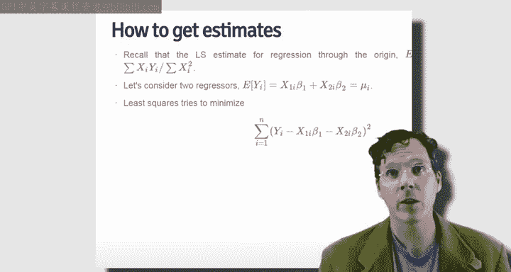

Remember if。You have regression to the origin。 You want a line that's forced to the origin that has no intercepts。

 You have a single predictor X and a single predictor Y， and you want no intercept。

 The slope estimate was just this sum of the product X times y divided by the sum of the x is squared that we talked about that earlier on in the class。

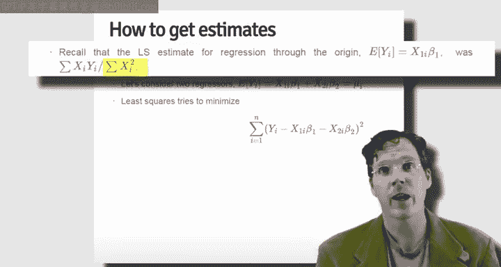

Now let's just consider， let's see if we can use that result to derive the least squares estimate when we have two regressors。

 and then I think if you've got the gist of this， you can see how it would work for three and how it would work for four and so on。

 Okay so derive is maybe a bit of an ambitious term as to what I intend to do here what I guess I mean is develop and I'm going to ask for those that are interested to fill in the details on their own but what I'm going to do is simply develop the estimator a little bit and the reason I'm going to go through this development is I think it illustrates what multivariable regression is doing if you're not too interested in in this sort of development。

 then I think you could reasonably skip over this slide or this set of notes and not worry about it。

 but if you're interested and you kind of want to understand how multivariable regression works I'm going to give a development thats。

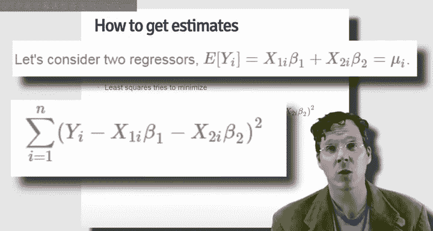

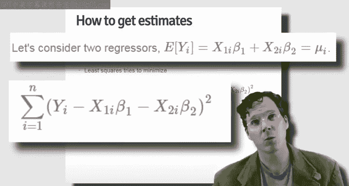

More intuitive than what you would get with something like linear algebra。In addition。

 I have some videos on YouTube where I go through the linear algebra development if you'd like to watch those。

 but I don't think that that's actually necessary to sort of understand what's going on so let's consider two regressors。

We have summation。Of the outcome， Y I minus the first regressor。

 X I1 times beta 1 minus the second regressor， X 2 x2 I times beta 2 squared。

 That's the least squares criteria that we would like to minimize。 So， for example。

 x1 I might just be an intercept。And x2 I。Might be some you know is a covariate of interest。

 blood pressure or something like that，So here's the trick。

Imagine if I were to adjust no beta 1 or fix beta 1。Then I get Y I tilde， let's say。

 is equal to Y I minus x 1 I times beta 1。And then this equation。Becomes。Sumation， Y， I。

 tilde minus X 2 I。Beta 2 squared。Well。Then this is exactly regression through the origin。

With just the single regressor x2 I， but the outcome y tilde I so we know what。

The estimate for beta 2 would have to be， it would have to be summation Yi Tilde x2i over summation x2 I squared。

Now what you can do this and remember why Iilda see， remember its definition over here。

If we were to plug it in， that's a function of beta 1。

So what I could do is now that I know that my beta 2 has to satisfy this equation。

 I can take this and plug it back in here。Right or equivalently back in here。

And then what that yields is an equation for that only involves beta 1 and a regression through the origin for beta 1。

 and if you want to， you can fill in the rest of the details。What it works out to be。

 and this is the interesting part。Is that the regression slope？For beta1。

Is exactly what you would obtain if you took the residual of x2 out of x1 and x2 out of y。

And then just did regression through the origin。 So kind of what multivariable regression is doing is it's the coefficient for x1。

 say beta 1 is the coefficient having removed x2， the other coefficientvariate from both the response and that first predictor X1 Similarlyly。

 the regression coefficient for x2 beta 2 is going to be what you get if you were to remove x1 out of both the response Y and out of the second predictor x2。

 We're going to go over this point a lot。 and I know it's probably confusing to begin with。

 but it explains what multivariable regression is doing。

 a coefficient from a multivariable regression is the coefficient where all the other variables have been their linear effect on that predictor and the response has been removed。

And this is a very useful fact and we'll exploit it in a variety of ways。

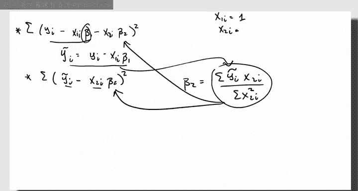

So in case you skipped over that previous slide， I wanted to go through the result because it's important for your understanding of multivariable regression。

So remember， we have two covariates in this case， an x1 and an x2， and of course， one outcome y。

And we're interested in a model that has only the two covariates。

And a regression slope beta 1 for the first one and a regression slope beta 2 for the second。

The result is that the fitted coefficient for beta 1。

Is what you would get with regression through the origin if I had removed the second coefficient x2。

 if I had removed its linear effect from both the response y。

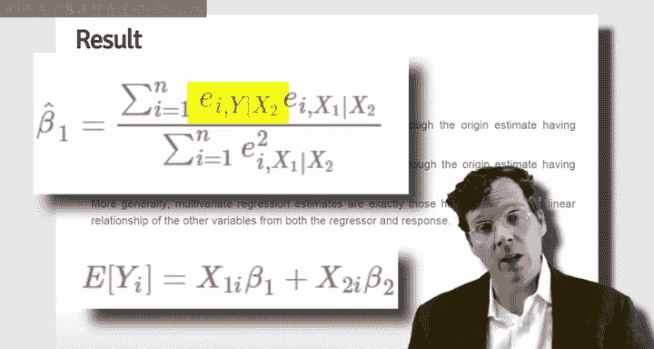

And。The first regression variable， x1。So that's the sense in which multivariable regression。

 the sense in which the coefficient for x1 has been adjusted for the effect of x2 because the linear effect of x2 has been removed from both the response Y and the first predictor x1。

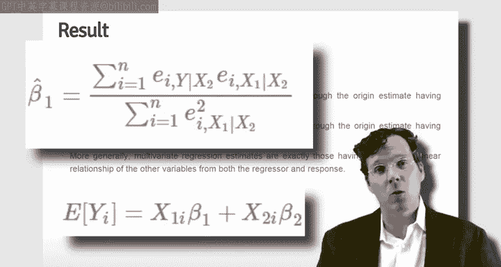

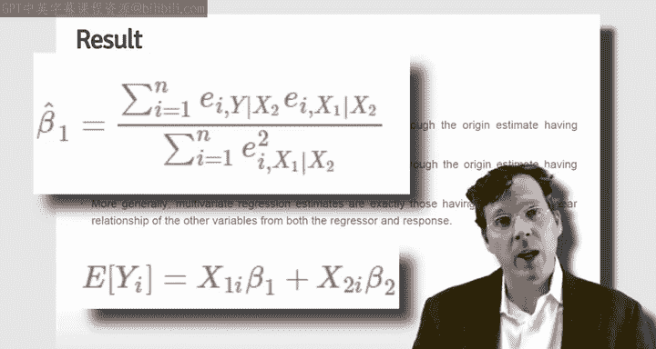

Similarly， the same thing could be said about the coefficient。For x2， beta 2。

Once we get its estimate beta 2 hat， it is what you would get if you were to remove the effect。

 the linear effect of x1 out of both the response y。And the second predictor x2。

And this is why multivariable regression relationships are sort of thought of as having been adjusted for all the other variables。

 we'll go on in the next slide and talk about how this relates to a full multivariable regression where you have lots of predictors。

So let's go through the case that we already know of simple linear regression where one of our covariates is an intercept term and the other one is some covariative interest。

 so here we have Yi equals beta 1 x1 I plus beta 2 x2 I where in this case I'm just going to assume the second one is the intercept term whereas we usually assume that the first one is the intercept term。

 but that of course doesn't matter。

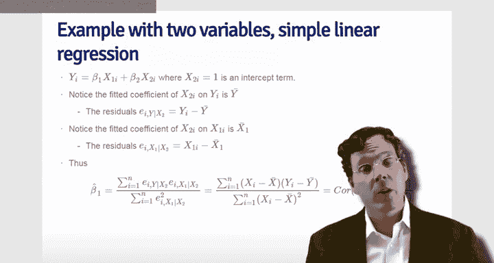

So if we adhere to my rule that the beta 1 co， the estimated beta 1 coefficient is going to be the one that's obtained by getting rid of x2 out of the both y term and the x1 term。

 let's think about what we would get if we fitted x2 on y well x2 is just an intercept so as we know in intercept only regression。

 the fitted value is just y bar and so the residuals are just the observations Y I minus y bar。

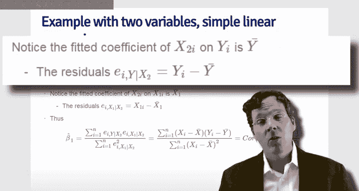

In other words， the centered version of the Y。And then if we were to fit x2 on x1， again。

 x2 is just a constant， if we were to do the fit， the fit of values。

 the coefficient would just be x1 bar， the mean of that covariate。

 and so the residuals would just be x1 I minus x bar， the centered version of that covariate。

 so getting rid of this intercept term from the Y is just centering that variable and getting rid of this intercept term from x1 is just centering that covariate。

And then my fitted regression estimate is given down here is just the product of the centered y times the centered x's added up divided by the sum of the centered x's squared。

 I give you that formula here and you can work with it and it just works out to be the standard regression slope。

 the correlation between the x's and the Y's times the ratio of the standard deviations。

So now let's extend this to more than two variables so that we can start dipping into the idea of multivariable regression。

So hopefully you see where we're going with multivariable regression our least square criteria is now the distance between our observed outcome YI。

And x1 times its' coefficient， all the way up to Xp times its coefficient。

 the square distances between those。If。We only have two regressors and intercept in a slope this amounts to minimizing the sum of the squared vertical distances between the outcome wise and the predictors and the prediction on the line。

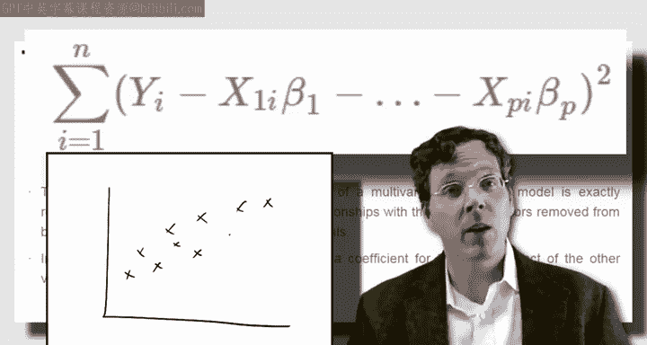

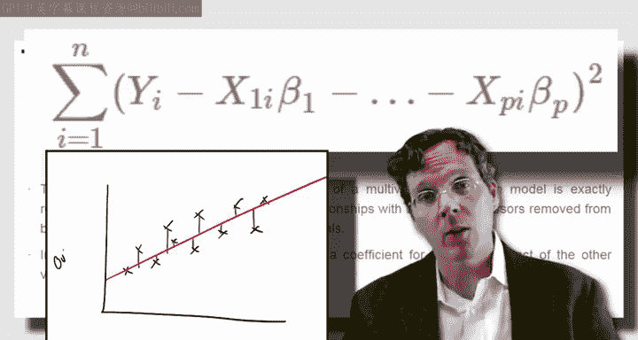

If it's three reors in intercept and two regression variables。Then the fitted line is fitted。

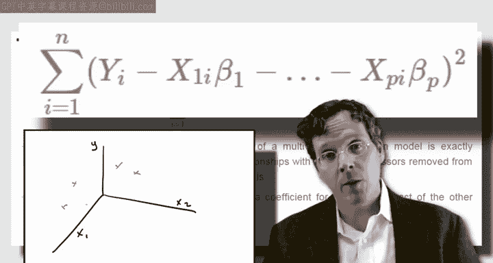

Construct is no longer a line， it's a plane， and the least scores criteria is minimizing the sum of the squared vertical distances between the outcomes and the plane。

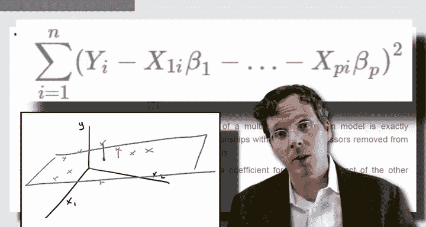

If we take more than two three variables and intercept and then let's say three covariates then we can't visualize it anymore。

 but it's sort of the generalized idea of the distance。

 the vertical distance between the Ys and some generalized version of a plane。

And what we've seen is the idea that multivariable regression adjust for the other variables in a sense by taking residuals。

 so for example， if we take this coefficient in front of x1， beta 1。

 the way in which we interpret beta 1 is that the remaining regression variables。

 x2 up to Xp have been linearly removed from both y and X1 and then the relationship between those residuals investigated by themselves so in a sense y has been adjusted for the remaining variables x1 has been adjusted for the remaining variables and we look at those two together so that beta 1 can be thought of as an adjusted effect。

 having adjusted for the linear relationship with the other variables。

So what we're going to do now is go through some computer experiments。

 just illustrate that this is how LM works， and then in the next lecture we're going to go through some examples in how we interpret the coefficients in a context。

