# 约翰霍普金斯大学《数据科学：统计和机器学习｜Data Science： Statistics and Machine Learning》中英字幕 - P64：23_多元回归示例 第2部分.zh_en - GPT中英字幕课程资源 - BV1jsAAeNE3k

So you might be surprised to find out how flexible linear regression models are。 For example。

 you can fit factor variables as regressors and come up with things like analysis of variance。

 if you've heard of that before as a special case of linear models。

 Let's go through an example where we have one covariate x equald to0 or1。

 and let's see what happens when we put that into a linear regression model。

 So here I have my model Y my outcome is beta not an intercept plus x times beta1 plus an error term where here now my x only takes the value0 for let's say people in a control group and1 for say people who received a treatment。

Then for the people who receive the treatment， the group of people where their x value is 1。

 their mean is beta n plus beta 1。For the people who are in the control group。

 those people where their covariate x is zero， their mean is beta not。If you were to fit this。

 as you would expect， the estimated mean for the treaty group is just the mean of the people who were treated。

 so that beta 1 hat plus beta knot hat works out to just be the mean for the treat group。

 Similarlyly， beta not hat by itself works out to be the mean for the control group。

Beta 1 now is interpreted as the increase or decrease if it's negative。

In the mean response for those that had the x value of one， for those that were treated。

So that's just a nice way to be able to fit factor a two-level factor variable as a linear regression variable。

 and it gives you not only the fitted values tell you about the means for both of the groups。

 but it gives you an inference for comparing the two groups automatically， that T test， by the way。

 the T test for beta1 is exactly identical to two group T test where you assume a common variance if you happen to have taken the inference class。

We can extend this to more than two levels， for example， imagine if you had a threele variable。

 for example you have some outcome， but you want to compare it to US political party affiliation in this case。

 let's see you were only considering those whether that were Democrats。

 Republicans or registered independents。Well， you can do that by having a variable x1 that's one for Republicans and0 for otherwise。

 a variable x2 that's one for Democrats and0 for otherwise。

 and then I'll tell you here in a minute why we omit the x3 that would be one for independence and zero otherwise that one would happen to be redundant okay so if a person is a Republican then their mean is going to be beta n plus this first x term is going to be1。

 so plus beta 1 and then the second x term is going to be0。

 and so their mean will be beta n plus beta1。If the person is a Democrat。

 then it's going to be beta not。Then x1 will be zero， so that terminal will dropout。

 then x2 will be 1 and so it'll be plus beta 2， so for the Democrat their mean from the regression model will be beta n plus beta 2 and then if they're an independent。

Both these x terms will be zero and it'll just be beta not and that's why we can't include a third term right because if we know that your' Republican in the way that we've set up the variable。

 if we know that you're not Republican and not a Democrat then you must be an independent in our data set the way we've set things up and so it would be redundant to have a third variable in there wouldn't have any new information here we have three means Republican Democrat independent in three parameters。

 beta not beta 1 and beta 2， if we were to add an extra parameter。

 it would kind of break the model and I'll show you in R what happens when you do that in a minute。

So if we look at our means here， if we compare beta not the mean for the independence versus the mean for the Republicans。

 if we subtract those two， we get beta 1， so beta 1 compares Republicans to independences。

And beta 2 similarly compares Democrats to independents。Then of course。

 beta 1 minus beta 2 compares Democrats to Republicans。

So what happens is by omitting the regression variable for the independence。

 then the intercept became。The value for the independence and all of the other coefficients have become interpreted relative to independence。

 the beta1 effect， the one in front of the Republican covariate is now interpreted as the change between Republicans in independents。

 the beta 2， the one in front of the。Democrat covaria is now interpreted as the change between Democrats and independents and this was all a consequence of having omitted the one regressor for independence if we had included the regressor for independence and excluded the one for Republicans。

 then the intercept would be for Republicans and the coefficient in front of the demomocrat one would be demo versus Republicans。

 the coefficient in front of the independent one would be independents versus Republicans。

 and we'll go through some more examples。Just to illustrate how this works and R kind of does this on purpose or R kind of does this automatically for you if you include it as a factor value it picks one of the levels to be the reference level and so let's go through some examples hopefully that'll shore this up but the main point I'd like to get across is。

Whenever you're dealing with factor variables and linear models。

 what you said as your reference level has a big effect these coefficients are interpreted quite differently depending on how you set them up and what you set up as your reference level。

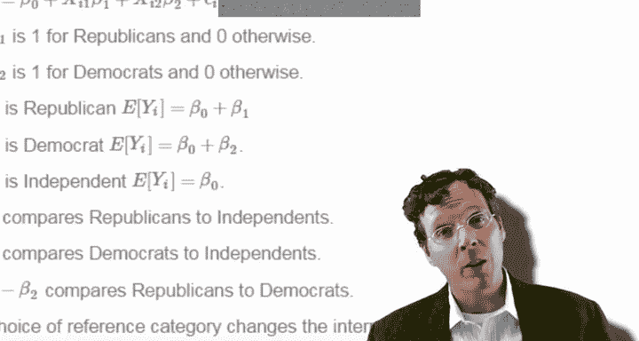

Okay， so let's go through an example in R where we look at a factor variable and see how R is treating it。

So， I want it。Make sure I require the data sets package， we've already loed that in in this lecture。

 but let's just do it again just to remind ourselves， and then I have this data insect spray。

And then I'm requiring the stats package， I don't know if that's technically necessary for what I'm doing。

 but if you do help insect sprays。

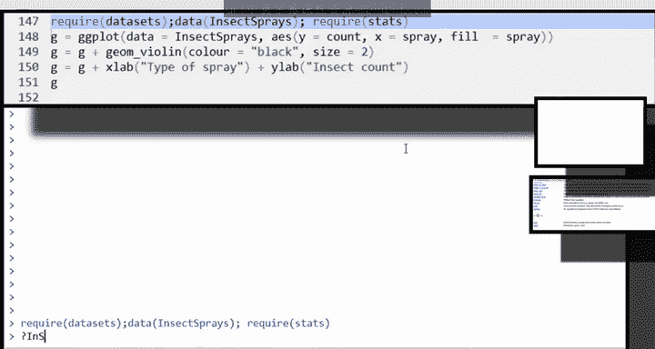

Sps。Here， it gives you the help file for this data set。

And the outcome is a count it a numeric insect count。

 so presumably number left after applying the spray and the spray factor is the type of spray。Okay。

 and then it gives some examples of working with this data。

 but you know we don't need that because we're going to use it， we're going to build our own example。

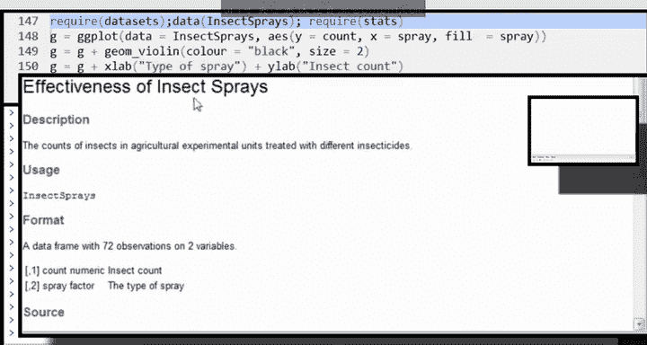

So let's first， let's plot some of the data。So I want to do a G P。And I've already loaded GGpl2。

 but just to remind you， in case you're restarting your R session from earlier。

 you want to make sure that you require GG plot2 there it's loaded。And then I have my G plot。

And then my data is insect sprays， and then for my aesthetic， my Y is the count。

 the number of insects， my X is the spray theres they don't give you too much information about the sprays。

 but there's a couple of different sprays that they used and then I want to fill the fill the objects I'm creating with the factor variable spray so there I've created myggG plot and then I want to do a violin plot a violin plot is kind of like a histogram but sort of tilted on its side and then they repeat it on both sides so it looks like a。

嗯。It looks a little like a violin， well it looks like a violin if your data cooperates。

 otherwise it looks like a blob。Okay there's our violin plot and then I want to set my labels and then if you want to actually see the plot you got to do bring it up Okay。

 so here's my violin plot so you see there's sprays eight labeled A B，C， D。

 E and F okay and you can see the insect counts for the so they applied I presume they applied the spray to numerous batches of insects and they it's unfortunate they're not count they're not telling me whether or not the count is the count of the number of alive or the number dead but。

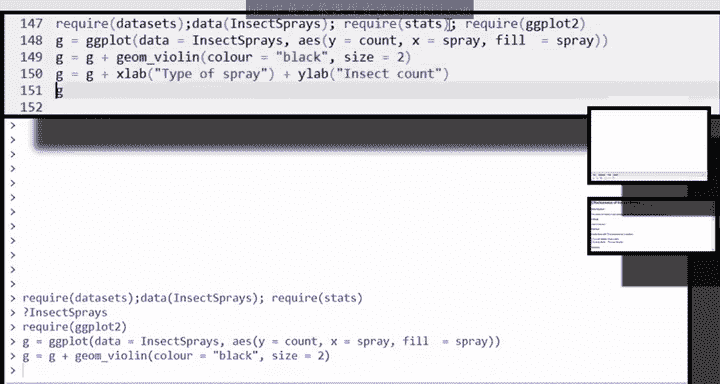

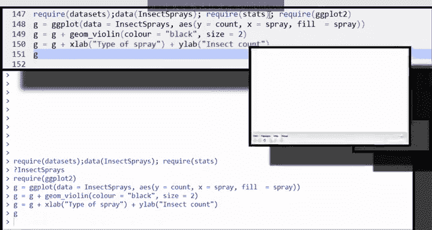

So we don't know if this is a better spray， a better， you know。

 let's say it's a mosquito spray or something like that because no one likes mosquitoes。

We don't know if this is a better spray or a worse spray。 so。

 but let's talk about how we can test the difference between different factor levels in this case using linear models。

 And then at the end， I'll talk about some shortcomings of the approach that I'm proposing here。

 But here's a violin plot。 And let me just to head。

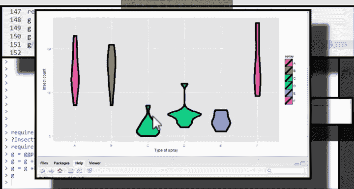

Insect sprays。To just show you the beginning the data， what it looks like。

 to see we have a bunch of counts and then the spray label is a very simple data set。

And so let's look at what happens when we include insect spray as a linear model and y as an outcome。

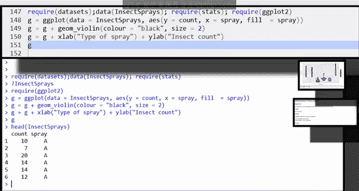

So let's fit our model。 And now what we're fitting is our outcome is the count。

 the number of insects。 our predictor is the spray， which spray was used as a factor variable。

 It's already a factor variable。 and then I give it the data and then here I just want the summary of the output from LN。

 again， normally you want to assign your LM to a variable so you can keep it for later。

 and then I just want to for。To keep the printing a little bit self contained。

 I'm grabbing the coefficient table。

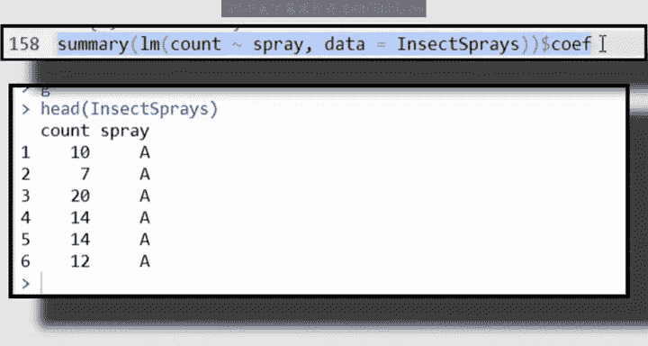

And so there you see the intercept， spray B， spray C， spray D， spray E， and spray F。

 and spray A is conspicuously missing。And the idea is that everything here is now in comparison with spray A。

So this 0。833。Is the change in the mean between spray B and spray A。In this case， 14。5。

 the intercept is the mean for spray A。And if you look over here at our plot， that seems about right。

 Look at our violin plot 14。5 seems about right for spray A and spray B。

It seems reasonable that it would be off by。 it would be changed just by a little bit from spray A。

 Now spray C looks like it has a much lower。Count， okay， and look， its coefficient is-12。Okay。

And that that looks like about right。 So this this one's at 14。

5 and you know somewhere around2 seems about right for this one， spray C。

 And so that's exactly what this coefficient is saying。

 This negative 12 here is the difference between spray C minus spray A。Now， if we wanted to compare。

 for example， spray B and spray C， we would have to subtract this 0。833 and this。Negative 12。

 now we wouldn't have a standard error for that comparison immediately。However。

 that would give us the estimate。If I were to take the average count for the for those with spray A。

 I would get 14。5。If I were to take the average count for spray B， I would get 14。5 plus 8。833。

So I'd like now to show you how I can hard code the same model and not rely on R to actually do the。

To pick the reference level， so remember what I did last time as I did count was my outcome and my factor variable spray was my predictor。

And what R does is it picks the。Spray level that's the lowest。alpha numerically。

 so in this case spray level A to set as the reference level so let me show how I can hardcode that myself manually。

 so here count as my outcome and then I'm going to create a variable using the I function which in LM actually performs the operation inside the regression inside the model statement So I here I just want to look at the instances where the spray is equal to B。

And then I multiply that times 1 to change it from Booley into numeric。

And then here's a variable that's one when spray is C and0 otherwise。

 and here's a variable that's one when the spray is D and0 otherwise， and here's one for E。

 and here's one for F。 So I've included all of them except A So I've forced a to be my reference level and I'm going to run this model。

 and it should give me the same result as what R did It's just now I've shown you exactly how R is creating the regression variables。

 So let me just remind ourselves。

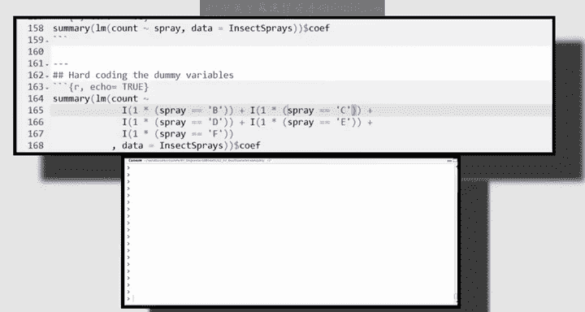

What R gives us when we run and let it handle the factor variable by itself。

 and then let me do the same thing where I've created my own factor variables。

 And then you can see 14。5， 14。5。833。833， you can see that it's identical。

 So this is what R is doing behind the scenes。 And let's keep exploring this because this is kind of an important point。

 If you mess this up with factor variables， you get very incorrect conclusions。

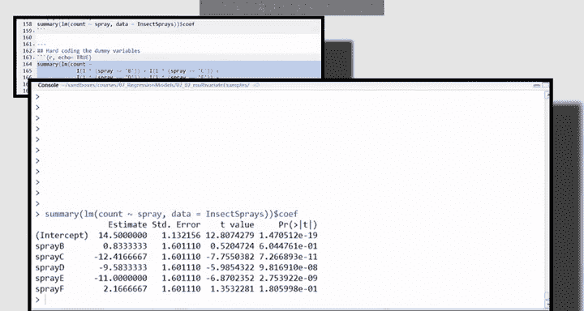

Now， let me show you what happens if I do include spray A here。So。

I've done the same model I did before where I include all the variables。

 But now I'm also including an extra variable for spray A。 And let me just do the L M part。

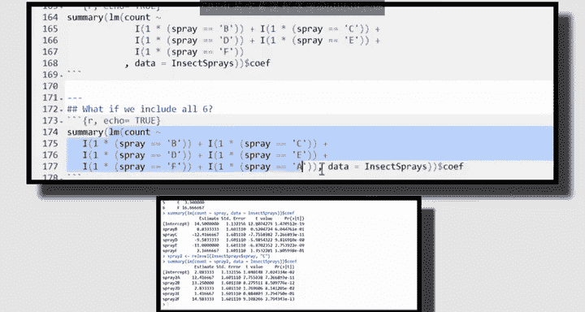

And notice it gives an NA in front of the spray A coefficient。

And the reason for that is because it's redundant， we have six means。Rightrite for six sprays。

 and we have seven parameters in intercept。 And then now I've tried to put in six regression parameters。

I have six means to fit seven parameters that can't do that， so it's going to drop one of them。Now。

 what if I do want my coefficients instead of being interpreted as levels referenced to a control level。

 What if I want my coefficients to be the mean for each of the groups， Well you can do that。

 but you have to remove the intercept。 So watch what happens when I fit count as my outcome and spray as my predictor。

 but I remove the intercept。Then notice what happens。

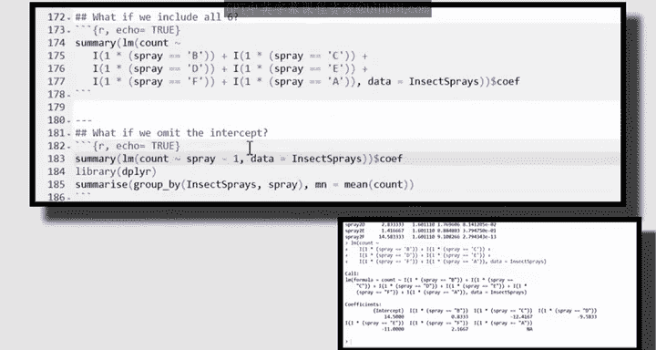

Is that now I get a different set of coefficients， one for each spray level。 So it includes A， B，C。

 D， E， and F。 It hasn't dropped any levels， and it can do that now because it has six parameters。

And6 means to work with。 And these are exactly equal to the means for each spray in the data。

 So if I were to just go ahead and calculate the means for each spray， right。

 It works out to be the same numbers，14。5，15。32。08 in both and so on。 Now。

 I want to emphasize this model is no different than my model that included in intercept。

 Why don't I go back to my model with my intercept， just to illustrate this。

So now it's just that the coefficients have a different interpretation。 Now。

 the intercept from the model， when I fit count as spray， but included the intercept。

 My intercept now is interpreted 14。5 as the mean for spray A。

 And you can see that it's exactly the empirical mean for spray A when I calculate the mean it works out that way。

And then Sp B， we talked about earlier was the comparison between the reference level Sp A and the reference and Sp B。

Okay， so if I add these together 14。5 and 0。833， I should get the mean for spray B。 Okay。

 and that's what you see，14。5 plus 。833。 That gives me 15。33 and so on。 So if I add 14。5 and-12。

 I'm going to get 2。08。 If I add 14。5 and negative 9， I get 4。9 and so on。

 So this model where I've included in intercept has all the same information as the model where I omitted the intercept。

The only difference is how the coefficients are interpreted in the model with the intercept now。

 the intercept is interpreted as the spray A mean， and all the coefficients are interpreted as relative to spray A differences from spray A。

And then if I were to fit it without the intercept， and I get the mean for each spray。

 And if I want differences， then I have to subtract the coefficients。

And you want to do the you usually want one of them to be a reference level because then you can do test。

 So now my P values are testing whether or not for the T test is whether or not a is different from B。

 and A is different from C， and A is different from D and so on。

 whereas the P values from this test are just testing whether or not those means are different from0 which is a very different test。

 did spray A kill any insects is what this is testing。

 where in this one the spray B row is testing whether spray A is different from spray B。

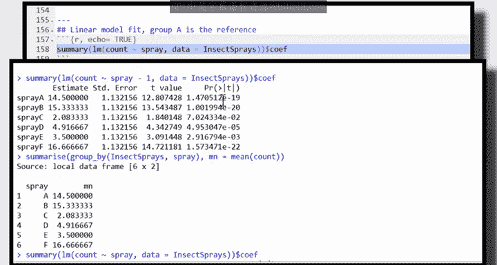

So what I'm trying to illustrate is that how you play around with factor variables in LM is very important in terms of how you interpret it。

 It's not just a conceptual or theoretical。Thing to worry about。

 it's a very practical thing to worry about what your intercept means changes dramatically depending on what your reference level is or whether or not you include an intercept。

Let me do one last thing。Where now I show you how you can releve in this case。

 spray A was my reference level。 You can very easily relevel it。

 So say spray C is your reference level。 So now here I've just used the relevel command。

 So now insect spray， the reference level is spray C。

 But now I've just created a new variable where that's spray 2。

 And now I'm going to do my linear model where my outcome is my count and spray 2 is my predictor now instead of spray。

 and this is the one that has C is the reference level。

 And then R knows not to do the one that has the lowest alphanumeric letter。

 but instead has the reference level that I've set。 And there when I do it。

 notice spray A is present， spray C is gone because now it's the reference level。

 my intercept is interpreted as the mean for spray C。 And you can see 2。0833。

 That's exactly the mean for group C。

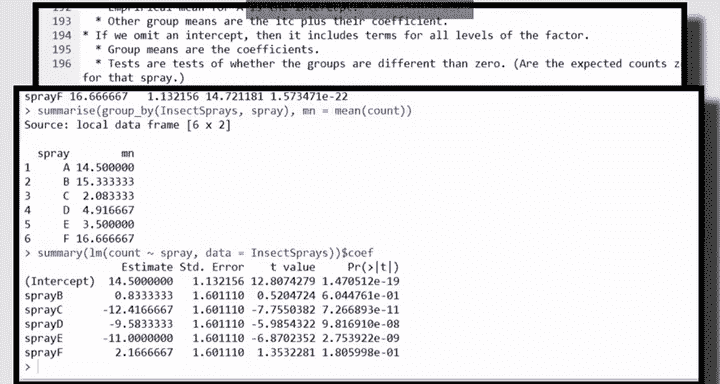

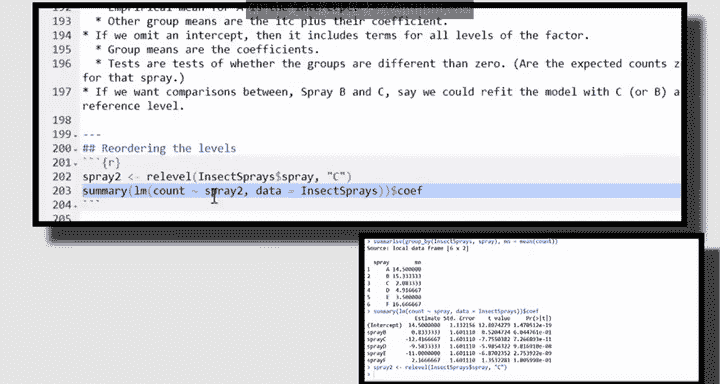

And then this coefficient 12。41 here is interpreted as the comparison of spray A to spray C。 This 13。

25 is the comparison of spray B to spray C。 And so if I wanted to test spray A versus spray C。

 I could look at this P value if I wanted to test spray B versus spray C。

 I would look at this P value。So let me just recap since this is a very important point。

If we include a factor level factor variable like spray in R。

Then R automatically includes an intercept and treats the first level of the factor as the reference level。

 So the intercept now is interpreted as the mean for that reference level。 In our example。

 the intercept is interpreted as the mean for spray A。Then each spray other effects。

 so spray B effects， spray C effects， spray D effects， spray E effect， and so on。

Is the comparison of that spray level versus the reference level， which is A。

If we want the means for those， it has to be the intercept plus their specific coefficient。

 so the intercept plus the spray B coefficient will be the mean for spray B。All of the tests then。

The test for the intercept will be a test for whether or not the mean for spray A is0。

 the test for all the other levels， the spray B， spray C。

 and other coefficients will be a test for the comparison versus spray A。If on the other hand。

 we omit an intercept， then we're going to get to mean for each level， including spray A。😡。

And then all the tasks would be for whether or not the spray A coefficient is different from zero。

 the one for B would be whether or not the spray B coefficient was zero and so on。

Which may or may not be relevant， usually you want the comparisons。

 and that's why R's default is to pick one of the levels and treat it as the reference level。

 However， if you want a different one， if you want B to be the reference level。

 you just need to use the relevel command， Or if you want to get involved a little bit more in linear models。

 then you need to go into how you calculate standard errors in more general settings。

 But that's a little bit more advanced for right now， if you want to do the comparison。

 say between B and C， then my current suggestion is just to relevel so that now B is the reference level and the coefficient for C will now be comparing spray B and spray C。

I want to give some caveats about this data analysis that I presented it's not exactly a complete data analysis I think the modeling the data as if they were normally distributed is perhaps problematic。

 their count data so they're bounded from below by zero I think it'd probably be a little bit more natural to model this data as if it was Poson or at least over dispersed Poson or something like that which we're going to cover in our GLM version of the class。

In addition， the variance is clearly not constant， so what I mean by the variance is I mean the variance around the mean。

 and it's clearly not constant as our regression models would assume。

So this is a potential problem and so our means are probably correct。

 our estimates are probably correct， but our inferences are surely not。

 so that that creates an issue that needs to be handled at some level and later on in the class we'll talk about some things for handling this and some of the rest you may have to take some further statistical inference classes to deal with some of the more advanced topics like when the variances are unequal。

 they call that hetero scasticity。