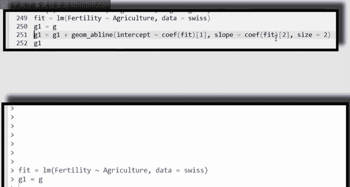
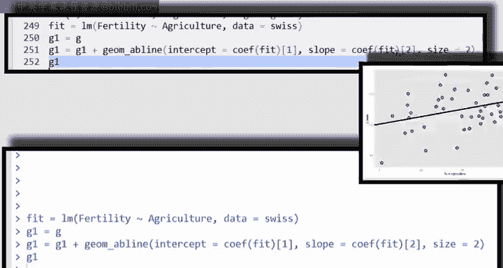
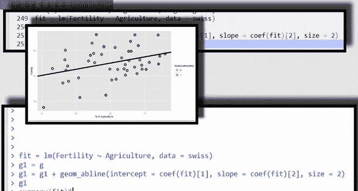
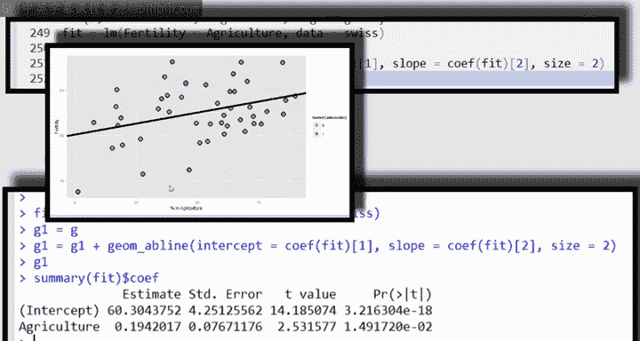
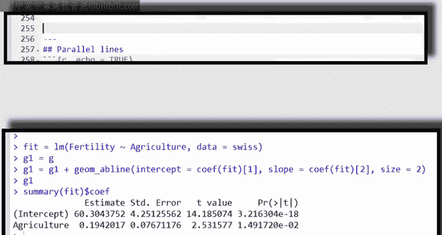
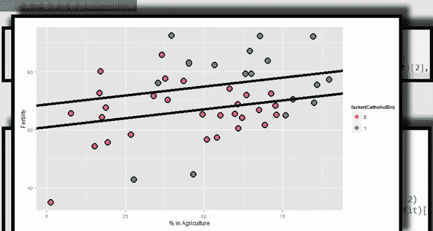
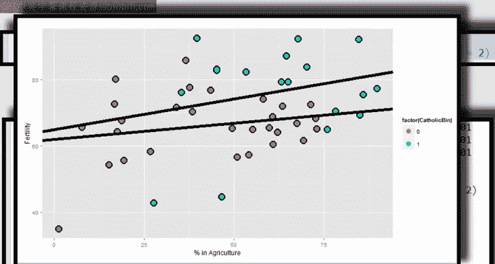
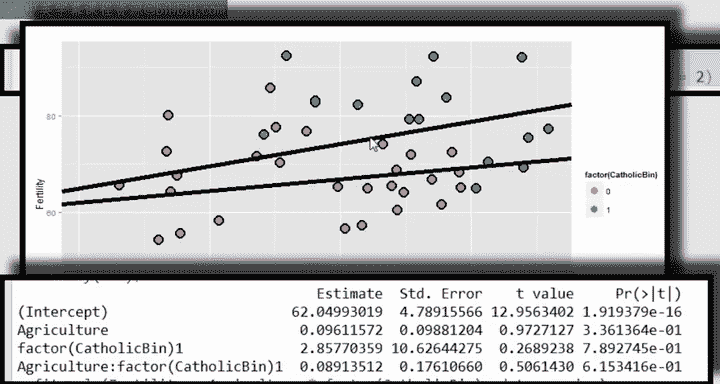
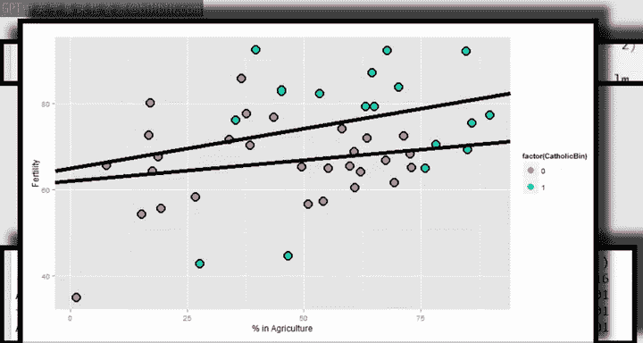

# 约翰霍普金斯大学《数据科学：统计和机器学习｜Data Science： Statistics and Machine Learning》中英字幕 - P66：25_多元回归示例 第4部分.zh_en - GPT中英字幕课程资源 - BV1jsAAeNE3k

Okay， so let's actually run some of these fits。 let's first just fit the model that doesn't include religion at all Okay。

 so it's just fertility。Is a linear regression with agriculture。 Now。

 I've already created my plot and labeled a G， but I want to save that plot so I can keep adding different things to it。

 so I'm going to assign that to G1。And then I'm going to add to it a line that grabs the slope。

 the intercept and the slope from my new fitted。

For my new fit， and then let me plot it， Okay， so there's my fitted line and let me show you my coefficient summaries。

So I'm going to do summary of my fitted linear regression and I'm just going to grab the coefficient table so here's my intercept that it hits around 60 you can see that right there and then there's my agriculture slope which is about 0。

19 Okay so this just disregards the color of the dots Let's do one now that fits two parallel lines。

Okay， so now here my fit， my linear model fit is fertility as agriculture。 but now my。Maai。

Catholic variable， my percent of the province that's Catholic that I've binized。

 I'm included as a factor variable because this variable Catholic bin is 0 or 1。

 Remember back from the dummy variables part of the lecture。

 I don't actually have to have this factor statement because coding a variable is 0 versus 1 treats it as a factor。

 However， I like to always call things factor variables。

 And the reason for this is sometimes I have a variable that 0，1，2， for example。

 for a three level variable。And if I don't then call that a factor。

 R is going to treat that as a continuous regressor。It's going to say two is twice one。

 even if two is just my numeric coat for representing red hair color and one is for for brown hair color or something like that where two really has nothing to do with being twice one。

In that case。So I like to get in the habit of calling factor variables always factor in my models just so I don't make that mistake。

 Now， when you print out your summary， you would hopefully notice that there's only one coefficient。

 And so you would hopefully notice that you've made that mistake。

 but this is an easy way to avoid it。 I don't maybe always live up to this standard of。

Treating my factor variables always as with the factor statement， but I try。Okay。

 so there I fit it and let's first look at the coefficients。So here's the intercept。

Here's the slope and the slope is the same regardless of the religion of the province。

And then here's the change in the intercept for those that are Catholic for those provinces that are Catholic。

 So let's go ahead and plot these。 And what I'm going to do is Im going to create my I'm going to copy my old plot。

 that's just the scatter plot， and then I'm going to add two lines to it。

 One that is the line for Protestants， which is just the intercept plus this agriculture slope。

 And then I'm going to add one， that is the line for the those provinces that are majority Catholic。

 So my intercept changes by adding the first coefficient。

 which is the intercept and the third coefficient， which is this 7。88， But my slope stays the same。

 It's just the same slope。So let me put that in and then now let me plot that。

 and there you see what that looks like， it's two fitted lines where now I've forced the fits to have different intercepts。

 but they have the same slope。Now let's do some lines where they have different intercepts and different slopes depending on。

The percent of the province that is Catholic。

So this one now I put in asterisk and I'll describe in a second what this asterisk does。So， I。

Did the fit， now I'm going to do summary， fit， star co。

 and maybe it's not the best practice to keep naming your model fits the same exact variable and overwriting it。

 you probably want to save them。So now look what happens。I have an intercept。I have that my slope。

 Okay， so this intercept is the intercept for。Mostly Protestant provinces。

 the slope is the slope for mostly Protestant provinces。This 2。86。Plus 62。

 that's going to be the intercept。For the mostly Catholic provinces and this slope plus this slope。0。

1 basically plus 0。9， that's going to be the slope for the mostly Catholic provinces because remember our coefficients added。

What happens when you add an asterisk in between two variables in R is it automatically fits the interaction。

 so here's my interaction term。😡，Here's my interaction term plus all the main effects。

 so here's the main effect for Catholic， here's the main effect for agriculture in the intercept。

 I'll show you in a minute how you can avoid doing that in R though you want to be very careful with doing that in general you want to include the main effects if you include the interaction。

Okay， so now let's plot those two lines。So here I'm going to。Assign my。

Ploot to be this original scatter plot that I keep overwriting。

 And then I'm going to add two lines to it。 The first is the line for the mostly Protestant provinces。

 They my first coefficient is the intercept。 and my second coefficient is the slope。 Now。

 I'm going to add a line。 That is the。Line for the mostly Catholic provinces here。

Here is my intercept， which is the first coefficient， right， The first coefficient。

62 here plus the third coefficient， right the one， this one that's the。Catholic main effect。Okay。

 and then the slope is going to be the second coefficient， right， this one right here， 0。96。Plus。

 the fourth coefficient， the interaction term that is agriculture， the slope and the。

Province being mostly Catholic。And let me plot it there you see it。

And so now what we have is two different intercepts and two different slopes。 You can see， of course。

 that these lines are not parallel so this。And you can see， so you might not。

Know which line is which， but we can guess from the coefficients， right？

，All the。All the interaction terms， all the Catholic terms were positive。

 So this line with the slightly higher intercept is going to be the Catholic line and this line for the slightly lower intercept is going to be the mostly Protestant So the salmon colored dots。

 Okay now I think you can probably see that， well， for the blue dots。

 it's not clear what these two blue dots over here how they're impacting the fit。

 So we might want to investigate that。

But that's for tomorrow for the next lecture， where we talk about residuals and influence diagnostics and that sort of thing the last thing I want to do。

