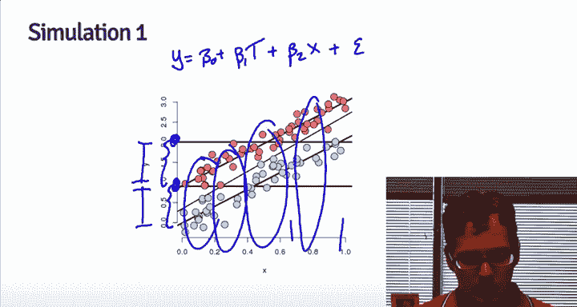
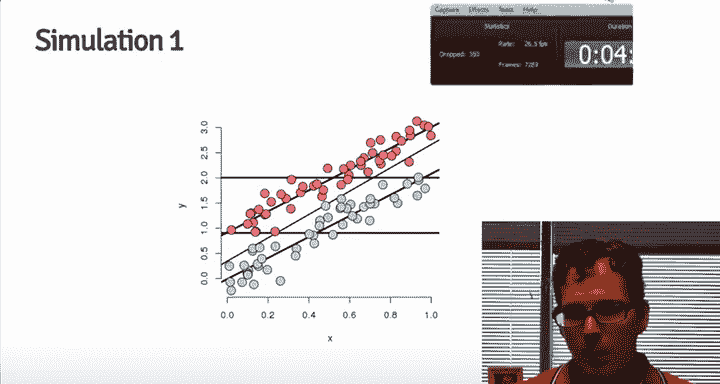
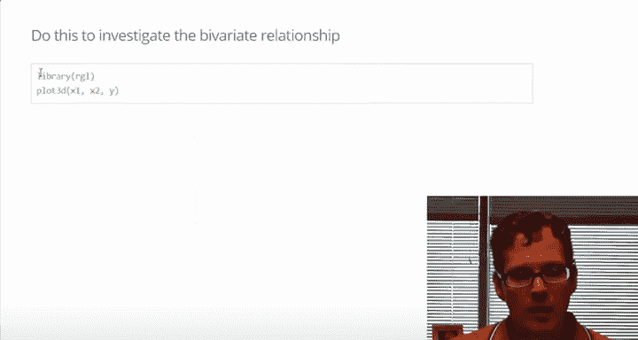
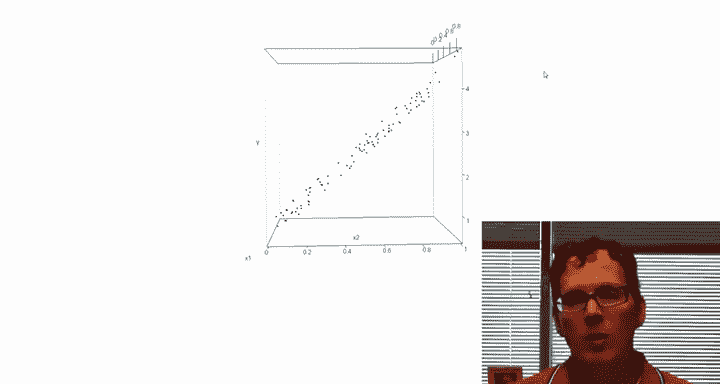
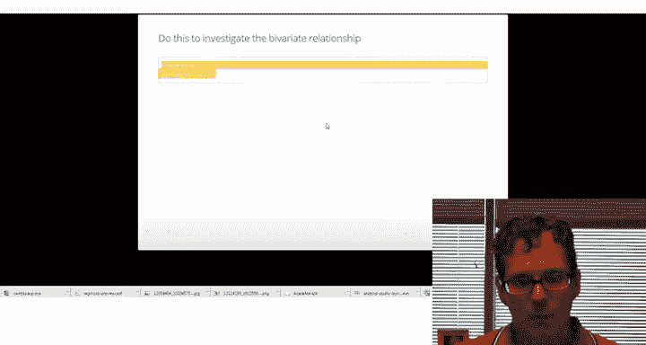

# 约翰霍普金斯大学《数据科学：统计和机器学习｜Data Science： Statistics and Machine Learning》中英字幕 - P67：26_调整示例.zh_en - GPT中英字幕课程资源 - BV1jsAAeNE3k

Hi and welcome to the lesson on multivariable regression in this lecture we're going to go over some examples of how adjusting for one variable can impact the apparent relationship we see。

Of another variable on an outcome。Okay， and I think the easiest way to see this is to look at a two group variable。

 take， for example， a treatment。Versus a control or something you might see in an AB test when we're adjusting for a continuous variable。

So let's just get started， we're going to go through a lot of examples and I think you'll be surprised at how different things can be when you adjust for another variable。

In this slide I give you an example set of code that I'm using to simulate the data and create the plots from this point forward I won't show the code anymore。

 but if you'd like to go through it it's all in the R markdown document。Here's the first simulation。

 in this case， it's a pretty straightforward one。Get my pen。Okay， so in this case。

The horizontal lines show。Show the marginal effect of group status。 In this case。

 there's one group colored red and another group colored blue。

 This shows the marginal effect disregarding X。 So if， for example。

 Y was blood pressure or something， then we would think that。If we hadn't factored in X。

This would be the mean for the group that say received the treatment and this would be the mean for the group that got the control。

Now there's a pretty clear linear relationship between the outcome and the regressor。

So what we could do is fit a model that looks like y equal to beta n plus beta 1 times our treatment indicator。

 01 for our treatment indicator plus beta 2 times x plus epsilon， this would fit two parallel lines。

 beta 1 would represent the change in the intercepts between the groups。

 Well beta 2 would be the common slope that exist。Across the two groups。If we were to do that。

 then beta 1 here， the change in the intercept between the two groups would be right there。

 it would be that distance and if you notice in this case， the marginal effect。

 the fact that we have if we disregard Xs，And the effect that we have if we incorporate X in a linear model and look at the change in the intercepts are about the same。

Another thing I would note in this example is that there's a lot of direct evidence to compare our groups for any given value of x。

 there's you know if we were to bin X say in these in a bin like this。

 then we would have a lot of red and blue circles to do a direct comparison of the treatment for kind of a fairly isolated level of X。

 so this would be a good experiment， this would be something that might happen。

 if we were to randomize treatment and then the collection of x's for the red group would look like the collection of X's for the Y group。

Okay。This is just reiterating some of those points。Now， let's try a setting。

Where it's going to make a big difference。So again。

 my horizontal lines here show the marginal difference between my red group。

 my red treated group and my blue control group。However。

 if we were to fit that model and look at the change in the intercepts。

 we'd see this tiny difference down here， this minimal difference， okay？

And so this is a case where we would go from a massive treatment effect。

To nothing when we accounted for x。Another thing I would note about this particular data set。

If we knew that the X value was one or smaller， we know that you're a blue group in the blue group。

 and if we know that you're about 1。5 or higher， we know that you are in the red Treat group。

 so knowledge of X at some level pretty much gives us perfect knowledge of which treatment you received。

This is an important concept and it goes to something the so called propensity score。

 but it basically goes to show that this is the exact opposite of what would happen。

If we had randomized， right， in this case， if we randomized， it would be very hard to。

To pick what treatment you had based on your X level because the X levels were all jumbled up some of the X levels got some of the high X levels went to the treated。

 some of the high X levels went through the control and so so on In this case。

 it would be an example where we。Clearly didn't randomize and which model here is the right one to consider is not really up for discussion for today。

 What we're just talking about today is about how the inclusion of acts can change the estimate now which is the right model to consider that is a different thing。

 For example， this might occur， an example of when this might occur is lets let's say treatment is whether or not you're taking some blood pressure medication。

OkayAnd why your outcome is your blood pressure， but suppose that the X variable was。

Clesterol or something highly related to whether or not you would have gotten prescribed this medication to begin with。

Okay， then you could see that adjusting for X is really just adjusting for the same sort of thing that would lead you to have treatment。

 So again， this is what makes observational data analysis very hard as opposed to instances where what you're interested in has been randomized okay so this is an example just to reiterate this point this is an example where we had a strong marginal effect when we disregarded X and a very subtle or a non-existent effect when we accounted for X。

Let's try some different scenarios。Again， this slide just reiterates these points。Oh。

 and I just to go back to this latter point， we have no instances of overlap in the red and blue groups to have direct evidence of what's going on。

For a specific value of x， there's no value of x we can hold constant and compare red versus blue directly。

 so this is a bad setting where we're relying very heavily on the model。To compare the groups。

Here's an instance where there is some overlap right here。

There is some direct evidence right there comparing the two groups。But。

It also is kind of a hard case because if you look。Here's the marginal mean for the red group。

 here's the marginal mean for the blue group。There's a probably significant effect here that says the red is higher than the blue。

 however we fit our model and look at the change in the intercepts。

 What we see is that the blue is higher than the red。

 so our adjust estimate is significant and the exact opposite。Of our unadjusted estimate。Okay。

 and again， during this lecture we're not going to talk about which one's the right one。

 we're just going to talk about how this can obviously occur here is a picture where you can see exactly what's happening。

This phenomenon here is often called Simpson's paradox。

And the idea is you look at a variable as it relates to an outcome。

 and that effect reverses itself as the inclusion of another variable。

 that's all often called Simpus paradox， which basically just says。

Things can change to the exact opposite when you perform adjustment。

 which is actually looking at this picture， not that surprising， it's not a paradox whatsoever。

All right， let's try some other examples again， the next slide is just going to reiterate these points。

In this example。There's basically no marginal effect。 However。

 there's a huge effect when we adjust for x。 So this is a case where we went from。

 we saw a case where we went from significant effect to when we adjusted for X。

 We got a non significant effect。 Well， here's an instance where we had a。

Non significantant effect if we ignore x and then a significant effect when we include x。

Okay so there's no simple rule that says this is always what will happen with adjustment。

 pretty much any permutation of going from significant to non significant， staying both significant。

 staying non significant， flipping signs， all of them can occur。

Here's the final example like this I'd like to show。

 And this just considers an instance where we would surely get this wrong if we were to assume the slopes were。

Common across the two groups， obviously the slopes are different and we know how to fit a model like this if we were to fit a model that said y equal to beta n plus beta1 times our treatment effect plus beta 2 times x plus beta 3 treatment times X plus epsilon that would fit two lines with different intercepts in different slopes and we could get a fit like this to this data set。

Another important thing to ascertain for this data is there is no such thing as a treatment effect。

 If you look right here， the red and the blue， there's no evidence of a treatment effect。

 If you look right here， there's a big evidence that blue has a higher outcome than red and if you look over here。

 there's a lot of evidence that red has a higher outcome than blue and。

The reason the interaction is the reason that this main treatment effect doesn't have a lot of meaning。

The end result is that this coefficient， the coefficient in front of the treated effects。

 which are just spits out， of course。Is not interpreted as a treatment effect by itself。

 You can interpret that number as a treatment effect。 As we can see from this picture。

 there is no such thing as a treatment effect for this data。

 The treatment effect depends on what level of X you're at。 So you can't just read the。

Term from the regression output associated with a treatment and act like it's a treatment effect if in fact you have an interaction term in your model。

 so that's an important point， but this also just goes to show how adjustment can really change things if you have a setting like this where you have not just adjustment。

 but also so-called modification。Okay。So again， that that was a crazy simulation this just summarizes some of the points you often see interactions but you rarely see interactions that that start but still nonetheless they can't occur and then I want to reiterate that nothing we've talked about is specific to having a binary treatment and a。

Continuous X in this case here we have our same outcome Y。

 but and our x1 variable is continuous and our x2 is continuous。

 but because it's kind of hard to show three variables at the same time， X2 is color coded。

 so higher lighter values mean higher and more red， darker values means lower okay so in this case。

 if you look at this plot， you would say there isn't much of relationship between Y and x1。 however。

Let's look at this in three dimensions and then I need a different setting。

 I need something where I can kind of rotate the plot around so I'm going to use RGL and。

It's pretty easy you can this doesn't show how I generated the X1 x2 and Y that's in the markdown document。

 but here I'll show you how to get it so there's the plot or data that's equivalent data that's equivalent because I reran the simulation。

Ands here's our plot， so here's exactly that plot recreated our my。Just to orient you。

 my Y is on this axis and my x1 is on this axis。Now， however， if I look。If I turn this with x2。

 you can see that most of the variation of y is explained by this relationship with x2 and there is a small amount of shearing so if I try and get it just perfect。

 you can see that there is some variation left between for y once I've accounted for x2 so let's look at that and an easy way to look at that without having to resort to three dimensional plots。

 especially which don't work if you move beyond two variables if you have three variables or four variables is to look at residuals。

 so let's look at what happens when we look at the residuals。

So here is the residual of y after having removed x2， the linear effect of x2 and the residual of x1。

 having removed the linear effect of x2， and there you can see there's a very strong relationship left over between Y and x1 after having removed the effect of x2 and the main point of set of this slide right here and the continuous variant is just to show that there's nothing specific about the binary case other than it's kind of easy to visualize。

 that makes the same things not occur in the continuous case we can get regression effects reverse themselves get bigger。

 get smaller， go from significant to not from not significant to significant。

 and all of the possible permutations when we have two or multiple continuous regressors。So。

Some final thoughts again I want to reiterate， we haven't said what exactly is the right model because the two differ。

 we need an answer right and I would say the probably best way to think about that is you have to bring in some of the specific subject matter or clinical scientific。

You know， subject matter， expertise into your model building， exercise sometimes the。

Treatment and the other regressor are highly related。

 but merely because they're related things that it isn't interesting to adjust for X。

 so the fact that it causes the treatment effect to go away isn't meaningful if I have systolic blood pressure in a model and I put diastolic blood pressure in a model as well。

 that of course， makes the first one go away。But that's not interesting。

 I know those two blood pressure measurements are highly correlated。

 Why should I have them both in the model？And so to really understand this。

 you need to have a dynamic process of going back and forth with the model fitting and the subject matter and scientific expertise bringing its full force to bear on the model building exercise to get sensible results。

 but hopefully after this lecture， you'll understand when you see the adjustment cause your effects to change。

 you'll maybe get a sense of how that's occurring in the background。

Okay and then for automated model selection， which is another process that you'll talk more about in your machine learning class。

 that's a different thing and I don't think it's particularly well suited for obtaining interpretable coefficients。

 it's better for obtaining good predictions with respect to a loss function so that's a different process I think there's no substitute if you're doing model building with a regular data set where you want interpretable coefficients to getting your hands dirty。

 getting the team of people that are working on it together some with the right scientific expertise。

 some of the statistical expertise and some with the computing expertise and so on all together to fit the models and if there's a big change in coefficients after different adjustment strategies。

 well then those need to be discussed and vetted and the benefits and side effects and downsides of each of the models should be discussed okay。

So thank you for listening to this lecture and I look forward to seeing you in the next one。

