# 约翰霍普金斯大学《数据科学：统计和机器学习｜Data Science： Statistics and Machine Learning》中英字幕 - P70：29_残差和诊断 第3部分.zh_en - GPT中英字幕课程资源 - BV1jsAAeNE3k

Okay， so let's go through some simulation experiments to understand how some of these diagnostic measures work。

In this first case， I'm looking at an instance where there's a big cloud of uncorrelated data。

 and I did this by just generating a bunch of pairs of independent random normals。

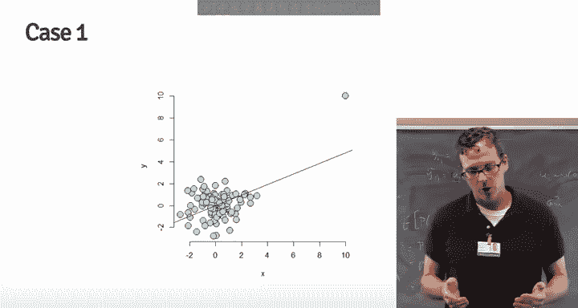

Then I added random standard normals， then I added the point at 1010。

 which clearly does not fit the rest of the trend of the data。

 what we can see in this case is that there's a strong correlation estimated by the data merely because of the existence of this point。

 otherwise the correlation would be estimated to be zero。

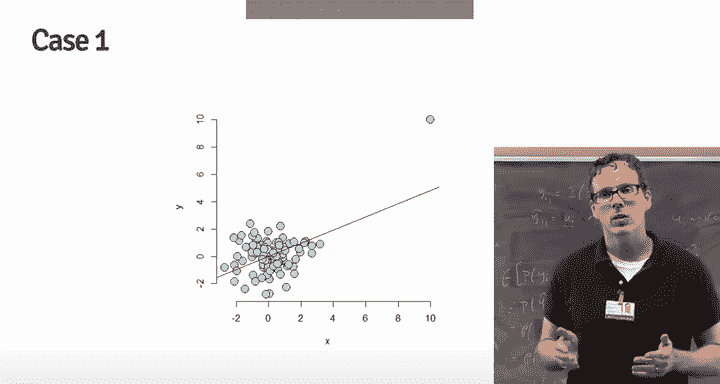

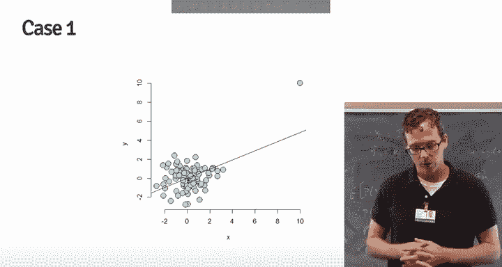

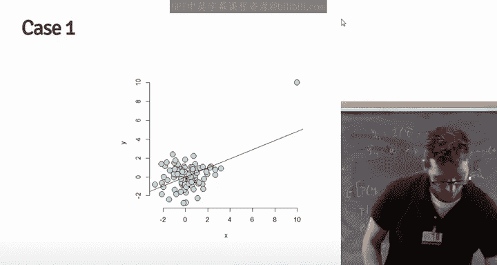

So you can see the code right here that I use to generate and plot the data。

So let's look at a couple of the diagnostic values。And。

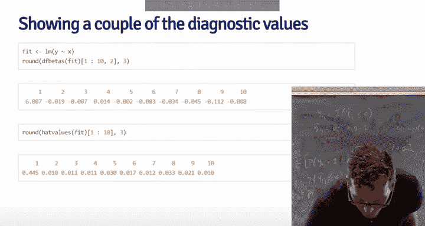

The first thing， why don't we look at the DF thetas so here's the DF betas。

 the round statement here just rounds it into the third decimal place when I put the three there and notice this first point。

 which is the 10，10 point。

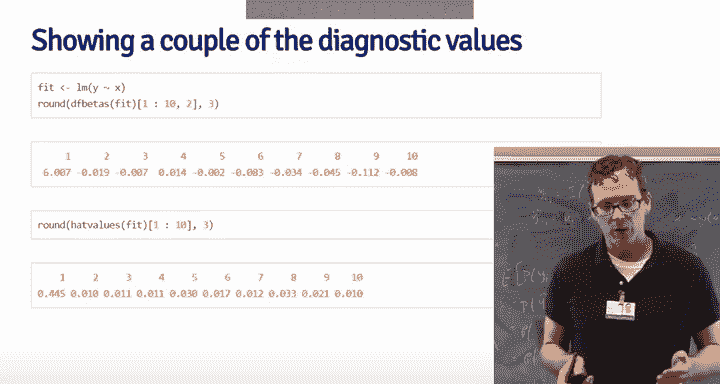

Is orders of magnitude larger of a Df beta than the？Then the remaining points。

Let's look at the hat values。The hat value for this point is much larger than the hat values for the remaining points。

 the hat values have to be between zero and1 so and it's of course much larger than the other point so if we were looking at these。

 we would obviously single this point out。

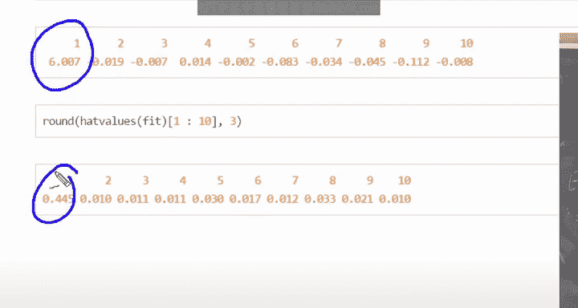

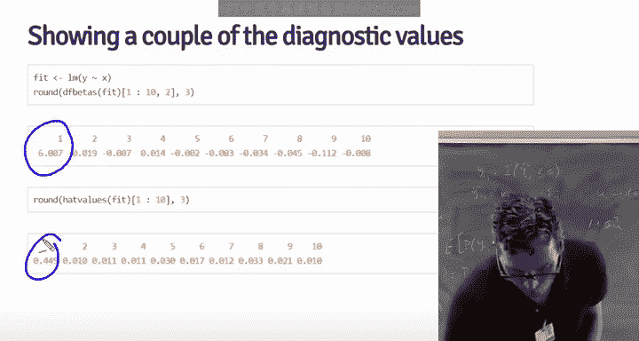

Now let's look at another point。

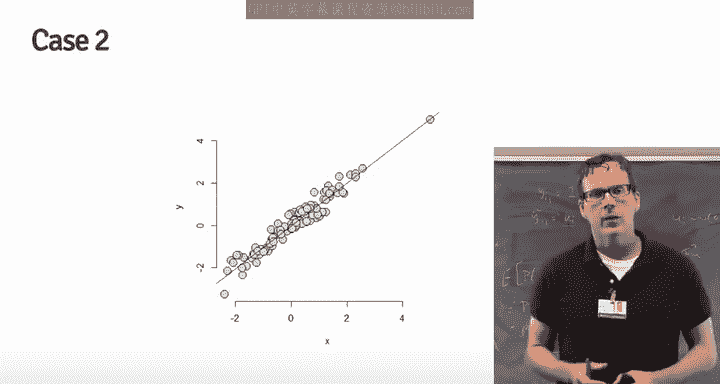

Or another instance where there's a clear regression relationship here。

 I just generated data along a line， and then I generated another outlier that's similarly distant from the cloud of data。

 However， it adheres very nicely to the regression line。 So let's see how our diagnostic values。

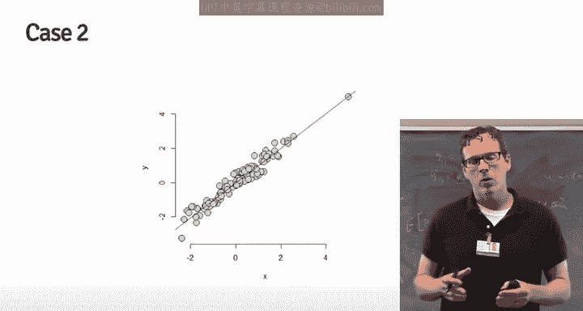

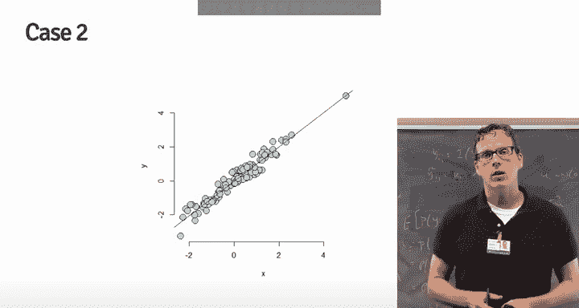

Look in this specific case。Okay， so here's my DF beta and if you look this first point。

 which was that outlineing point， it's still large。

But nowhere near as distinctively large as in the other case。

 so it still does appear to have some influence in the fit。

 but nothing nothing like in the other case， however， if you look at the hat values。

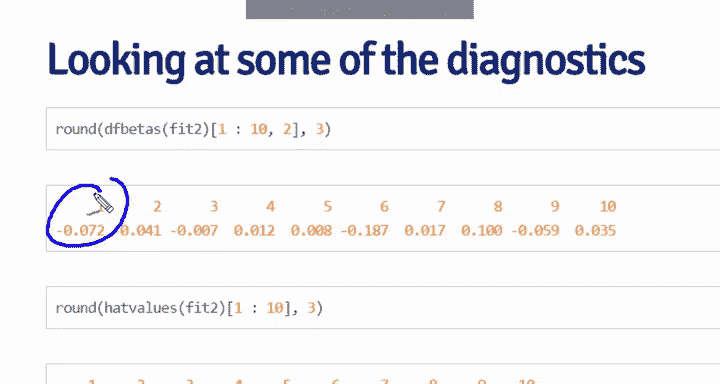

If you look at the hat values， this has a much larger hat value than the remaining all the other points。

 a factor of 10 than most of the other points， why well if we go back。

 what we see is that this point is outside of the range of the x values。

It's outside of the range of the x values。But it does adhere to the regression relationship。

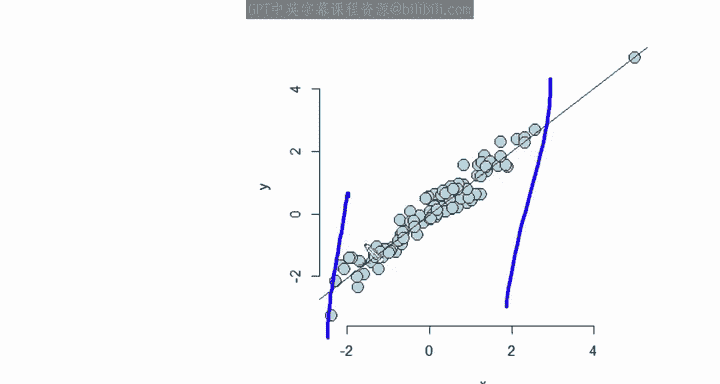

So it's going to have a large leverage value but not a large DF beta or DF fits or some of these other things let's look at this example by Steansky all that to me shows why we do residual plots basically the reason we look at residual plots is because they zoom in on potential problems with our model in this case you can download the data from their website。

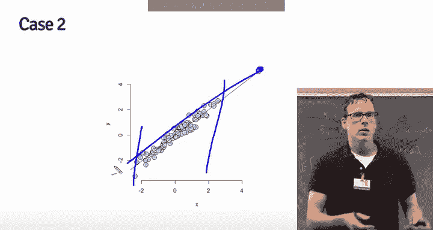

The pairwise scatter plots are given here， they show kind of nothing interesting other than a lot of overploting。

Here I show my linear model fit。😡，And。If you look， every single。

P value is highly significant for every single coefficient here， I've fit all of the data points。

 but for this to work for this model you have to subtract out the intercept in the way that he generated the data Okay。

 so should we be done is this fine， Well here's the problem。

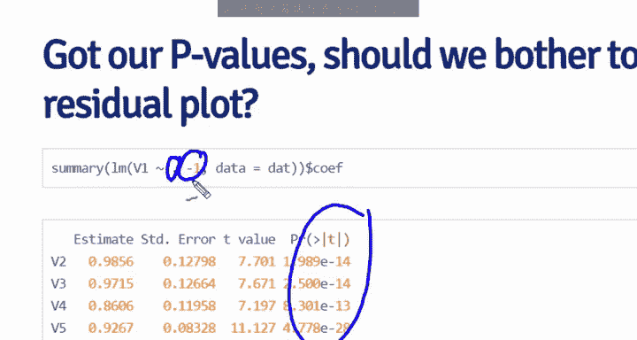

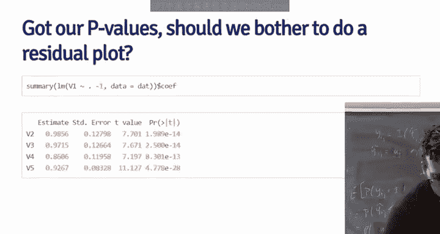

So the residual plot that you tend to do when you have multivariable example because you can't plot the residuals versus versus the only x as you can in linear regression is you need to pick a summary of the x so the most common one is to plot the residuals versus the fitted values plot residuals which are E versus Y hat okay so what happens in this particular instance when we plot the residuals versus y hat and you can see you get this very clever little picture that comes out so what's happened without looking at the residuals we wouldn't have seen anything but looking at the residuals has zoomed in on this very clear aspect of model poor model fit and very clear systematic pattern in our residuals that we've missed and remember in most cases in regression we want to model the systematic things and everything that we can't explain。

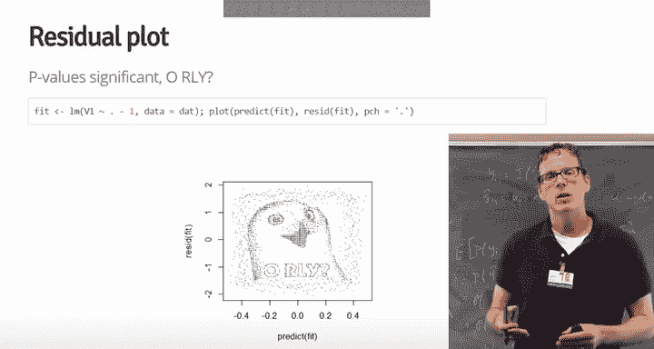

We want to model as if it were noise， but the systematic things like obviously this picture is systematic。

 we want to actually be able to model so in this case。

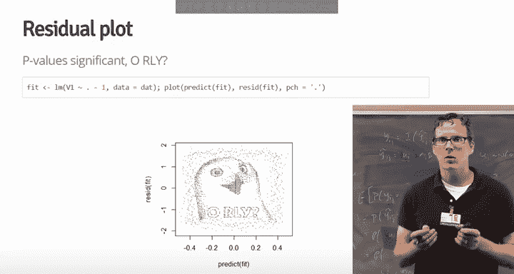

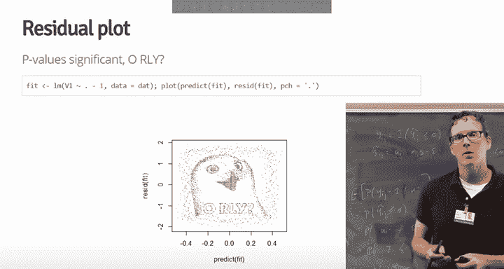

Without having looked at a residual plot we would have missed this pattern and it's really just created by Steefansky and his co-authors to describe for us why it is that we do residual plots and that is that they zoom in so finally on aspects of poor model fit。

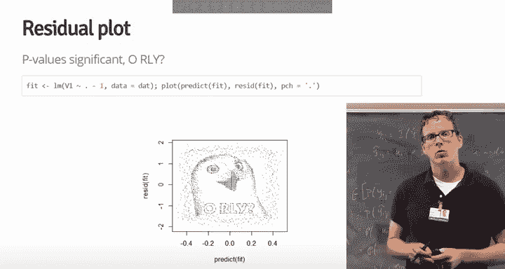

So let's go back to the Swiss data and just look at the different examples of diagnostic plots that get spit out by default by R remember at the beginning of the lecture we started out with this so let's see if now we can interpret these things well for the residual plot versus the fitted of values that's the same plot as we just saw with the Orelio just a slide ago so what you're looking at in that plot is trying to find anything that's systematic anything that you know for example if you saw the data something like that that would suggest heteroschasticity that the variance is either increasing or decreasing in a way that you wouldn't like and so on so in this plot it doesn't look so bad there doesn't seem to be too many。

Aspects of absence of。Of model departures there。The QQ plot is specifically designed to test normality or not to test to evaluate normality of the error terms。

Okay this scale location plot is plotting the standardized residuals remember we talked about the standardized residuals。

 they're the ordinary residuals but standardized so that they have a more kind of comparable scale across subject across experiments and they're scaled to try and make them to be like a T like statistic so again this is a lot like the residual plot you're plotting them against the fitted values but now you've just mostly you've changed the scale so that that's potentially useful that's potentially useful for looking at。

For looking at these across different experiments， the final final is plot of the residuals versus leverage。

 so here's the standardized residuals on this scale and then here's the leverage on that scale。

And in this plot， again， you're trying to look at any sort of systematic pattern。

 any reason why points with higher leverage are having higher or particularly small residual values if you had an instance like。

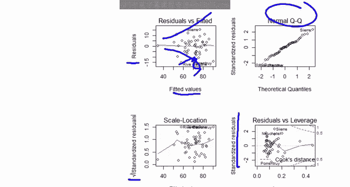

Like you know where you have plots like this and you have one very high leverage point and you get something like that that point might have a very small residual but unnecessarily while it happens to have a very large leverage or you might have an instance like this where that even though it's really impacted the regression line。

 it still has high leverage and also has a high residual so anyway these are many these are just a couple of the examples of the kind of plots you might want to look at in this data set that none of them seem to look too inherently bad。

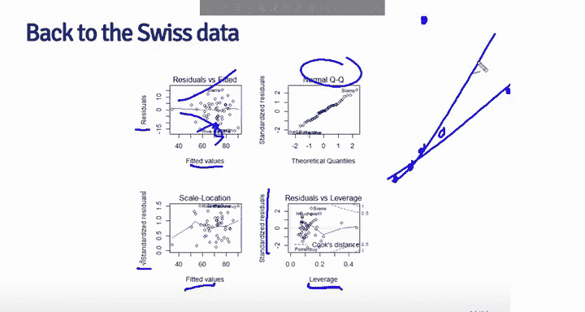

But when you go through these things， ideally， you would have something where you could click on the individual points and it would describe the。

Aspects of the point when you hover over it with your mouse。

 some of the other software systems can do that R can do that now we'll talk in the data products。

 how you class， how you can actually create those kinds of plots。

So that's the end of the lecture and I look forward to seeing you next time。

 but I hope now that you know a little bit about diagnostic measures and influence diagnostics and leverage diagnostics that you can incorporate them into your analyses in the future all right。

 see you next time。

