# 约翰霍普金斯大学《数据科学：统计和机器学习｜Data Science： Statistics and Machine Learning》中英字幕 - P73：32_模型选择 第3部分.zh_en - GPT中英字幕课程资源 - BV1jsAAeNE3k

So up to this point， all that we've talked about is the impact of。

Unnecessary or necessary included variables on our regression coefficients。

But there's one other parameter that we estimate in a regression model。

 the residual variance sigma squared。So what happens？

If we have assuming IIV errors that our linear model is additive that that part of the model is correct。

Then we can mathematically describe the impact of omitting unnecessary variables or including unnecessary variables。

And it follows along the same lines as what we discussed before， if we underfi the model。

 in other words we omit important variables， then the variance estimate is biased。

 why is that because we've attributed to variation things that are actually systematically explained by these covariates that we've omitted。

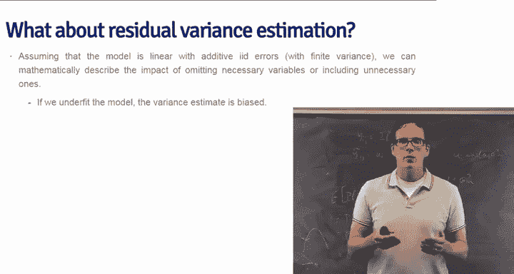

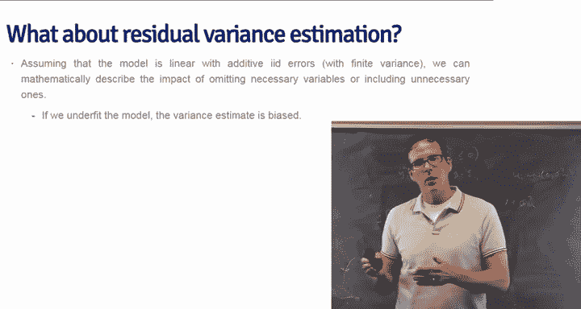

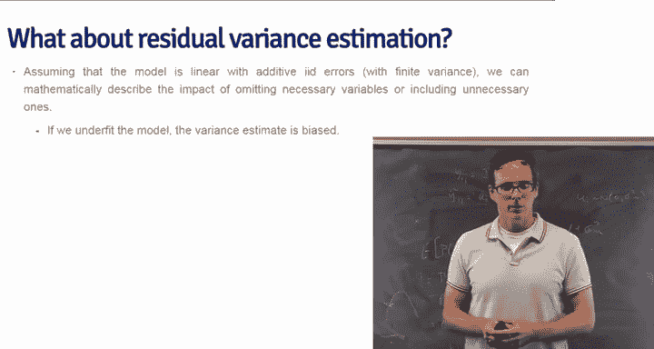

On the other hand， if we either correctly fit the model， we include all the right。

Terms or if we overfit the model。Then the variance estimate is unbiased， however。

The variance of the variance estimate gets inflated if we include unnecessary variables。

 so it's actually kind of the same rule if we omit as we discussed before with coefficients。

 if we omit variables，Then we get bias， if we include variables。

 then we get a less reliable estimate， so it's roughly the same impact going on。

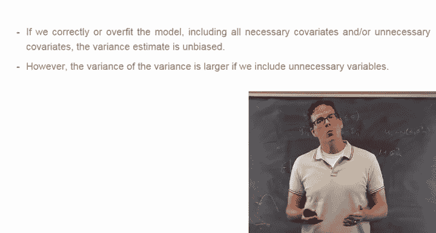

So let's talk about model selection in general， automated model selection。

 and I just want to briefly mention again that automated model selection is something that we cover in the machine learning class and really。

 I think at one point it was a statistical topic but it's really moved into the realm of machine learning for the most part。

And I would say， though， even for relatively simple linear regression models。

 the space of model terms that you have to search among explodes really quickly when you start including interactions and polynomial terms like the square of a regressiongressor and so on。

If you have a lot of lot of regressors and you're interested in how do I reduce this space。

 then there's a lot of factor analytic and things like principal components。

 those kinds of techniques that are available to you to reduce your covariate space down to side now however those come with consequences your principal components or factors that you obtain might be less interpretable than the original data that you're interested in again。

 again， this is probably a better served in a multivariable class。

 a multivariate class or a class on machine learning。

 but for us we're going to mostly consider the case where we have a relatively small number of regressors and we're going to pick through them with highly interactive process between the analyst。

 the data and the scientific context。Another thing I would mention is that good design can often eliminate the need for a lot of this model discussion。

 We've talked a lot about how randomization can really prevent a lot of the。

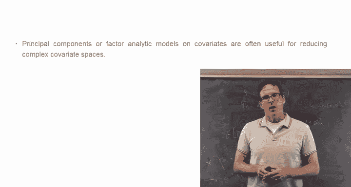

Problems that we're talking about with making our variable of interest unrelated to nuisance variables that we're not interested in or nuisance variables that we don't even know about。

However， there's other aspects of design that can serve the same purpose， for example。

 if we stratify and randomize within strata， the classic example of this when this was developed was our is working in field crop experiments and they needed let's say you're trying a different kind of seed you might block on different you know block on different areas of the field that you were going to plant in and randomized the different seeds to those areas。

 so you might have two different kinds of seeds， but they will have been distributed in a systematic way that is fair across the field but also then within that design there will also be some randomization this topic of experimental design is a pretty broad topic another great example is in biostatistics the field that I work in the most a very common kind of design is a crossover design。

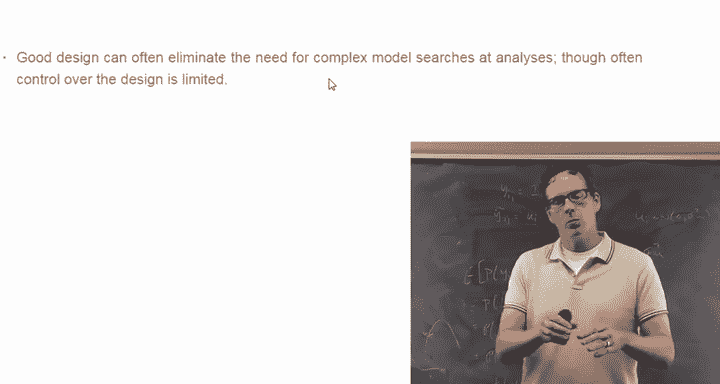

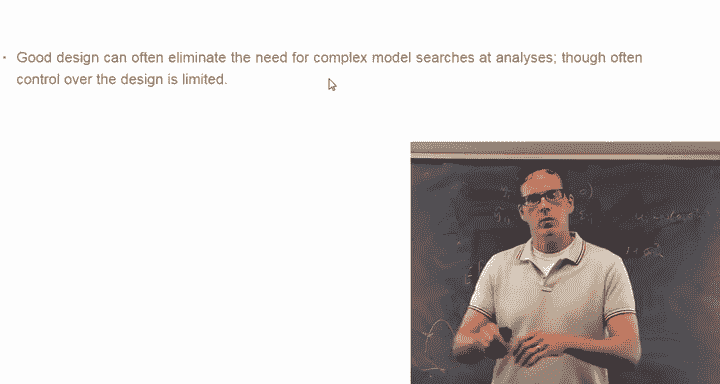

And in that case， you try to use every subject as their own control， so let's say， for example。

 you're interested in looking at an as two different kinds of aspirin。

And you might give the aspirin to one group of people and then the aspirin to another group of people。

 the other aspirin to a different group of people。Let's say they have different gels or whatever that determine how it gets absorbed in your stomach。

So。If those two groups aren't the same， either the randomization wasn't very good and there was some sort of imbalance that you just got unlucky about。

 or if the study was just observational，Then the comparison of those two groups might be biased by whatever differentiates the groups rather than group one receiving one kind of aspirin and group two receiving a different kind of aspirin。

On the other hand， if you can give a person one kind of aspirin and then later on give them a different kind of aspirin when they have another headache that would compare each person to themselves right control block on the person so to speak so that's a design strategy now there's some nuance with this design strategy as well。

 what happens if there's some residual effect of the first aspirin when you give the second one right so maybe you could handle that with some sort of washout period a long washout period or something like that。

 but anyway the point of that design is to make it so that you're comparing people with themselves to control and everything that's intrinsic to the person。

At least across time periods control for that by giving both aspirins to each person maybe you would randomize the order in which they receive them that's called a crossover design at any rate the broader point that I'm trying to make is it's often the case that good thoughtful experimental design can really eliminate the need for some of the main considerations that you'd have to go through in model building if you were to just collect data in an observational fashion。

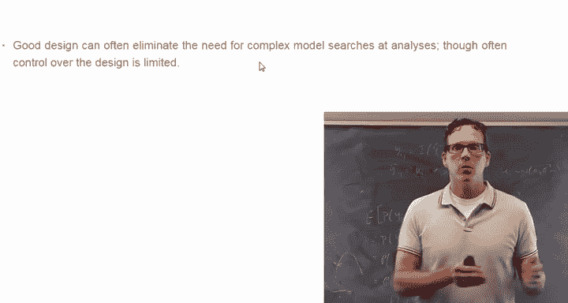

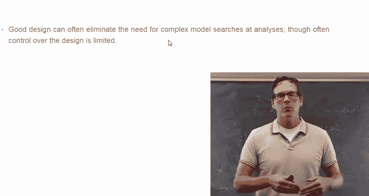

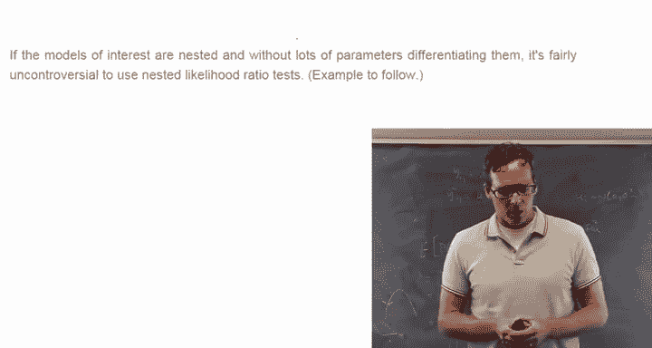

The last thing I would say is there's one automated model search technique that I like quite a bit and I find it very useful and it's the idea of looking at nested models。

 so I'm often interested in a particular variable。And I'm very interested in how the other variables that I've collected will impact it。

 so I'm interested in a treatment or something like that， some important variable。

 but I'm worried that my treatment groups are imbalanced or with respect to potentially some of these other variables so I might look what I'd like to look at is the model that just includes the treatment by itself then the model that includes the treatment and let's say age。

 if the ages weren't really balanced between the two treatment groups and then one that looks at age and gender。

 if maybe the genders between the two groups weren't really balanced and then so on and this idea of creating models that are nested every successive model contains all the terms of the previous model leads to a very easy way of testing each successive model okay and these nested model examples are very easy to do so I'm just going to show you some code right here。

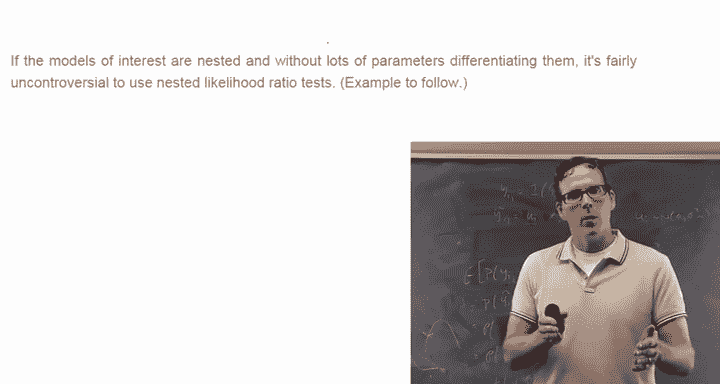

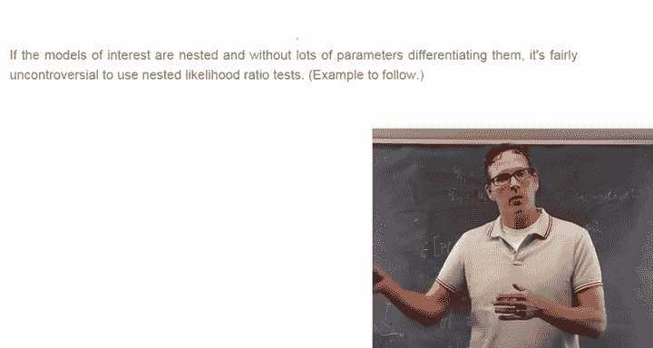

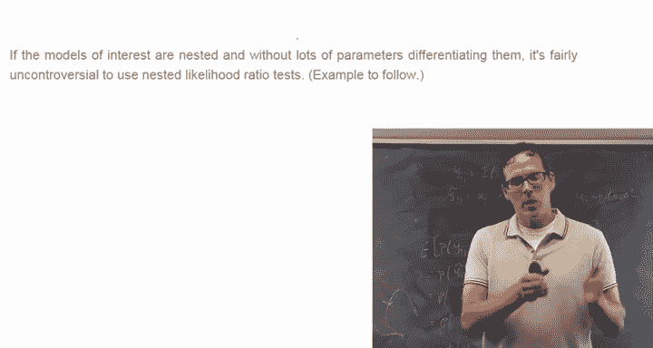

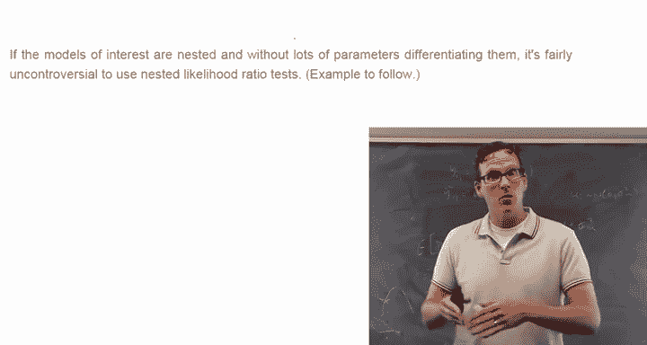

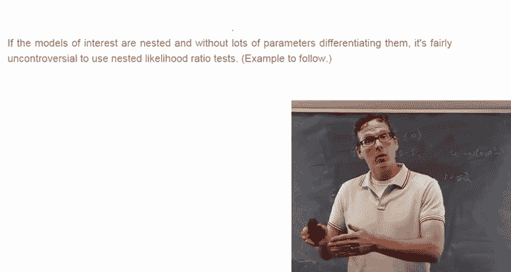

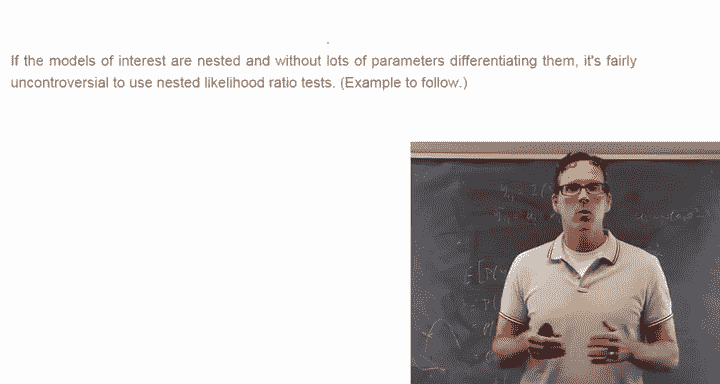

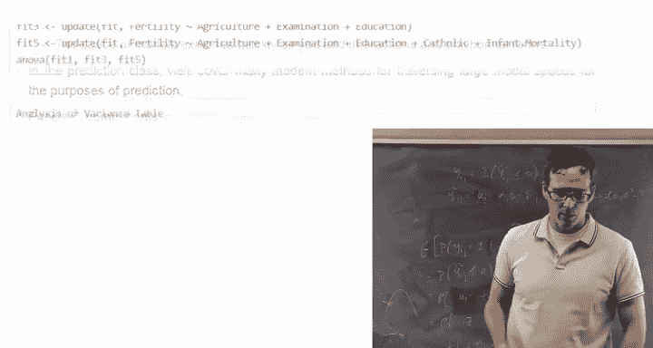

On how you do nested model testing in R so hit I fit three linear models to our Swiss data set。

 the first one just includes agriculture， let's pretend that that's the variable that we're interested in okay and then the next one includes agriculture and examination in education。

 I put both those in because I'm thinking they're kind of measuring the same thing but now after this lecture I'm concerned over the possibility that they're two much so measuring the same thing but let's put that aside for this time being and then the third model includes examination education plus cat plus infant mortality so all the terms so now I have three nested models and I'm interested in seeing what happens to my effect as I go through those three models。

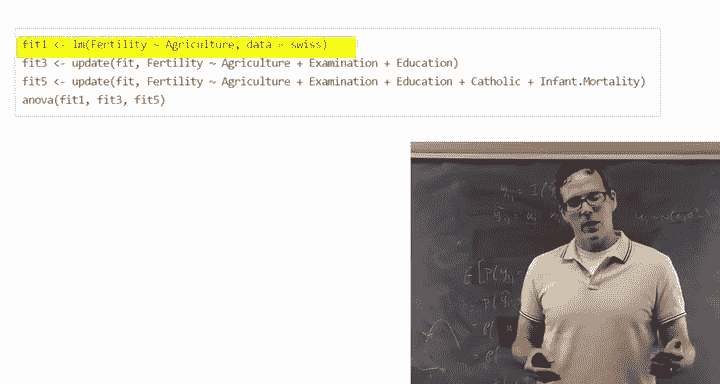

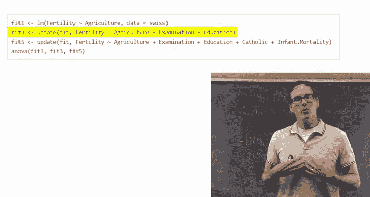

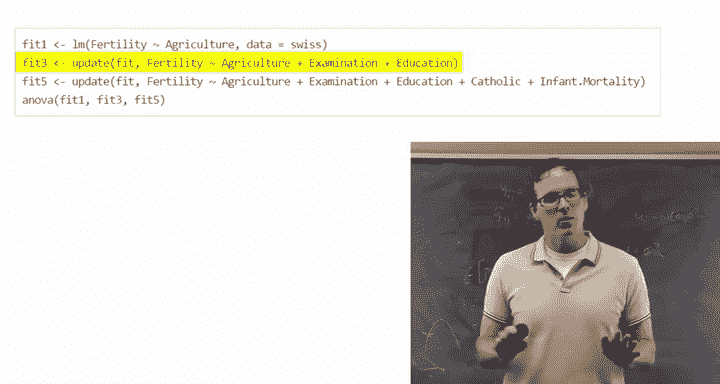

The point being in this case you can test。Whether or not the inclusion of the additional set of extra terms is necessary with the I No function。

 so I do AO fit one fit3 and fit5 okay that's what I name them 135 and then you see down here what you get is listing of the models Model1 Model 2 Model3 and then it gives you the degrees of freedom okay that's the number of data points minus the number of parameters that had to fit the。

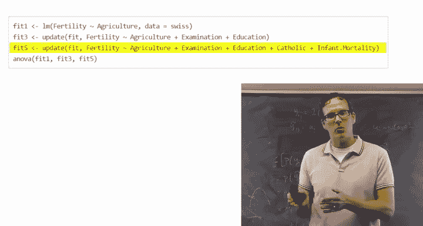

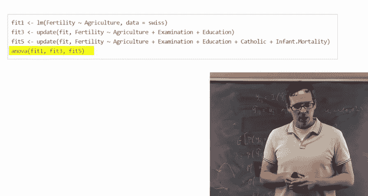

Sums of squares， the residual sums of squares， and then the excess degrees of freedom of going DF is the excess degrees of freedom of going from。

Model1 to model 2 and then model2 to model3 so we added two parameters and going from model1 to Model2 that's why that Df is2 and then we added two additional parameters going from model2 to model 3 so the two parameters we added from going from model1 Model1 to model2 is we added examination and education there to regression coefficients going from Model2 to model3 we added cat and infant mortality there two regression coefficients okay so with this residual sum of squares and the degrees of freedom you can calculate so-called f statistic and that get at P value this gives you the s statistic and the P value associated with each of them and then here it shows that yes。

 the inclusion of education examination appears to be necessary over just looking at agriculture by itself and then when I look at the next one it says yes the inclusion of Catholic and infant mortality appears to be necessary beyond。

Just including examination， education and agriculture。Okay。

 so if the way in which you're interested in looking at your data naturally falls into a nested model search as it often does。

 I think， when you're interested in one variable in specific。

 as in this case I think this would be a pretty natural way of thinking about the series of analyses。

 then some kind of nested model search is a reasonable thing to do。

 it doesn't work if the models that you're looking at aren't nested。For example。

 if I had the first model or model two had examination but not education and the third model had education but not examination this wouldn't necessarily this wouldn't apply you'd have to do something else and there I think you get into the harder world of automated model selection with things like information criteria so I would put all that stuff off to our prediction class and then just leave you this one technique that's useful in the one specific instance where you've decided to kind of。

Look along a series of models each getting increasingly more and complicated。

 but including the previous one。Okay so I hope in this lecture that you've gotten a couple of model selection techniques that you can use。

 I hope you've also learned that there's some basic consequences that occur if you include variables that you shouldn't have or exclude variables that you should have。

 these has consequences to your coefficients that you're interested in。

 they have consequences to your residual variance estimate。

 we didn't even touch on some other aspects of poor model fit that can occur such as absence of linearity and other things like that nonnormalality and so on。

So again， it's generally necessary to take your model fits with a grain of salt because more than likely one aspect of your model is wrong。

And I'll leave you then with this famous quote by George Box， who's very famously said。

All models are wrong， some models are useful， and I think that's a very good credo to go along with that yes。

 for sure your model is wrong， but it might be useful in the sense of being a lens to teach you something useful and true about your data set。

Okay， so that ends today's lecture and I look forward to seeing you for the next one。

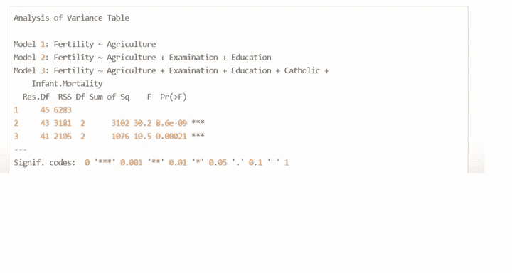