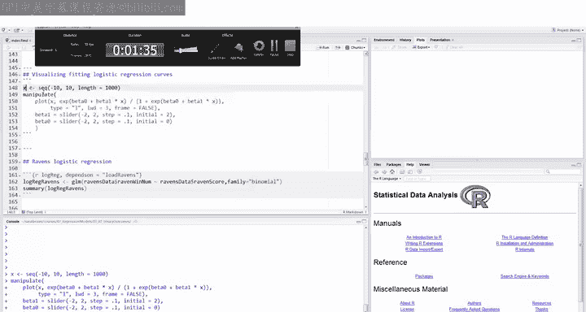
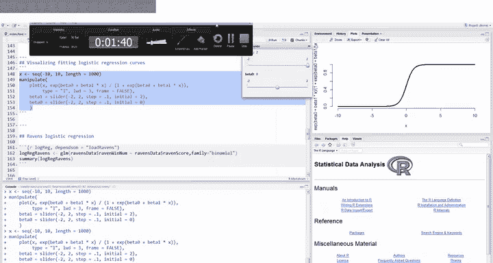
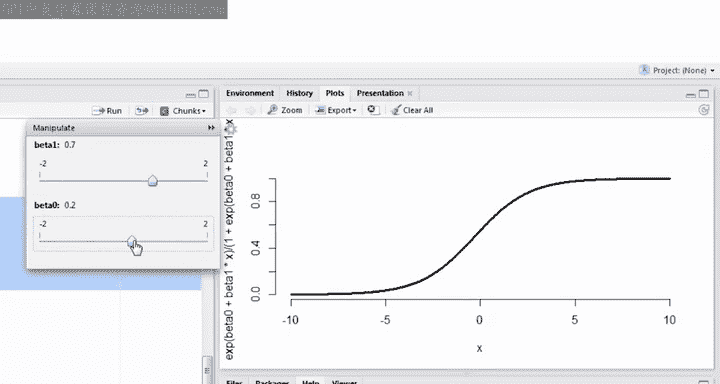
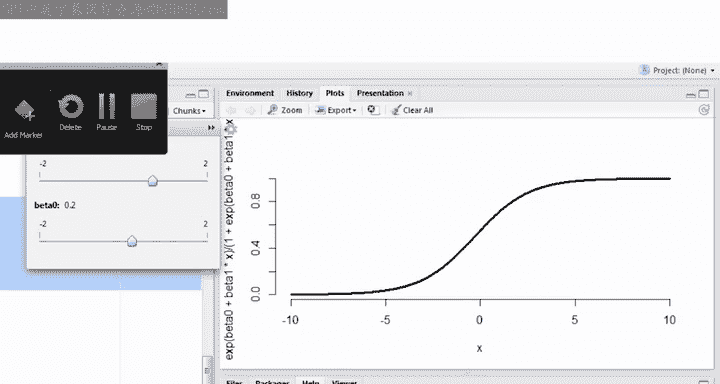
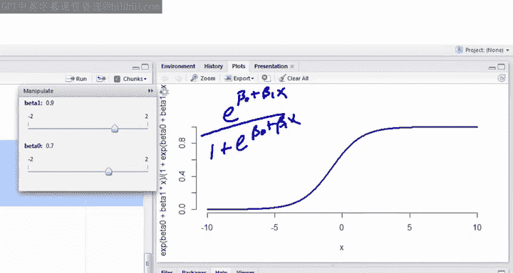

# 约翰霍普金斯大学《数据科学：统计和机器学习｜Data Science： Statistics and Machine Learning》中英字幕 - P76：35_逻辑回归 第2部分.zh_en - GPT中英字幕课程资源 - BV1jsAAeNE3k

Okay， so let's look at logistic regression curves and think about how R is fitting the data。

So here I'm going to mut。

Use the package manipulate。

And I have my beta 2 and my beta 1 set here。And so here's my logistic regression curve。

Looks like an S kind of， and here's beta 1。Let's see what happens as I render it。Or as I change it。

 it notice as I。As I get it closer up to higher values， it becomes more peaked。

And then if I go negative， it actually flips around。Okay。Then my beta zero curve。

 what happens to this， it just shifts it along。It's hard to tell because I'm keeping the。That don't。

The X axis here is always the same， but it's just shifting the S curve to the left or to the right。

Okay， so let's think about what R is doing when it's trying to fit logistic regression curves。

So。

Imagine I have a bunch of zeros and one。 So all my x axis one is up here and0 was down there。

 So imagine for this regressor， this X regressor here， I have a bunch of。A bunch of zeros down there。

 but maybe I had occasional one。But then over here I have。

A lot more ones and then right here I have some zeros。Okay， so what R is trying to do， Okay。

 so it knows as I head。We can see as a head to larger x values。

It becomes increasingly likely that my outcome is a one as I head towards smaller x values。

 it becomes increasingly likely that my outcome is a zero。 So R， what R is trying to do is then move。

Is trying to move the S curve， it's trying all different sorts of S curves。Right。

 all different sorts of logistic curves to find the one that best。

Matches up with the associated probabilities。Okay， and that's all that logistic regression is trying to do。

And it does it with the principle of so-called maximum likelihood。

 which again is something if you take the inference class from the data science specialization。

 you'll know a little bit more about， but so just imagine these points staying there。

And I'm going to get rid of them okay， and then just see how what R has under its disposal is to be able to move these two sliders and then define the S curve that fits that data the best。

Okay， and so that's all that logistic regression is doing。 And then this function。

 this is the fitted function out， right， is， this is the function。E to the。

Beta n plus beta 1 x over1 plus E to the beta n plus beta 1 x。 That's the that's the。

Logistic regression model， but convert it back to the probability scale。Okay。

 so I hope this helps you understand a little bit of behind the scenes what logistic regression is trying to do。

