# 约翰霍普金斯大学《数据科学：统计和机器学习｜Data Science： Statistics and Machine Learning》中英字幕 - P79：38_泊松回归 第2部分.zh_en - GPT中英字幕课程资源 - BV1jsAAeNE3k

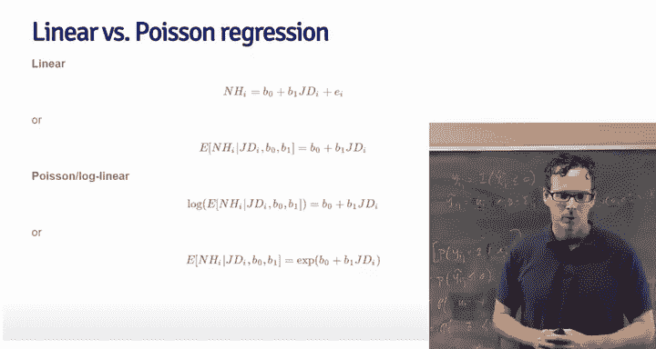

So let's talk about linear versus Poisson regression。

 so remember in GLMs we don't log the outcome itself。

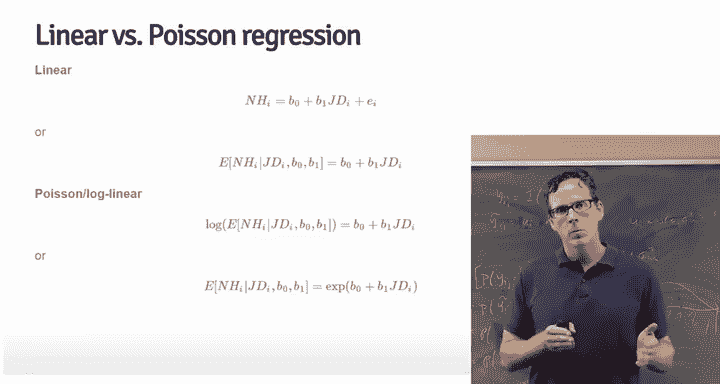

Or we don't take a transformation of the outcome itself。

 we take a transformation of the mean of the outcome so in linear models we have our outcome is the linear component plus the error or we could just write that as the expected value of the outcome is the linear component in a Poisson log linear model it's the log of the expected outcome that is the linear part log of the expected number of web hits per day is B0 plus B1 times the Julian date we could reverse that process by exponentiating both sides of that equation and just say the mean web hits per day now depends on E to the linear regression model okay。

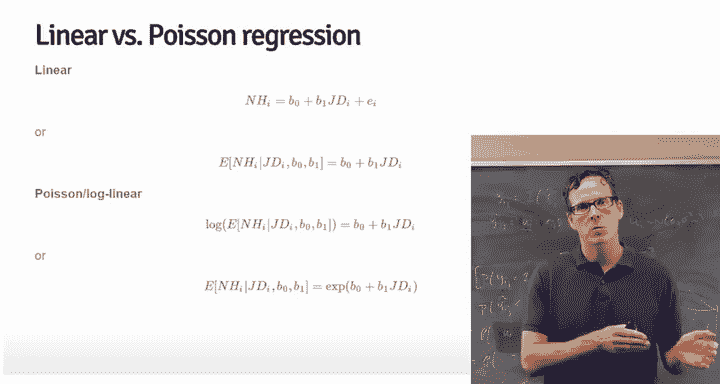

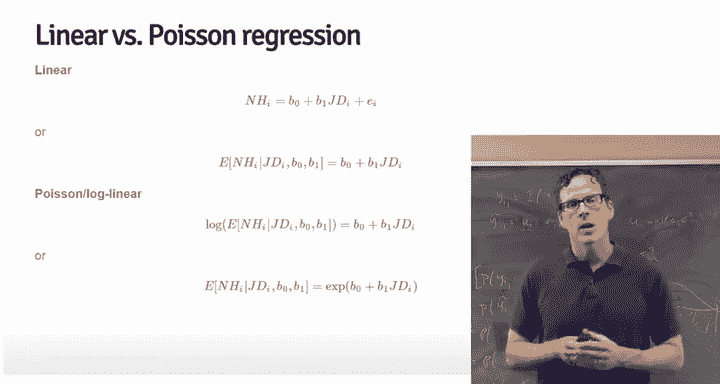

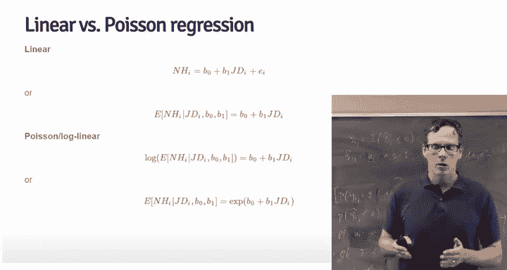

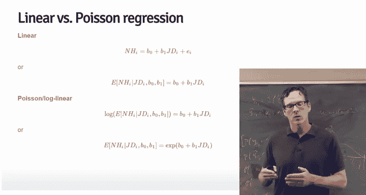

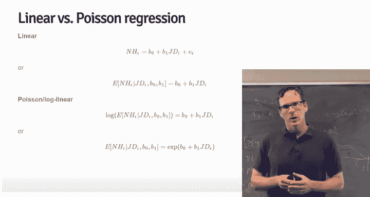

So that's the main difference is that weve we're going to assume our data is plus on distributed with a mean。

 and that mean takes this form E to the B0 plus B1 times a regressor。

 okay and that's the main difference though it changes the interpretation a lot。

 we get a distribution that's much more believable for our observed outcomes。

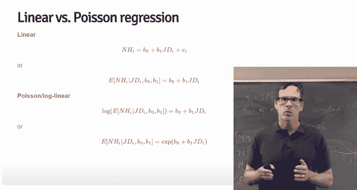

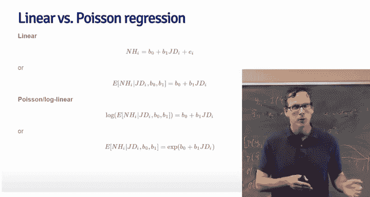

Okay and we get relative interpretations because everything's logged our coefficients are going to be interpreted in a relative sense。

 just like when we log the outcome， though we're going to avoid problems like taking logs of zero like we had on the previous slide okay now I want to reiterate taking logs of your outcome is actually often a very good thing to do that's a trick that you should apply not just for count data but in general in regression if you have positive data。

 log is one of the best transformations you can do it's extremely helpful the coefficients remain as if not more interpretable on the log scale。

 so that's a great transformation to do some of the other transformations if you square root or Q root data than it gets hard。

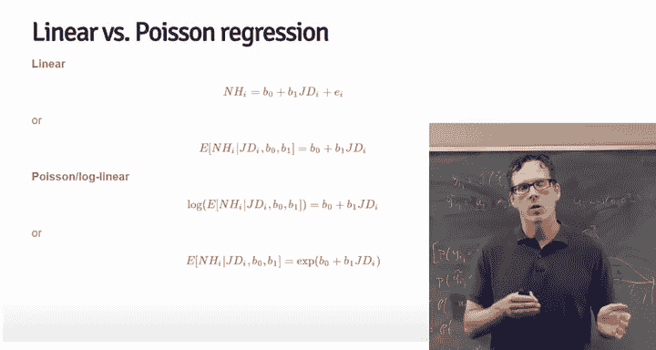

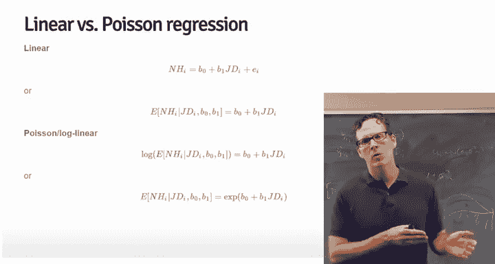

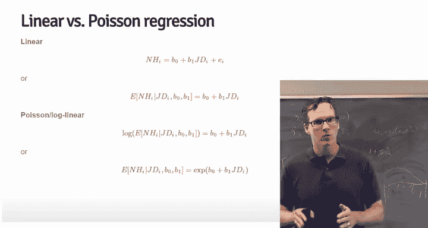

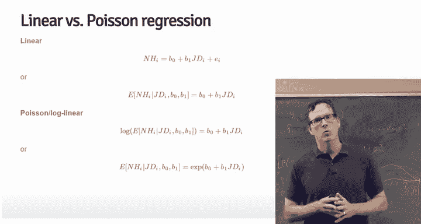

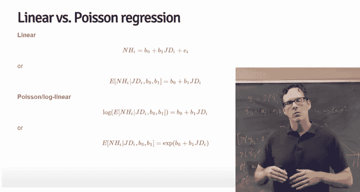

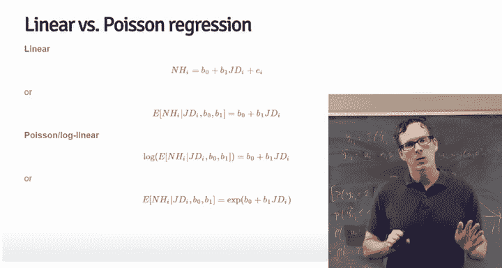

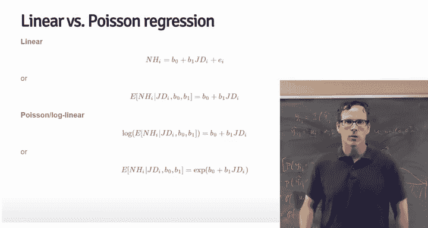

Okay so let's just remind ourselves that the differences that we're looking at are now multiplicative when we transform them back to the natural scale。

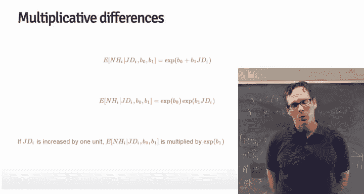

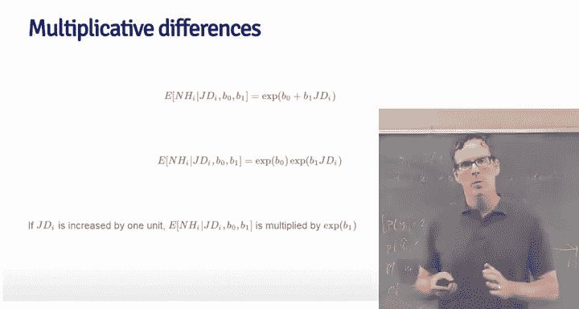

So if we look at our。Our model， it's the expected value of the outcome is E to the beta n plus beta 1 times the Julian date。

 Well， by the properties of expected value， we can factor out beta n and beta1 times the Julian date。

 Now， if we looked at what would be the expected。What would be the expected mean for the next day。

 the Julian date plus1， right that would be e to the B0 plus B1 times Julian date plus1 okay？

So divide this by that and you get E to the beta 1。So。

Our coefficient E to our slope coefficient is interpreted as the relative increase or decrease。

In the mean per one unit change in the regressor。Okay and so the on if we expent are coefficient。

 we're going to be looking at whether or not they're close to one， if we leave them on the log scale。

 we're going to be looking at whether or not they're close to zero and again all these interpretations when we extend them to the multivariate setting are just。

E to the beta 1 is the expected increase or decrease in relative increase or decrease in web traffic the other coefficient。

 holding the other regressors constant， okay？So I'm hoping at this point that most of this stuff is kind of old hat for you。

Okay so here's our fitted Poson regression model overlaid onto our data and you can see it actually fits pretty closely to the linear model though it has some nice curvature to it which is what we wanted。

 we could' have accomplished that in our linear model by adding a squared term of course。

 but it's nice to note that a simpler model with fewer coefficient seems to fit the data better。

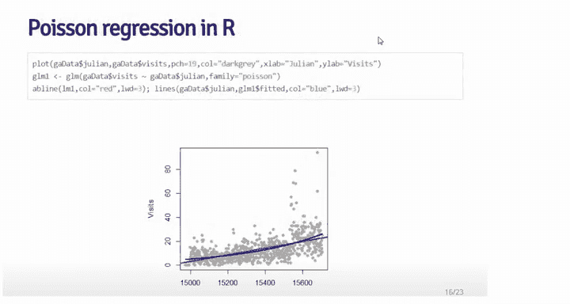

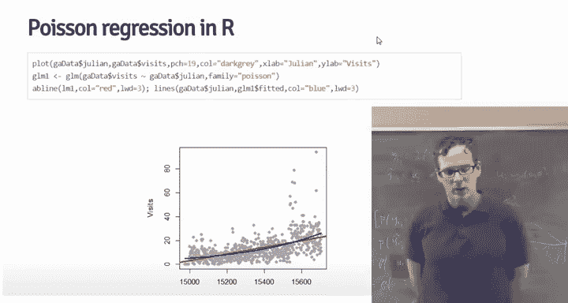

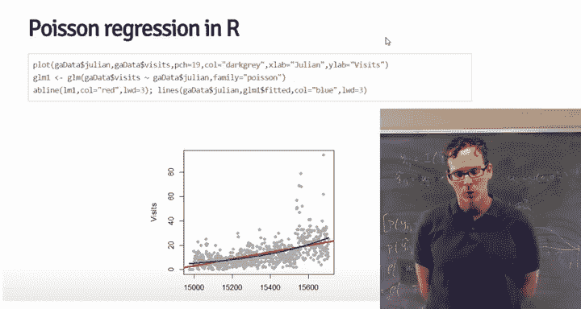

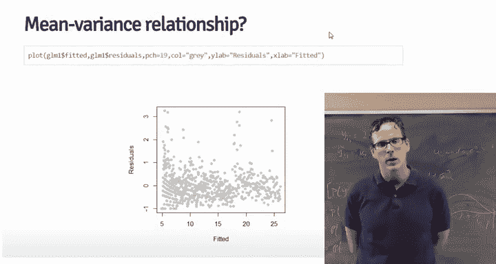

A concern often is that， the variance has to equal to mean。

 so the variance in this case needs to go up。

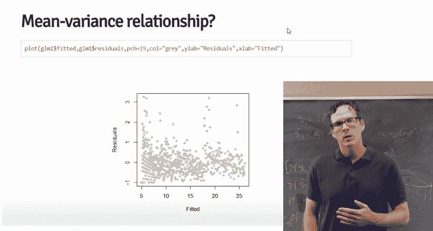

As the mean goes up， but here if we plot the fitted values versus the residuals。

 it's very clear that the variance is higher for lower mean values。

 that's a problem okay so we need at least some way to account for the fact that the variance is not necessarily constant there's a lot of ways to do that and if you read in the book。

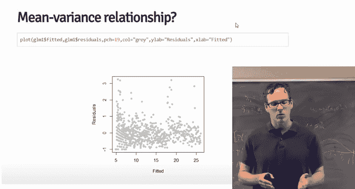

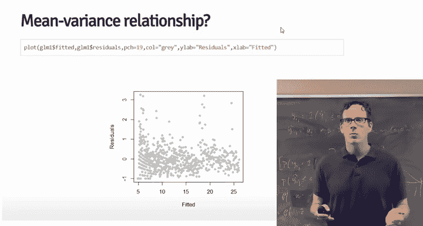

One thing that we talk about are the quasi Poisson models。

 this model would look at the variance being a constant multiple of the mean rather than being equal to the mean。

 but in this case that doesn't appear to be the case in this case because it looks like we have this issue where there's larger variance for lower fitted values when the Poisson model seems the opposite。

 so Jeff actually had this code from this model the sandwich which seems like a funding name for a package but it comes from the sandwich variance estimator being famous by generalized estimating equations。

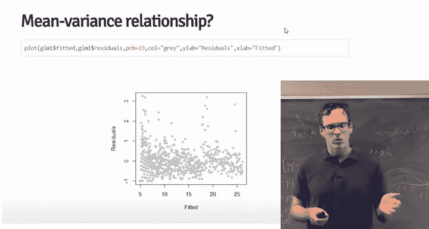

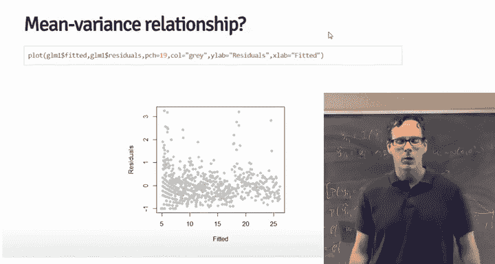

Which， by the way， was a technique that was invented here at Johns Hopkins Biosstatistics by two very well known professors here。

 Scott Zieger and Congi Li Yang。At any rate， Jeff gives some code here for getting model agnostic standard errors and if you read in the book there's some a little bit more discussion about this。

 this is kind of a more advanced topic than we would like to delve into it in this class。

 however it's a very important applied topic as well， it's not just a theoretical exercise。

 so the main point is is to do some residual plots to understand whether or not you think your model assumptions hold try a quasi Poisson model because that's a very easy thing to do in R。

 if you think at least it holds at some level but maybe not just in the sense of the variance being a constant multiple of the mean but if it really fails like in this case then you have to dig into some other solutions。

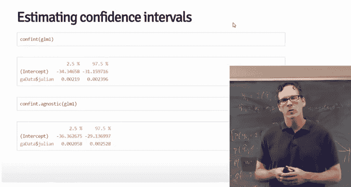

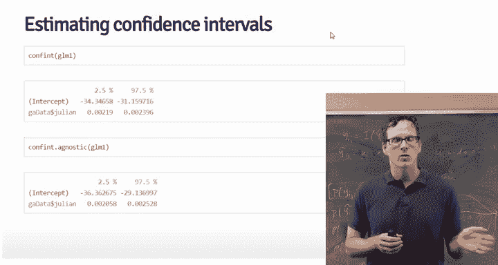

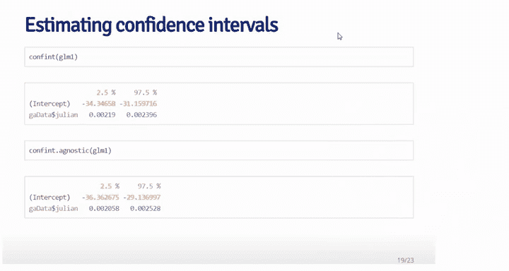

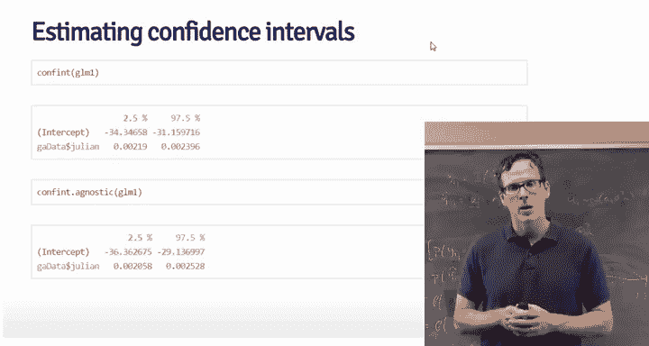

So in this case you see here's the confidence interval on the top if we don't do anything。

 if we do the model agnostic confidence interval you get on the bottom in this case it actually doesn't make that big of a difference on our。

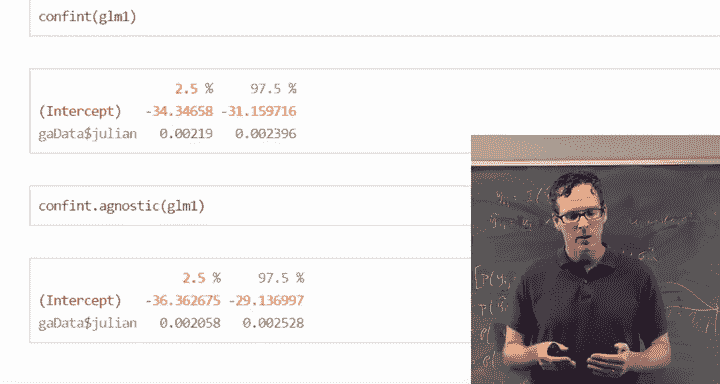

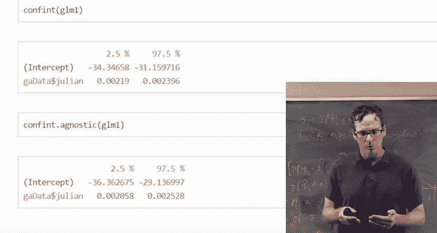

It doesn't make that big of a difference between the two and again these are both of course。

 non exponentiateated if you wanted to expiate them， which by the way。

 I should also mention expentiating for a small coefficient like this。

 it basically just adds1 so probably if I were to enter this into R， this would be about 1。002。

 just like before about a 2% increase on the low end being estimated 2。

021% increase estimated on the low end you know a  point maybe at the highest possible a point。

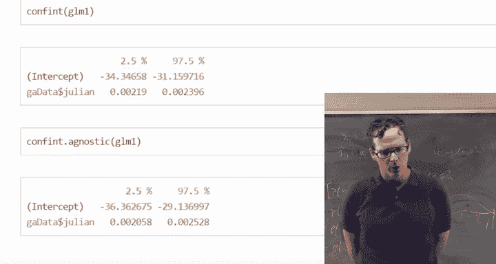

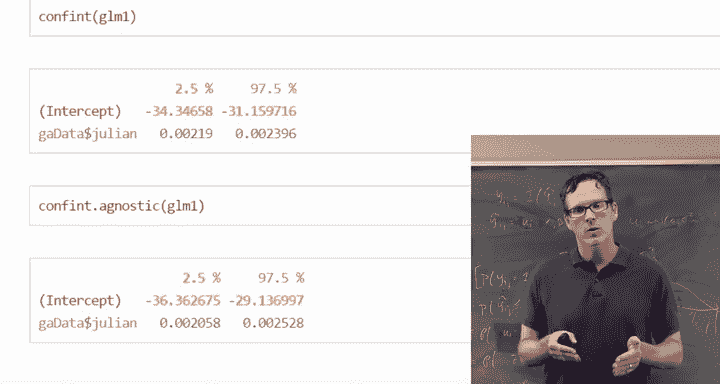

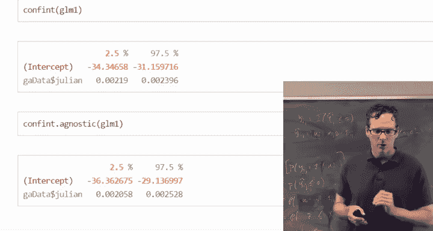

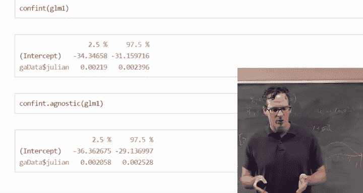

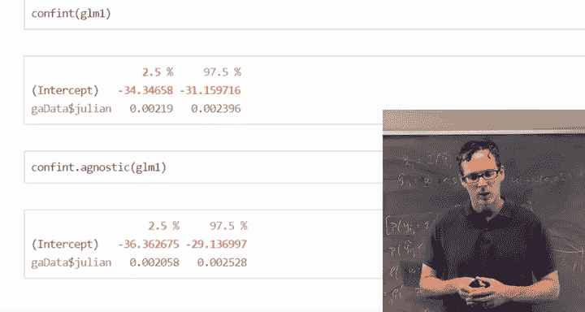

3% increase per day on the high end。

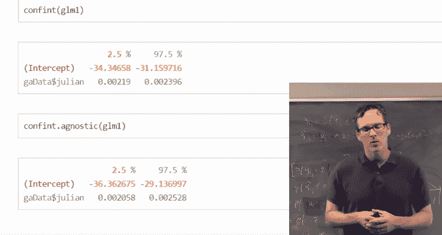

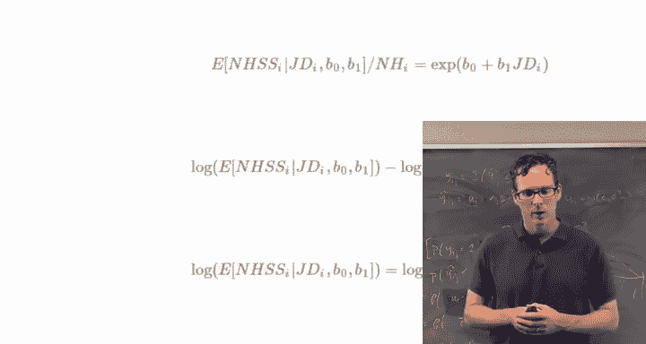

So how do you handle rates so I should say rates and proportions because I like to distinguish between rates and proportions。

 so this is an instance where you have accounts and then you have some offset that should tell you how large or small the count should be。

 so for example if I'm counting failures of my nuclear pumps that I mentioned before。

 I should have more failures if I monitor them for a longer time。

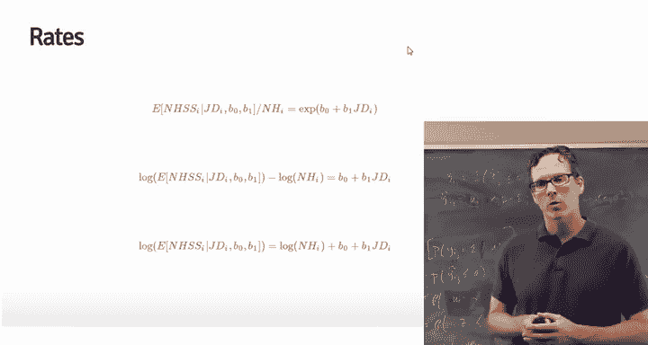

If I'm counting the number of flu cases， I should have more flu cases。

 if I'm looking at a larger population right so I should have more flu cases in a bigger city than I would have in a smaller city。

 so in all these cases， if the counts that we're interested in。

 have some term that we really want to interpret our count relative to that。

 whether it's a unit time， person time at risk。

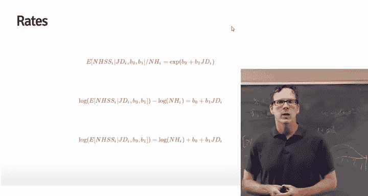

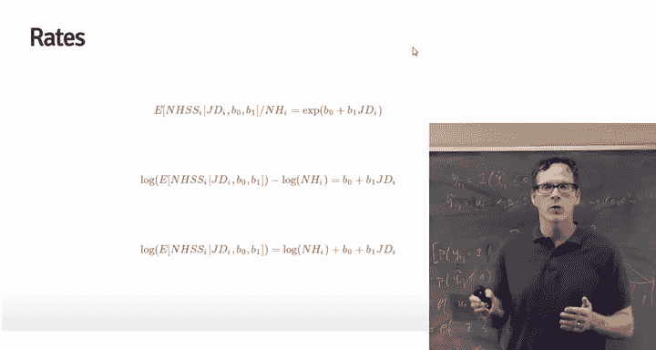

Number of total sample size then what we want to do and it's quite simple how to do this in R the first thing we note is that we want to actually interpret not the expected value of the outcome。

 but the expected value of the outcome divided by divided by this relative term whether it's monitoring time person time at risk or whatever。

 so in this case Jeff was looking at the number of web hits originating from simply statistic relative to the total number of web hits and E wants to model that as e to the beta n plus beta1 times the Julian gate。

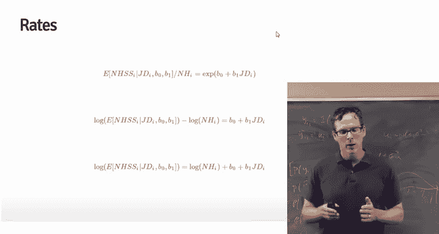

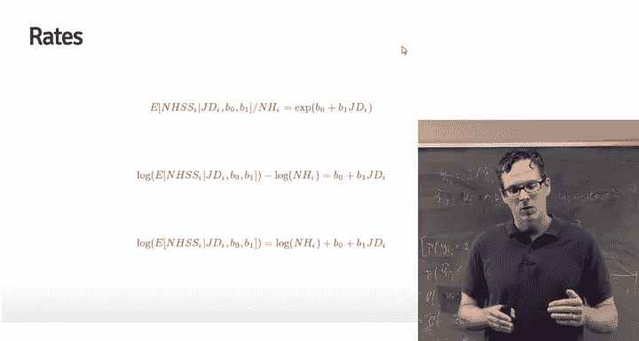

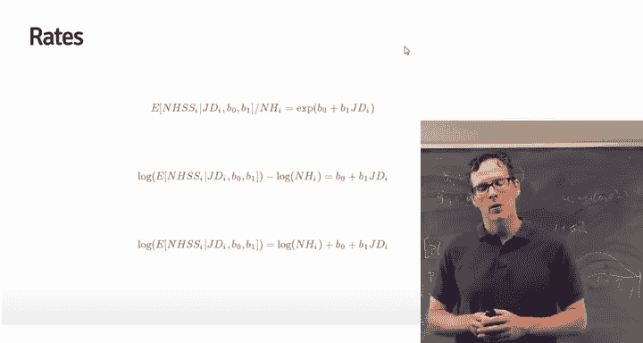

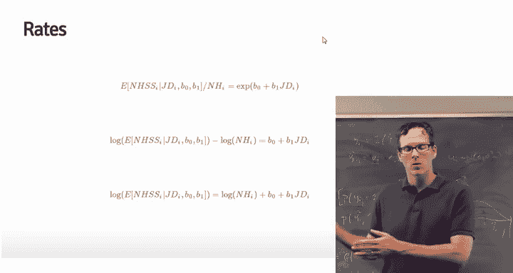

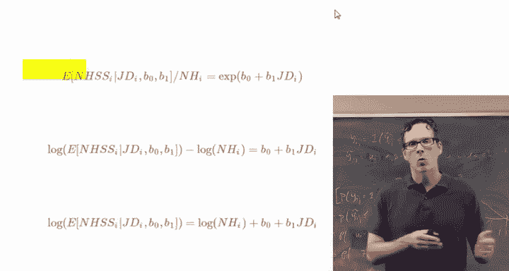

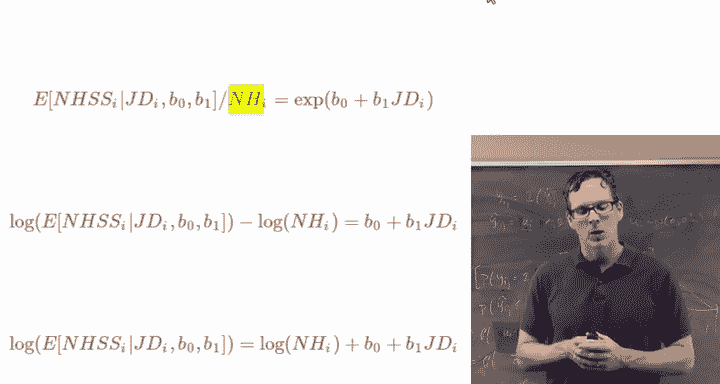

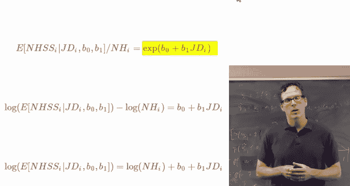

So he wants to model that proportion as being this log linear model。

Well， if we take the log on both sides。

And we add mess around a little bit， we see that we get the kind of a similar model to what we had before。

 we get the log of the outcome is the linear regression part。

 but that also it has this log offset with no coefficient and that it turns out is all you have to do to add a term into to add a rate or proportion into a Poson GLM。

 you just take whatever this relative denominator count or time or whatever it is that you want to consider and add it as a log offset in your linear model。

Okay， so the easy way to add this offset into our linear model is just to use the term offset equals log visits plus one。

 remember we have to add the plus one because we can't take the log of zero。

Remember， we have to have family equals Poson in the model statement here and by default it assumes a log link which is what we want。

 we haven't really covered any other kinds。

So there's another way you can add the offset， I think you can add a plus O variable name in the actual model specification part on the right of the Tilde。

 but this isn't just as easy to do it as an argument in the GLM function。

Here， Jeff gives the difference between the GLM1 fitted rates which was remembered to the outcome to the number of web hits versus the GLM2 fitted rates。

 the assigned variable GLM2 fitted rates， which was the relative number of web hits originating from simply statistics。

 so these blue points are adjusted for the red points in a sense。

And this actually shows the fitted model relative to the data there were a lot of zeros early on。

 and then it took off quite a bit， but this is the fitted model。

 the blue line is the fitted model and the gray points are the actual data points。

So you can get more information on log linear models and multiway tables and。

Another very common problem that occurs in plusson data is when the particular number zero occurs way more often than it should。

 this is called zero inflation， than the Poisson model would allow it to if it wants to fit the other counts。

And so this is called zero inflation， and so there's a lot of different ways to handle zero inflation and Poson data but you need to think about that in this case。

 yeah we might be concerned with handling all of those zeros early on。

 though there's a temporal component to the zero inflation in this case。

 which makes it even a little bit more challenging。

To model it well， but the Jeff is a package here that actually helps assist with modeling zero inflation。

So I hope you enjoyed the lecture that's the end of the lecture on Poisson data to get you started。

 and I'm hoping you can use a lot of your skills from binary logistic regression analysis and your skills from linear regression and multivariate regression and just apply them directly in our Poisson examples here。

Next lecture is the final lecture of the series it's kind of a fun little lecture with just some kind of a bonus content of a smattering of things you can do with linear models that I think are kind of cool。

 so look forward to seeing you next time and thanks for taking the class。

