# 约翰霍普金斯大学《数据科学：统计和机器学习｜Data Science： Statistics and Machine Learning》中英字幕 - P7：6_03 03 独立性.zh_en - GPT中英字幕课程资源 - BV1jsAAeNE3k

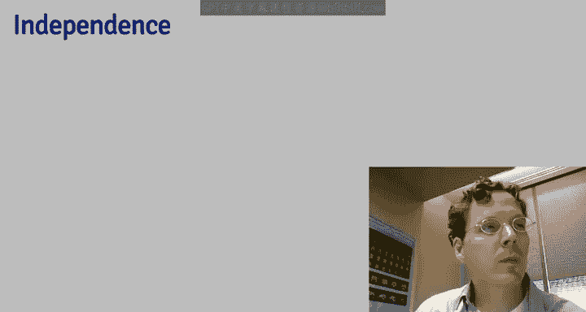

Let's cover briefly the subject of independence。We alluded to this earlier in that we said that a is independent of B if the probability of a given B is equal to the probability A for an event B that has positive probability。

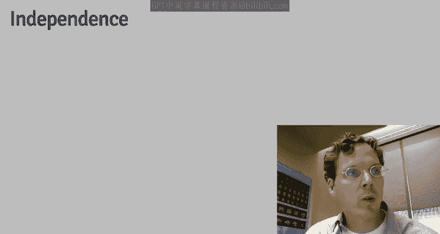

Another definition of is that the probability A and B are independent if the probabilityb of A intersect B works out to be the product of their probabilities。

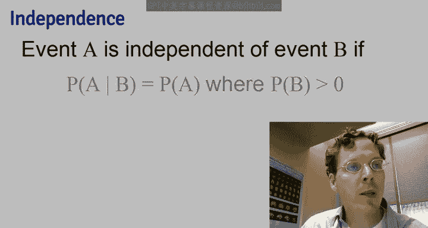

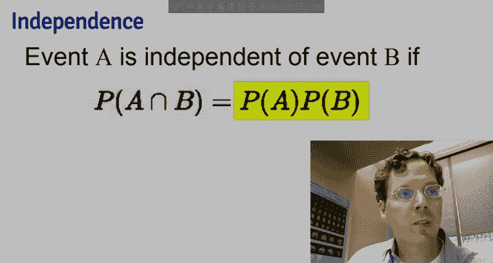

This then begins a very important lesson， you can't just multiply probabilities Will nilly。

 you have to multiply independent probabilities associated with independent events。

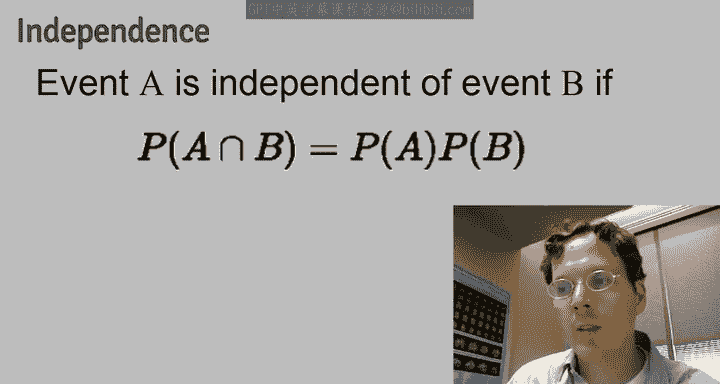

Let's go through a numerical example， what is the probability of getting two consecutive heads？

Let's define a as the probability of getting ahead on F1 and B is the probability of getting ahead on F2 both probabilities are 0。

5 in this case we're assuming a fair coin。

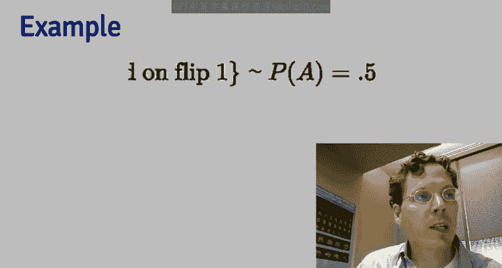

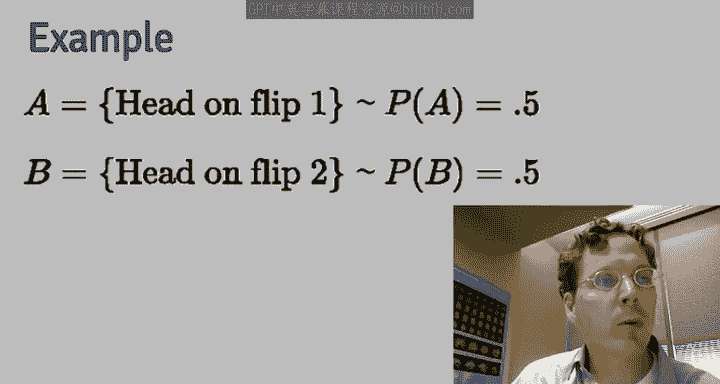

A intersect B is the event of getting heads on flips one and two。

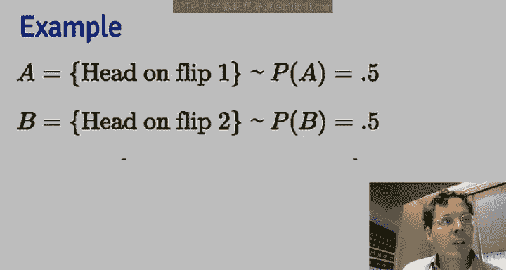

In this case， because the events are independent， the probability of A inter sec B is the product of the probabilities。

 and so we would say that it's 0。25， people do this calculation rather naturally。

The problem is when people multiply probabilities when they shouldn't。

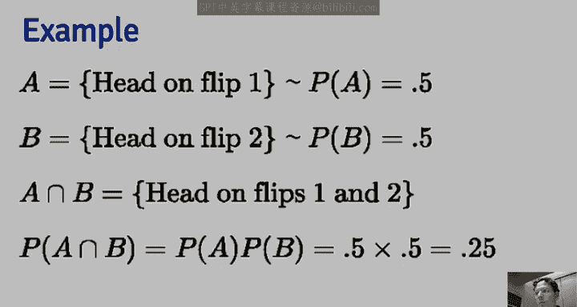

A particularly stark instance of incorrectly multiplying probabilities occurred in volume 309 of science。

Which was reporting on a physician who was on trial for giving expert testimony in a criminal trial。

The criminal trial involved a mother。Who had had two children die from sudden infant death syndrome？

The expert testimony took the prevalence of Southern sudden infant death syndrome as one out of 8500。

 and then multiplied them together to find the probability of two children having sudden infant death syndrome with the same mother。

 based on this evidence， and I presume other evidence the mother on trial was convicted of murder。

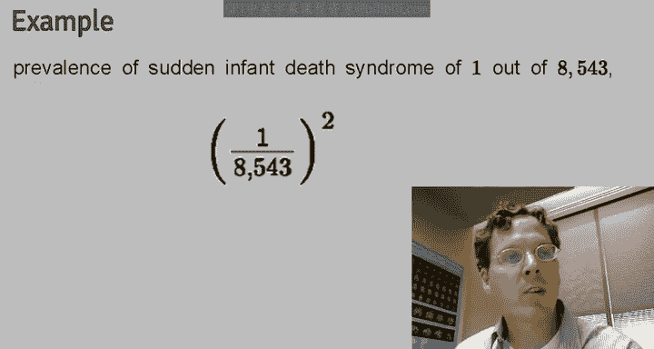

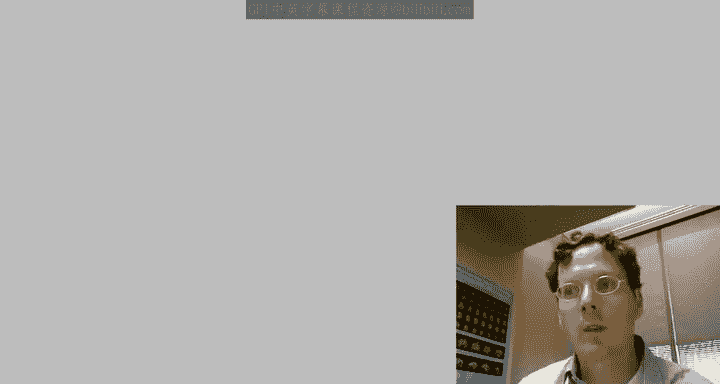

Relevant to this class， the principal mistake was to multiply probabilities for events that were not necessarily independent。

And it makes sense that in this case， to assume that the events would be dependent because any biological process that has a genetic or familial environmental component is likely to be dependent within families。

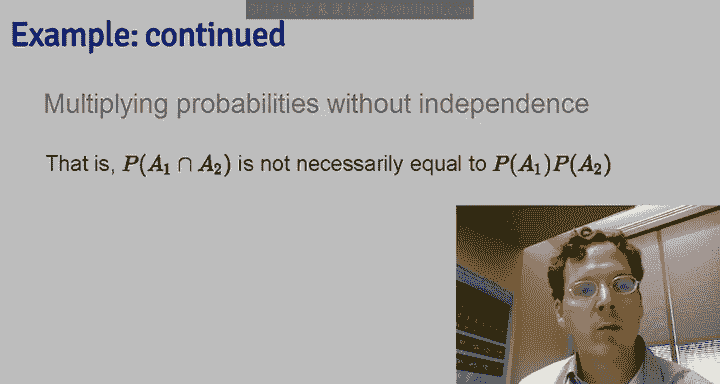

In this class， the main way we're going to use independence is that we're going to assume that a collection of random variables are independent and from the same distribution。

 we call such random variables independent and identically distributed。

 so you might think of several coin flips as IID because they are independent one coin flip is independent from the next one。

 and they all arise from the same distribution 0。5 for heads and 0。5 for tails。

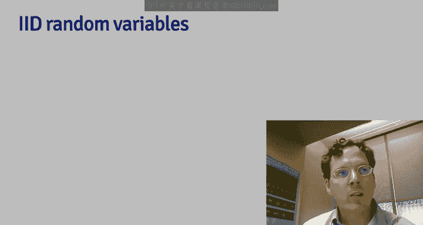

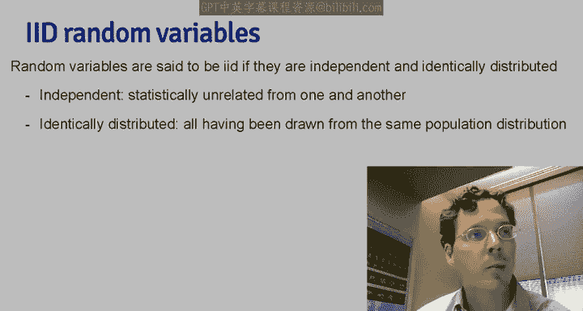

IID sampling is our default model for a random sample。

 so whether we have an actual random sample or not。

 we often use random sampling or the model of IID as a conceptual model to analyze our data。

 it'll be our principal mode of analysis for this class。

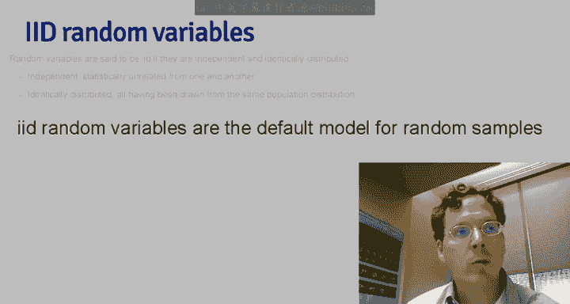

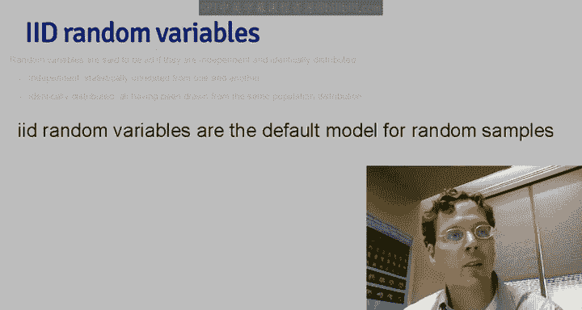