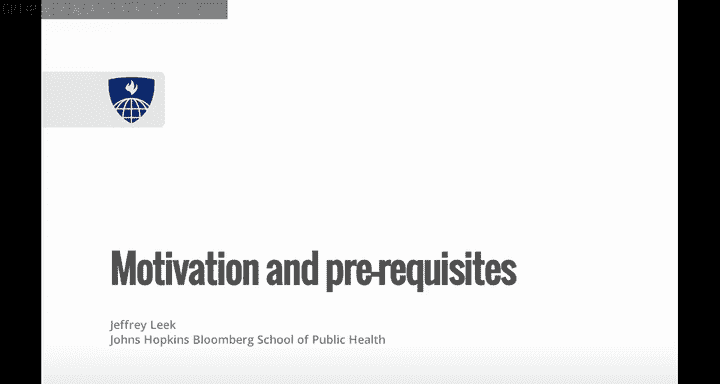
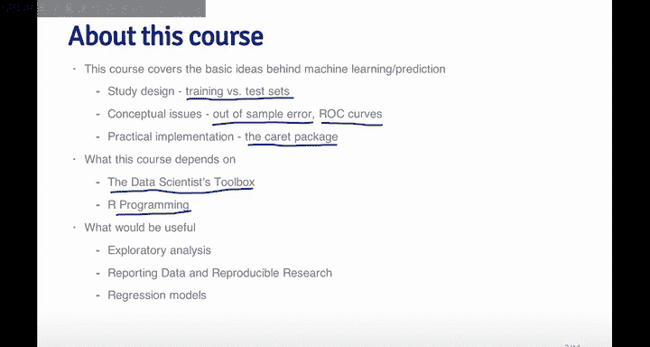
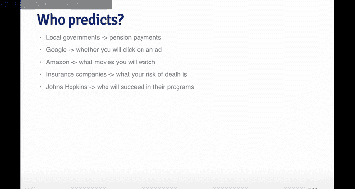
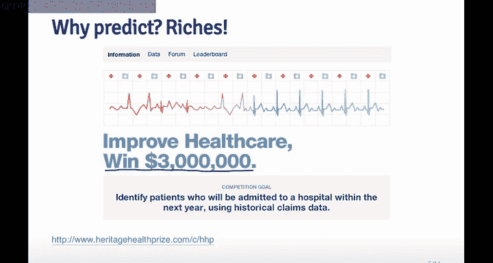
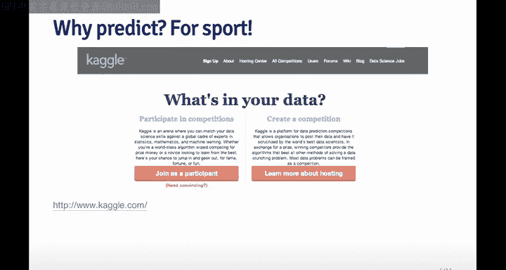
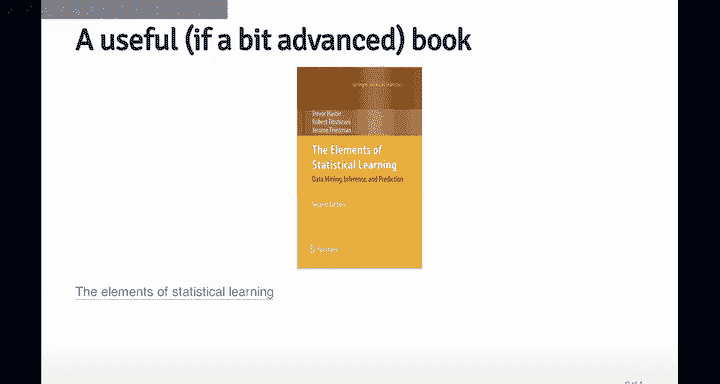
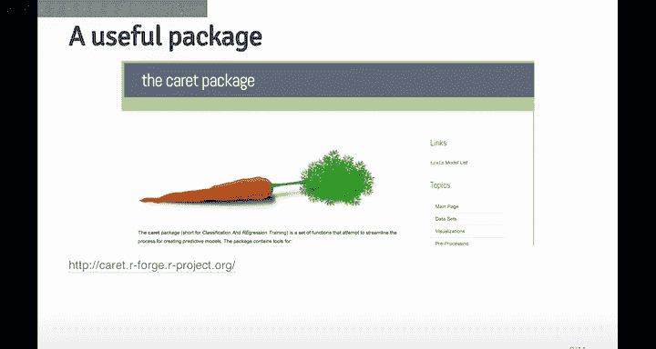
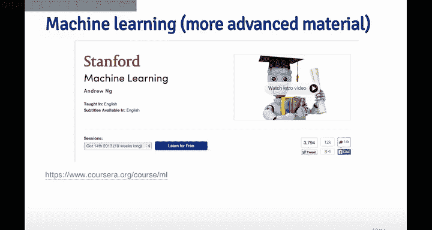
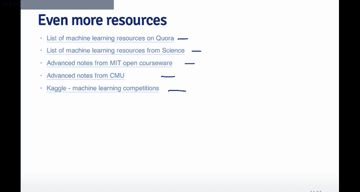

# 约翰霍普金斯大学《数据科学：统计和机器学习｜Data Science： Statistics and Machine Learning》中英字幕 - P81：0_预测动机.zh_en - GPT中英字幕课程资源 - BV1jsAAeNE3k

Welcome to the course Pra Mach learning This is one of the funest classes in the data science specialization I'm very excited about all the ways that you can use data to predict and I think it's one of the areas that's probably the most sort of well known when you think about data science。

This first lecture is going to cover the motivation and prerequisites for the course and give you a little bit of idea about where we're going to be going。

So this course will cover the basic ideas of machine learning and prediction and our goal is to be very practical and very handson with our understanding of machine learning and so the idea here is that we're going to cover the main techniques that lots of people use and that you maybe heard about linear regression and random forests and things like that。

 but we're also going to cover sort of the nitty gritty details and the practicalities of doing machine learning in real examples and so we got to start off with ideas like study design so training versus test sets and deciding how do you actually build up a predictor in a real data then we'll talk about conceptual issues like out of sample error and overfitting so you might have heard of the fact that some models are maybe a little too tuned to the noise and so won't predict well in a new sample and so we'll talk about how do you sort of prevent those sorts of problems we'll also talk about things like ROC curves or methods for evaluating predictors for deciding whether a predictors any good or not。

And we're going to be focusing a lot on the practical implementation of these machine learning algorithms and also these more conceptual issues in R and we're going to be using the carrot package for a large majority of that the carrot package is nice unifying framework for a lot of machine learning packages that exist in R those packages were built by a lot of different people and they have different parameters and different choices that have been made by their developers and the carrot package is sort of a nice unifying framework for that This course does depend quite heavily on the tools that you've learned in the data scientist toolbox and in our programming so if you haven't taken those classes already they're highly encouraged before taking this class。

It would also be useful if you've taken exploratory data analysis。

 reporting data and reproducible research and regression models， those classes aren't required。

 but a lot of the material that we'll cover in this class will be related to that material and so if you've seen it before。

 it might be a little bit easier on you when you go through the material in this class。

So who predicts things this is an important question I think an important motivator for this class。

 basically most organizations now use machine learning in some simple form at minimum and often in much more complicated forms。

 so here are a couple of examples local governments might try to predict pension payments in the future so that they know whether their revenue generation mechanisms have sufficient funds generated to cover those pension payments。

Google might want to predict whether you're going to click on an ad so that they can show you only the ads that are most likely to get clicks and so increase revenue。

Amazon and Netflix and other companies like that will show you one movie and they want you to buy the next movie in order to do that they want to show you what you may be interested in movies that you have seen this one movie so you might be interested in these other movies so that they can kind of keep you watching and again increase revenue insurance companies employ large groups of actuaries and statisticians to try to predict your risk of all sorts of different things including death so that they can know what's the right price to set insurance premiums at and then places like Johns Hopkins where I work will also want to predict who's going to succeed in their program so which students that have applied to our program will be most likely to be successful。

All of these different prediction tasks are performed by a variety of different organizations and they're performed at different levels。

 so some of them are very complicated， predicting which ad you might click on might have a whole bunch of predictors and it might be based on quite a complicated machine learning algorithm in some cases it might be a lot simpler in terms of what you're trying to predict and so either way it's an important component of basically every major organization these days。

😊。

So why would you predict things well one is Glor This is a picture of Chris Fenssky he's a member of the team that won the Netflix Prize。

 the Netflix Prize was a million dollar prize that was given out to a team that could reduce the error that Netflix was making when they were trying to predict which new movie somebody might be interested in seeing So Chris was a member of a large organization of multiple teams that blended their models together and they predicted the best and won the prize it's actually kind of a fascinating story about how that happened and so of course they all got a lot of sort of nerd credit and a lot of glory for winning these competitions and so that's one way reason you might be excited about being good at machine learning。

You might also be excited because you can there's money in it so not only through organizations where you can earn a lot of money。

 if you know how to best predict which ads people will click on and so forth。

 but even in these competitions so for example this is the Heritage Health prize and so this was a $3 million prize to the team that could best predict who would be admitted to the hospital in a year。

And when you were trying to do this prediction， you would use information about the previous hospitalizations from previous years and nobody actually won $3 million。

 but people did win quite a bit of money from this prize over in the sort of interim prizes and so people actually both make money through the competitions。

 but they also spun off。Analytics， companies and organizations based on their performance in these competitions。

In general， it's now kind of a sport， data science is a sport， particularly in terms of prediction。

 and so these are this organization Cago is one of many organizations that can host these competitions where you can try to predict the outcome of a particular experiment or you try to predict all sorts of different things and these competitions often run for a certain fixed period of time and often have a lot a little bit of money on the line as well so it can be a lot of fun and there's a ranking and a leaderboard so you can kind of get into the fun of the competition。

This is a little closer to my area of research so you might also predict for the purposes of doing sort of better medical decision making and so oncotype VX is a prognostic gene expression signature that can be measured in women who have breast cancer and it can be used to predict how long they'll survive given a particular set of conditions that they have and so that could be very useful for medical doctors when making decisions about patients with breast cancer。

This is a book that I find very useful， it's a little bit advanced for this class。

 although a lot of the tools are incredibly useful still it's called The Elments of Statistical Learning and so this is a book that's actually you can get a free copy of the PDF from the author's website so that's very nice but if you do really like the book I encourage you to buy it as well the authors put a lot of effort on into it and it's a great book and so it can be very useful in terms of having a lot of information that we'll cover in this class。

😊。

And then the package that I think we're going to be using by far the most in this class is the CAt package。

 so the CAt package combines a very large number of predictors that have been built in R and it allows you to sort of set up training and test sets in a kind of a unified framework that prevents a lot of the problems that come up when building prediction models。

If you want some more advanced material so the one place to go would be the machine learning class from Coursera and what I mean by advanced material is sometimes you might be interested in a lot more of the sort of mathematical detail behind how these algorithms work or you might be interested in a lot more of the sort of high- levelvel machine learning algorithms that are on the very cutting edge and I think this class would be a great place for you to start learning about those sorts of material this class like I said。

 will cover the basics and will' focus on getting you to the point from sort of zero to 60 and in other words。

 it'll get you to the point where you can use machine learning tools in your day to- day but it won't necessarily cover all the toplevel details of machine learning algorithms。

There's actually a huge amount of information available out there on machine learning。

 it's a very hot topic right now so I've listed here a bunch of links that send you to information at Qra。

 it's from science， from MIT， CMU and CAGL which will give you a lot of information about how to do machine learning in a variety of different ways and so if this class what's your appetite and gets you excited about some of these other things。

 that'd be great too。

