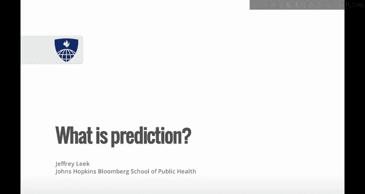
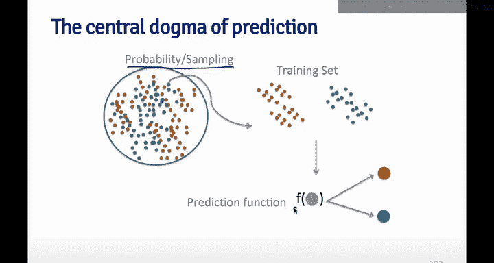
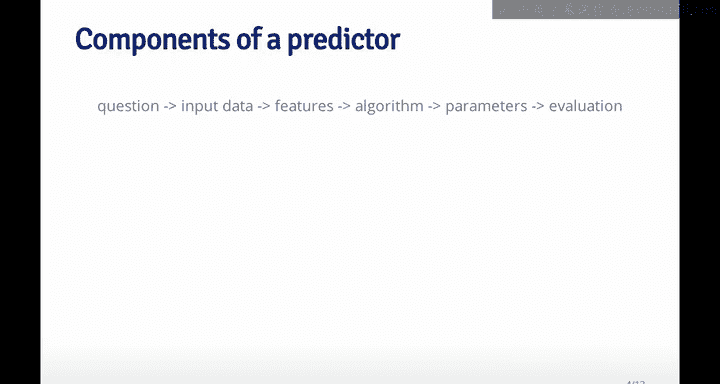
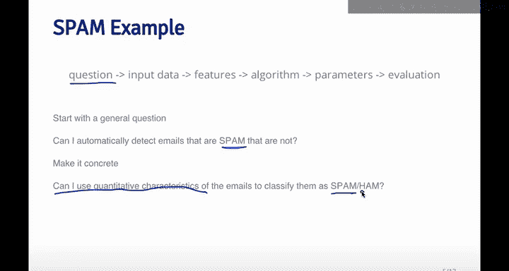
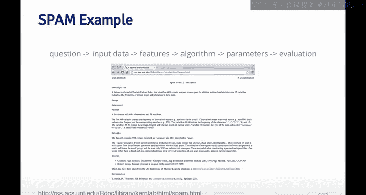
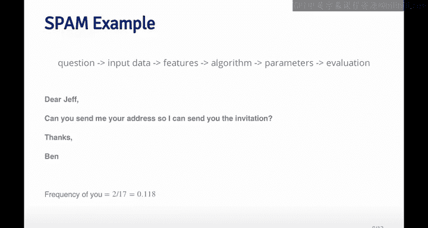
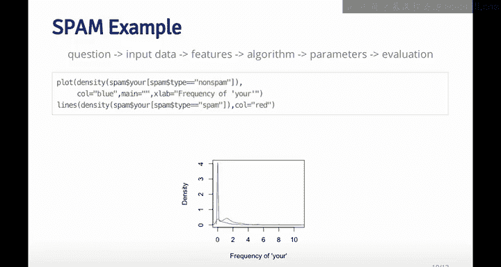
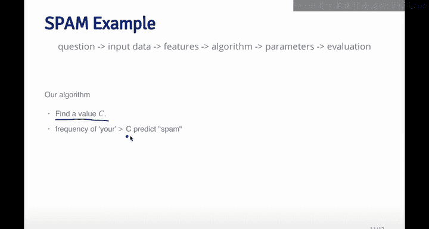
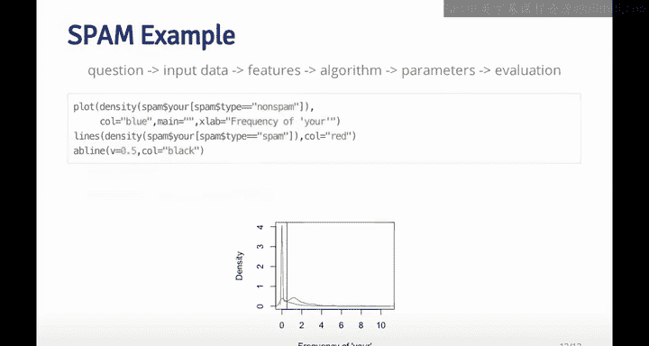
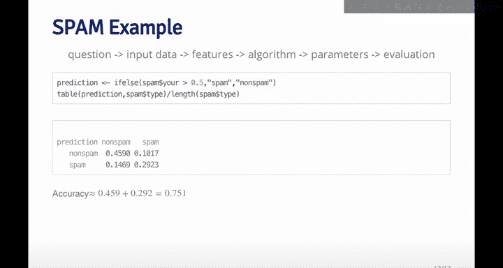

# 约翰霍普金斯大学《数据科学：统计和机器学习｜Data Science： Statistics and Machine Learning》中英字幕 - P82：1_什么是预测.zh_en - GPT中英字幕课程资源 - BV1jsAAeNE3k

A lot of the action in machine learning has focused on what algorithms are the best algorithms for extracting information and using it to predict。

 but it's important to take a step back and look at the entire prediction problem。

This is a little diagram that I made to illustrate some of the key issues in building a predictor。

 so you start off with suppose I want to predict for these dots， whether they're red or blue。Well。

 what you might do is have a big group of dots that you want to predict about and then you use probability and sampling to pick a training set。

 the training set will consist of some red dots and some blue dots and you'll measure a whole bunch of characteristics of those dots。

Then you'll use those characteristics to build what's called a prediction function and the prediction function will take a new dot whose color you don't know。

 but using those characteristics that you measured will predict whether it's red or whether it's blue。

 then you can go off and try to evaluate whether that prediction function works well or not。

One thing that I think is very important and often underappreciated about building a machine learning algorithm is to look at probability and sampling step of building the training and test sets。

This is always a required component of building every machine learning algorithm。

 is deciding which samples you're going to use to build that algorithm。

 but sometimes it's overlooked because all of the action that you hear about for machine learning happens down here when you're building the actual machine learning function itself。

One very high profile example of the ways that this can cause problems is the recent discussion about Google F trendsrends。

Google F Transrens tried to use the terms that people were typing into Google。

 terms like I have a cough， to predict how often people would get flu， in other words。

 what was the rate of flu that was going on in a particular part of the United States at a particular time？

And they compared their algorithm to approach taken by the United States government where they went out and they actually measured how many people were getting the flu at different places in the US。

 and they found in their original paper that the Google F trendsrens algorithm was able to very accurately represent the number of flu cases that would appear in various different places in the US at any given time。

 but it was quite a bit faster and quite a bit less expensive to measure it using search terms of Google。

The problem that they didn't realize at the time was that the search terms that people would use would change over time。

 they might use different terms when they were searching and so that would affect their algorithm's performance and also the way that those terms were actually being used in the algorithm wasn't very well understood and so when the function of a particular search term changed in their algorithm it could cause problems and this led to highly inaccurate results for the Google F trends algorithm over time as people's Internet usage changed so this gives you an idea that choosing the right data and knowing what the specific question is are again paramount just like they happen in other classes in the data science specialization。

So here are the components of a predictor， you need to start off as always in any problem with data science with a very specific and well definedfined question。

 what are you trying to predict and what are you trying to predict it with？

Then you go out and you collect the best input data that you can to be able to predict。

And from that data， you might either use measured characteristics that you have or you might use computation to build features that think you might be useful for predicting the outcome that you care about。

At this stage， then you can actually start to use the machine learning algorithms you may have read about。

 such as random forests or decision trees。And then what you can do is estimate the parameters of those algorithms。

And use those parameters to apply the algorithm to a new data set and finally evaluate that algorithm on that new data。

So I'm going to just show you one quick little example to show you how this whole process works。

So this is obviously a trivialized version of what would happen in a real machine learning algorithm。

 but it gives you a flavor of what's going on So you start off with asking something about the question so you start with in general people usually start with a quite general question so here is can I automatically detect emails that are spam from those that are not So spam emails are emails that you got that you come from companies that get sent out to thousands of people at the same time and that you might not be interested in。

So you might want to make your question a little bit more concrete and you often need to when doing machine learning。

 and so the question might be， can I use quantitative characteristics of those emails to classify them as spam or what we're going to call hamAM。

 which is the email that people would like to receive。

So once you have your question then you need to find input data in this case there's actually a bunch of data that's available and already preprocessed for us in R。

 so it's actually in the current lab package， KER and LAV。

 and it's the spam data set so we can actually load that data into R directly and it has some information that's been collected about spam and hamAM emails already available to us Now we want to keep in mind that that might not necessarily be the perfect data。

 in fact we don't have all of the emails that have been collected over time or we don't have all the emails that are being sent to you personally so we need to be aware of the potential limitations of this data when we're using it to build an prediction algorithm。

Then we want to calculate something about features so imagine that you have a bunch of emails and here's an example email that's been sent to meDear Jeff。

 can you send me the address so I can send you the invitation thanks Ben。

If we want to build a prediction algorithm， we need to calculate some characteristics of these emails that we can use to be able to build a predictiveative algorithm。

 and so one example might be we can calculate the frequency with which a particular word appears so here we're looking for the frequency that the word you appears。

And so in this case it appears twice in this email。

 so two out of 17 words or about 11% of the words in this email are you We could calculate that same percentage for every single email that we have and now we have a quantitative characteristic that we can try to use to predict。

So the data in the current lab package that I've shown here are actually information just like that for every email we have the frequency with which certain words appear and so for example。

 if credit appears very often in the email or money appears very often in the email。

 you might imagine that that email might be a spam email。So as one example of that。

 we looked at the frequency of the word your and how often it appears in the email。

 and so I've got a plot here that's a density plot of that data and so on the X axis is the frequency with which your appears in the email and on the Y axis is the density or the number of times that that frequency appears amongst the emails。

And so what you can see is that most of the emails that are spam， those are the ones that are in red。

 you can see that they tend to have more appearances of the wordyre。

 whereas all of the emails that are ham， the ones that we actually want to receive have a much small higher peak right over here down near zero。

 so there's very few emails that have a large number of yours that are ham。

So we can build an algorithm， in this case， let's build a very very simple algorithm。

 we could estimate an algorithm where we want to just find a cut off。

 a constant C where if the frequency of your is above C， then we predict spam。

 and otherwise we predict that it's ham。

So going back to our data， we can。😊。

Try to figure out what that best cutoff is and here's an example of a cutoff that you could choose so choose a cutoff here that if it's above 0。

5， then we say that it's spam and if it's below 0。5。

 we can say that it's hand and so we think this might work because you can see that the large spike of blue ham messages are below that cutoff。

 whereas one of the big spikes of the spam messages is above that cutoff so you might imagine that will catch quite a bit of this spam。

So then what we do is we evaluate that， so what we would do is calculate， for example。

 predictions for each of the different emails， we take a prediction that says if the frequency of your is above 0。

5， then your're spam and if it's below it， then you're non spam。

And then we make a table of those predictions and divide it by the length of all the observations that we have and so what we can say is that when your non- spam about 45% of the time。

 46% of the time we get you right when your spam about 29% of the time we get you right so total we get you right about 45% plus 29% is about 75% of the time so our prediction algorithm is about 75% accurate in this particular case so that's how we would evaluate the algorithm。

 this is of course in the same data set where we actually calculate it the prediction function and as we'll see in later lectures this will be an optimistic estimate of the overall error。

So that's an overview of the basic steps in building a predictive algorithm。

