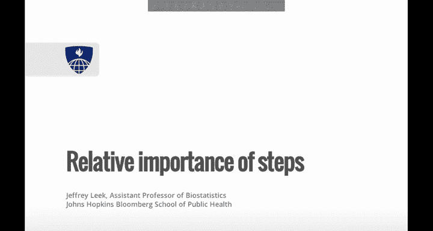
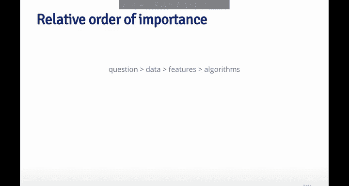
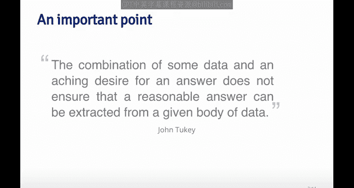
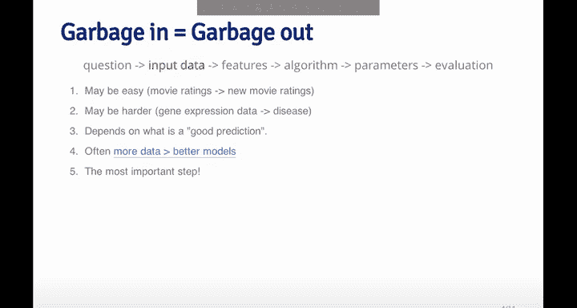
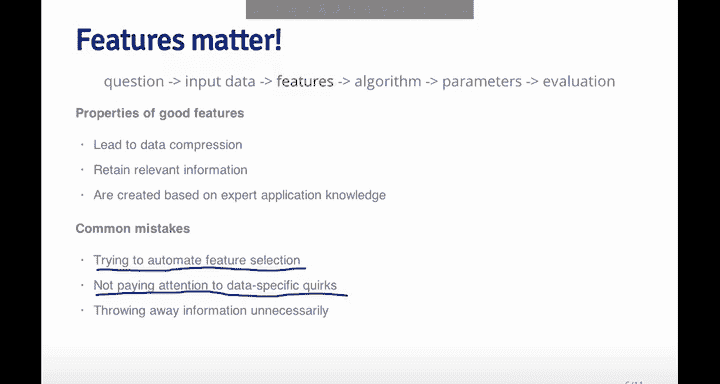
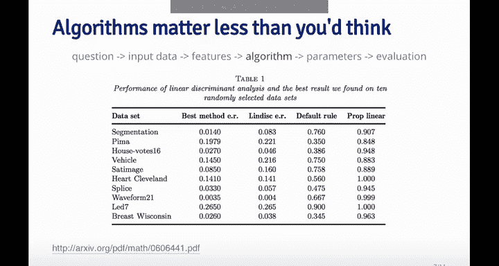
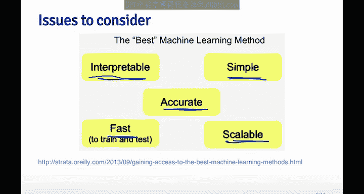
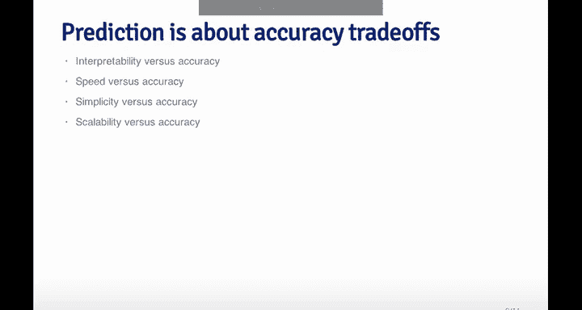
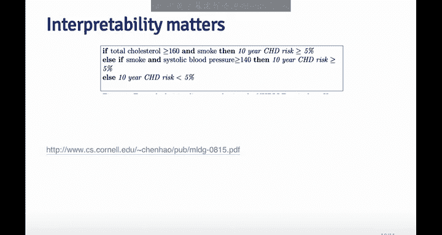
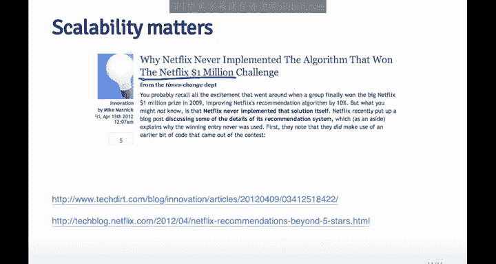

# 约翰霍普金斯大学《数据科学：统计和机器学习｜Data Science： Statistics and Machine Learning》中英字幕 - P83：2_步骤的相对重要性.zh_en - GPT中英字幕课程资源 - BV1jsAAeNE3k

This lecture is about the trade offs and the different components of building a machine learning algorithm。

So remember from the previous lecture that we talked about the different components of building a machine learning algorithm and we started off with a question。

 so this is the question we're trying to answer and we try to make it as concrete as possible。

Then we collect some data， the data that we're going to be using to build our machine learning algorithm and to apply that algorithm later on from that data we compress press it into a set of features that we're going to use to predict with。

 and then we feed those features into an algorithm which we then used to apply to predict things。

InMy experience it's been that the question is the most important component of building a a good machine learning algorithm。

 getting a very concrete and specific question where you can collect data。

 The next most important step is to be able to actually collect data frequently the question that you actually really want to answer the data won't be available or the data will be only available in a sort of tangential form。

Then creating features is an important component in that if you don't compress the data in the right way。

 you might lose all of the relevant and valuable information and finally in my experience it's been that the algorithm is often the least important part of building a machine learning algorithm。

 it can be very important， depending on the exact modality of the type of data that you're using。

 for example， image data and voice data can require certain kinds of prediction algorithms that might not necessarily be as important for different kinds of prediction。

So an important point that I think is worth hammering home is driven was actually first quoted by John Tki。

 which is that the combination of some data and an aching desire for an answer does not ensure that a reasonable answer can be extracted from a given body of data in other words。

 an important component of knowing how to do prediction is to know when to give up when the data that you have is just not sufficient to answer the question that you're trying to answer。

The key point that you need to remember when making that decision is garbage in garbage out。

 in other words， if you have bad data that you've collected or data that isn't very useful for performing predictions。

 no matter how good your machine learning algorithm is， you'll often get very bad results out。

In general， the easiest thing to predict is when you have data on the exact same thing that you're trying to predict。

 in other words， when you're in the Netflix Prize， they were trying to predict new movie ratings。

 how people would rate movies， and they were trying to make that prediction on the basis of old movie ratings。

 and so that's a very direct relationship you could imagine how old movie ratings would be governed by a similar process as the new movie ratings。

In my area， one thing that you might do is collect molecular measurements such as gene expression and so that's a measure of something that's going on in your body and you might use that to try to predict how people respond to disease or to other different medical conditions Again。

 there's sort of you can imagine a pathway from the gene expression data we've collected the molecular information we've collected about you to your disease status in general it depends what is a good prediction。

 what are the features that you would collect to be able to predict， but in general。

 the closer that you could get to similar types of data the closer that you can do to performing high predictive accuracy。

This is a link here to a video that talks about the unreasonable effectiveness of data。

 in other words， that getting a lot more data can often beat out getting much better statistical or machine learning models in almost every case。

 and the most important step in developing a machine learning algorithm after you define a question is collecting the right data and data that's relevant for the question you're trying to answer。

The features also matter， so the important properties of good features are that they compress the data in a way that make it possible to compute your prediction or your machine learning algorithm in a very simple way and maybe are more interpretable than the data that you've collected that the raw data that might be complicated the good features retain all the relevant information while compressing the data and that can be a hard balance to strike。

They're also usually created with expert application knowledge and this is something that there's a debate in the community about whether it's better to create features automatically or whether it's better to use expert domain knowledge。

 and in general it seems that the expert domain knowledge can help quite a bit in many。

 many applications and so should be consulted when building the features for machine learning algorithm。

Some common mistakes are trying to automate feature selection in a way that doesn't allow for you to understand how those features are actually being applied to make good predictions。

 black box predictions can be very useful， they can be very accurate。

 but they can also change on a dime if we're not paying attention to how those features actually do predict the outcome。

Not paying attention to data specific courts is another problem that can come up。

 so in some cases the function of a particular set of data might be that there's outliers if there's weird behavior of specific features and not understanding those can cause problems and obviously throwing away information unnecessarily is not a good idea。

You can automate feature selection sometimes with care， in fact。

 there's a whole area of research that's been dedicated to this or what I would call sort of semisupervised learning or deep learning and so the idea in this paper was to try to use to try to discover features of YouTube videos that could later be used in prediction algorithms and so for example they were able to create a very accurate predictor of whether you were a cat in a video or not based on a bunch of features that they sort of collected in an unsupervised way。

 in other words they filtered through the data in a way to identify those features that might be useful for later predictive algorithms。

 but even when they did this， they would went back and looked at those features and tried to figure out why they would be predictive and so for example feature this feature here makes it very clear why it would be a good predictor for a cat because you can kind of see the image of a cat there in the video feature that they've collected。

Algorithms matter less than you think and this can be a bit of a source of surprise and frustration for some people so this is a table where they actually tried predicting a variety of different prediction tasks。

 for example， sort of a segmentation task predicting votes in the US House of Representatives and predicting waveform and a bunch of other different prediction tasks and so they did it with two different ways first they use something called linear discriminant analysis。

 which is sort of a very basic early predictionor you might learn and then they also tried for each data set to find the absolute best prediction algorithm they could have and then this table shows the prediction error of these two different approaches and you can see that the best prediction error is always a little bit better than the linear discriminant error but it's actually not that far off So for example here in this pma prediction it was 0。

19 was the 197 was the error with the best method and 0。

22 for linear discriminant analysis so it seems like using the same method over and over again。

 did make the prediction error worse but not。Incredibly worse。

 and so that's very typical of many applications that using a very sensible approach will get you a very large way to solving the problem and then getting the absolute best method can improve。

 but it often doesn't improve that much over sort of most good， sensible methods。

Some issues to consider when building a machine learning algorithm are that there's different components to it first。

 you might need it to be interpretable in other words。

 if you're going to be showing this machine learning algorithm to doctors or in my case。

 or in the case of a web company， you might want to show this to the CEO。

 you want your predictor to be interpretable so they can understand it part of being interpretable is often being simple in other words being very easy to explain is often better than being really complicated and hard to understand。

And often you have tradeoffs with respect to accuracy。

 so getting those two qualities can reduce your accuracy and the question is how much do they reduce your accuracy。

 is it too much to give up the interpretability or the simplicity that you've gained？

You also want it to be scalable and fast so fast by fast I mean it's very easy to build the model。

 it's very easy to test the model in small samples。

 scalable means it's easy to apply to a large data set， whether that's because it's very。

 very fast or whether it's because it's parallelizable across multiple samples， for example。

So in general， prediction is about accuracy trade offs。

 so the idea is sometimes you will trade off a lot of accuracy or a little bit of accuracy for interpretability。

 sometimes you'll trade it off for speed or simplicity or scalability。

 but in general what you're trying to do is find that right balance between those other features of the prediction algorithm that might be important to you and how accurate you need it to be。

Interpretability often matters， so for example， in medical studies。

 this is a paper that studied how some physicians like better prediction rules that look like this。

 they look a little bit like decision trees， in other words。

 you start off and you say if total cholesterol is above a particular value and you smoke。

 then you get a certain outcome so those sort of if then statements can be very interpretable to some people and as the reason why people like things like decision trees。

 and that can matter more or less depending on what the purpose of your algorithm is。

 but interpretability prevents things like the Google flu trends problem where people didn't really understand how the features were directly tied to the rate of flu and so if you don't understand how the features are working。

 you can get caught when the algorithm starts to have problems or fail。

Scalability also matters a very interesting component of this Netflix challenge is that the Netflix Pri was a million dollar challenge and they had lots of teams compete and several teams produced analytic algorithms that were much better at predicting than Netflix original algorithm but it turns out they actually never implemented the final on their production machinery and the reason was that the algorithm didn't scale very well。

 it was a blend of many， many different machine learning algorithms and it took a long time to compute particularly on the huge data sets that Netflix was collecting and so they actually went was something that was a little less accurate but quite a bit more scalable so that tells a lesson of accuracy isn't always the best and only decision maker when trying to build prediction algorithms。

 although that's often the one that gets focused on the most。

