# 约翰霍普金斯大学《数据科学：统计和机器学习｜Data Science： Statistics and Machine Learning》中英字幕 - P84：3_样本内和样本外误差.zh_en - GPT中英字幕课程资源 - BV1jsAAeNE3k

This lecture is about ins sample and out of sample errors。

 this is one of the most fundamental concepts that we deal with in machine learning and prediction。

 and so it's worth understanding the concept with a very simple example。

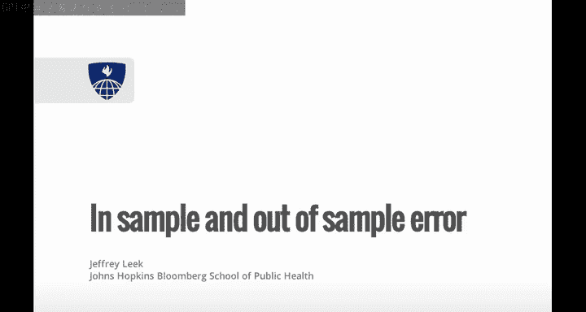

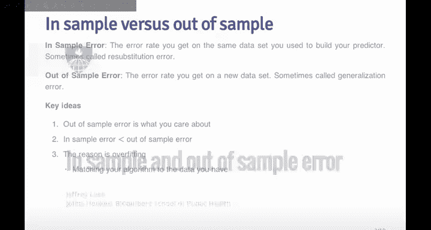

So in sample error is the error rate you get on the same data you use to train your predictor this is sometimes called resubstitution error in the machine learning literature and ins sampleample error is always going to be a little bit optimistic for what the error is that you would get on a new sample and the reason why is in your specific sample。

 sometimes your prediction algorithm will tune itself a little bit to the noise that you collected in that particular data set and so when you get a new data that'll be different noise and so the accuracy will go down a little bit so what we do is we look at this out of sample error rate。

 this is sometimes called the generalization error in machine learning and so the idea is that once we build a model on a sample of data that we've collected。

 we might want to test it on a new sample and a sample collected by a different person or at a different time in order to be able to see what the sort of realistic expectation of how well that machine learning algorithm will perform on new data。

So almost always out of sample error is what you care about and so if you see a reported error rate for the error rate reported only on the data where the machine learning algorithm was built。

 you know that's very optimistic and it probably won't reflect how the model will perform in real practice in the sample error is always less than out of sample error so that's something to keep in mind and the reason is overfitting basically again you're matching your algorithm to the data that you have in hand and you're matching it a little bit too well so sometimes you want to be able to give up a little bit of accuracy in the sample that you have to be able to get accuracy on new data sets in other words when the noise is a little bit different your algorithm will be robust。

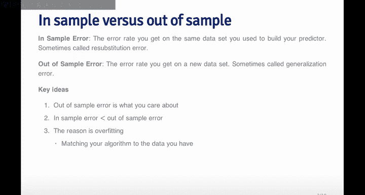

So just to show you a really simple example， I thought I'd show you in sample versus out of sample errors with kind of a trivial example so here's what I've done I've taken this again I've gone to the current lab package and I looked at the spam data remember that was data where we collected information about spam messages or messages from robots and things like that and hand messages messages we actually care about and what I do is I actually take a very small sample that spam data I just take 10 messages and what I do is I basically look at whether you see a lot of capital letters so I'm basically looking at the average number of capital letters that you observe in a particular email and so I plotted the first 10 examples here versus their index and so in red or all the spam messages in black or all the ham messages and so you can see for example that some of the spam messages like this one up here have a lot more capital letters than the ones that are ham messages that sort of makes sense intuitively。

So we might want to build a predictor based on the average number of capital letters as to whether you are a spam message or your hand message。

 So one thing that we could do is build a predictor that says if you have a lot of capitals。

 then you're a spam message and if you don't then you're a non-s spam message and here's what this rule could look like you could say if you're above 2。

7 per capital average we're going to call you spam and if you're below 2。

40 you're classified as non-spanm and then one thing that we could do is we could actually try to train this algorithm very。

 very well to predict perfectly on this data set So if we go back to this plot of the different values。

 you can see there's one spam message right down here in the lower right hand corner that is a little bit lower than the highest nonspanm value in terms of this capital average so we could build a prediction algorithm that would capture that spam value as well and so what we would do then is we would make a rule here that just picks out that one value in the training set it says if you're between 2。

4 and 2。45。

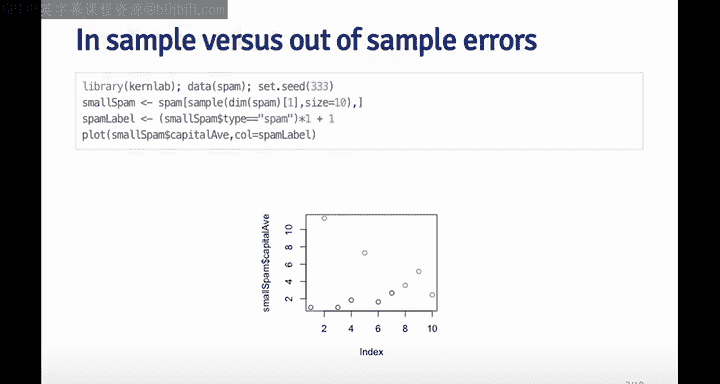

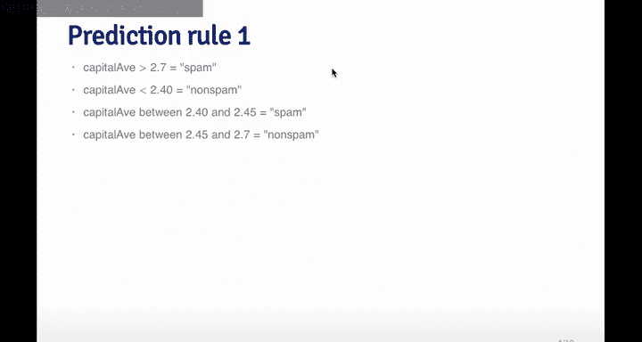

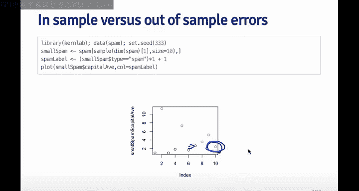

You're called spam as well and that's designed to basically make the training set accuracy perfect and you can see if we apply this rule to the training set。

 we actually do get perfect accuracy so if you're non spam we perfectly classify you as non spam and if you are spam we perfectly classify you as spam。

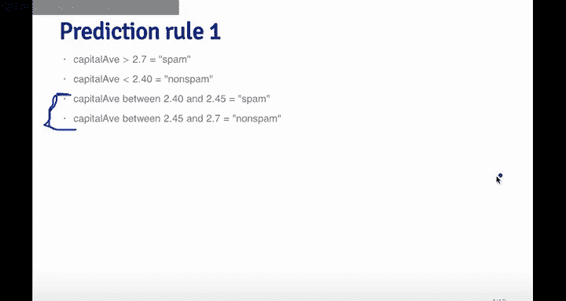

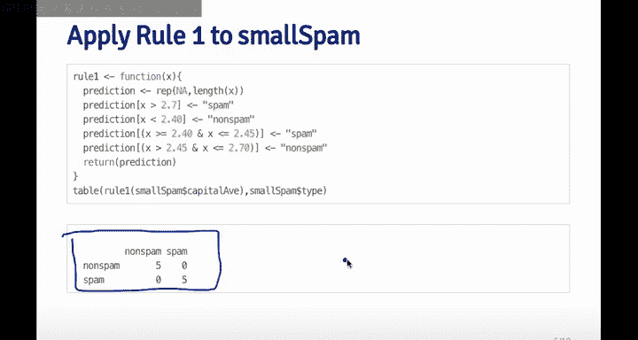

An alternative rule would not train quite so tightly to the training set but would still use the basic principle of if you have a high number of capital letters then your spam message and so this rule might look something like this if you're above 2。

40 you're a spam message， if you're less than or equal to 2。

40 than your non spam message so this rule on the training set would then miss that one value in other words。

 you could have a prediction of non spam for that one spam message that was just a little bit lower in our training set。

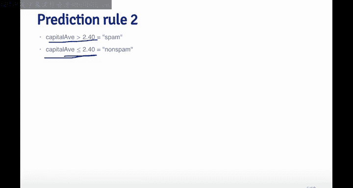

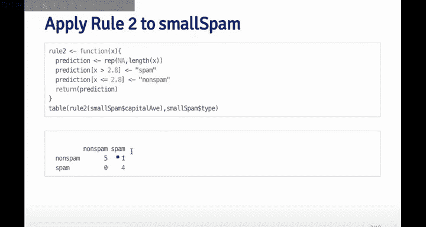

So overall this looks like in the training set that the accuracy is a little bit lower for this rule it's a little bit more simplistic。

 so then we can apply it to all the spam data in other words apply it to all the values。

 not just the values that we had in that small training set and these are the results that you would get so this is a table of our predictions on the rows here and in the columns that's the actual values and so you can see the number of errors that we make are the errors here that are on the off diagonal elements of this little matrix that we've created so those are the number of errors that we made and so what we can look at is we can actually look at the average number of times that were right using our more complicated rule so this is just the sum of the times that our prediction is equal to the actual value in the spam data and so that happens 3366 times in this data and then we can also look at the more simplified rule the rule where we just use the threshold and also look at the number of times that that's equal to the real spam type and you can see about 30 more times we actually get the right answer when we use。

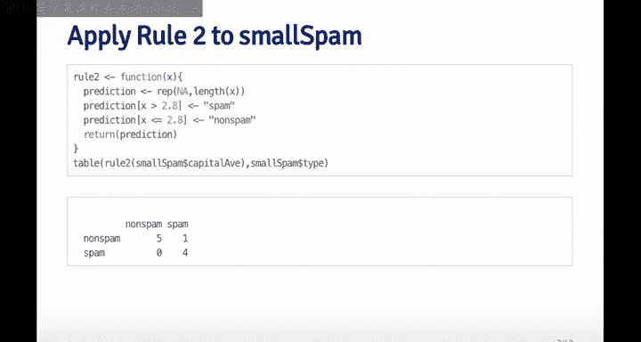

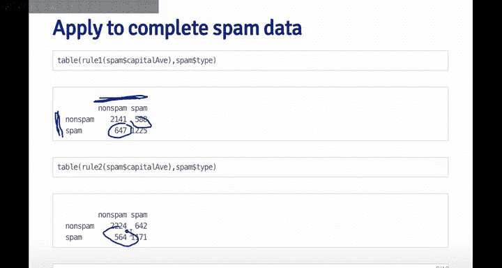

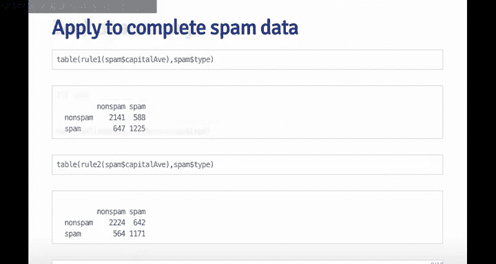

This more simplified rule So what's the reason that the simplified rule actually does better than the more complicated rule and the reason why is overfitting so in every data set we have two parts we have the signal component that's the part we're trying to use to predict and then we have noise that's just random variation in the data that we get because the data are measured noisily。

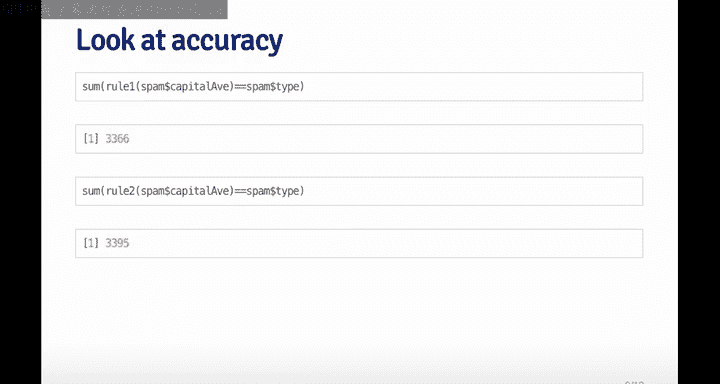

And so the goal of a predictor is to find the signal and ignore the noise and in any small data you can always build a perfect in-s samplele predictor just like we did with that spam data。

 you can always carve up the prediction space in the small data to capture every single quirk of that data。

 but when you do that you capture both the signal and the noise， so for example。

 in that training set there was one spam value that has slightly lower capital average than some of the non-spanm values。

 but that was just because we randomly picked a data where that was true where that value was low。

So that predictor won't necessarily perform as well on new samples because we've tuned it too tightly to the observed training set so this lecture has had two purposes one is to introduce you to the idea of ins sample and out of sample errors。

 in sample errors or errors on the training set we actually built with and out of sample errors or errors on the data that wasn't used to build the training predictor and also to introduce you this idea of overfitting in that we want to build models that are simple enough and robust enough that they don't actually capture the noise while they do capture all of the signal。

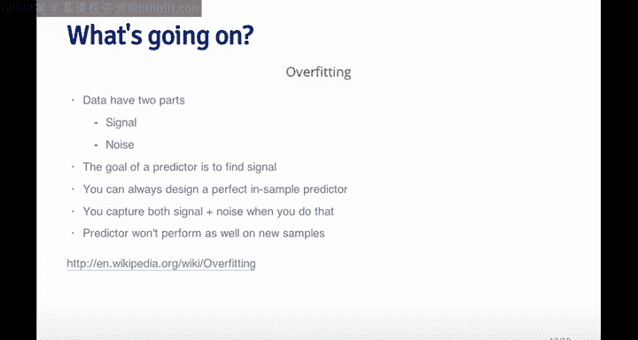