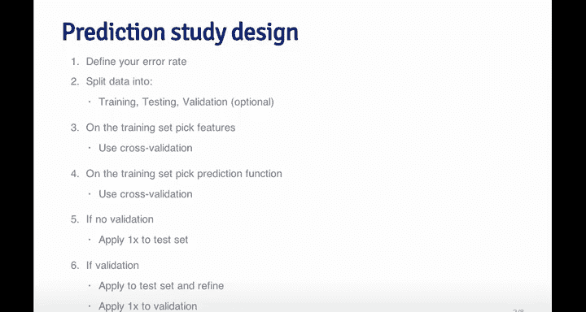
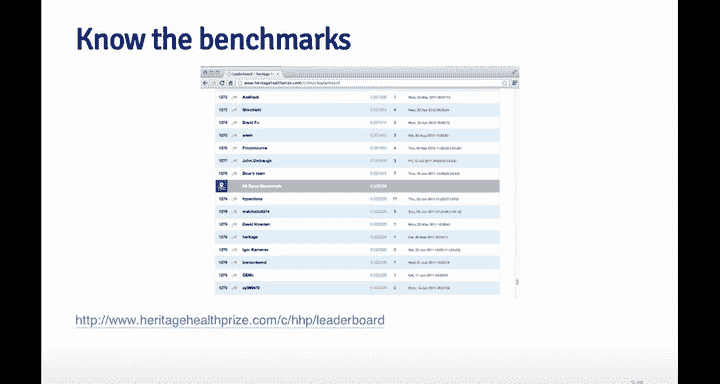
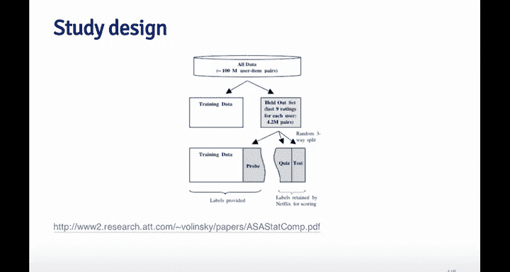
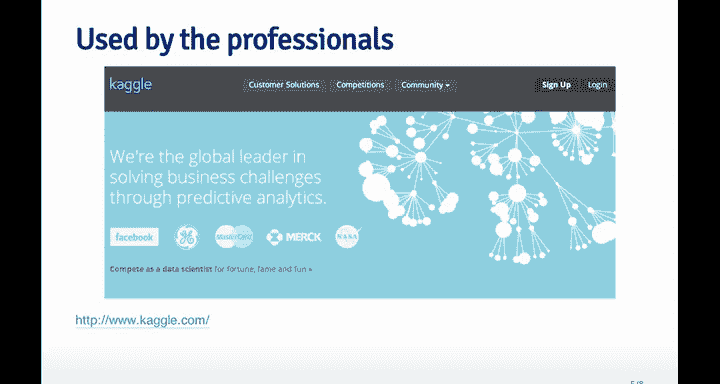
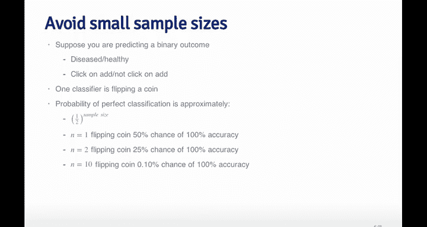
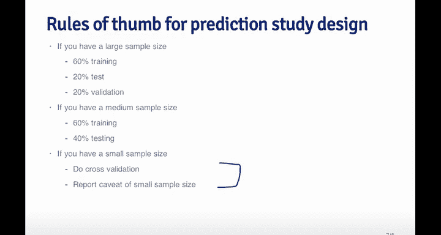
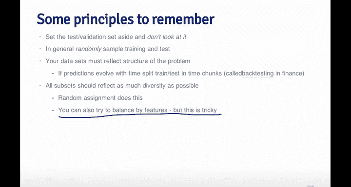

# 约翰霍普金斯大学《数据科学：统计和机器学习｜Data Science： Statistics and Machine Learning》中英字幕 - P85：4_预测研究设计.zh_en - GPT中英字幕课程资源 - BV1jsAAeNE3k

In the last lecture， we learned about in sample and out of sample errors。

 as well as overfitting In this lecture， we'll talk about prediction study design or how to minimize the problems that can be caused by in sample versus out of sample errors。

So in prediction study design， the first thing that we need to do is define our error rate so in this lecture we're just going to use a generic error rate。

 but in the next lecture we'll talk about what are the different possible error ratess you could choose。

Then you need to split your data and the data that you're going to be using to build and validate your model into three components。

 well two components and one optional component， so there's a training set that must be created in order to build your model。

 a testing set to evaluate your model， and optionally a validation set as well。

 which is also going to be used to validate your model。So what you do is on the training set。

 you pick features using cross validationidation， for example。

 we'll talk about what cross validationation is later in the course。

 but the idea is basically to use that training set to pick which of the features that are most important in your model。

 then use that same technique to actually pick the prediction function and estimate all the parameters that you might be interested in。

 we build a model using the training set。If there's no validation set。

 then we apply the best model that we have to our test set exactly one time and so the why do we only apply at one time。

 if we apply multiple models to our testing set then and pick the best one。

 then we're using the test set in some sense to train the model in other words。

 we're still getting an optimistic view of what the data error would be on a completely new data set so you should apply the prediction model to the test set exactly one time。

If there's a validation set and a test set， then you might apply your best prediction models all to your test set and refine them a little bit。

 So what you might find is that some features don't work so well when you're doing outof sample prediction and you might refine and adjust your model a little bit。

 but now again， like I said， your test set error is going to be a little bit optimistic error for what your actual outof sample error would be and so what we do is we again apply our model to exactly one time to the validation set only the best one to get our prediction So in other words。

 the idea is that there's one data set that's held out from the very start that you only apply exactly one model to and you never do any training or tuning or testing to and that will give you a good estimate of your outof sample error rates。

So an important point to keep in mind when you're doing this is to know what the benchmarks are。

 so this is an example of a leaderboard from a CAgo competition and so they often give you benchmarks marked in gray here on this plot that shows what happens if you say make all the values equal to zero and it's a good idea to know what the prediction benchmarks are because sometimes if your prediction algorithm is performing way better than it should be or way worse than it should be。

 the benchmarks will give you some idea of what you should be doing wrong and they'll tell you if your prediction algorithm is kind of going astray。

So this is the study design that was used in the Netflix prime so they had 100 million user item pairs in other words movies that people had given their preference on。

 they split that into a training data set which they were going to give to users that were going to build models for prediction then they held out a bunch of ratings that were not going to be shown at all to the people that are building the models and so what they provided for people who were building models was a training set and what they called a probe data so you would train your model on the training dataset and then you would apply it to the probe data to get some idea of what the outof sampleamp error would be before submitting it to Netflix then what Netflix would do is they would take your predictions and they would apply it only to a quiz set so this quiz set you didn't get to actually see and you couldn't build your model on but it would give you some better idea of how well your model would perform out of sample。

But in general， people could submit multiple submissions to this quiz set and so they might actually tune their models a little bit and get a little bit better performance on the quiz set。

And so what they did ultimately was for the final valuation of all the different teams。

 they applied the model just one time to this test set that was held out to the very end of the competition。

 and so at the very end of the competition they got an unbiased estimate of how well this model would work on a completely new set of data that the participants in the competition never had a look at。

So this idea was actually very important in their study design and it actually turned out that some teams that did better on the quiz set actually didn't do quite as well on the test set and that was because they were tuning their models or overfitting their models to the quiz set so this is an important take home message for you in the sense that if you're building prediction models you always have to hold one dataset and leave it completely aside while you're building your models This is now used by professionals so CaagL is a company that actually runs lots of competitions for prediction competitions on a whole bunch of different datas provided by companies and they always do a similar model in the sense that they always have a leaderboard that consists of the predictions that people have submitted for a validation data that they have。

 but it's not necessarily the data that they'll use to evaluate the methods at the very end that dataset is held out until the very end and each person gets to apply their algorithm to that dataset only one time。

Something to keep in mind is that when you're splitting your data sets up into training testing and validation sets。

 they can get a little bit small， but you need to avoid small sample sizes。

 particularly if you're dealing with the test set size and the reason why is suppose you're predicting a binary outcome so in my case a very common thing to try to do is to predict diseased versus healthy and in general it might be something like whether people click on an ad or whether they won't click on an ad then one classifier is just flipping a coin you could always just flip a coin and say they'll be diseased if the coin is heads and not diseased if the coin comes up tails。

And so the probability of a perfect classification using this really silly algorithm is one half raised to the sample size。

 In other words， half the time you'll be right just by chance by flipping the coin and each time suppose each prediction is independent then each time that you flip a coin then you'll get  one half times that a number will be the decrease in accuracy that you would get So if your test set has only one sample in it。

 then you'll have about a 5050 chance of getting that sample right。

 So even if you got prediction and accuracy of 100% on the test set。

 you would have a 50% chance of that even with a coin flip with n equals 2 you only have you still only have a 25% chance of 100% accuracy and with n equals 10 in your test set now you have only about a 。

1% chance of getting 100% accuracy So if you see that 100% accuracy you'll feel a little bit more confident that it's actually true and it's not something that's just random。

 So this suggests that we should make sure that especially our。Set sizes are a relatively large size。

 so we can be sure that we're not just getting good prediction accuracy by chance。

So some rules of thumb， these are by no means set and stone。

 but they're reasonable rules of thumb that I've used and I think a lot of people have used similar ones So you set when you get a new data set if it's large enough。

 you'll set 60% of your data to be training 20% of your data to be test and 20% of your data set to be validation This is again assuming that your test and validation data sets won't be too small if you do that if you have a medium sample size。

 what you might do is you might take 60% of your data to be training and 40% of your data to be testing this means you don't get to refine your models in a test set and then apply them to a validation set but it might ensure that your testing set is a sufficient size Finally if you have a very small sample size。

 first of all you might reconsider whether you have enough samples to be able to build a prediction algorithm in the first place。

 but suppose your dead set on building a prediction or machine learning algorithm then the idea might be to do cross the validation and report the caveat of the small sample size and the fact that you never got to predict this in an out of sample are a testing dataset set。

So some principles to remember are the test set or the validation set should be set aside and never looked at when building your model。

 In other words， you need to have one data set which you apply only one model to only one time and that data set should be completely independent of anything you use to build the prediction model in general you want to randomly sample the training and test set and random might depend on the type of sampling that you want to do so for example。

 if you have time course data in other words you have data collected over time you might want to build your training set and chunks of time but again random chunks of time and build them on random predictions。

Your data must reflect the structure of the problem， in other words。

 if you want to sample any data that might have sources of dependence over time or across space。

 you need to sample your data in chunks， this is called back testing and finance and it's basically the idea that you want to be able to use chunks of data time that consist of observations over time。

Also should reflect as much diversity as possible， if you do random assignment it does this。

 you might also try balancing by features， this can be a little bit tricky but it often is a useful idea。

