# 约翰霍普金斯大学《数据科学：统计和机器学习｜Data Science： Statistics and Machine Learning》中英字幕 - P86：5_误差类型.zh_en - GPT中英字幕课程资源 - BV1jsAAeNE3k

This lecture is about the types of errors and the ways that you will evaluate the prediction functions that you generate during this class。

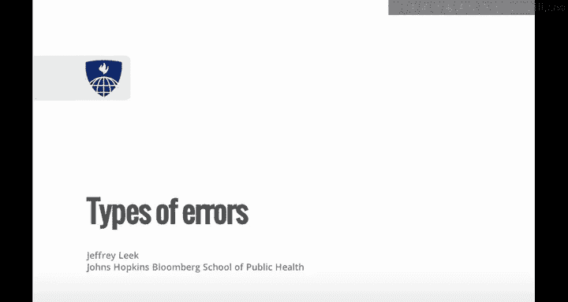

So first of all， we're going to focus on the types of errors that you can make when you're doing a binary prediction problem。

 in other words where you're trying to predict things into one of two groups。

In general we're going to be talking about language in terms of true positives and true negatives and false positives and false negatives。

 so the first thing to keep in mind is that when we talk about positive versus negative。

 we're actually talking about what the algorithm decided。

 whether it decided that you're in a class or not in a class。

Then true and false refer to the true state of the world so true means that you actually belong to the class we're trying to identify and false means that you actually don't belong to that class So as an example。

 true positive the true part of true positive means that you were correctly so in other words the truth is that there actually it was something to identify a positive in other words we actually identified you as being belonging to that class Similarlyly for a false positive。

 the positive part again refers to the fact that we identified you as being part of the positive class and false refers to the fact that you were wrong。

 we didn't actually class you to the correct class。To make this a little bit more concrete。

 consider a medical testing example， so in this case we're trying to identify people that are sick using say a screening test。

 a very common example would be say mammograms to try to identify if women have breast cancer。

In this case， the true part will be the status as to whether you're sick or not。

 so if we say that we truly identified you， then you were truly sick。

And if we falsely identified you， then you were actually healthy， you were not truly sick。

So in this case， a true positive is truly somebody who is truly sick and it' positive。

 in other words we actually diagnose those people as correctly as being sick if you're are false positive。

 it means that false， in other words you are a healthy person。

 but positive means we were still somebody that we identified as being sick even though you weren't similarly with a true negative。

 this is somebody true who is truly negative， truly healthy。

 and we identified them as being negative。And a false negative would be somebody who is sick。

 so we incorrectly identify them as healthy and the negative part is we identified them as healthy。

You can learn more about sensitivity and specificity by going to this Wikipedia link below。

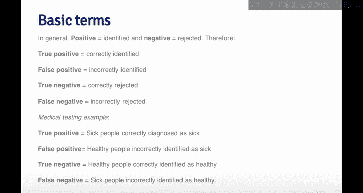

You can also see them in this two by2 table， so it's called a two by two table because it has two rows here and two columns here。

 so the columns correspond to what your disease status is， so in this particular example。

 positive means that you have the disease and negative means that you don't have the disease。

 that's the real truth about your disease status and the test is our prediction are our machine learning algorithm。

 a positive means we predict that you have a disease and the negative means that we predict that you don't have the disease。

So some of the key quantities that people talk about are the sensitivity。

 this is the probability that we give you a predict that you are diseased given that you really are diseased。

 so if you're really diseased， what's the probability we get that right and then the specificity is if you're really healthy。

 what's the probability we get it right。The positive predictive value is the probability that we call you diseased。

orProb that you are diseased given that we call you diseased。

 so it's a little bit different than the sensitivity in the sense that now it's looking at all the people we call diseased and saying what fraction of them actually are diseased similarly for the negative predictive value and the accuracy is just the probability that we classified you to the correct outcome so in this table it's the terms on the diagonal it's the true positives and the true negatives just added them。

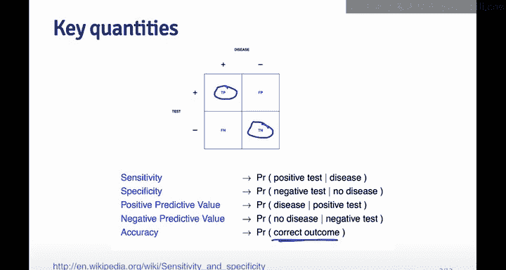

So you can write these as fractions so for example the sensitivity that's the probability given that you are diseased that we called you diseased so we look at this first column。

 this is all the people that are diseased and we look what fraction of them did we actually get right so that's the true positives divided by the true positives plus the false negatives that gives you the sensitivity you can similarly make the same sort of fractions for the specificity。

 the positive predictive value， the negative predictive value and so forth when looking at the positive predictive value we basically look at in this case it's the true positives divided by the true positives plus the false positives because we're looking at only the positive tests and we say what fraction of the positive tests did we get right so the true positives were the ones that we got right and the true positives plus the false positives is total the positive tests。

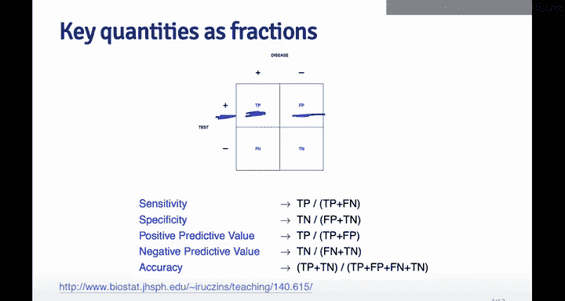

So this is kind of important because many prediction problems。

 one of the classes will be more rare than the other。

 so for example in medical studies it's very common that only a very small percentage of people will be sick in this case suppose there's a disease that were only 1。

1% of the people are sick in the population and suppose we have a really good machine learning algorithm。

 a really good testing kit that is 99% sensitive and 99% specific in other words the probability that will get it right if your disease is 99% and the probability will get it right if you're healthy is 99%。

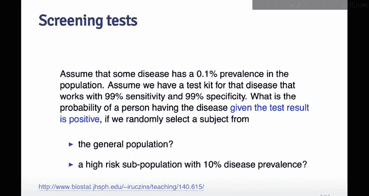

So in this case， suppose that you get a positive test。

What's the probability that you actually have the disease， you can consider two different cases。

 one in a general population， in other words， in a population where there's a very small chance that you have the disease。

 Another one you can consider is a case where 10% of people have the disease so the disease is much more prevalent。

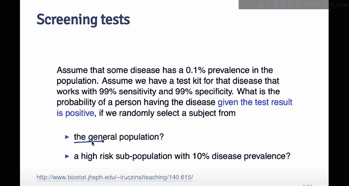

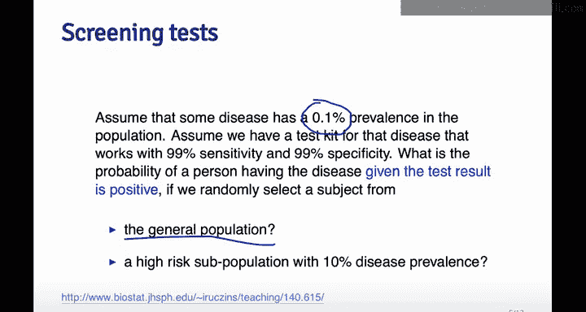

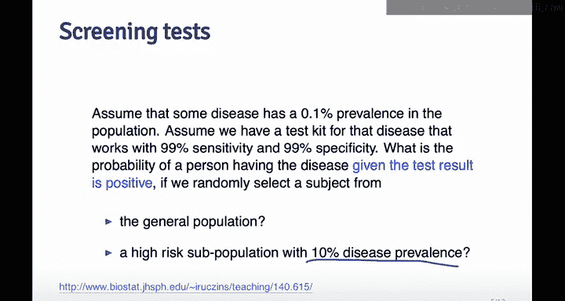

Let's look at how that changes your positive predictive value。So in the general population， remember。

 we only have about 1% of the people that have the disease。

 so there are only 100 people in this column that have the disease。

But there are a lot more people that are healthy。Similarly。

 we have a 99% accuracy if you have the disease， so 99 out of 100 people at 99 out of these00 are correctly called diseased。

Similarly， among the people that are healthy， we get 99% right， so 98。

901 we call healthy when they really are healthy， that's 99% of the time。

But suppose that we wanted to know is if you got a positive test what's the probability that you actually have the disease So let's look at this for a second So you say suppose you actually got a positive test that's this first row right here。

 what's the probability that you actually have the disease so that's the number of people that actually have the disease among the total number of people that had a positive test so that's 99 divided by 99 plus 999。

 so it's only a 9% positive predictive value in other words。

 if you got a positive test it's only about a 9% chance that you actually have the disease what's the reason for that The reason is 99% of a small number a 99 out of 100 is still smaller than 1% out of a much bigger number。

 so 999 out of a much larger fraction that are actually healthy people。

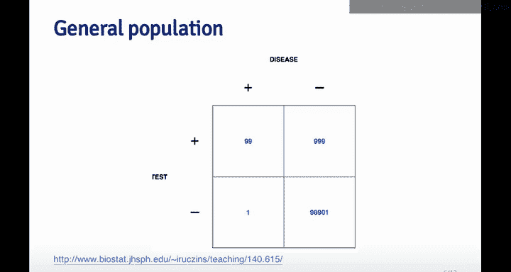

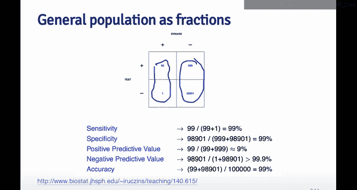

If instead we consider the case where 10% of people are actually sick。

 then you have a much larger number of people that are actually sick and 99% of the time will get it right。

 so 9，900 of people that actually are sick will call sick and only 900 of the people that are healthy will we call sick and so then things work out how you'd expect them to in other words。

 9，900 out of 9，900 plus 900 so that's this number in the top left hand corner divided by this total row。

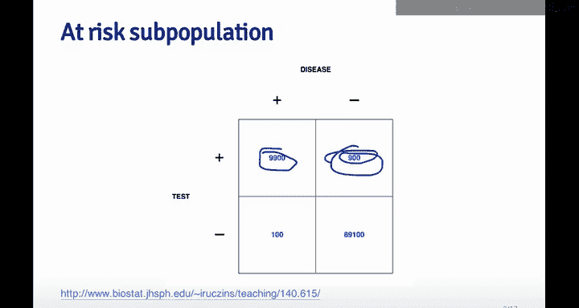

Is 92% and so you have a high positive predictive value What does this mean if you're predicting a rare event。

 you have to be aware of how rare that event is this goes back to the idea of knowing what population you're sampling from when you're building a predictive model。

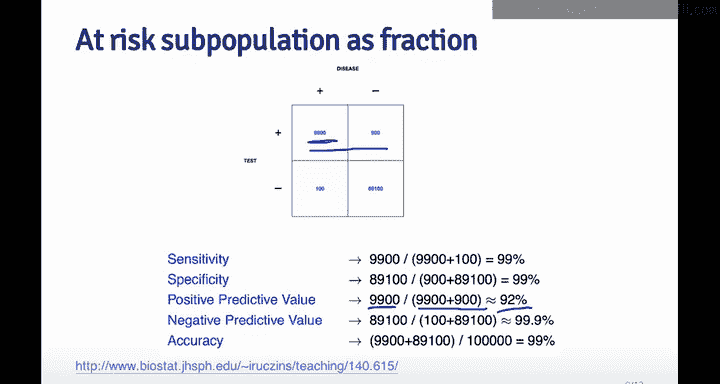

This is actually a key public health issue， so you've probably seen it in the news that there's been questions about what's the value of mammograms and detecting disease and detecting the value of disease versus detecting cases that aren't necessarily lifethre。

 similarly you've probably heard about it for prostate cancer screening in both of these cases you have a fairly rare disease。

 and even though the screening mechanisms are relatively good it's very hard to know whether you're getting a lot of false positives that as a fraction of the total number of positives that you're getting。

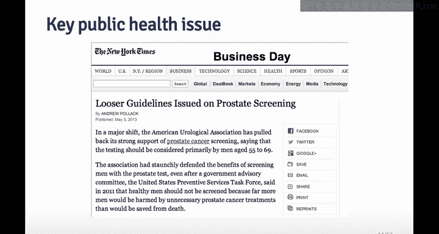

For continuous data， you actually don't have quite so simple as an area where you only have one of two cases and one of two types of errors that you can possibly make The goal here is to see how close you are to the truth and so one common way to do that is with something called mean squared error and so the idea is you have a prediction that you have from your model or your machine learning algorithm and so you have a prediction for every single sample that you're trying to predict and you also maybe know the truth for those samples say in a test set so what you do is you calculate the difference between the prediction and the truth and you square it so the numbers are all positive and then you average the total number of sort of total distance between the prediction and the truth。

The one thing that's a little bit difficult about interpreting this number is that you've squared this distance and so it's a little bit hard to interpret on the same scale as the predictions or the truth and so what people often do is they take the square root of that quantity so here underneath the square root sign is the same number it's just the average distance between the prediction and the truth and you just summit and square it and then you take the square root of that number and that gives you the root mean squared error and this is probably the most common error measure that's used for continuous data。

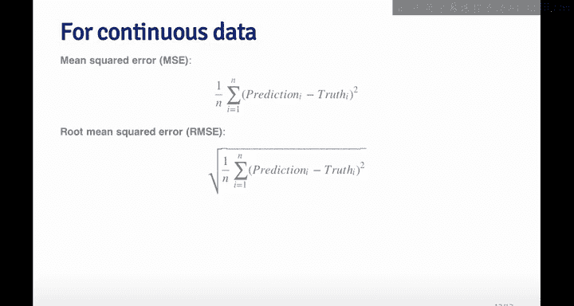

So for continuous data people often use either the mean squared error or the root mean squared error。

 but it often doesn't work when there are a lot of outliers or the values of the variables can have very different scales because it will be sensitive to those outliers so for example。

 if you have one really really large value， it might really raise the mean instead what people use is often the median absolute deviation so in that case they take the medium of the distance between the observed value and the predicted value and they do the absolute value instead of doing the square of the value so again that requires all the distances to be positive but it's a little bit more robust to the size of those errors。

And then sensitivity and specificity are very commonly used when talking about particularly medical tests。

 but they also are particularly widely used if you care about one type of error more than the other type of error and then accuracy which weights false positives and false negatives equally this is an important point if again you have a very large discrepancy in a number of times that you're a positive or negative for multi-class cases you might have something like concordance and here I've linked to one particular distance measure KappA。

 but there are a whole large class of distance measures and they all have different properties that can be used when you have multi-class data。

 so those are some of the common error measures that are used when doing prediction algorithms。

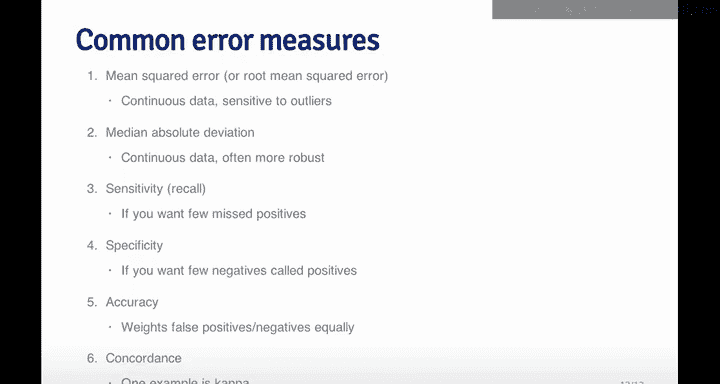