# 约翰霍普金斯大学《数据科学：统计和机器学习｜Data Science： Statistics and Machine Learning》中英字幕 - P87：6_接收者操作特征.zh_en - GPT中英字幕课程资源 - BV1jsAAeNE3k

This lecture is about ROC curves or receiver operating characteristic curves。

These are very commonly used technique to measure the quality or the goodness of a prediction algorithm。

So in binary classification， you're usually predicting one of two categories so again you might be predicting whether someone's alive or dead or sick or healthy。

 you might also be predicting whether they'll click on an ad or whether they won't click on that ad。

 but your predictions often come out to be quantitative In other words。

 almost all the modeling algorithms that we have won't just assign you to one class or the other they might give you say a probability of being alive or prediction on a scale from 1 to 10 about whether you'll click on the ad or not。

 The cutoff you choose give different results In other words。

 if we predict a probability that you're going to be alive is 0。7。 and we say all the people above 0。

5 will be assigned to be alive。 then that's one prediction algorithm。

 alternative if you say only people with a probability above 。

8 will be predicted to be alive then that will give you a different prediction for that same person and the different cutoffs will have different properties。

 they'll either be better at finding people that are alive or better at finding people that are dead。

 So what people use is what's called an ROC curve。 And so the idea is on the y axis is what they usually。

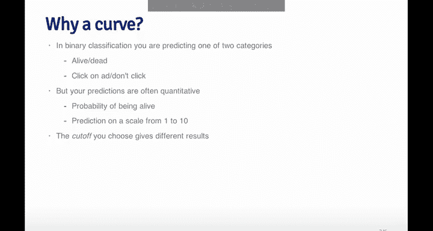

Ploot is one minus the specificity， in other words， the probability of being a false positive。

 and on the y axis they plot the sensitivity or the probability of being a true positive。

And so what they're trying to do then is make a curve where every single point along this curve corresponds to exactly one cutoff So for a particular cutoff。

 you get a certain probability of being a false positive or certain specificity and that's point one minus the specificity is this point right here on the x axis at the same time you get a certain sensitivity and that's this point here on the y axis and so you can use these ROC curves to define whether an algorithm is good or bad by plotting a different point for every single cutoff that you might choose and then plotting a curve through those points So this is an example of a couple of algorithms that are used to predict and so these are example of what real ROC curves look like so for example。

 if you want to look at say the net chop algorithm and you look at say one minus the specificity is equal to 02 in other words this specificity is quite high it's 0。

8 you can trace that number up and you get about here on the curve the red curve in this case and that corresponds to a sense。

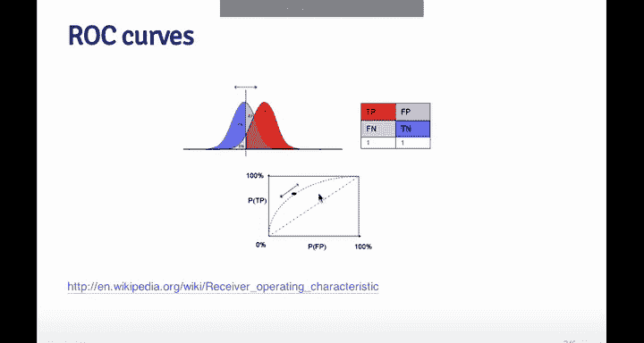

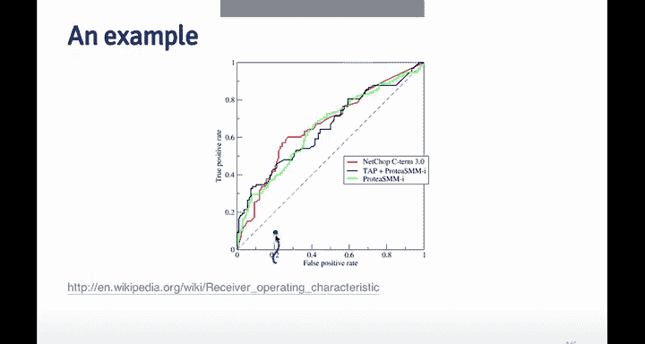

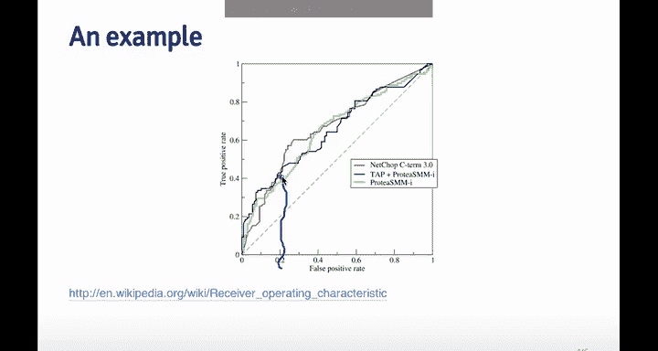

of only about 0。4 so it's very highly specific but not very sensitive and similarly。

 if you move out here to the right on the y x axis。

 you'll get less and less specificity and more and more sensitivity。

 and so this curve tells you a little bit about the tradeoffs。

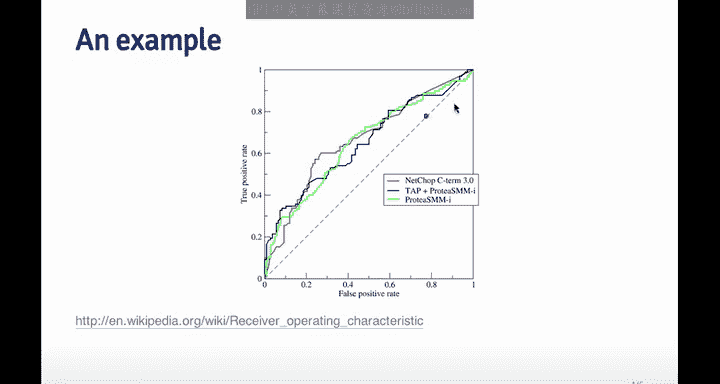

Now， although the curve tells you a little bit about the tradeoffs。

 you may actually want to know which of these prediction algorithms is better。

 And one way that people use to quantify one curve versus the another is they basically calculate the area under the curve。

 In other words， they follow say the red curve here and they trace the entire area underneath that curve。

 so that'd be this area down here And so that area quantifies how good that particular prediction algorithm is。

 So the higher the area， the better the predictor is。

 And so some standard there are some standard values that makes sense to pay attention to。

 So if the area under the curve or Auc is equal to 0。5。

 that's equivalent to a prediction algorithm that's just on the 45 degree line and that's equivalent to basically randomly guessing。

 whether you're gonna to be a true positive or false positive。 So 0。

5 is actually quite bad anything less than 0。5 is actually worse than random guessing。

 So it's worse than flipping a coin Auc of one is a perfect classifier In other words。

 you get perfect sensitivity and specificity for。

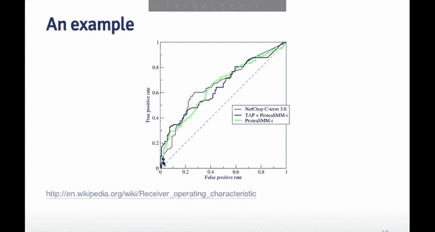

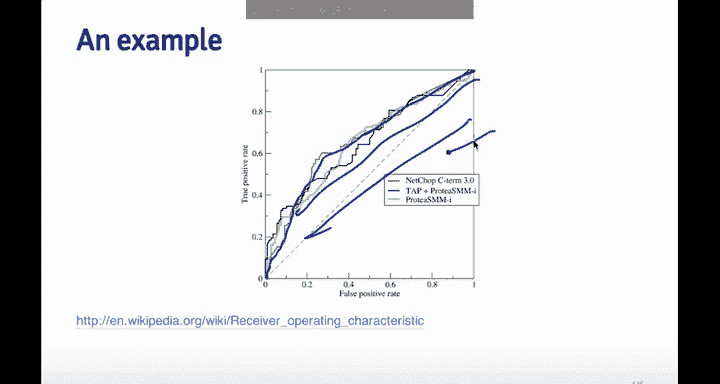

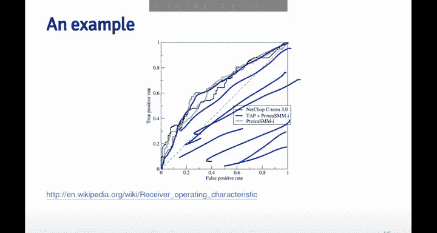

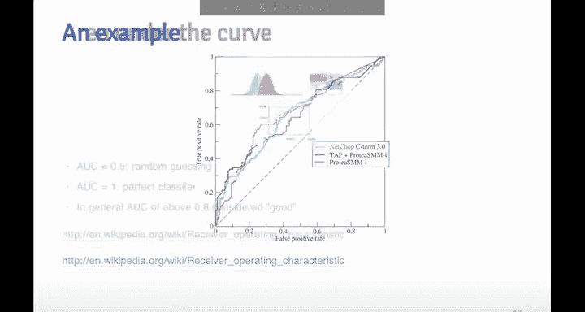

certain value of the prediction algorithm and so that's the perfect classifier in general it depends on the field and it depends on the problem you're looking at。

 but people often think of an AU above 0。8 to be considered to be something that's sort of a good AU of a particular prediction algorithm。

😊。

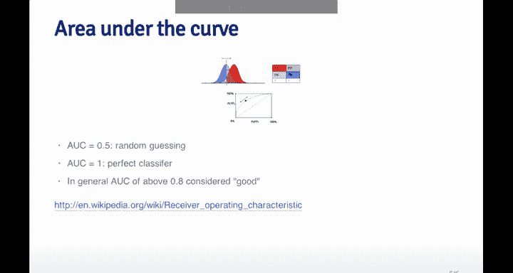

In general， something to pay attention to is how did you just look at an ROC curve and decide whether it's a good ROC curve or a bad ROC curve so remember the 45 degree line corresponds to just guessing。

 in other words， the sensitivity and the specificity match each other on this particular line。

So a perfect classifier goes at one minus the specificity。

 so one minus the specificity of zero means perfect specificity and it jumps straight away up to perfect sensitivity and then straight over so that curve represents a perfect classifier when it goes straight up to this corner so the farther you are towards the upper left hand corner of the plot the better the ROC is and the farther you are down to the bottom right hand corner of the plot。

 the worse the ROC is and so points along graphs along the 45 degree line are below are considered pretty bad and you want your curve to look to go as straight up towards this top lefthand corner and over as much as you possibly can so that's how you interpret an ROC curve which will be used later when we're picking out particular values of predictors of binary outputs that output quantitative numbers。

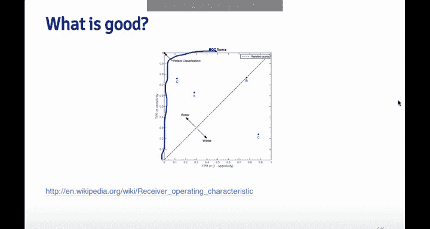