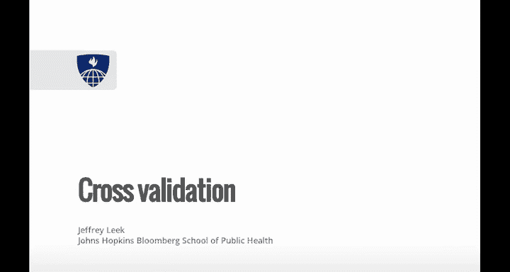
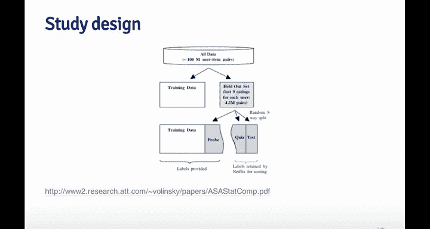
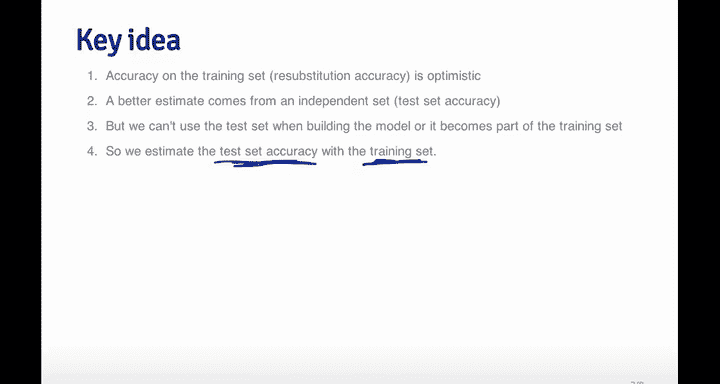
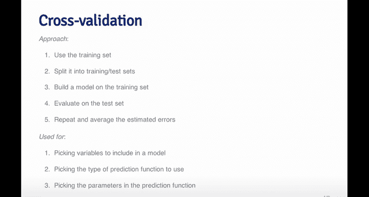
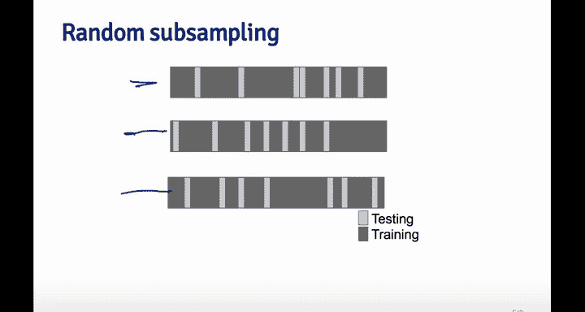
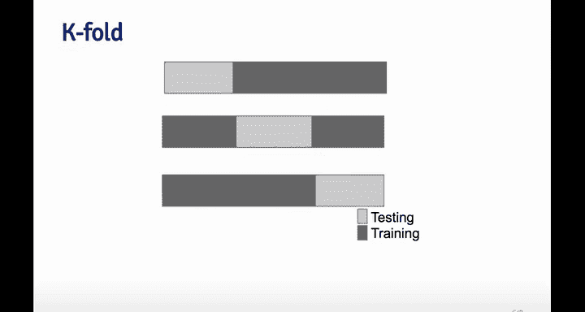
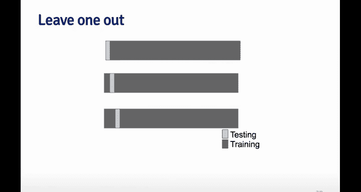
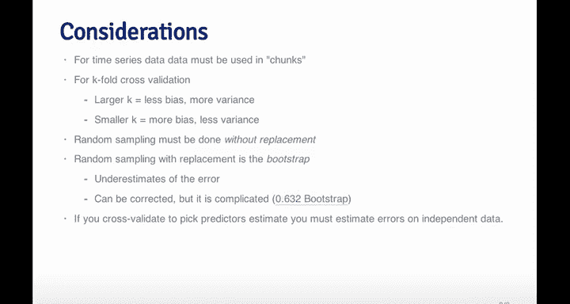

# 约翰霍普金斯大学《数据科学：统计和机器学习｜Data Science： Statistics and Machine Learning》中英字幕 - P88：7_交叉验证.zh_en - GPT中英字幕课程资源 - BV1jsAAeNE3k

This lecture is about cross validation， which is one of the most widely used tools for detecting relevant features and for building models and estimating their parameters when doing machine learning。

So remember the study design that people frequently use when building machine learning algorithms and evaluating them。

 they take a data set in this case this is the Netflix Pri study design。

 so this is the  100 million user item pairs where it's a movies that were rated by specific users and they break that up into a training dataset and then a test dataset and remember that all the model building an evaluation by the people building the model will happen on the training data and then once at the very end of the competition they would apply it to the test dataset。

So one problem that comes up that very quickly is that accuracy on the training set is or what's called restitution accuracy is often optimistic。

 in other words， always picking we're trying a bunch of different models and we're picking the best one on the training set and that will always be tuned a little bit to the quirks of that data set and may not be the accurate representation of what that prediction accuracy will be on a new sample。

So a better estimate comes from an independent data set， so in this case， say the test set accuracy。

 but there's a problem that if we keep using the test set to evaluate the out of sample accuracy。

 then in a sense， the test set has become part of the training set and we' still don't have an outside measure or independent evaluation of the test set error。

So to estimate the test set accuracy， what we would like to use is use something about the training set to get a good estimate of what the test set accuracy will be so then we can build our models entirely using the training set and only evaluate them once on the test set just like the study design calls for。

So the way that people do that is with cross validations。

 so the idea is you take your training set just the training samples and we subsp that training set into a training and a test set。

Then we build a model on the training set that's a subset of our original training set and evaluate on the test set。

 that's a subset again of our original training set。

 we repeat this over and over and average the estimated errors and that's something like estimating what's going to happen when we get a new test set。

So again， the idea is we take the training set and we split the training set itself up in the training and test sets over and over again。

 keep rebuilding our models and picking the one that works best on the test set。

This is useful for picking variables to include in the model， so again。

 we can now fit a bunch of different models with various different variables included and use the one that fits best on these cross validated test sets。

And then we can also pick the type of prediction function to use so we can try a bunch of different algorithms。

 again， pick the one that does best on the cross validation dataset sets。

Or we could pick the parameters in the prediction function and estimate them。Again。

 we can do all of this because eventually， even though we're sub splitliing the training set into a training set and a test set。

 we actually leave the original test set completely alone， it's never used in this process。

 and so when we apply our ultimate prediction algorithm to the test set it'll still be an unbiased measurement of what the out of sample accuracy will be。

So the different ways that people can use training and test sets one example is they do random subsampling so imagine that every observation we're trying to predict is array out along this axis here and the color represents whether we included in the training set or the testing set So again this is only the training samples and what we might do is just take a subsample of them and call them the testing samples so in this case it's the light gray bars here are all the samples in this particular iteration that we call test samples then we would build our predictor on all the dark gray samples。

And so again， this is only within the training set。

 we take the dark gray samples and build a model and then apply it to predict the light gray samples and evaluate their accuracy。

We could do this for several different random subss so this is a one random sampling。

 and then this second row is a second random sampling and this third row， a third random sampling。

 do that over and over again and then average what the errors will be。

Another approach that's commonly uses what's called Kfold cross validationidation。

 so the idea here is we break our data set up into K equal size data sets， so for example。

 for threefold cross validationation this is what it would look like so here is the first data right here then there's a middle data set right here and a last third data right here and so what we would do is on the first fold we would build a prediction model on this training data and we would apply it to this test data。

Then we would build a training our model on the just the dark gray components of this second fold and apply it to the middle fold for evaluation then finally we would do the same thing down here。

 we would build our model on this dark gray part and apply it to the light gray part and again we would average the errors that we got across all of those experiments and we would get an estimate of the average error rate that we would get in an out of sample estimation procedure so again all of these model building and evaluation are happening within the training set which we've then subsdivided into a subtraining set and a subtesting set to evaluate models。

Another very common approach is called leave1 outcro validationid。

 and so here we just leave out exactly one sample and we build the predicting function on all the remaining samples and then we predict the value on the one sample that we left out。

 then we leave out the next sample and build on all the remaining values and then predict the sample that we left out and so forth until we've done that for every single sample in our data。

So again， this is another way to estimate the out of sample accuracy rate。So some consideration is。

 first of all， for time series data， this doesn't work if you just randomly subsample the population。

 you actually have to use chunks， you have to get blocks of time that are all contiguous。

 and that's because one time point might depend on all the time points that came previously and you're ignoring a huge rich structure in the data if you just randomly take samples。

For Kfold cross validation， the larger the K that you take， you'll get less bias。

 but more variance and the smaller K that you take， you'll get more bias， but less variance。

 In other words， if you take a very large K。Say， for example。

 tenfold cross validation or2fold cross validation that means you'll get a very accurate estimate of the bias between your predicted values and your true values。

 but it'll be highly variable in other words it'll depend a lot on which random subsets that you take for smaller case。

 we won't necessarily get as good an estimate of the outof sample error rate and that's because you're only leaving one sample out and so you're using most of your data to train your model。

 but there'll be less variance， in other words， if you in the extreme case， if you have， for example。

 only two cross twofold cross validation， there are only a very small number of subsets that can make up a twofold cross validationation and so you get less variance。

Here the randomly sampling must be done without replacement。

 in other words we're subsampling our data sets， that's of course a disadvantage because it means that we have to break our training set up even further into smaller samples。

If you do random sampling with replacement， this is called the bootsottrap。

 that's something that you've learned about in your early inference classes if you've taken those the bootsottrap in this particular example will in general underestimate the error rate and the reason why is because if you do the bootstrap so you sample with replacement from some of your samples。

 some samples will appear more than once and so when samples appear more than once。

 that means that if you get one right， you'll definitely get the other right and so you actually get underestimate of the error rate and this can be corrected but it's rather complicated the way to do that it's something called the 0。

632 bootsottrap which is not exactly a great name for a method but it it's sort of explains how you can account for the fact that you have this underestimate of the error rate you can do any of these approaches is when you build models with the cart package like we'll be learning in this class。

If you crossvalate to pick predictors， you again must estimate the errors on an independent data set in order to get a true out of sample value。

 so in other words， if you do cross validationation to predict your model or to pick your model。

 the crossvalated error rates since you always pick to the best model will not necessarily be a good representation of what the real out of sample error rate is。

 and the best way to do that is again by applying your prediction function just one time to an independent test set。

