# 约翰霍普金斯大学《数据科学：统计和机器学习｜Data Science： Statistics and Machine Learning》中英字幕 - P90：9_Caret 包.zh_en - GPT中英字幕课程资源 - BV1jsAAeNE3k

This lecture is about the care package， which is a very useful front end package that wraps around a lot of the prediction。

 algorithms and tools that you'll be using in the R programming language。

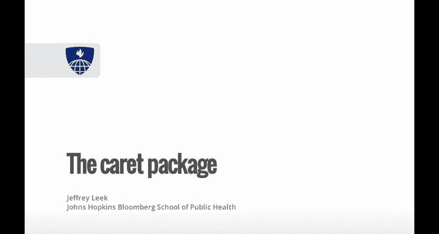

So the cart package can be found here at this website that I'm linked to here at the bottom。

 where you can just Google Cart our package and you'll be able to find the package。

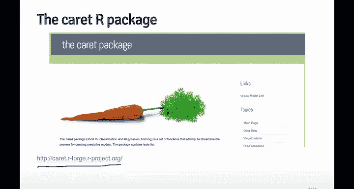

The functionality that's built into the carrot package are some of the following。

 so for example we can use the preprocessing tools in the carrot package to clean data and get the features set up so that they can be used for prediction。

We can also do sort of cross validation and data splitting within the training set using to create data partition and create time slices functions。

We can also create training and test sets with the training and predict functions。

 and we can use those to train data sets and train prediction functions and apply them to new data sets。

We can also do model comparison using the Con matrix function。

 which will give you information about how well the models did on new data sets。

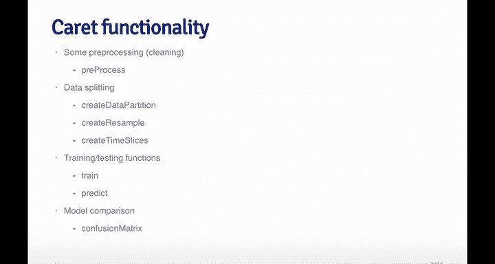

There are a large number of machine learning algorithms that are built into R。

 so these range from very popular statistical machine learning algorithms like learning or discriminant analysis and regression to much more widely used algorithms and computer science like support vector machines。

 classification and regression trees or random forests and boosting all of these algorithms are built by a variety of different developers all coming from different backgrounds and so the interfaces to each of these sort of prediction algorithms is slightly different。

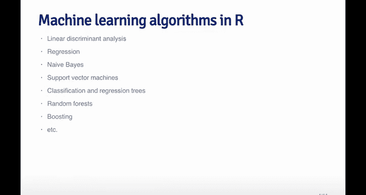

As one example of this， consider this class of different prediction algorithms that you could have applied。

 so everything from linear discriminant analysis down to boosting。

 and so for each of these different algorithms， you can imagine creating an object called OBJ and R that object will have a different class。

 say a linear discriminant analysis or GLM and so forth。

And for each of these objects we can try to predict and if we apply the predict function。

 we have to pass slightly different parameters each time in order to get the prediction of the outcome so for example。

 from the GLM package， we have to say type equals response to get the prediction of the response from that model fit or for example。

 if we want to use our part， we want to predict with type equals probability in order to predict the response in each case they're a little bit different and the cart package provides a unifying framework that allows you to predict using just one function and without having to specify all the options that you might care about in order to get the same prediction out。

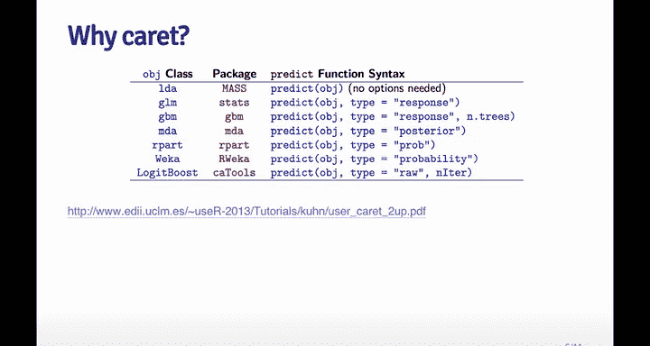

So here's a quick example using the carrot package。

 we'll go into the details of how this is done very specifically in later examples。

 so here we've loaded in the carrot package and we've loaded the currentern labb package as well to get the spam data set。

And so what we can do first is partition the data set up into a training and a test set here I'm going to use the spam type and I'm going to split it into the training set and the test set I'm going to say we're going to use about 75% of our data to train the model and 25% to test。

Then what I can do is I can actually subset the data into the training data using thetrain bit。

 the intrain object that comes out from createate data partition。

 and I can create the testing data set by finding all those samples that aren't in the training set。

 then this will give me a subset of the data that are just for training and a subset of the data that are just for testing and you can do this with sort of the simple interface。

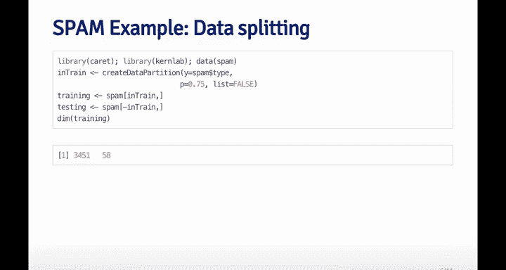

Next you can fit a model so here I'm going to use the train command from the carrot package and so again I'm trying to predict type and I use the Tilda and adopt to say use all the other variables in this data frame in order to predict the type and I tell which dataset set I want to build the training model on and so in this case the training dataset that we created on the previous slide and then I just tell which of the methods that I'd like to use and so you can use GLM where you can use a bunch of other different models。

And so what this does is it'll create a model fit from the train function， and this will use the 3。

451 samples in the training set and the 57 predictors to predict which class you're belonging to based on a model a GLM model and so what it can do is it can do a bunch of different ways of testing whether this model will work well and to select the best model and in this case it used resampling and it does bootstrapping with 25 replicates and it corrects for the potential bias that might come from bootstrap sampling。

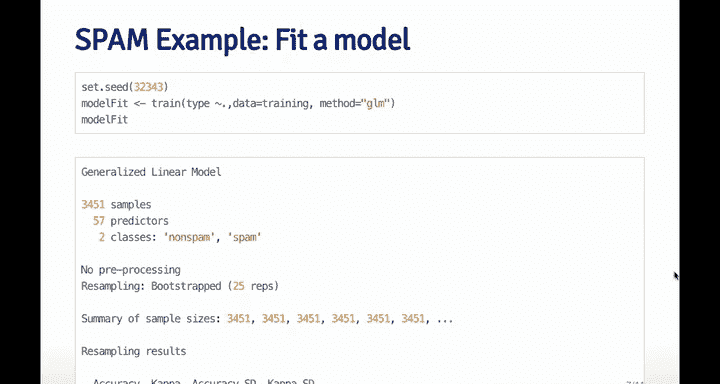

So once we fit that model， we can actually look at the model and so the way that you can do that is look at the final model component of the model fit object and the way that you do that is you take the model fit object and then you type dollar sign and then always the same final model。

 it will tell you what are the actual fitted values that you got for that GLM model。

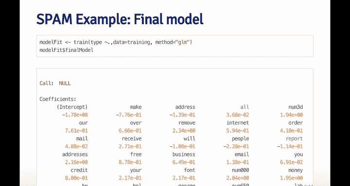

Then you can predict on new samples by using the predict command again it's a unified framework so we just type predict we pass it the model fit object that we got from the train function in Carrot and we pass it which data we'd like to predict on so in this case the new data is the testing data When you do that it'll give you a set of predictions that correspond to the responses and you can use those to try to evaluate whether your model fit worked very well or not。

One way that you can do that is by calculating the confusion matrix so that's using this confusion matrix function and so note the capital M here and don't miss that when you'retyping confusion matrix。

 then you pass it the predictions that you got from your model fit and then the actual outcome on the testing sample so in this case it was the type whether it was a spam or a ham message and then it will report the confusion matrix so it'll tell you a table for which of the cases that you predicted to be non spam were actually non spam。

 which of the cases where it was spam and you predicted to be spam and so forth。

 and then it gives you a bunch of summary statistics， so for example， the accuracy。

 a 95% confidence interval for the accuracy and then a bunch of information about how well they correspond in other categories so for example。

 the sensitivity and the specificity of that so the confusion matrix function wraps a bunch of different accuracy measures that you might want to get out when you're evaluating a model fit。

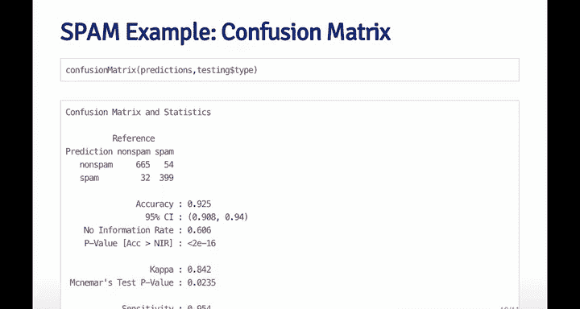

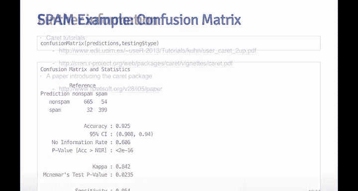

For a lot more information about CA， we're going to cover a lot of it in this class in terms of how do you actually apply the CARF package。

 but I found that these tutorials are actually very nice and they can be very useful for covering material that we don't cover in this class and there's also a very nice paper in the Journal of Statistical software that introduces the CARE package if you want further information。

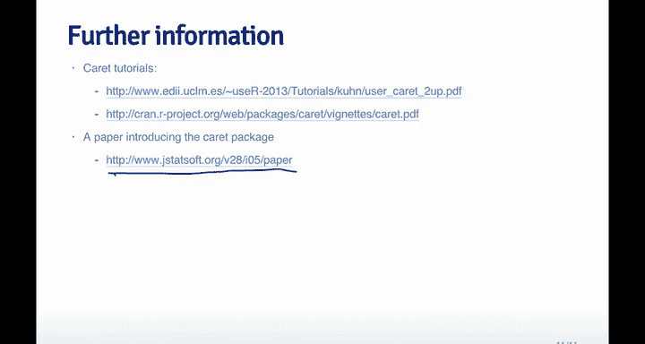