# 约翰霍普金斯大学《数据科学：统计和机器学习｜Data Science： Statistics and Machine Learning》中英字幕 - P96：15_使用主成分分析进行预处理.zh_en - GPT中英字幕课程资源 - BV1jsAAeNE3k

This is a lecture about prepro covariates with principal component analysis。

The idea is that often you have multiple quantitative variables and sometimes they'll be highly correlated with each other。

 in other words they'll be very similar to being almost the exact same variable in this case it's not necessarily useful to include every variable in the model you might want to include some summary that captures most of the information in those quantitative variables。

So as an example I'm going to use the spam data set again so I've loaded the CAA package here and I've loaded the current labb package and loaded the spam data set。

 I again create a training and test set and I'm going to perform only the operations on the training set that I'm doing here so that all exploration and model creation and feature building has to happen in the training set。

The first thing that I do is I leave out just the 58 column of this training set。

 which in this case is the outcome， so I'm looking at all the other predictor variables and I calculate the correlation between all those columns。

 the correlation between all predictor variables， and I take it absolute value。

 so I'm looking for all the predictor variables that have a very high correlation or very similar to each other。

Every variable has a correlation of one with itself。

 so I'm not interested in those variable you know removing variables that have high correlation with themselves since they all do so I set the diagonal of this matrix that comes out to be equal to 0 that's basically just setting the correlation between variables with itself equal to 0 and then I look which of these variables have a high correlation with each other In other words which of the variables have a correlation greater than 0。

8。

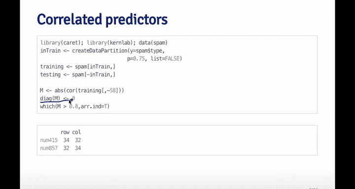

So it turns out two variables have a very high correlation with each other。 They are the。

Num 415 and nu 857， so it's how if the number of 4 415 and 857 appears in the email it frequently appears together。

 this is likely because there's a phone number that has similar variables there。

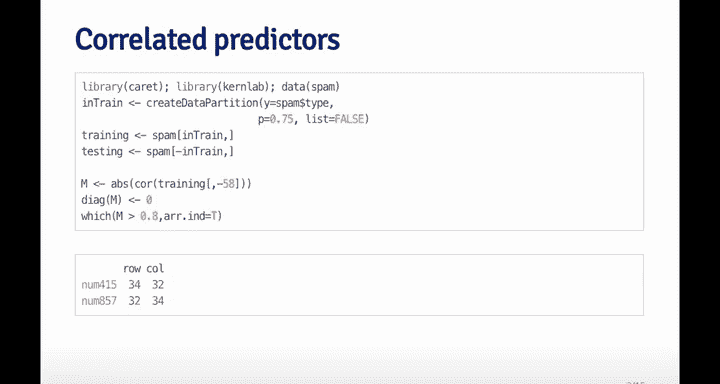

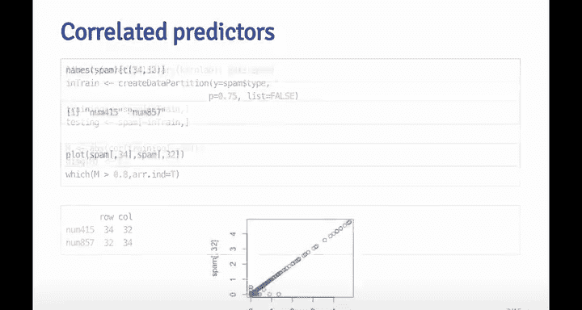

So if I look at the spam data set at the columns 34 and 32。

 which I got from getting that from the previous correlation variable。

 I see that it's these two variables， these two columns that are highly correlated with each other and if I plot those two columns against each other I see exactly what I'd expect so the frequency of 415 and 857 is incredibly highly correlated。

 they basically lie perfectly on a line with each other so as the number 415 appears more frequently so does the number857。

So the idea is including both of these predictors in the model might not necessarily be very useful and so the basic idea is how can we take those variables and turn them into say a single variable that might be better and one idea is to think about it as a weighted combination of those predictors that explains most of what's going on。

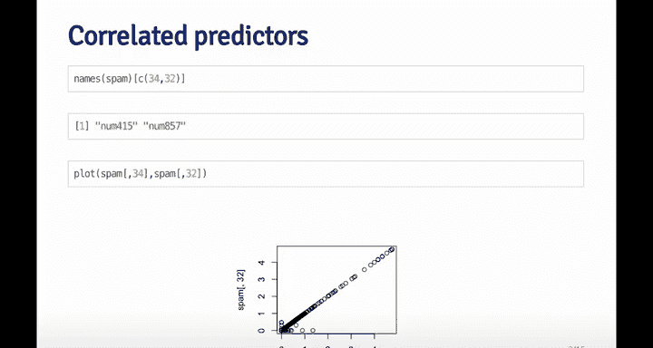

So the idea is to pick the combination that captures the most information possible and the benefits here are you're reducing the number of predictors you need to include in your model so that's nice and you're also reducing noise。

 in other words you're averaging or combining variables together so you might reduce them together so if you do this in a clever way you actually gain quite a bit by doing principal component analysis。

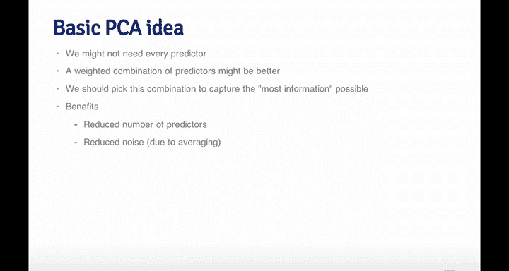

So one idea to think about is just。

Basically what you're trying to do is figure out a combination of these variables that explains most of the variability So just as an example。

 here's a combination I could do I could say I could take 0。71 times the 415 variable plus 0。

71 times the 857 variable and create a new variable called X that's just basically the sum of those two variables then I could take the difference of those two variables by basically doing 0。

171 times 415 minus 0。71 times 857 so this is basically adding x is adding the two variables together Y is subtracting the two variables。

So then if I plot those variables versus each other， when I add them up。

 that's the x axis and when I take the difference that's the y axis and so you can see most of the variability is happening in the X axis in otherwise there's lots of points all spread out across the x axis but most of the points are clustered right here at zero on the y axis so almost all of these points have a y value of0 so the adding the two variables together captures most of the information in those two variables and subtracting the variables takes less information so the idea here is we might want to use the sum of the two variables as a predictor and we reduce the number of predictors that we have to use and reducenew some of the noise。

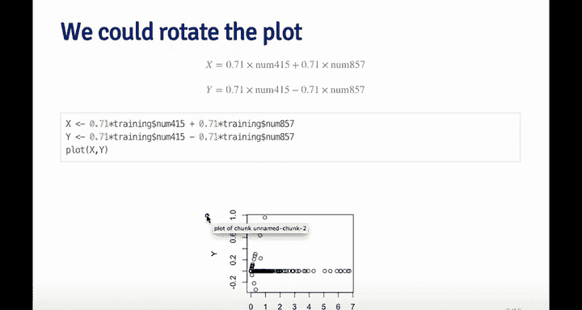

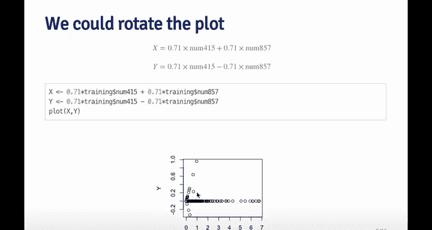

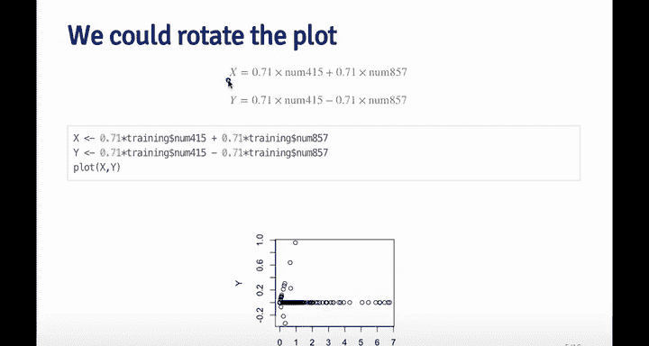

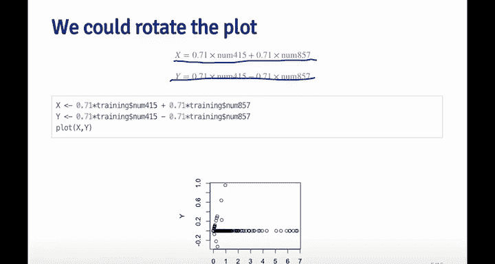

So there are two related problems to how you do this in a more general sense。

 and so the ideas are find a new set of variables based on the variables that you have that are uncorrelated and explain as much variability as possible。

 in other words from the previous plot we're looking for the X variable which has lots of variation in it and not the Y variable which is almost always zero。

So if you put the variables together in one matrix， create the best matrix with fewer variables。

 In other words， this is a lower rank if you're talking mathematically that explains the original data。

 these two problems are very closely related to each other and they're both the idea that can we use fewer variables to explain almost everything that's going on The first goal is a statistical goal and the second goal is a data compression goal but they're both very useful for machine learning。

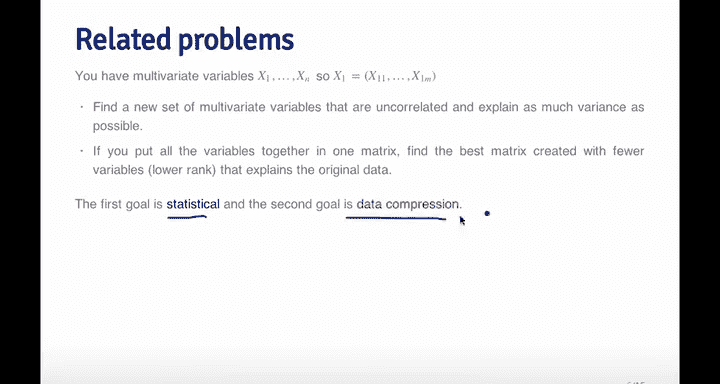

So there's two related solutions and they're very similar to each other。

 so if x is a matrix with a variable in each column and an observation in H row。

 like a data frame you usually have an R， then the singular value decomposition is a matrix decomposition so it takes that data frame X and breaks it up into three matrices。

 a U matrix， a D matrix and a V matrix and the columns of U are called the left singular vectors and the columns of V are called the right singular vectors and D is a diagonal matrix。

 those are called the singular values。You will have learned about this in getting data or exploratory data analysis if you take in those classes。

 the principal components are equal to the right singular vectors if you scale the data in the same way。

 in other words the solution to both of those problems I talked about on the previous slide is the same if you do the right scaling。

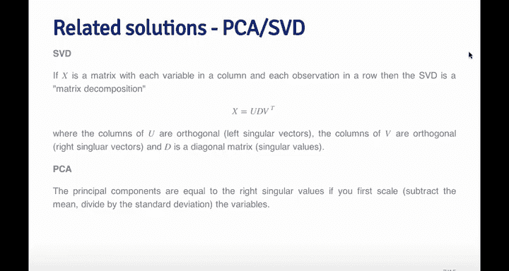

So the idea here is these variables in V are constructed to explain the maximum amount of variation in the data。

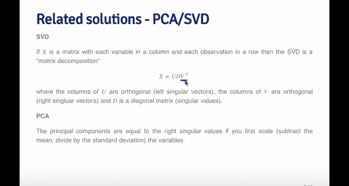

So just to show you how this works in a real example。

 suppose we take that spam data set and we just take those two variables that were highly correlated with each other。

 variables 34 and 32， so then we do principal components。

 same as the singular value decomposition on that small data that just consists of those two variables。

If we plot the first principal component versus the second principle component。

 we see a plot that's very similar to the one I showed you earlier where the first principle component looks a lot like adding the two variables together and the second principal component looks a lot like subtracting the two variables from each other so why would we do principal components instead of just adding and subtracting well principal components allows you to perform this operation even if you have more than just two variables you may be able to reduce all of the variables down into a very small number of combinations of sums and differences and weighted sums and differences of the variables that you've observed and so using principal components can let you look at a large number of quantitative variables and reduce it quite a bit。

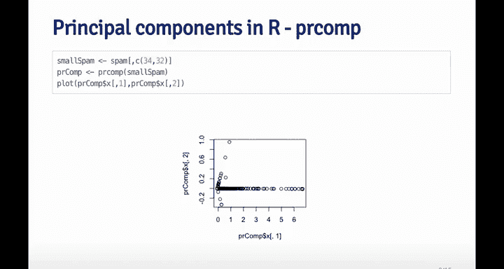

The thing that you can also look at in this principal component object is the rotation matrix which is basically how it's summing up the two variables to get each of the principal components and so here you can see why I put 0。

71 in the sum in the difference on the first slide so principle component 1 is just 0。

7081 times nu 14 415 and 0。7061 times nu 857 principal component2 is just the difference again by multiplyied by 0。

0761 and minus 0。0781 so basically in this particular case， the first principle component。

 the one that explains the most variability is just adding the two variables up and the variable that explains the second most variability in these two variables is the taking the difference between the two variables。

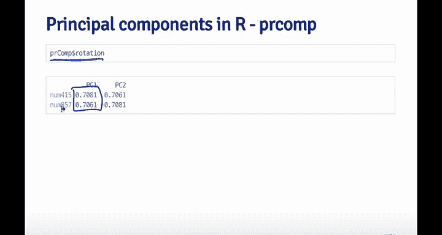

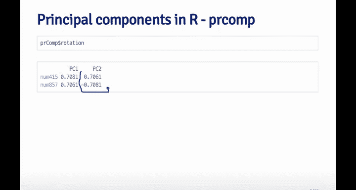

So on the spam data we can actually do this for more variables than just the two variables this is why principal components may be useful。

 so here I'm creating a variable that's just going to be the color we're going to color points by so it's color equal to black if you are not a spam and color equal to red if you're a spam。

And this variable here or this statement here calculates the principal components on the entire dataset。

 so you'll notice that I've applied a function of the data， the log 10 transform， and I've added one。

 I've done this to make the data look a little bit more Gaussian because some of the variables are very or normal looking because some of the variables are skewed and you often have to do that for principal component analysis to look sensible。

 so then I've calculated the principal components of the entire data。

So in this case， I can now again plot principle component1 versus principle component2。

 Princ component1 is no longer a very easy addition of two variables。

 It might be some quite complicated combination of all the variables in the data。

 but it's the combination that explains the most variation in the data。

 principal component2 is the combination that explains the second most variation in principle component3 explains the thirdmost and so forth。

 So if I plot principle component one， that's just a variable that I've calculated versus principle component2。

 that's another variable that I've calculated and then I color them by the spam indicator so whether each point。

 so each of these points corresponds to a single observation。

 the red ones correspond to spam observations the black ones， this hamm observations。

 you can see that in principle component one space。 So along the principal component1。

 there's a little bit of separation of the ham messages from the spam messages In other words the spam messages tend to have a little bit higher values of principle component one。

 So this is a way to reduce the size。

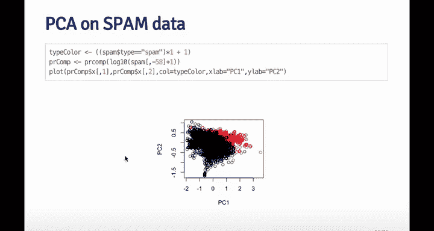

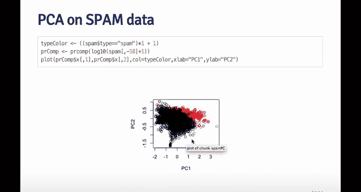

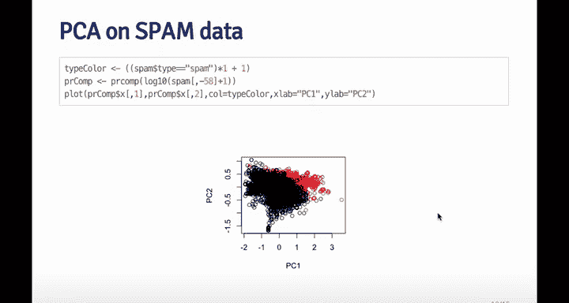

Your data while still capturing a large amount of variation。

 which is the idea behind feature creation。

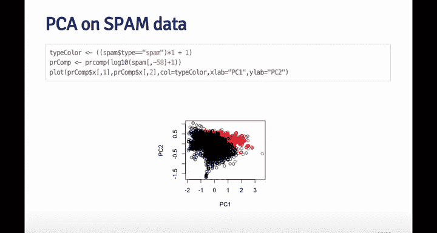

You can do this in carrot as well， so you can do it using the preprocess function so this is just basically doing a similar type operation with the carrot package you pass the preprocess function。

 the same data set that you did before， you tell it what method use in this case you're telling it to use principal component analysis or PCA you tell it the number of principal components to compute and then what you can do is you can actually calculate the values of each new principal so the principal components or two new variables。

 there's principle component one and principal component2 and they are basically a model that you fit to the data so the idea is that if you get a new observation you have to predict what the principal component will look like for that new variable so we pass this preprocess object and the data to the predict function and that gives us the principal components if we plot them versus each other you see span PC1s that's principal component1 versus principal component2 here and again you see a little bit of separation。

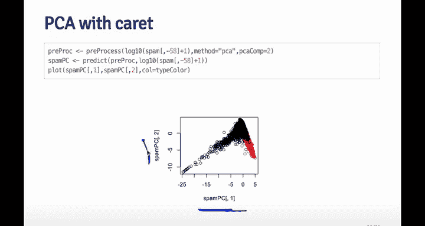

Between the ham and the spam messages in both principle component one and principal component two。

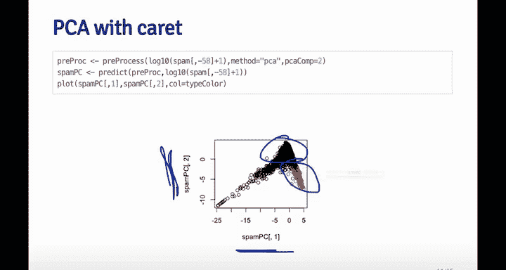

You can do this like I showed you before by doing preprocessing with the method PCA using the preprocess function。

 and then you can create training predictions by using the predict function and then fitting a model that relates the training variable to the principal components。

 so here I haven't used the full training set as the data for fitting my model。

 I've just passed it the principal components for the model fitting。

In the test dataset， you have to use the same principal components that you calculated in the training data set for the test variables。

 so the idea here is we again pass it the preprocess object that we calculated in the training set。

 but now we pass it the new testing data so this predict function is going to take the principal components we calculated from training and get the new values for the test data on those same principal components。

So then what you can do is you can predict the using the model fit on the original data。

 using the test principal components， and you can use the confusion matrix argument in currentt to get the accuracy。

 and so here we've calculated a relatively small number of principal components but still have a relatively high accuracy in prediction。

 so principal component analysis can reduce the number of variables while maintaining accuracy。

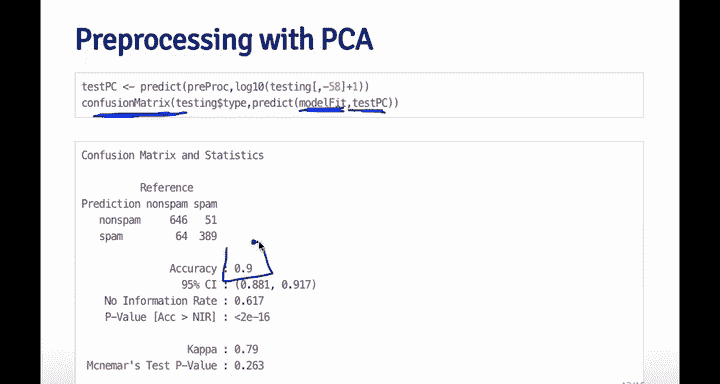

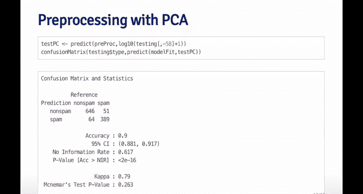

So the other thing that you can do is you can actually decide for this analysis to not use the predict function separately。

 you can build it right into your training exercise。

 so if you take the train function from the CAA package and you pass it the training set。

 but you tell it to pre-process with principal component analysis。

 it will do that preprocessing as part of the training process。

 and then when you do prediction on the new data， you just pass it the testing data and it will actually calculate the PCs for you。

The reason why I showed you the more elaborate way of calculating the PCs first and passing them to the model is so that you can see what's going on under the hood when you pass a command like this to the train function in the cart package。

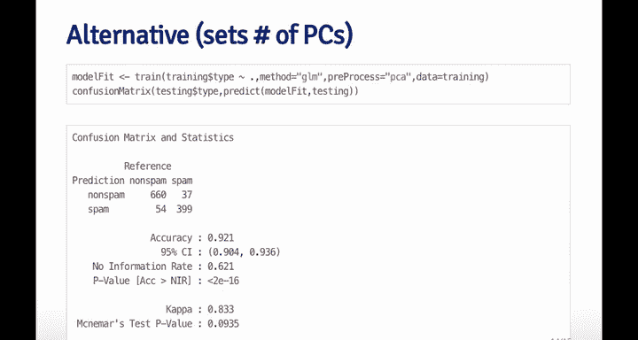

So this is most useful for linear type models。 This includes linear discriminant analysis。

 linear and generalized linear regression， things like that。

 It can make it a little bit harder to interpret the predictors in the case where I only had two variables。

 it was just the sum and the difference of those variables it was very easy to predict what that meant in general。

 though if you do principal components on a large number of quantitative variables and each principal component might be quite a complex weighted sum of the variables you've observed and so it can be very hard to interpret you have to watch out for outliers outliers can really wreak havoc on calculating principal components So you do that by looking at an exploratory analysis first and identifying outliers doing transforms like I did the log 10 transform of the data you might do box cox transformations as well and again。

 plotting predictors to identify problems is the key place to figure out whether this is working out For more information you can see the exploratory data analysis class where we talk about principal component analysis and Sd in more detail and this book the elements of statistical learning has a quite。

If a little bit technical overview of how principal components work for machine learning。

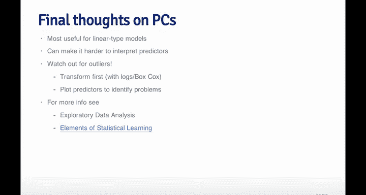