# 约翰霍普金斯大学《数据科学：统计和机器学习｜Data Science： Statistics and Machine Learning》中英字幕 - P97：16_使用回归进行预测.zh_en - GPT中英字幕课程资源 - BV1jsAAeNE3k

This lecture is about one of the most direct and simple ways to perform machine learning using regression modeling if you've taken the regression modeling class and the data science specialization。

 then a lot of this material will be familiar to you。

 we're just using it in service of performing prediction。

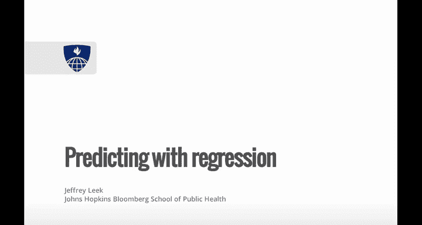

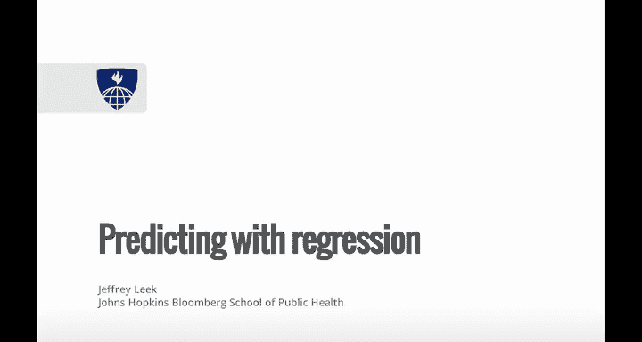

So the key idea here is we're just going to fit a simple regression model and so if you don't know what that is。

 don't worry about it I'll explain it briefly in the rest of the lecture。

 but the idea is that basically we're going to fit a line to a set of data so that line will consist of basically multiplying a set of coefficients by each of the different predictors and so then we get new predictors or new covariates and we multiply them by the coefficients that we estimated with our prediction model and then we get a new prediction for a new value。

This is useful when that linear model is nearly correct， in other words。

 when the relationship between the variables can be modeled in a linear way， in other words。

 as a function of lines， then this is a useful way to predict。

 it's very easy to implement and it's also quite easy to interpret compared to many machine learning algorithms in the sense that you're fitting a set of lines to his data and the lines are relatively easy to interpret。

It can have performance in nonlinear settings， so it's usually used in combination with other machine learning algorithms on complicated examples。

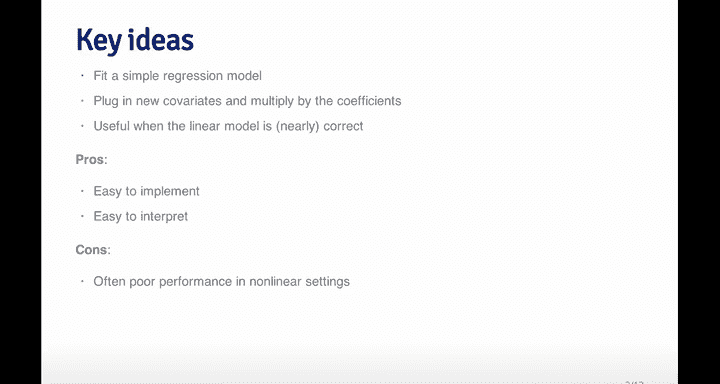

So we're going to be using data on eruptions of geysers and so their geysers are。

Have a waiting time in between their different eruptions。

 And there's amount of time that they actually erupt for。

 And so there's a data set that we can load in very easily that contains some information on eruptions for a particular geyser old faithful in the United States。

Famous geyser so we can load the carrot package and load the data for this eruptions and I'm going to set the seeds so that all the analysis that I'm going to perform after this can be reproduced。

Then I create a training set and a test set， just like usual。

 I create a training set because we're going to be building models only in the training set and then applying them in the test set。

And so if you look at the data set， if you look at the training set。

 you can see that we have just two variables so it's a very easy example。

 we have an eruption time and a waiting time， so the waiting time is the time between eruptions and the eruptions is the length of time that the geyser was erupting。

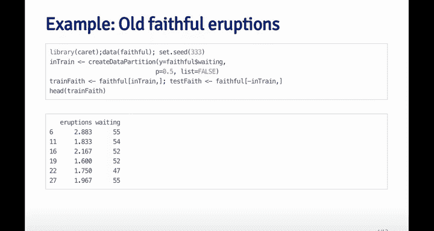

If I make a plot of these two variables， I see waiting time here on the X axis and duration here on the y axis。

 you can see that there's roughly a linear relationship or you can imagine drawing a line through this that predicts relatively well the duration time from the waiting time。

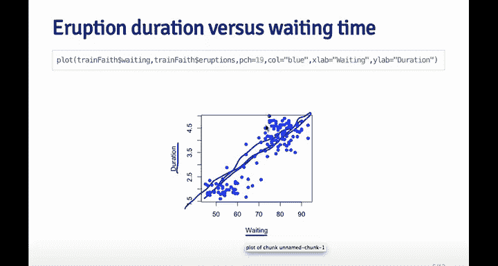

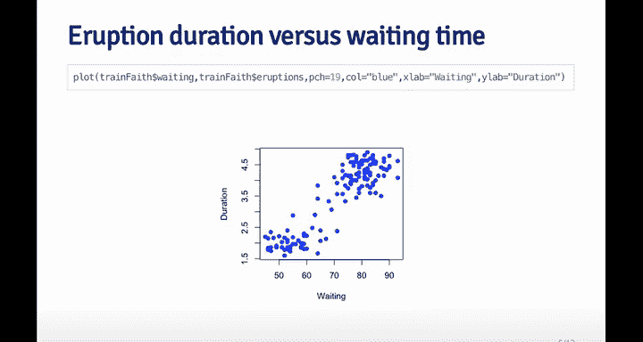

So we can do that by basically fitting a formula that's just a line so remember that the formula for a line is going to be the eruption duration here is equal to a constant or an intercept what people call an intercept term plus another constant times the waiting time plus an error term so as you saw in the previous slide even if a line fit through the middle of the data looks like a sort of a reasonable approximation to the relationship there's obviously not the points don't exactly fall on a line and that's why we allow for some error in our model the error models everything that we't have we didn't measure we didn't understand about the relationship。

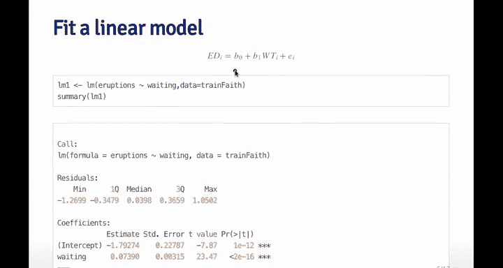

And so we can use the LM command in R to fit a linear model。

 so LM relates the eruptions that's going to be the outcome variable that you're trying to predict the Tilda says we're going to predict it as a function of everything on this side of the Tilda and here we're going to use the weighting data we're going to build that model using the data from the training set so if we do that summary we do that we get a summary of the output and point the part to look at in terms of prediction here are these estimates。

So the estimate here is just the intercept， that's just the constant so that's B0 in this formula and the waiting time estimate here is B1 in this formula and so if we get a new prediction。

 we just add minus 1。79 plus 0。073 times whatever our new waiting time is。

 and that produces our new prediction for the expected duration。

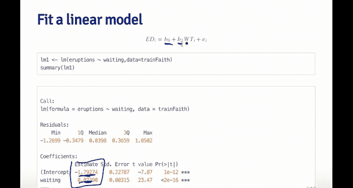

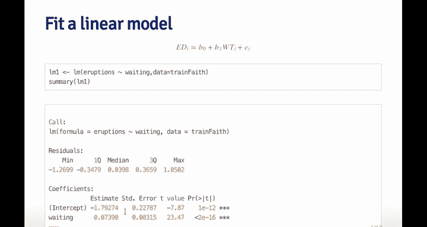

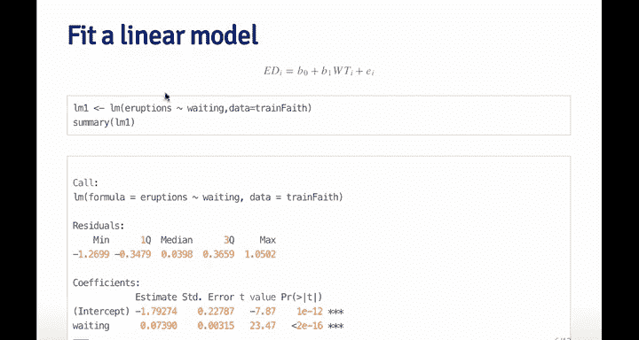

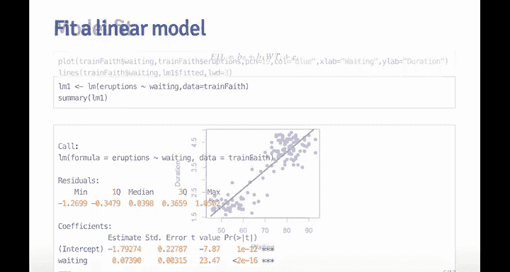

So this is what the model fit looks like and so I'm basically again I'm plotting the training set。

 the waiting times versus the eruptions and then I plot the fitted values and the way I do that is I can extract that from the linear model object Na with an Lm1 sign fitted will give me the fitted values and then I plot that versus the predictor variable that I use to predict the values so here this is the waiting time plotted versus duration。

 the points come from this first plot command and then the line that is fit right here。

 the black line comes from this lines command that's adding a line with the fitted values and so you can see just like we saw previously there's a line that is a reasonably good representation of the relationship between these two variables obviously it's not perfect the points don't lie exactly on the line but it's a reasonably good capturing of the main feature of the data。

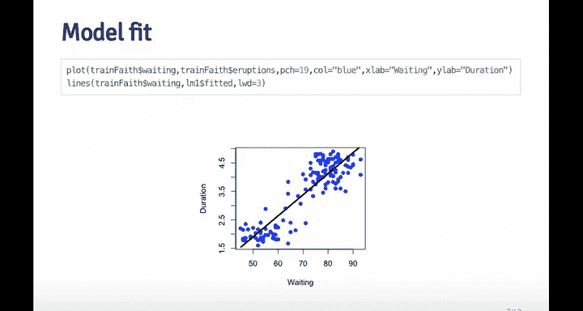

So to predict a new variable， we just， again， like I said。

 take the estimated value for B0 and the estimated value for B1。

 we usually denote those with little hats above the values and then we just multiply them together using the formula from the previous page。

 remember we don't have in this formula we don't have an error term because we don't know what the error term is for this particular value so we just use the parts that we can estimate。

So to get those values extract those values from the linear model object。

 you can use the COF command that gives you the coefficients。

 which is the name that we use for these two variable， the estimates for those two variables。

And so COF LM11 will give you the intercept value， the beta hat0。

 and COF LM12 will give you beta hat 1， the value fit for the waiting time。

 and then suppose we have a new waiting time that's 80， then the prediction that we get out is 4。

119 as the time for the eruption duration。So another thing that we can do is we can actually predict using that LM object。

 you don't actually have to every time extract the coefficients and multiply them together。

 so if we create a new data set which is a data frame that has one new value that we want to predict so we say we have waiting time equal to just 80。

 then if I type predict and I pass it the fitted model from the training set and the new data set。

 new data frame we created， it'll give me the prediction for the new value and it matches so it's using the same formula in this predict command that you would use if you actually calculate it out the prediction by hand。

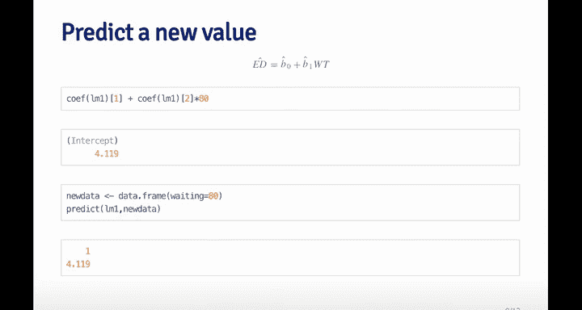

So another thing to look at is so remember we built this model on the training set just like we always do and we want to see how it does on the test set so here I've separated the data into two separate sets。

 the training and test sets and I made two plots on the left there's a plot of the training data and on the right there's a plot of the test data。

And so the training data， I plot the waiting time versus the duration and then I put the model fit in and it's a reasonably good model fit that's to be expected because it is the exact data that we use to build the model then I also plot the test dataset set and so over here this is the line that you get the predictions that you get from the model built on the training set。

So you can see that it doesn't quite perfectly fit the data anymore， like it did on the training set。

 it's a little tilted underneath over here， but that's to be expected because the test set is a slightly different set of data。

 but you can see it still captures the overall trend or the overall part of the variation that can be explained by the waiting time。

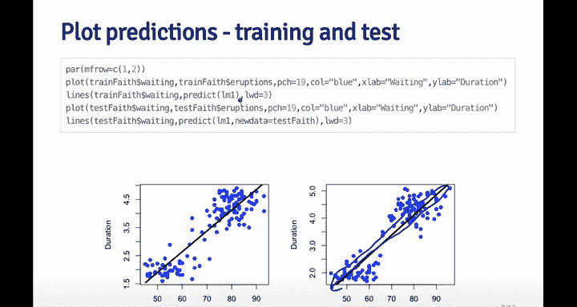

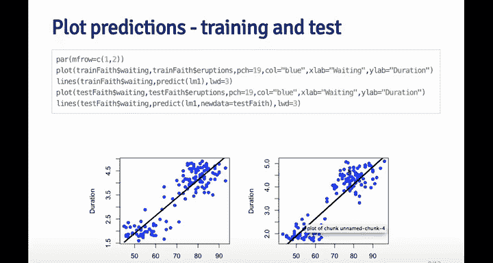

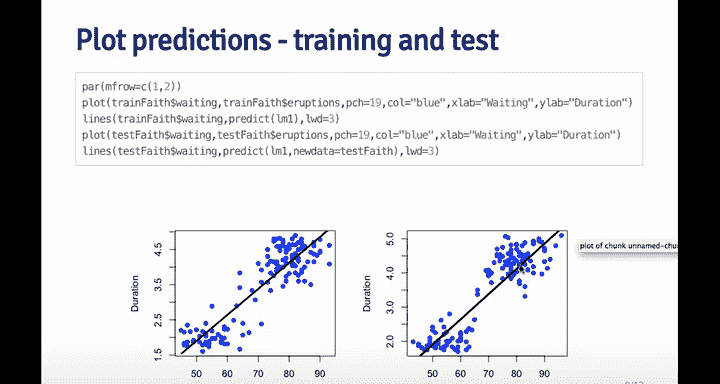

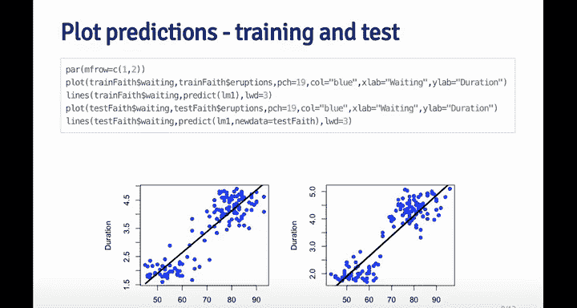

The next thing to do is to get the training and test set errors so to get the training set error we get the fitted values LM1 fitted so remember LM1 was the object we actually fit to fit the model and the fitted values where the predictions that we get on the training set then we can subtract the actual values of the eruption duration on the training set square them sum them up and take the square root and that gives us the root mean squared error if you remember that from our lecture on the types of errors that we could have so it basically measures how close the fitted values are to the real values and we get a value of 5。

752。

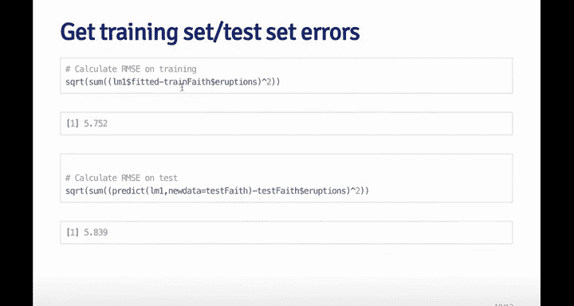

We can also calculate the root mean square error on the test set and so the way that we do that is we calculate。

 you predict again now we using this Lm object that we fit on the training set。

 but now we pass it the new data， the test dataset so now this is predicting values on the test dataset and we subtract off our actual values since we know what they are on the test dataset。

 square them and sum them up and since we didn't use the test set at all when we built our algorithm。

 this is a more realistic estimate of the root mean squared error that you would get on a new data compared to the value that we got on the training set and just like always the test data error is almost always larger than the training set error because again we're moving to a new set of values that weren't used to calculate the model so that represents the added error that error and variability you get when you move to a new dataset out of sample error。

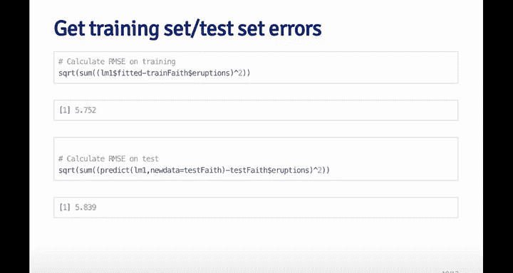

The other thing that you can do that a nice component of using linear modeling for prediction is that you can calculate prediction intervals。

 so again here I'm just calculating on I'm calculating a new set of predictions for the test data set from using our linear model that we built on the training data set and I say that I also want a prediction interval out and so that's just a argument that I pass the predict function and then if I order the values for the test data set and plot the test。

Waiting times versus eruption times。I can also add lines that show not only my predictions。

 that's what I've got here in this black line that shows the predicted values。

 but I can also show an interval that is the interval that captures percent where the region where we expect the predicted values to land So we expect most of the predicted values to land in between these two red lines if our linear model is correct and so this shows you a little bit about the range of possible values we could predict not just a single prediction。

 which can be useful for giving you an idea of how well your model is likely to do on new predictions。

 it'll tell you what are the range of possible predictions that you might get out。

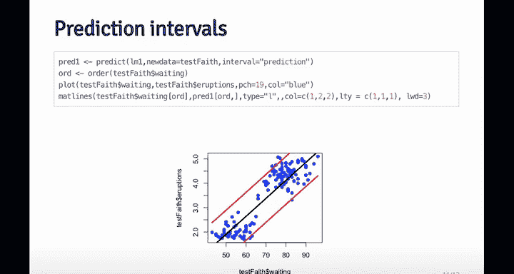

You can do the same thing in the carrot package again the carrot package I'm showing you how to do it by hand。

 but you can also very easily do it with the carrot package。

 I use the train function in the carrot package to build the model and so again the eruptions is the output outcome waiting time is the predictor and they're separated by this Tilde and then I say which data set I want to build the model on and for the method I tell it linear modeling。

So if you do a summary of that final model fit， so the final model is the part of the modern fit object that was created by train that tells you the exact final model that's being used for prediction。

 and again it looks very similar to the model that we fit by hand， it's minus 1。

79 for the intercept and 0。07 for the waiting time。

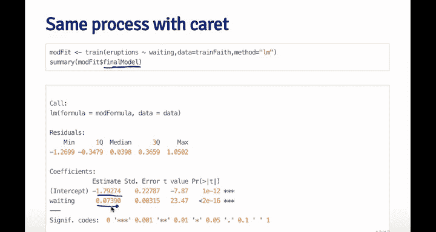

So regression modeling can be done with multiple covariates as well and we'll have a lecture on that but you can also combine it with all other prediction and machine learning methodology again it's sort of a good quick and dirty method for use it does miss get a higher misclassification error when the relationship isn't necessarily linear a lot of prediction is covered with regression modeling is covered in these books and would be a good place to go if you want more information。

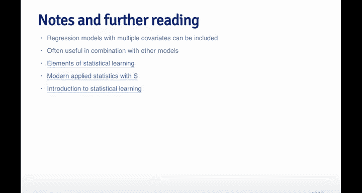