# 约翰霍普金斯大学《数据科学：统计和机器学习｜Data Science： Statistics and Machine Learning》中英字幕 - P99：18_使用树进行预测.zh_en - GPT中英字幕课程资源 - BV1jsAAeNE3k

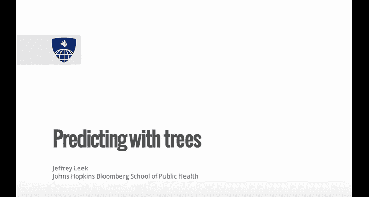

This lecture is about predicting with trees。The basic idea is that if you have a bunch of variables that you want to use to predict an outcome。

 you can take each of those variables and use it to split the outcome into different groups。

 and so as you split the outcomes into different groups。

 then you can evaluate the homogeneity of the outcome within each group and continue to split again if necessary until you get outcomes that are separated into groups that are homogeneous enough or that they're small enough that you need to stop。

The pros of this approach is that it's easy to interpret。

 and you tend to get better performance in nonlinear settings than you do with the linear regression models we talked about in the previous lectures。

The cons are that without pruning or some sort of cross validation， this can lead to overfitting。

And they can be harder to estimate uncertainty than it can be for the linear regression model setting。

In general， the results may be variable depending on exact values of the parameters or the variables that you've collected。

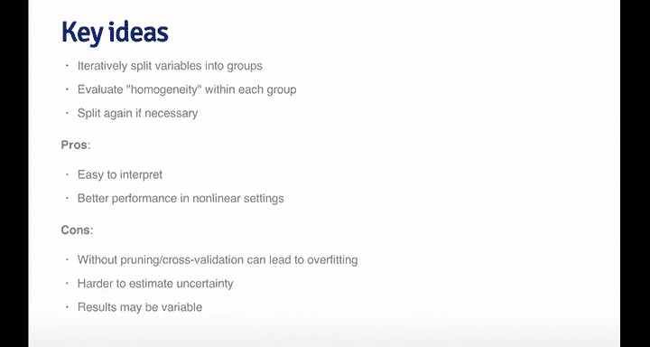

So here's an example of what a decision tree looks like after it's already been built。

 so this is a decision tree that appeared in the New York Times during the 2008 elections when Barack Obama was running against Hillary Clinton for the Democratic nomination for President。

And they were trying to decide what would be a prediction rule for whether a county would vote for Obama or for Hillary Clinton。

And so the way that that happened was that they would build a prediction model that asked questions of each of the different variables that they had in their data。

 so the best split happened to be this variable， so if the county was more than 20% African American。

 then the county was much more likely to vote for Barack Obama。

If it was less than 20% African American， then it became more likely that the county would vote for Hillary Clinton。

Then within each of these two subgroups， they went and looked for other variables that might split those subgroups out。

 so on this branch here the next question was is the high school graduation rate greater than 78%？

If it wasn't， then the county was more likely to vote for Hillary Clinton， and if it was。

 then it's more likely to vote for Barack Obama。And the algorithm continues in that manner until youve split out into the smallest subgroups that you are willing to consider。

And so you see within each of these leaves of the tree， the predictions were quite homogeneous。

 in other words， Obama won 383 out of about 450 counties in this case。

 and Hillary Clinton win 704 out of about 790 or 800 counties in this case in other words。

 these questions split the counties into groups that were homogeneous within each leaf their prediction was likely to come true that that candidate would win the election。

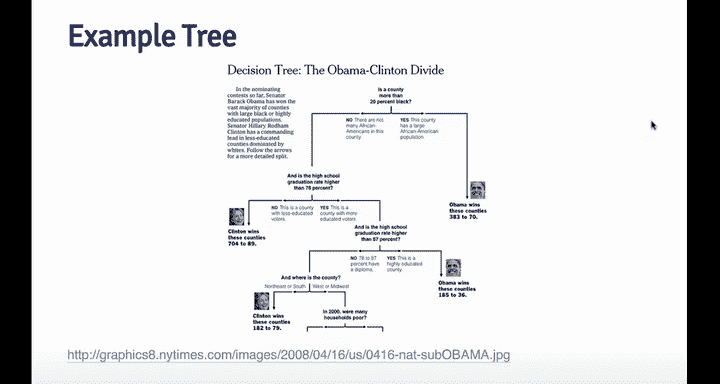

So the basic algorithm behind building one of these trees is start with all the variables in one big group。

 and then you find the first variable that best splits the outcomes into two different homogeneous groups。

You then divided the data into two groups， which we call leaves and the split that you just performed is called a node。

Within each split， we then search through all the variables again。

 including the variable we just split on and tried to find within that group if there's another variable or split that separates the outcome into even more homogeneous groups。

You continue until the groups are too small or they're sufficiently pure， in other words。

 sufficiently homogeneous to stop the algorithm。

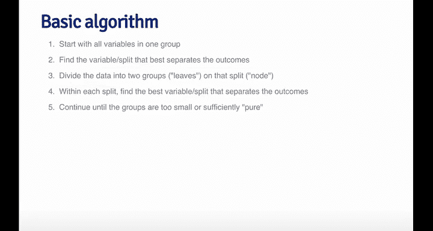

So there are different measures of impurity and they're all based on basically this probability that you can estimate。

 so within a particular group so in the M leaf then you have n total objects that you might consider and you can count the number of times that a particular class appears in that leaf。

 so this is the number of times that class K appears in leaf M。So that's this probability。

 so it's P hat for the m leaf and the Caith class。The misclassification error is one minus the probability that you're equal to the most common class in that particular leaf。

 so for example， if if it's a leaf where almost all of the counties would vote for Barack Obama。

 then one minus the misclassification error is one minus or the misclassification error is one minus the probability that you would vote for Barack Obama。

So zero means perfect purity in other words， there's no misclassification error and all of the counties would go for Barack Obama。

 0。5 means no purity because it's not one because in any particular leaf if the county was overwhelming if the counties were overwhelming overwhelmingly likely to vote for Hillary Clinton。

 then you would get perfect purity in the other direction。

 so it's actually when the leaf is perfectly balanced between the two different outcomes。

 that's when you don't have homogeneity within that particular leaf。Similarly。

 there's something called the Genie indexex， which is not to be confused with the Genie coefficient in economics and it's basically one minus the sum of the squared probabilities that you belong to any of the different classes。

 so again zero means perfect purity in other words the class has one particular class has probability equal to 1 and all the other classes have probability equal to 0 0。

5 means no purity in other words all of the classes are perfectly balanced within each leaf。

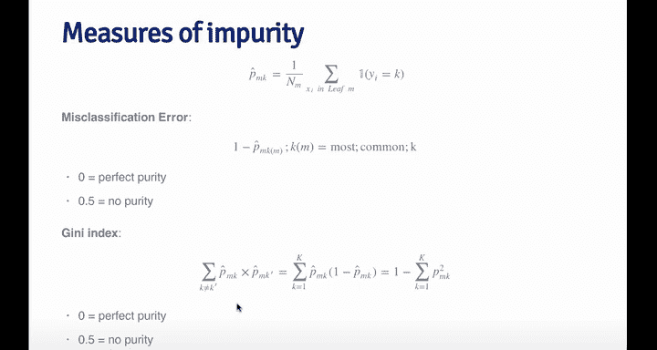

Dance and information gain is another measure that can be used and so it's called deviance if you use a log with base E here and log base2 is information gain and it's basically minus the sum of the probability of being assigned to class K and leaf M times the log base 2 or base E of that same probability value of0 means there is perfect purity within the leaf and a value of one means there's no purity If you go to this link from Wikipedia you'll have a lot more information about how these measures of impurity are used to separate the values within each leaf。

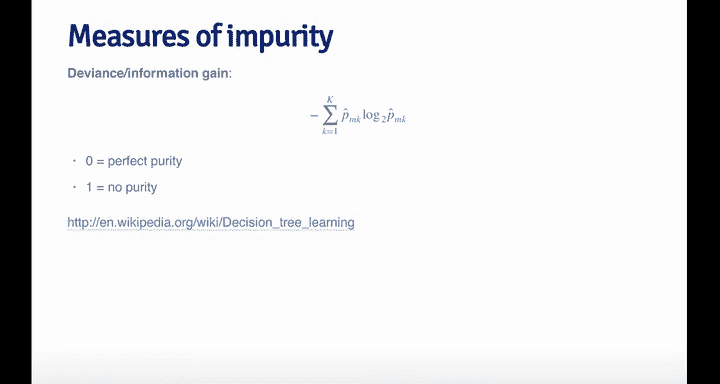

So here's what they look like a couple for a specific example。

 so suppose we had a variable that was trying to split the dots into the blue and the red dots。

 if the variable split it in the following way where 15 of the dots were blue in a particular leaf and only one was red that would be a relatively pure situation and so misclassification rate would be one out of 16 so that's just this one dot here and so it's relatively low value。

 the genie coefficient would also be low because it's one minus one divided by 16 squared plus 15 divided by 16 squared which is a relatively small number。

And then the information gain is similarly would be in this case smaller towards zero because it's1 over 16 times log base 2116 plus 15 divided by 16 times log base2 of 15 divided by 16 so that's a case where there's a relatively pure outcome in the two groups we could also look at the case where it's not so suppose this variable split the outcomes into a leaf where half of the values were a blue and half of the values were red so that wouldn't be a very good split because it's basically coin flip whether you're from one class or the other and that leaf and so the misclassification rate here is 0。

5 it's very large the gene index is also maximized it's 0。

5 and the information is also large it's1 so this would be a split that wouldn't be made because it wouldn't separate the two groups very well on that particular leaf。

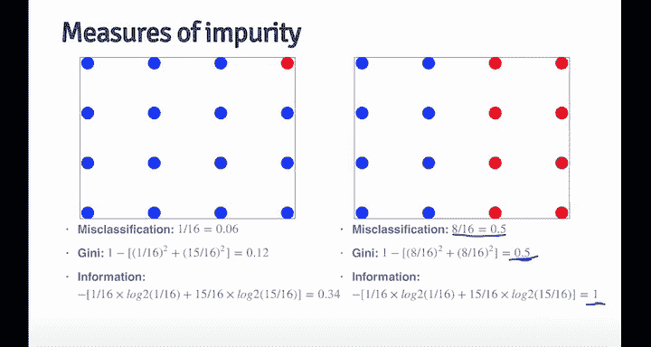

So I'm just going to show you an example with the IIS data。

 this is a very old data set but it shows you the idea of how this works。

 so this I'm loading the data with the command data Iis and then I'm loading the Ggiplot2 library for making plots。

So the names of this data set are the different variables that we're going to be using to predict with here it' SEL length。

 SEL width， petal length and petal width， and what we're trying to predict is the species。

 so there's 50 of these three different species that we're trying to predict with those variables。

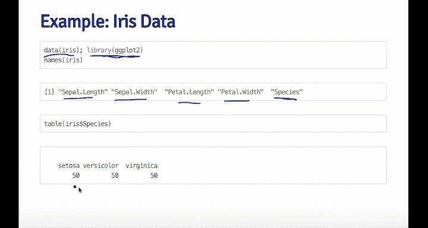

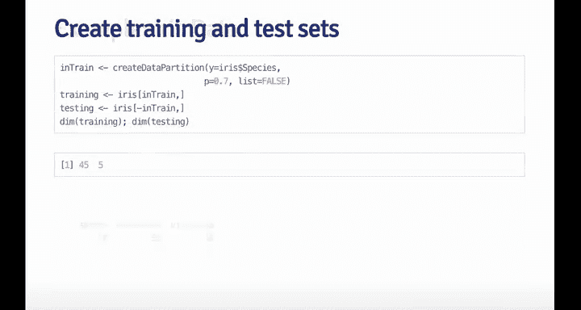

So again， I always separate the data into the training and the test set。

 and in this case I have 45 examples in my training set that I can use to build a prediction model。

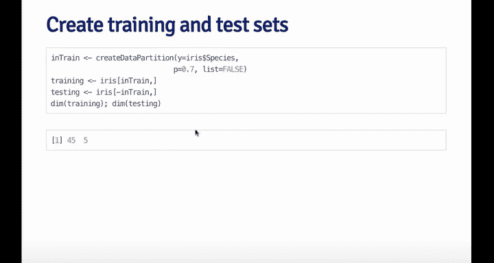

And the first thing that I do is I'm going to plot the pal width versus the seepL width。

 so that's pedal width on the X axis and seal width on the Y axis。

 and then I'm going to color it by the different species and you can see there are three very distinct clusters here。

So it's a relatively easy classification problem， it might be a little bit challenging for a linear model。

 but not necessarily challenging for this more advanced modeling with the classification trees。

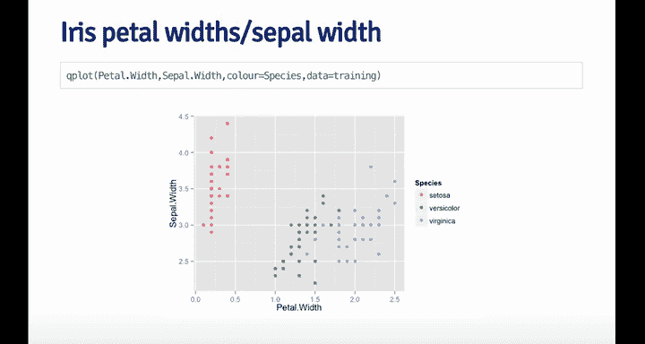

So you can fit the model using the train function and cart， so again I'm training the model。

 the outcome is species， I'm predicting with all the remaining variables which is why I have this Tilda and then a dot and I'm telling it the method is R part which is R's package for doing regression and classification trees。

 one of the packages。

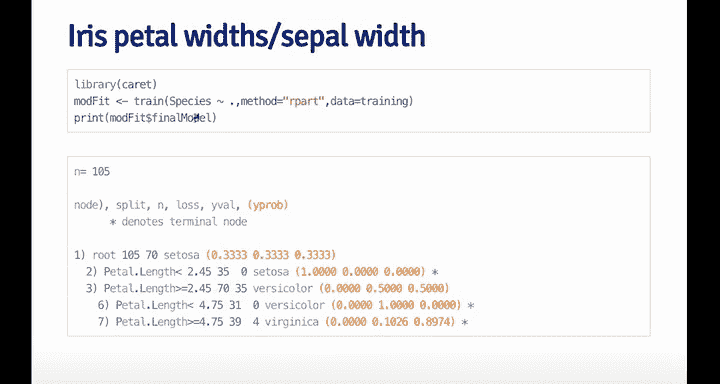

And I'm telling you to use the training data。 If I look at the final model。

 it tells me what all the nodes are and how they're split and in order to and what the。

The probability of being in each class is for each split。So here， for example。

 there's a split that says petal length is less than 2。45 and if that happens， then you in that case。

 all of the examples that have petal length less than 2。

45 belong to this species Stoosis so you can read those model splits to tell you what the classification tree is doing。

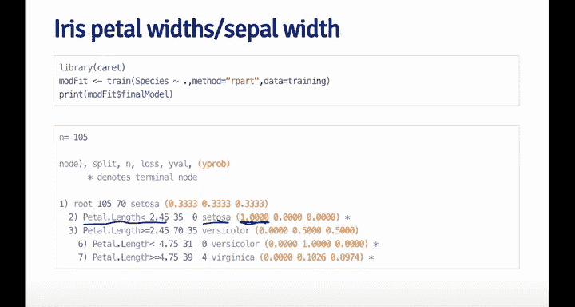

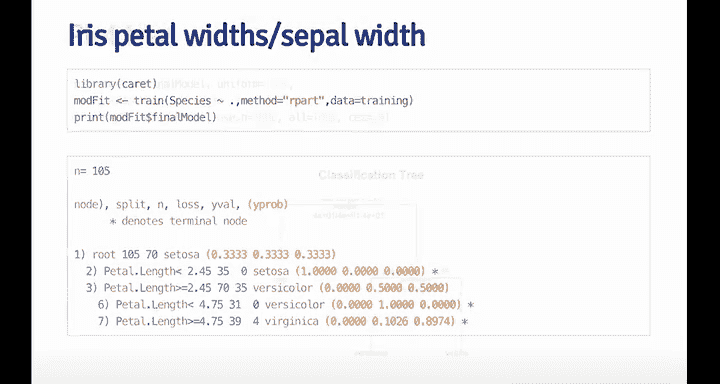

You can also make a plot of the classification tree and so if you just plot the final model that's produced what it'll do is it'll produce what's called a denogram like this and so it's a little bit hard to read it's cut off here but you can see pal length less than 2。

45 then you're assigned to Ctoa and so you can follow to the left what happens if the pal length is less than 2。

45 and to the right what happens if pedal length isn't less than 2。

45 and then follow the next split here at this node down to the see the total classification for any particular example a prettier version of that plot can be made with the rattle package so you use the function fancy R part plot and you pass it the final model that was fit using carrot and it makes again a dengram but now it's a little bit easier to see so here we see that if the pedal length is less than 2。

5 we move over here to the left and if it's greater than 2。

5 then we go over here to the right and then within that。

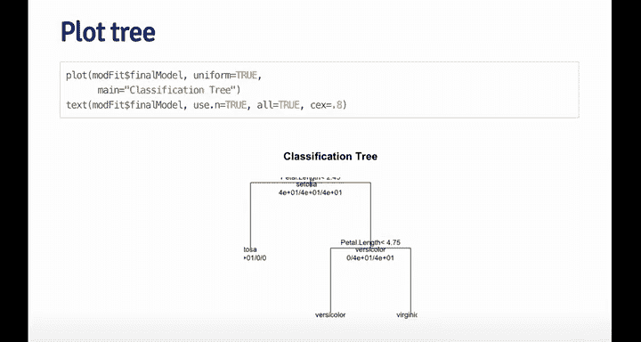

So once you've already made that decision among those samples， if the pedal length is less than 4。8。

 you go down here to the left and if the pedal length is greater。

 you go over here to the right and so this makes it a little bit easier to see what's going on。

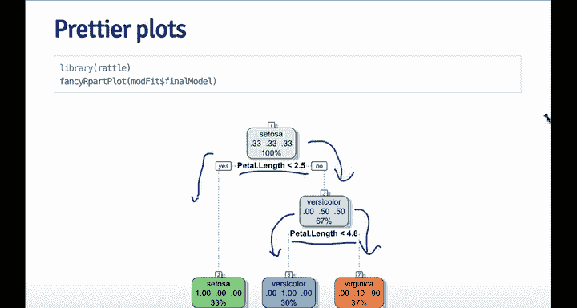

You can predict new values using the predict function just like you can with the other linear regression models here the prediction is going to be a particular class label because the classification tree was built to predict a particular class。

 and so when I pass the new data testing data to the model。

 it'll actually write out the different categories of a species because it's actually predicting the class for each variable。

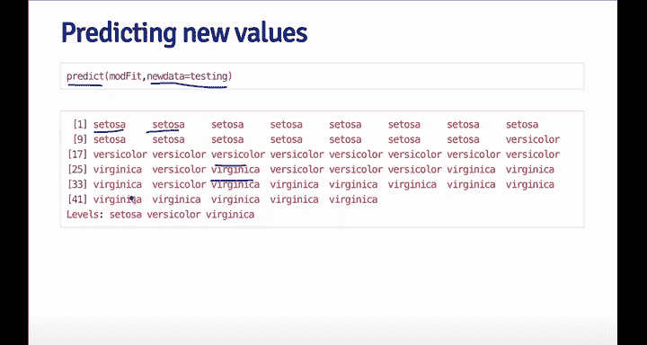

So notes and further the research sources classification trees arelinear models。

 so they immediately use interactions between variables。

 this is important to keep in mind because it's always a model that's built on the relationship between multiple variables and if you have a large number of classes for a particular variable for example。

 that you're predicting with the models can overfit a little bit the data transformations maybe a little bit less important。

 if you do any monotone transformation of a continuous variable in other words any transformation that doesn't change the order of the values but maybe makes them bigger or smaller then you will get the same data splits with the classification and regression trees this can make the transformations a little bit less important。

They can also be used for regression problems， so I've showed measures of misclassification impurity。

 you can also use root mean squared error as a measure of impurity and do a similar classification tree building procedure for building models for regression as well。

There are multiple tree building options in our R， both in the carrot package using the party package。

 the R part package， or you can even use this package tree。

 which doesn't appear in the carrot package， but also has a lot of useful functions that can be used when building these models for more information you can read in these two books where there's a lot of good information about classification regression trees or in this book about that's more specifically targeted to this particular prediction algorithm。

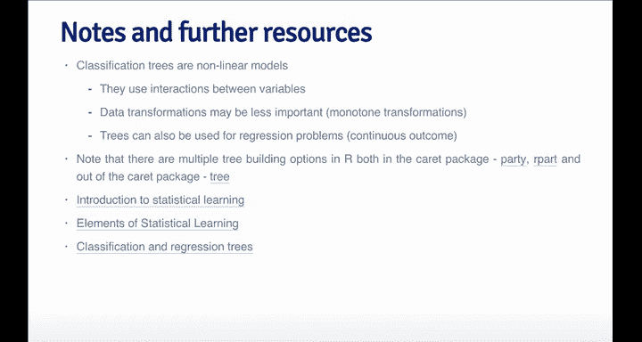