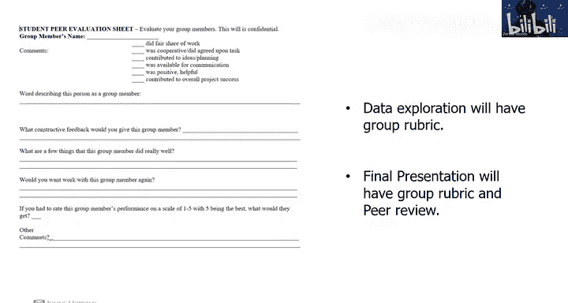

# 约翰霍普金斯大学《神经网络基础｜Foundations of Neural Networks》中英字幕 - P1：0_导论与背景知识.zh_en - GPT中英字幕课程资源 - BV1w1uqzSEHZ

So。Most。Talk about foundations of neural network。So the chorus will introduce neural networks and it will emphasize the derivation of the underlying so mathematical theories and so what the goal here is to gain experience and formulate the models and implement them in algorithms using Python as well。

So we focus a lot on the mathematics that we do a lot of practical stuff in Python as well。

And so there's a big emphasis here on research， I think that God would be doing all of a dis service without having united research because this shows moves so quickly。

嗯。I expect for everyone to be comfortable with variety code in Python and you will need that in order to be successful in of course。

 all code in this course will be re in Python and it' not。To be mean or anything like that。

 but the most。Step learning languages the models are in Python and so because of that。

 I require that to be in the course。嗯。At the end of the course， students will be able to implement。

 apply and mathematicalally analyze a variety of re neural networks or when apply to the real world right so we don't。

You know， think about this as。Textbook things or anything like that I want you to be able to go out and stumble on the data set and kind of。

Get some ideas about so what you can do with that data set that is the goal here。And again。

 this course， it differs from E from other EP work courses and that the primary focus here is on the foundations is in mathematics right in underlying algorithms。

 so I don't care to have everyone just applying algorithms。

 what I want you to do is understand it and then be able to apply the algorithms because you're understanding mathematics。

可。So the main text is。Deep learning by fellowello， the author actually。

Publish is are free a PDF of this online， I really enjoy this book。

And then the other half will be current like research right so so we'll use this textbook kind of the first half then we'll start exploring the open literature more in the same in the second half。

All right and so what kind of math do I expect right and so there are a few of them that I expect the first one is that for you to be comfortable and multi tovari calculus a linear algebra。

Probability and statistics and I would hope that everyone is comfortable in writing math addicts proofs so kind of in classes is what I expect。

 but if any of you are you know feeling like any of this is scary that's kind of office for please come and talk to me about this kind of thing i'm happy to help。

 but these are kind of the prereqs for this course。

And these are food links if you want to get caught up on these kinds of things from Khan Academy。

 okay。Now let's discuss what everyone cares about right how are we going to get great right I think that that what I want everyone to focus on is。

Is learning the most and then the grade will follow。

But I understand and I was a student at this point。

 so I will explain how each part of the course is graded。

So homework six assignments that will be assigned in the first six weeks of class right so kind of the first half of it is homework driven。

The most of the problems are as adequately based， each homework assignment will have a coding problem to practice using Python operators to implement the algorithms right so you will have ask adequate questions and you will have one coding question every week that you must answer as well。

Good。And that's 18% that breaks down。Three% for homework。

So that's your first 18% is your homework ratess。And then you will have a weekly discussion on a research paperer that I choose。

 so the class will be assigned a research paper that will be that I will present some relevant research on the topic of the week so we'll go over a topic。

 you'll get assigned a research paper that kind of goes over that and you're expected to read it and each student is expected to discuss some major points and findings in the papers and discuss it on the discussion board。

There would be one discussion post per student and students are expected to comment on their own ideas and or respond to classmates ideas and comments right so I want this to be interactive I want everyone to be talking about these kinds of things and so this is part of your weekly in class discussion and so part of your weekly in class discussion。

No i'm sorry so I want all of us to be discussing this this was one say in。Person course。

 but I would like to con as much discussion as well， even though this will be an asynchronous course。

Okay， so that was 12% so we're up to 30% 40% here is your researcher paper assignment so this is an individual assignment。

 so what you're going to do is you're going to begin by googling a research paper in the field of your networks that you find interesting。

It can be a peer reviewed article that is appealing to you。

 so my only requirement here is that it is peer reviewed I tend to ask folks to stay away from some so not to peer reviewed because I don't want you spend any words on things that aren't accurate。

And so after that， you'll email the instructor with the title of the paper and the office name。

This is important because you want the instructor to approve your selection right so it is particular that you email me let me know it and get about with this so that I can approve it for you。

And then you will do a recorded presentation on the findings and topics of the research paper and post the video on the discussion board。

And so you'll be responsible for asking at least one question to response to a classmates video so everyone want to do one。

 you will have a responsibility to ask at least one question to one of your peers about their discussion。

And so obviously if a question is asked on your video you're responsible for trying to respond to it。

 I want to stress here that perfect responses are not the thing that I'm looking for so obviously answer the best as you can but that is not the thing that's going to make or break it grade the goal is to get experience in reading research right that's what I want youre doing I want reading the research and being comfortable with that。

😡，And sharing that information with your classmates and also me right so again this topic is large it moves fast。

 we can't keep up this is a way for us to keep up with with more of the research topics。

And so a discussion posted that must be posted no editing in。

The day before the last day of class right so that is。I kind of highly suggest that you do a。

Way before it gives your classmates time to respond。

But that is the absolute last day right it is highly encouraged to do it way before that。

All discussions so must be had by the last day of class amendment right so any kind of discussions that you have about that paper has to be in before for the last day of class amendment。

可。So we got 40% already， then we have 20% more， which is the data exploration assignment that'll make 60%。

And so what happens here is so students will be placed in groups in the first day of class。

This is a and so that group will be chosen so randomly the idea there is when we're doing at work in the real world we are usually in teams and so I am trying to mimic that also usually you don't get a chance to true for your team is and that's the comes as random and so you know so we will randomly pick groups and so what this is is a proposal of your final project with a selected out of set right and so。

How do I want to say so so what you're going to do is you're going to go out and you're going to find the data set that's interesting to you it could be from CAgo it could be from your job if you can have it released and we can see it it could be from anywhere that is。

That has curated data。And what so what this project is going to do is you're going to treat it。

As if you're trying to propose it to get， say like funding for research。

So kind of so why do we care about it so what is the thing that we're doing so what are some of the structures that we think that we could exploit using neural networks I mean you're not actually doing any neural network to work on it yet。

But this is the time to kind of do all of the background， so kind of the why， what， when。

 where how these kinds of questions are the questions that you're going to ask so imagine standing in front of a room for people trying to get funding for your new and excited a research paper and that's what you're trying to do here。

Okay。And so so what you're going to do is on the like about halfway point of the class you are going to to get in groups and you are going to present。

Your research， are you want to present this data set to your classmates？嗯。嗯。

And you're going to to put that so you're going to record it and you're going to put it in a discussion post and then again so you are responsible for。

A few things that I'll go through， usually you want that about 20 minutes。That discussion and。

Your classmates will be。Judging you on these and so there's a rubric that I will go over soon。

And then。诶。The most important thing on the rubric is is the comments right and so in particular right the graces will affect your grace a little bit that your classmates will so we'll。

Will provide， but I think that the comments are the most important and so if you are a person that is listening to this group。

 right？It does in like very severe disservice to just give them the great right I am more interested in the Congress than I am the great and so at the end of that and what I will do is I will anonymize all of the comments and I will pass them to the groups so that the next time they present their this is very very important to us okay。

And then we have the final project， so what you're going to do is you're going to use that same data set that you use halfwaypoint。

And at this point you're going to have applied at work techniques so that you've learned in class or that you've learned somewhere else right and you're going to kind of see。

 you know。So what you've learned or so what kind of information that you can glean of out of that data set I want you to stress again that it is not about getting perfect performance on your data it is about getting a hard at a set exploring it and earning a lot from it right and so particularly if you're said it's too easy I'm not going to approve I can't right it's just a thing that I want you to learn the most I don't care about you getting perfect results or anything like that。

If so the。Iject Karent， so the code it must。You submitted to by the end of class you are going to do an oral presentation that is going to be on the discussion post you're going to get peer reviewed again from i'm sorry you're going to get peer review from your classmates but then on this time on the final project you're also going to get peer review within your praise so this is the kind a time to kind of to kind of say you know。

Hopefully so what it's said is that everyone to work together great and that everyone pull their weights。

 but this is a time to kind of help help me score your classmates to so what's the idea behind this right so most of the times I'm at work when when I hear some of my friends about this it isn't about a person you know so one particular person having control over you know how you're scored in the neural network project usually it is your peers that are doing right so it's just kind of the thing that we're trying to make me care as well okay。

40% overall follow this and that gives you your 400% this right here is the group oral presentation right so there's a section for comments again this is the most important part I can't stress that enough right this is a rubric。

The four to three to 2001， it doesn't mean that much。

 but the comments mean a whole bunch so I am particularly interested in these。嗯。

For your final project this is what you're going to do your peer review internal of your group so again you're going to do the group review but then on your final project this right here is going to say you know my teammate did well。

 my teammate lacked with this right here and and this is kind of the thing that you're doing。

啊。Pmer sure that we're gonna to have a great journey looking forward to it。

 I really really love the moviess Xman and so from now from so while we're in class you can kind of think of me as professoror Zine have a professorfesor X and I am going to think of you as my mutant students。

 the idea here is that once you start doing this like at work work everyone kind of thinks that you are the special breeder people and they don't know what you're doing and so we call those mutants。

 those are the ones that have powers and stuff like that and so appease me here。

 I love this thing that one of the things I forgot to tell you is that so when you're someone of you're formulate in your groups。

The one of the things that I really， really want is for you to stop give me an X man giving me your X man team name right until so you're going to。

Name your team， so based off of Xman in some ways I've had all kinds of interesting interesting。

Names， I'm looking forward to hearing yours。 But again， and so I end this by saying newton， you know。

 are you ready to go on this adventure with me so I'm looking forward to the semester I。😊。

I want to make sure that everyone knows that you know it is us against the material and not you against me I love this stuff I love to talk about it so looking forward to everyone joining me in this semester okay looking forward to any questions email office hours see everyone soon。

