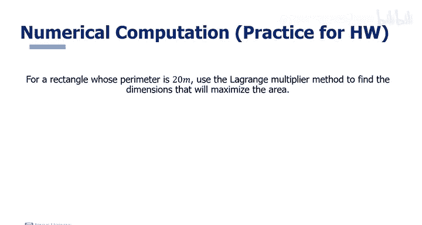
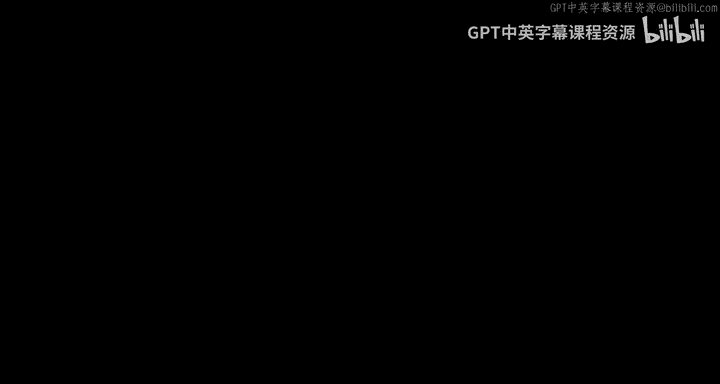

# 约翰霍普金斯大学《神经网络基础｜Foundations of Neural Networks》中英字幕 - P3：2_深度学习数学基础.zh_en - GPT中英字幕课程资源 - BV1w1uqzSEHZ

So there are a few things that we want everyone to know and understand so why we are。Learning。

Dke learning so kind of these foundational things and so let's jump into a few of them so there's scalarrs and vectors and matrices and tensors there's some multiplication of matrices and vectors identity and inverse matrices anydepend and span norms eigen decompositions singular value decompositions the inverse of pseudo I'm sorry the pseudo inverse the trace to determine these are a few things that will be great for you to have a good understanding of so as you're doing。

And so what I want to do is I want to kind of。Go through kind of an example homework problem that you're going to see soon in linear algebra right so here's an example that we're going to go through the expression alpha u for alpha and real and unit vector u in R n defines a line of points that may be obtained by a varying value of alpha deriving expression for the point y that lies on this line that is as close as possible to an arbitrary point x and R R so this operation of replacing a point by its nearest。

Member within some set is called a projection so what i'm going to do is i'm going to。

Prove this right so I am going to show you kind of how things go when you're doing some mathematical proofs。

So let's jump into how to prove it， let's do it right now so we have this expression out for you out in the reals and and I'm a unit vector you and R end and whenever another it defines a line。

Of points that may be obtained by a sovari this value of alpha right and so we want to do is want to derive an expression。

But the point why that lies on this line and as close as possible to an arbitrary point X RN right and so this operation over placing a point by its nearest。

Remember within some set we call it a projection right and so how do you do this right so the first thing that we want to do is we want to just define some metric。

All right， so our thing we do that I want to do is want to define a metric， right。

 so let's just define this right here。To be some metric， be some distance。Okay。

 and so what we're trying to do is we're trying to mix， we're trying to minimize。U。

The norm of x minus y。I mean， well， the distance of xon is y and we might as well square it， right。

 because squareing it。Um， it's fine because if we were to square because if we were to minimize the square。

 we're also also minimizing the distance as well。Okay。

And so so what do we know right we know that y is equal to alpha times u for some alpha in R because we know that。

Made lives on that line。All right， and so what we're actually trying to do here is you're trying to minimize we're trying to do a minimum over alpha。

Of the normal。X minus alphapha U。Square right。who would expand this out？

This is equal to the minimum over alpha of。X minus u。

 x minus alpha u transpose times x minus alpha u。う。And if we were to expand this out， right。

 this will be。Oh。X transpose X。Right， and then this will be minus。Nan。2 alpha for。咁。Ex transpose you。

Amen， plus。Alpha squared。CU transpoU right， and so what we know here is that。

That this right here right， is equal to。The normal view。Right， and we know that you as a unit vector。

 so this is equal to one so what we get here is that so this is so we get so what we get here is that this right here is equal to the man。

This why he're supposed to be a man， too。So what we know is this is the men。Over Al。Of。

X transpose x minus2 alpha x transpose u plus alpha squared。And so。Let's see here。

So what we so when we're doing an optimization problem right。

 thing that we're supposed to do is just to set a derivative is n equal to zero。

So let's see what we's supposed to do a derivative。Right and。

So when are you supposed to do it with respect to alpha？Right。

 because're that's the thing that we're do to different right。

 and we're supposed to a set of equals zero right？So we get。As we get。

 let's we're supposed to get two x transpose。Minus。

To alpha and we know that that equal to zero right and so what this implies is that。Alpha。I it go to。

Ex transpose you。Right， and so now we're going to sell back in for why， right， so we know that。

Y is equal to alpha times u and so this implies。That y is equal to x transpose。You。You transpose。

And that'll just be extra transpose。 Okay， and so we're done Q D。All right so。

Probability and information and information here right so stuff like randomum variables。

Probability distributions， argument distributions， conditional probability。

 chain rule of conditional probability， independence and conditional independence。

 expectation variances and covariances。Bayase rule， continuous variables， information theory。

Structure。Probbil probabilistic models right these are a few things that would be great as you're learning right so again let's look at an example here right prove that the information measures as the right and that means that。

That the information gained from observing the combination of independent events。

Whose probabilities are。P1 for I is equal to one to n is the sum of information gained from observing each one of these events pepper in any order so let's prove this as well let's do it right now。

All right， and so we're trying to prove that the information some measures additive right and so what do I mean by that？

I mean， that。The information gained from observing the combination of in independent events whose probability is PI for Isaac could want to end。

 right？That it's the sum of the information gained from observing。Each one of these events。

Separately in in order right so how do you prove this， right？

And so we know that the information measure。Assans。Law based2。A屁。Bit。U。To an event。With。

Probability P。Okay。And if we're trying to look at the joint and the joint。Distribution， joint。

Probability， sorry。Of in independentent。Even。嗯。With probabilities。P one。He， too。Of the P。嗯。

Is given by。I'm the product。O S。RightAnd so if we look at the information measure there。Right。

And the information measure allows log based two。Oh， this right here。but the magic。

The vlog is that this is equal to is that it changes it to a sum。Right， and this is equal to。

 and this is。Information。Obtained。By。U。Adding。Each game。Each events information。嗯。In order。QD。

All right， and then we have numerical computations right so this is kind of overflowing underflow poor conditioning gradient based optimizations constraint optimizations right so let's look at an example here right and so forth a rectangle whose parameter is 20M use a laggrangian multiplier method to find the dimensions that will maximize the area。

So this is a cool proof as well， it's easy and calculus。

 but let's prove it using the laggrangian and let's do it right。All right。

 so we have a rectangle and it has a parameter of 20 meters。And so we're going to use the Larangian。

Um。Some method to find the dimension that'll maximize the area， right？And so how do you do this。

 right， so what you want to do？Is you want to maximize？F of x Y。嗯。一果是XY。given。嗯。Twis。That's 2。

 equal equal 20。And so let's go ahead and applylaud the Laungian。Right。So we know that。

There's F of x Y。Becauseals。只有个XY。😔，For some land。嗯。

And so so what that means is that we can solve for。The partialc of L with respect to x。

Equal to lambda， the parcel of G with respect to。Exs right， and so I'm making this right here my。

Elfph then is right here will be my G right here。嗯。

And then we also know that and so we also want to solve for。The partial of E with respect to why。

Being equal to the lambda times of the partial the G with respect to while。

And so what does that imply？It implies that y is equal to2 lambda。

And that x is equal to when this is also equal to x。嗯。Okay， and so， and so that implies。

That lambda is equal to。Y over 2， that's also equal x over 2。And呢。It just implies that X is equal y。

Okay。And so if we were to apply， if we were to plug this into the other equation， right。

 and that execute to y is intuitive， right because we know that the thingme that maximizes a rectangle is if the rectangle is actually a squares。

 so this actually makes sense。RightAnd so we know that 20 is equal to 2 x。Plus2 y。Right。

And so that's equal to if we use the fact that x is equal to y。

 this is equal to 2 x plus 2 x just equal to 4 x。And that implies that X is equalative。5， right。

 and so what does that mean， right， that means that 5， five。I a constrained mix。Um。另外。

You know it's a max because it's a critical point， but you also know it's a max because the man is zero。

Right， and so you have a minimum。5 is larger than five is larger than that is minimum。

 so it has to be a maximum right and so。So。Oh， this is QD。

All right， so that is kind of the foundational things that is going to underlie this course。

 I hope that everyone had fun and I'm looking forward to week two as we started jumping more into the material so I will see everyone in office hours I see everyone。

Cool， see you later。