# 约翰霍普金斯大学《神经网络基础｜Foundations of Neural Networks》中英字幕 - P6：5_深度学习正则化.zh_en - GPT中英字幕课程资源 - BV1w1uqzSEHZ

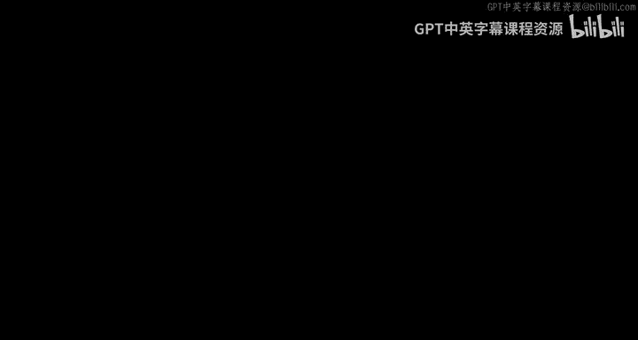

So today we're going to talk about regularization and I mean。

 deep learningedrgs are powerful models and so sometimes we need to do a thing that we call regularization and that's what we're going to do。

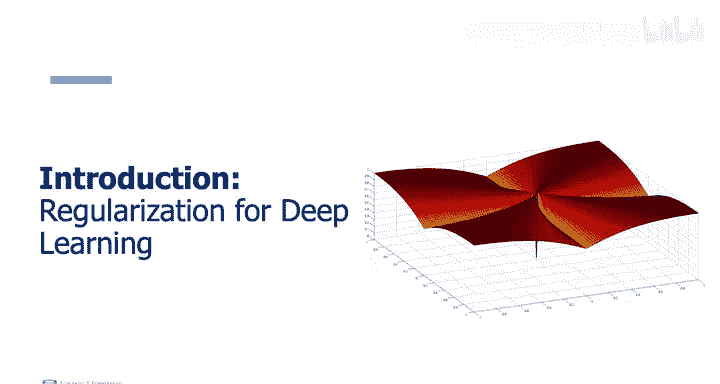

So why do we do that right so again I just said。High capacity models and they're able to be really really flexible and you know kind of cont contort in any kind of ways that we need them to contort right so there's a high risk of overfitting。

RightAnd so what is overfitting that's fitting noise or rather than underlying patterns and so right the idea this what we're doing to you get even learning this to generalize right to kind of say I'll train on some data right？

And I want to be able to generalize to other data that it hasn't seen right so and so what you want is for this model that you create to be able to perform well on unseen data and so regularization is important for that。

你稣。You know， it's not just about like reducing overfeing， although that's a very， very important。

Part of it right right you have to balance the trade off right so so you want the model to be complex enough to be able to express the way that you've able to express but you also don't want it to be so so aggressive to where it's starting to do weird things are to you training of that in way that you don't want it to right and so you have to find up a balance in between two right and so right you need to incorporate prior belief right so in particular right smoother functions are probably more applausible right is a thing that we kind of stick with in the back of our minds all the time。

Okay and so regularization terms in terms of loss functions right so we have L1 and02 regularization right right kind of like the intuition and the impact of those are really really good do you also have basic interpretation right so priors and maximum and the maximum and priors and maximizing a posterior estimation rate is another one here right？

Right and so right some of the key takeaways in the prelude right so it's a vital it's vital growth。

Well like robust and effective models， right？The Doma Eical Foundation is kind of rooted in optimization and statistics。

 that's kind of to where we kind of like get those things from， right？

And you know they there is a variety of ways to do that where we're only going to explore a few of them right。

 but I encourage you to jump in， I actually did my dissertation in this area。

 so this is a rich area of research and I encourage everyone to adapt into it。

All right so let's kind of jump into the first aspect of it which is kind of a norm parameter right and so what do you do you add a penalty to the loss function based on on the weight size right and so the most common one is L1 and02 right and so you have this you know you have your loss function J and what you're going do is you're going to add a penalty term right and you're going to multiply it by alpha to be able to scale how much you want to penalize right but we'll call that term sigma right and it's going to be dependent on the weights。

And so the wonderful thing about L1 is that L1 leads to sparsity right and so what that means is some of the weights become exactly zero L2 shrinks the weights but it barely becomes zero right so there's a tradeoff there。

And so there's a Bayesian interpretation where L1 as theplace prior and L2 is Gaussian。

And so right so what are the impacts on the learning right。

 so I with a weight update group right and what they do is they dampen the weight growth。

And what they help is is in the converges and the general of things right so right it kind of stops things from like the weights being absurdly large right which doesn't seem reasonable on when you think about it right and some of them being absurdly small right so even absurdly negative right so imagine you know if you had a weight that was positive100 in weight that was negative 10 right that kind of seems weird you should probably shrink them down to make them actually learn something like useful。

Good idea的。And you have this hyper problem the eight right which I kind of which I can at make the beginning and what it does is if it balances the model fit versus the weight penalty right and if it's too large it'll start to underfi right if it's too small it'll be in effective recognition so you'll start getting overfitting again and so you know it's important to kind of set this for tuning right so you want to kind of tune these and you want to kind of tune this outfit to kind of to get that right tradeoff in order to get the right kind of training for your model。

Okay， so right？This is not a silver bullet， it's like the most things aren't right and so it's usually combined with other techniques。

Right but it is computationalally efficient right and it's suitable for a large range of problems right and so we usually start with with these as it's because there easy to implement right and they don't and they aren't you know super problem specific all right so we have norm penalties right and so we want to kind of think about those now as constrained optimization problem so we can pitch them in a different way to make them into a constrained optimization problem right？

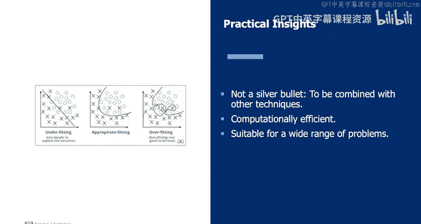

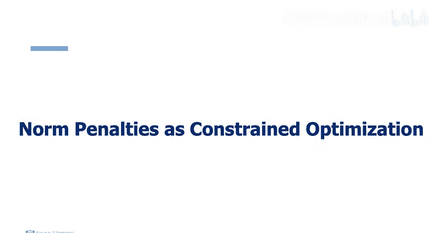

And so why do we do that right and so direct penities alter the objective function right and so constraints restrict the solution space in a way right and so another perspective on regularization is model parameters right？

And so。And so you kind of look at kind of a so if you're in L2 or L1 kind of think of it and saying it can't be any any larger than K or K as a constant right and so this is now a constraint optimization problem right and so the constraint bound the weights values right and it's often to represent right as a sphere for L2 and like a diamond for L1 right that's I don't know what you see in the picture here is a L2 constraint。

And so objectives with penalties can be right so reformulated with constraint right so for L2 penalty it's a soft constraint right for a heart constraint and exact。

Boundary in a parameter space， right， so particular right。

Palizing the size in in in general is is a way to do it， But there's also a way to say， hey。

 the the the the。The weights can't be， but so large and not that that will cut them up。Okay， and so。

Another way to do it is a Lagrangian multiplier right and so that converts a constrained problem into an unconstrained one right and so it makes it easier computationally right and so it incorporates the constraints into the objective function right and so here's the formula right here。

I'm not you say at the bottom right here。And so so how do you you know optimize with those constraints right so desent still applies？

And so you project the gradient descent for hard constraints and then the update rule includes the projection stuff right so you kind of update you project update。

 project that kind of thing。And so why do we like constraining optimizations right and so it introduces kind of like several essence in the model right is computationally efficient with modern tools。

And it could be combined with other regularization techniques as well。

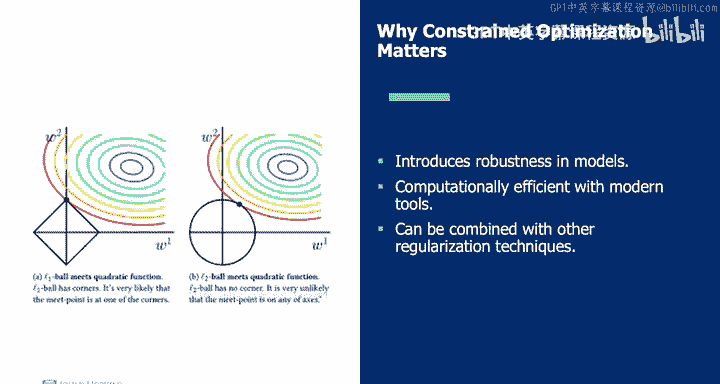

系。And now we got some regularization and under constrained problem。

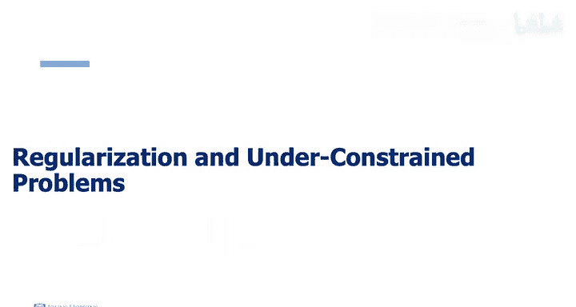

So situations where the models were has more parameters than training samples right and this actually happens often right this is the nature of under constrained problems right and so you have infinitely many solutions in that case but the question is so which one is the best？

And right， you have a danger in， you know， overfitting in this situation a really high danger and overfitting in this situation。

And so what regularization does is that it introduces so biased to the curve of variant right and so it picks a solution amongst many so based on what kind of certain criteria that is helping you with trying to see which model is the best okay and so it introduces。

Biaes to reduce the variance， right？Most are a generalization， right in this way。Okay。And so， right？

Under constrained problems are you know abundant in deep learning right right we create these huge children networks in our out of sets right can't you know the out of that we have since sometimes to put in those are not even as as large as the parameter space right and so regularization techniques help were finding a minimal a meaningful solution in that case and mathmatics and heuristic go hand in hand when you're doing these so you know the ways that we do these kinds of techniques is going be you know sometimes somely rigorous but also like heuristic and like I just feel like this makes sense。

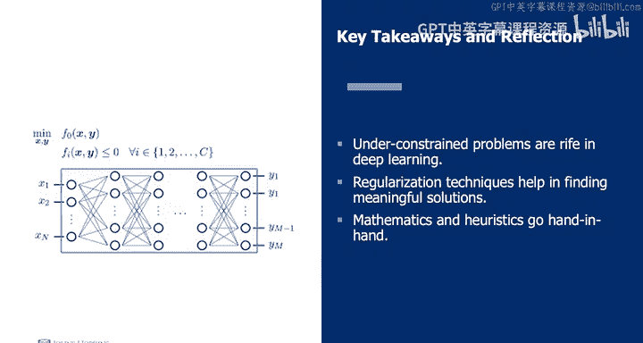

Okay， so then now we have， you know， as a norm or as a term that we put in the the in the loss function。

 but like how about other technique called the data augmentation？

Right， and so。So why don't we do the data augmentation right so again right these models in particular like deep models are really。

 really data hungry right and so limited the data can eat over fitting right so where we're。😡。

Data sets might not be sufficient in their cells， right？

And so creating new training data and you can do that via transformation is appealing。

 and so you preserve the original data data when you do the augmentation and that enhances the models to world blessings in order to generalize to unseen things。

And so right so what are some of the popular ones there image rotation。

 scaling and cropping the flipping brightness and contrast adjustment， translation， noise injections。

 all of these kinds of things that you can do， you know， these that you've seen in image。

Pccessing text all around in places or ways that we can augment data。So again。

 you know you could kind of you could kind of group these into kind of geometric transformation and aine and perspective transformations noise b models right。

 these are ways that you can kind of group these things to see with all of the different kind of ways that that we can augment data。

And so so the regularization in this case kind of helps with overfitting right。

 and this is how come we call it a regularizer right it reduces overfitting。

And it creates a more challenging training scenario right which is going to reduce overfiing right and the model become invariant to those applied right transformation right so again a regular。

Technique to make it to wear。It does better with unseen data。And so geometric transformations， right。

 are just kind of like。So rotation matrices and scaling matrices， and you know。

 you could think about aine and perspective transformation as just aine operations。

And kind of those noise models so we usually get those from Gaussians and things like that right so these are kind of the underlying some mathe addicts that we use in order to to inject these kinds of things。

And so， you know。There are way more advanced techniques right the ones that we just discussed are kind of the common ones but generative models right are things that also can give us augmentations right so we'll talk about generative models later but there's also more researching ones called things like mix up that's going combine features and labels two samples right there's also randomly racing There's a lot of more researching augmentation things that we can do in this I gonna be specific to your your situation as to the one of the gene ones。

And so right， not so as I was just hinting it， not。

 not all augmentations are suitable for all the a says， right？

And so the risk of introducing noise and mis labelbels right are high in this case you have to be careful with that and then again you have to think about stuff like computational overhanging efficiency doing these things。

And so right it's a vital thing to have you know augmentation I in your toolbox right and so it improves generalization and model robustness right iss tailored augmentations based on your day8 set in nature right so augmentations for images are not going to be the same and say signals right are these are things right and so it's an it's an active area of research right we still but we still。

Think about this every day and it's getting more and more important to explore the space of like synthetic data generation in general。

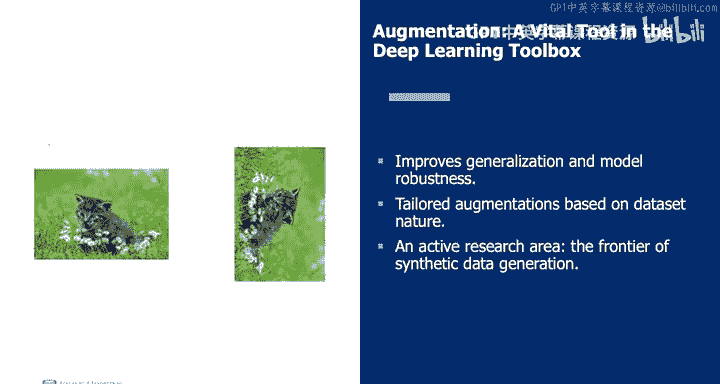

嗯。And so how about right so how about you know， how do we start to get like robust to noise right this is also a regularization technical to think about and so what is noise right is unwanted alter alterations that you done right simple enough right and inherently most data that you get in the real world is going to be noise。

And so it could be internal， right， or it could be external， right， but you know。

 it's introduced all the time。And so noise can lead to like reduced accuracy right。

 obviously right reduced I mean， increased a in your model so kind of unpredictive validity of your outputs。

嗯。And， you know， it is important to be able to deal with that further the robust essence of the real world applications that you're going to apply your models to。

And so injecting noise during training can actually enhance the。

Questions of your model right and so you noise your inputs your weights and your activations these are all ways that you can do this right and you emphasize the need to learn fundamentally other parameters right instead of the exact thing that's going on in the picture you kind of look at underlying patterns in these patterns and so coming one that we use when you Galian uniform salt and pepper right and as a right as a regularizer it reduces overfitting a lot right and so right if you want to think about it in a baesian weight it's also a way to think about it as like as like so model averaging。

Okay， and so noise。Ous this is crucial for the real do the realro application that we apply this to right and so smart noise and action can enhance the generalization capabilities and so you have to constantly be eilent against adversarial threats right and so in particular there's a whole field of research of like can you inject noise in a particular way to make things happen that you didn't expect right so in particular you add right here's a pitch of a piglet right you add some kind of noise to it。

 you see what that is right and you kind of look at the output into our eyes that it doesn't look the same but to a network it looks very very much so the same it looks very much so different and it's able to call it a different thing。

So these are the kind of thing that we think about， right？

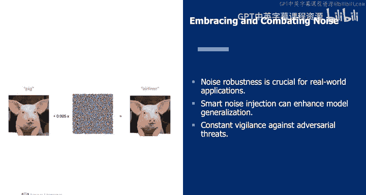

And then， there's a。

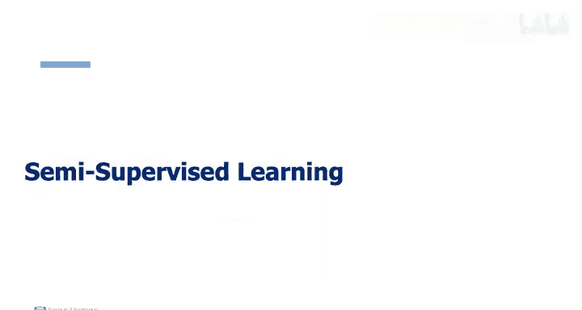

Another field called semi supervised learning right so we'll talk about that as a regularizer right and so it utilizes both labeled and unlabeled data okay。

And so it expands the models and knowledge and context， right， because you're able to add more data。

Right， and。Boost the performance without having to do the manual label of labeling。

So so it's a good thing right and so it's cost effective right because you don't have to label every sub piece of data right it makes things better generalizable because you have a larger data set right and it potentially outperforms supervised on the some methods right because of that robustness so it's also a very appealing being okay？

Its so right。 So what are some of the。The challenges here right definitely out of quality right all that is not great data right you want to risk you're gonna risk the reinforcing of biases and errors right so if youre labels are bias or if they have errors in it right like if you use if you use a semi supervised methods you're going gonna reinforce that and then complexities and determining unable do data as a contributions right like we don't know like what exactly it's doing to enhance it but like like if it's doing it well and great if it's not doing the well we can't really tell sometimes okay and so what are some of the the practical implementations right there's training methods right there's OT view training that's combining with transfer learning right these are things that we're doing practice to kind of help with this semi supervised problem。

And so right again， con growth out of generation need for efficient and sustainable learning methods right like these are things that we're currently researching in this field to figure out some better ways to hender this and you know again it's still a buding area right even though there's been such a research engine it that's still growing and in its efficacy so it's still you know an evolving front of work that's being done in this okay？

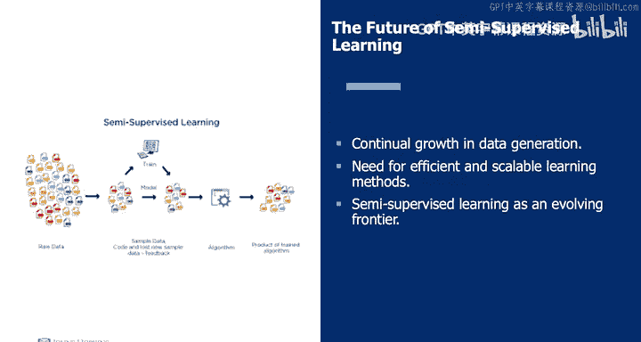

And then we have some multitash learning， this is also another regularization technique right so so you have you have so so with some multitash learning you have a single model。

That does multiple tags，And what that does is that you have to share the representation learning right between two tasks and one model。

And so it concurrently optimized for several objectives at the same time。

And so why do we do that right efficiency is the is one of the biggest ones right but it also does things like improve generalization and then transfer some models outlet between tasks right so think about object detection right like I I see a car in an image I't want you to tell me it's a car what you to tell me where it is right than being able to localize that car right and Dan say as a car gives me better generalization。

Better understanding what's in the picture and so you're able to transfer for our knowledge between the task and everything。

And so so so the way that you do that is you have joint。

Loss functions and then the regularization for task coherence right and then you need to balance between the task right so in particular the one where I say object detection and localization you have both of them there but you have to transfer off like which one is more important or which one is more harder and then you wait the harder one higher that kind of thing。

And so so what are some of the challenges right， determining the relatedness of the task。

 right the balancing and task importance right and avoiding like negative transfer right to kind of like not amplifying the bad but more amplifying the good？

And so where is it used right so there's stuff like actual language processing right there's parsing and tagging and sentiment analysis analysis。

 computer vision detection， segmentation recognition， healthcare diagnostic across multiple symptoms。

 these kinds of things。ways that we use it a lot， okay？And so。

Mititaask learning right is a complex thing， but like it's one of those steps that we are doing towards more of a general intelligence or more of a generalized AI holistic AI。

Right and so you want to merge the breadth and the depth right so kind of like you you know you want to ask yourself do I want to know a whole bunch about a little or？

Bunch about a lot。And so you want to merge those two and then kind of like the synergies of diverse tag bringing out they the best in the both of the model。

And so here are some of the， you know。Reseearing areas right of regularization right I list out a few of them dropout is one that I think is one of my favorites when it comes to regularization it's a straightforward method and I think that you guys are going to read this in your reading so enjoy that but yeah these are some of those that are really really researching。

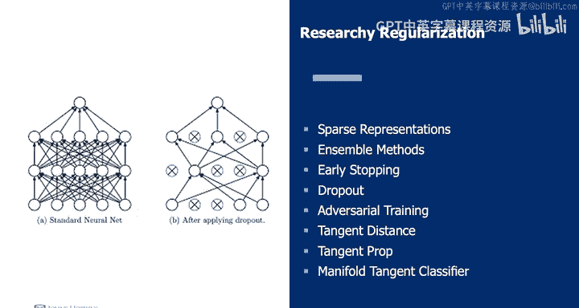

And so with that， I will end and buying any questions， I will talk to you soon。

