# 约翰霍普金斯大学《神经网络基础｜Foundations of Neural Networks》中英字幕 - P9：1_自动编码器.zh_en - GPT中英字幕课程资源 - BV1w1uqzSEHZ

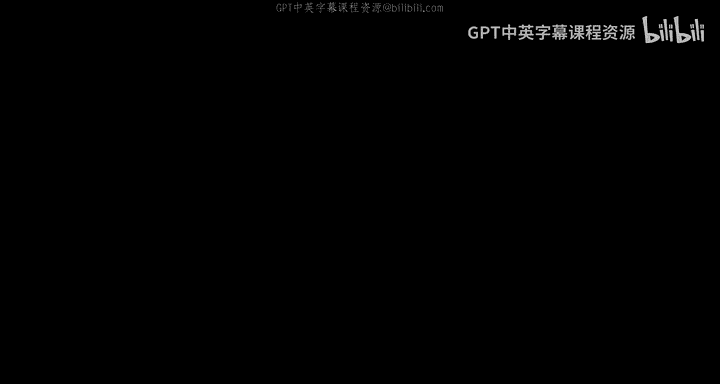

All right， so let's jump into kind of more unsupervised methods in machine learning well。

Streep learning I mean in particular we're going to go through autoenrs。

 these are interesting some methods， so let's just go ahead and dive into it。Okay， so。

You know so what are onclos right so they are neural networks that are designed to reconstruct their input data。

And so the purpose of them is to kind of efficiently encode data。

UAnd retain it just representation and the encodecod so kind of think about like compression in some sense。

and so the structure of the autoends as follows right。

 you have an encoded and what that does is that it compresses the input into a hidden representation。

You have hidden layers， so those the compressed versions of the input data。

 you have a decoder which is expands the hidden representation outputs。

Okay so why do we do that right and so de data compression is one of them right and so they store and transmit data more efficiently right so you don't have to store you don't have to pass as much of it there's stuff like denoising right which kind of remove the noise from the data dimensionality reduction it's just kind of like understanding the core features of the data right if you're able to reduce the dimensionality you kind of know what's important in the data and then things like generative models right which we will minute well in another lecture right but these generate new de data similar to the inputs。

Okay， and so there's different flavors of auto enrs right there's undercomplete there's sparse there' noisy。

 there's variational right so there' there's a lot of different flavors of water encoders。

And so there's some key concepts one of them as the loss function。

And this measures the difference between the original input and the reconstructed output。Okay。

 and then like the goal there is to minimize the difference to make the reconstructions as close as possible to that original album。

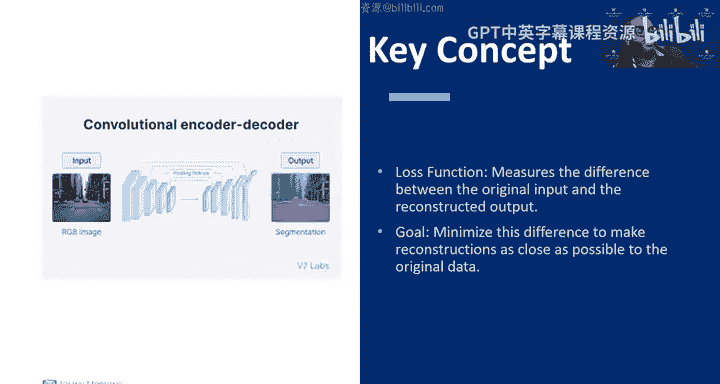

嗯。So let's go go through a few examples of them right so this is an undercomple autoenr right so undercomple autoenach encoders right the hidden layers has fewer units。

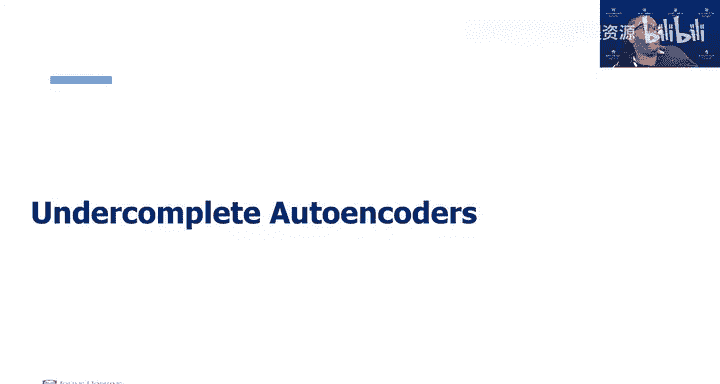

T the input layers right and then overcomplete ones right。

 the hidden layers has more or equal to the units than the input layers okay。

And so the key point here is that under complete design forces the autoenr to capture the more alienient features right of the data right so so because it's shrinking down and say saying I have to find the most important。

Aspects of the data in order to be able to read to reconstruct it okay。

And so the concept of dimensionality reduction is to reduce the number of random variables under consideration right and so applications there did data compression。

 noise reduction and feature learning right these are things。And we do， right？

And so when you're training under complete autoenrs right。

 the objective there is to minimize the reconstruction error。

And so the loss function is usually that doesn mean squared error between the inputs and outputs。

And then the regularization， sometimes we use those to avoid trivial solutions。

 so we are going to that more。And so the question is so why are we doing this funny kind of you know dimensionality kind of thing and not just using something like right so PCA right is a linear technique right and so that's not come we don't use it all the time and so sometimes we need not linear techniques right and so under complete autoenderrs can capture none any relationships right and in comparison right we charge side by side so visualization of that out reducing PCA and autoencoders right you can kind of see you know there's a difference there。

And so what are some applications， right？But。Kd of Ted that already right one of the challenges there is that you risk kind of learning the trivial solution。

 which is something that you don't want to do right the choice of architectures can actually influence the performance there and regularization techniques could be needed to guide your learning system。

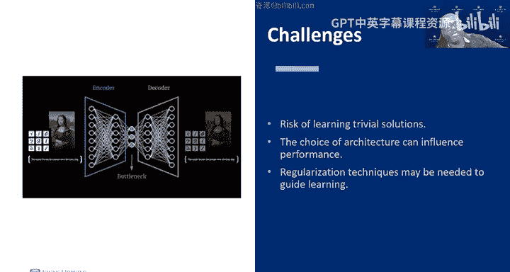

Okay， so that was the beginning I just started talking about so regularized auto encoders right so what are those right so so so what so。

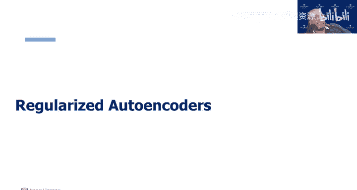

So what is that right， it is a technique that is that adds a penalty on the complexity of the model right we talked about theization before right and the purpose there over is to prevent overfiing and to force the model to learn more of your useful features。

Okay， and so some types of regularized autoenrs， right， we have sparse autoenrs， dennoing autoenrs。

 contrastive autoenrs and variational autoenderrs， right？

And so with sparse autole encoders right the goal is to limit the number of active neurons in the hidden layers right so we kind of kill out some of those neurons right to make them sparse some be zero。

And the way that you do that is you add a sparsity punity on the activation on the activations of the inner layers。

 right， most of the times is L1。right， and so the benefit there is to learn more so robust and meaningful features right。

 because you're you're killing off some of the features you have。Or in ones。And so and right。

And so right， with a denoising autoenrs， right？The idea there is to introduce noise to the input and the training to kind of recover the original noise right and so why do we do that is to encourage the network to learn patterns and to ignore the noise there。

Okay。And so how about contrastive right， so contrastive autoenrs right so they make the encoders's functions resistant to small variations in the input space。

And they do that by adding a penalty based on the Jacobian matrix of the encoder activation。

And so the benefit there is to create a smooth encoding of the data。是。

And so with aational auto encoders and we'll go through these more in detail， right。

 these combines the ideas from deep learning and from Beijing in French， right？

And the way that they do and so instead of encoding an input as a single point。

 they encode as a distribution right and so these are generative models so which we'll get into later and they can create new samples。

 which is pretty。So what are some of the advantages of recordized item codes right they utter generalization to unseen data right and they learn more meaningful than interpretable features right and so they are also more robust against noise and variations。

So what are some of the challenges， right， well， the choice of regularization can actually fulfill your results a lot？

The need to carefully tune the regular strength is a thing we have to always consider and not all regular are suitable for all types of data。

嗯。

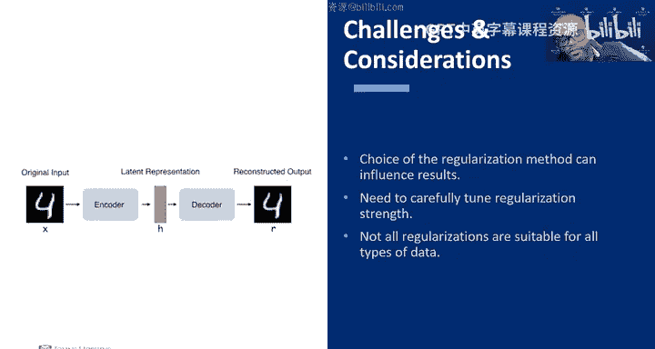

And so now we have stochastic encoders and decoders。

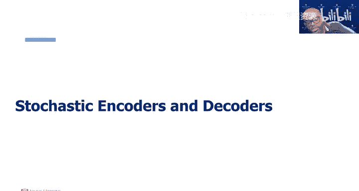

So what is the definition here so an auto encoder where。

The encoding and or decoding process involves randomness。And so， you know， contrast with。

Deterministic auto encoders right every input produces a fixed output so that's the。

That's the difference there， okay？And so while would we introduced do ostertoocity right so it aids in robustness。

 the model becomes less sensitive to noise right and it encourages the model to capture the most important features right and so it acts as a form of regularization in that way。

And so right introducing so randomness in the encoding process right this is another way that we can do it right and an example will be a variational autoenr to where the encoder outputs a mean and a variance for a distribution so rather than a fixed point。

And so。With。So casting。Ecoding thiss the random this introduces randomness to the decoding process right and it's less common than stochastic encoding。

 but it's also useful in some context。And so with variational autoenderrs， right。

 this is a popular form of autoender with stochastic encodederrs right and it makes assumptions about the distribution of the input data right and so you have a loss function plus a regular term in this case right here。

And so the benefits there is that it generates new samples。

 so it's a generative model its more robust against overfitting right because of the stochastic nature of the model。

And it's flexible right， it could be combined with other architectures。

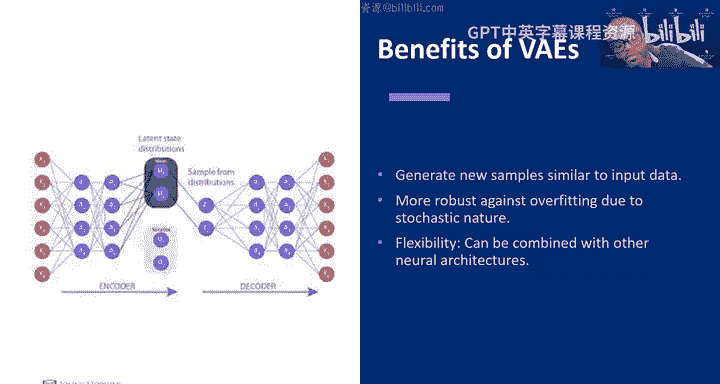

So it makes it super duper flexible right and so what are some of the challenges right the choice of regularization methods right this is this is one of them that like a need to carefully tune the regularization term and right again。

 not not all regularization is suitable for these methods。

And so what is some of the practical implementation right dropout is a very simple way to bring in stochocity okay if you inject noise that also adds so essence in your latent spaces。

And then things like sampling techniques right so Monte Carlo sampling andding encoders and decos are powerful in ways like that。

Okay， so what about denoising autoenrs right so the basic concept there is that an autoencoder train to reconstruct the original input but from a noisy version of it right so you start with a noisy version and you end up with a non a noisy version right and the key idea there is to capture underlying structures of the data while ignoring the noise。

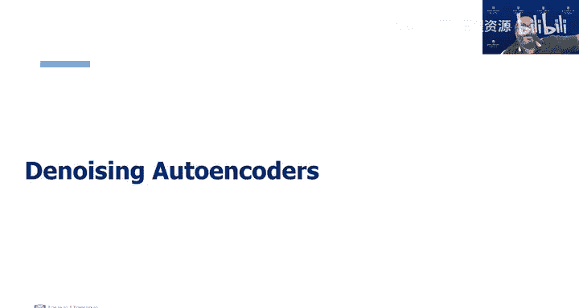

Okay。And so what's the purpose there， so the purpose is to intentionally corrupt your input data。

So you do it with things like Gaussian noise and mashed noise and salt and pepper， right？

And what you're doing and so the idea there is you process your noise， so so you inject your noise。

 you encode it you decode it and you compare it to the original clean data right and so that way you're saying can I like。

Be noisr right and the objective is to minimize the difference between the reconor and the unnoise clean data。

Okay。so why do we do it right so's regular right so by reconstruction from noisy data a model focuses on the essential features。

 overfitting and then also things like so utility utilitytil right so it would be great if we could take noisy data and then like kind of like denoisy right in particular right every piece of data comes with noise and so being able to deal with that is great。

And then you have this thing called tying weight and so what do you do there you reduce overfitting and the number of parameters right and so image and weights between encoders and。

😡，Decodes is the key here。And then you have things like stack in stacked denoising id encodes and this is basically so stacking like multiple layers of denoising id encoders in each layer trained individually。

And that just enhances the features extraction capabilities， right。

A denoising auto encoder right on stairoids or something like that， right？

So what are some of the challenges right， determining optimal noise levels right。

 a solution there would be things like process validation， adaptive noise introductions， right？

And then so another challenge right is ensuring the model doesn't learn the noise right and so a solution there is kind of like directly like like monitoring it。

 avoiding you know overly complex architecture， these kinds of things that things I thought we can do in practice to kind of deal with these kinds of things。

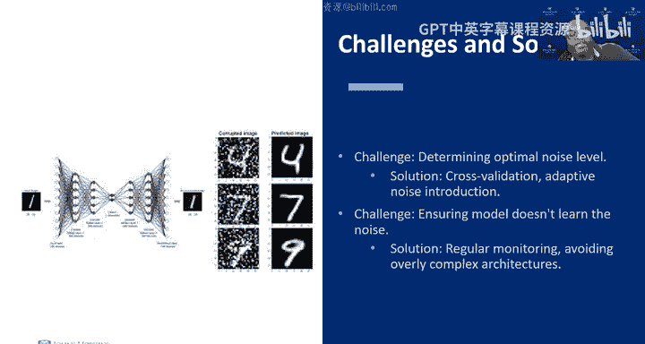

Okay， and then now we have kind of a more way of thinking about it。

 but kind of like learning like some nanophos with autocors right， so what do you do here？

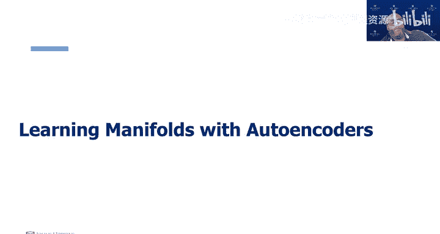

RightSo a continuous none intersecting service in a high dimensional space is called a manifold。

And so in data terms， it's where the most of the probability mass resides。Okay。

And so so why do we use them right， high dimensional data often lies on or near a low dimensional man。

And so understanding the structure can lead to the added representation， so practical implications。

UmFor compression， de noiseise anymore is all found in like the smaller dimensional so mannofolds。

And so the manifold hypothesis hypothesis says that natural data forms or dimensional to manifolds in it' embedding space。

 right？What are some implications right is understand the manifold to understand the data right so if you understand that you know that the place that holds the data。

 you can understand。Okay， and so。Other encoders can approximate the functions that generate the data amount offold。

 right that's the idea here， and this is done by learning a compressor representation in the latent space。

Okay， and so encoders push data points to a manifold。

 and then it captures the intrinsic structure of the data。😡。

And then the decoder learns to reconstruct the data from points on or near the manifold。

And so it acts as like a mapping from the manifold back to the original data space。

And so some of the benefits there is that it improves out of compression， right。

 it does a better like noise reduction capabilities。

And kind of it enhances the generalizationization in related。Thiss just a few of them。

And the challenges there is kind of determining the correct dimensionality of the manifold。

 ensuring that the manifold captures the meaningful structure and not just the noise。

 right these are things that well always have to think about。

And then when you think about tangent planes and outerenrs right， this is another situation。

 the idea there is at each point on the manifold there exists a tangent line or tangent planes。

 sorry and the outender can approximate these tangent planes pretty well。RightAnd so right。

 and with contrastive。I'm sorry， contractive autoendrs。

 they regular autoenrs to be more sensitive to directions along the manifold and less sensitive across it。

And so the result there is an autoencoder that contracts around the manifold， right？

And so let's kind of take a deep dive into that so what does it mean to be contractive right so you focus on the local stability around the at a point and the aim there is to make the autoender insensitive to small variation small variation than。

Okay so the motivation is to address the potential issues of oversensitivity in the autoender。

 and that enhances the robustness of the latent representation。

And so the regular term addeds to the I function， this is the way to do it。

 right and it penalizes large derivations of the encoder's output with a with respect to its input。

And so why do we use this penalty right and so large devations apply sensitivity to input changes right and so if you penalize these。

 the encoder becomes more stable and less sensitive to those smaller changes right？

And so the Jacobian matrix it actually captures the rate of change right of the encoder's output to respect to its input right and so it's central to computing the contractive ability penalty in this case。

😡，And so it combines， so the contractive， I don't encode the loss， right。

 combines the traditionals of reconstruction。Los， so with the contractive penalty。And so。抽了。

Los functions。Okay anyway， and so the。Interface there is improve de generalization， right？

More overall us to noise and small input perturbations right and the stability of the features and the latent spaces are all benefits of this contractive auto unfold。

 right？And so， right？Some considerations that you need to think about as you're implementing these guys is your choice of penalty coefficients。

 right computational costs of the Jacobian calculation and applicability to that specific problem domain。

I all things you think about， right？And some applications right it' things like denoisising tasks right so creating cleaner data and then domains where the small input variation shouldn't drastically change the output the representation right so obviously because were making those less sensitive to the small perturbations。

 you want applications to where that actually makes sense。And so challenges and limitations right。

 have a parameter tu in right， this is Allison reconstruction and contrastiveness right。

 potential for reduced。Paient power is always a concern and then finding that sweet spot for contractivs。

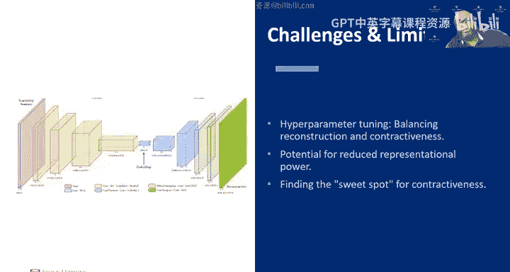

Okay， and then so now let's talk about predictive sparse decompositions。

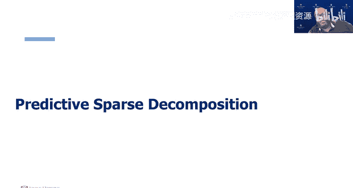

And so sparse coding， right， it represents data using few to non zero coefficients， right？

And the challenge there is kind of like the complexity and the slowness of the optimization。

And so you need a fast yet accurate alternative right to do that right and so PSD combines predictive modeling with sparse coding right and so it leverages a fee for a neural network in order to do that。

And so how does it work right some stages， right it predict a predictor phase。

 right neural network predicts a sparse coding and then a refinement phase。

 sparse coding adjusted using church traditional sparse coding techniques。And so in the predictor。

 you use a parametric function like Pan neural networks to predict sparse coding。

And then it's trained to minimize differences between these predictions and traditional sparse coding outputs。

And then in the refinement process right after the prediction。

 traditional sparse coat some methods refine the output and it ensures that the final representation is truly sparse at me。

And so， so when we think about the。Lost function， right？So it combines the area in the。

That the error from the prediction and the sparsity terms right and so the mathematical formulation is us function that encompasses predictive error and sparsity constraints。

And so right， some of the advantages of this method， right。

 is acid in traditional sparse coding due to neural network predictions， right， flexibility。

It could be fine tuned according to specific needs and kind of effectiveness。

 comparable results to traditional and the methods， but like in less time。Okay， and so。

It's typically a single layer of fee for a neural network and activation function promotes sparsity。

 right in particular something like south threshold holding。Okay。

And so some of the practical applications here is stuff like image compression。Um。

 and stuff like feature extraction， right， these are things that we use。PSD for a lot。

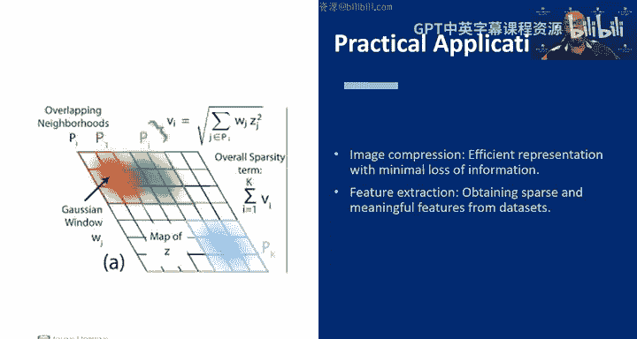

And some of the challenges is things like choosing the hyperparameter， right。

 scalability and achieving true sparsity right， kind of trading off right speed。

A pretty speed and kind of refinement accuracy， right is they we have one here。

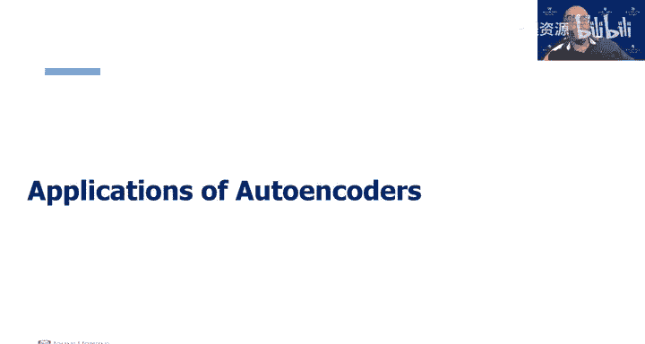

Okay and then now let's kind of think about some applications of vital encoders right so in particular dimensionality reduction is a big ones similar to PCA but not linear right and it's more suitable for complex added distributions。

 you know if you can use PCA you obviously would， but if not you know this is a great option to go with。

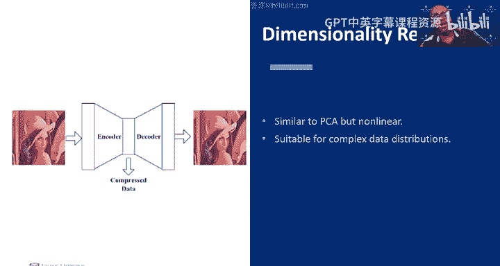

Anomaly detection right， auto encoders can learn so can learn to reconstruct normal data right and then height。

 so reconstruction error indicates anomalies。And so you could buy stuff like fraud detection and system health monitoring things of this nature。

Imagegy noing right， I think that that's self explanatory。

 you have a noisy image you come out with a noise image。

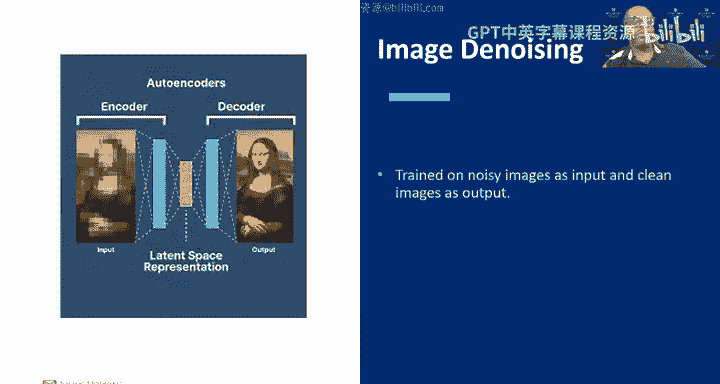

Image generation， so in particular with variationational auto encoders。

 those are agenerative models right and so you're able to create new data with those。Okay。

Then feature learning， those autoenrs can be used for unsupervised feature learning right and extracting compressed representations from autoenrs。

I'm sorry， I'm in codeus。And sequence to sequence learning right kind of actual language processing tasks or these things are great for and so think about stuff like translation。

 chat box， summarization， these kinds of things are great file uncover。

And then s information a retrieval， right， semantic caching and then fast to document retrieval based on like semantic similarities。

Great things for autoenrs collaborative filtering right so recommended systems right so things like movies and music to represent stroke recommendations systems right auto encoders kind of excel in these kinds of things。

P training for deep neural networks， you know， this is an interesting one it's kind of like train an auto encoder right in an unsupervised way and then use the encoder。

Right as the beginning of your。Neur network work structure， right。

 so freeze the encoder and then train the rest of your。

Ne network and this does things like tackle div vanishing gu urraium but probably and other things like that。

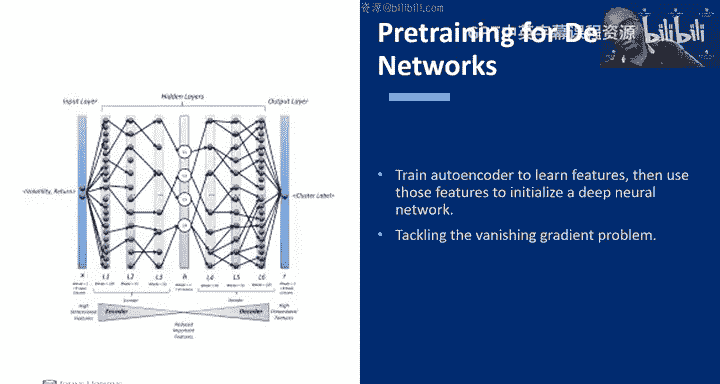

Okay， and so with that， I will if there's any questions about the reading or anything like that。

 I'll be email all right。