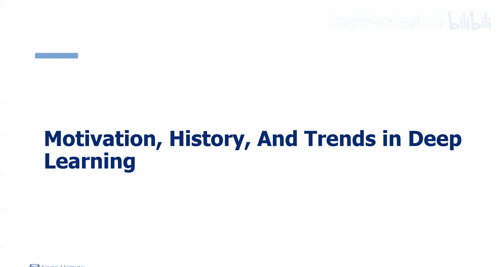
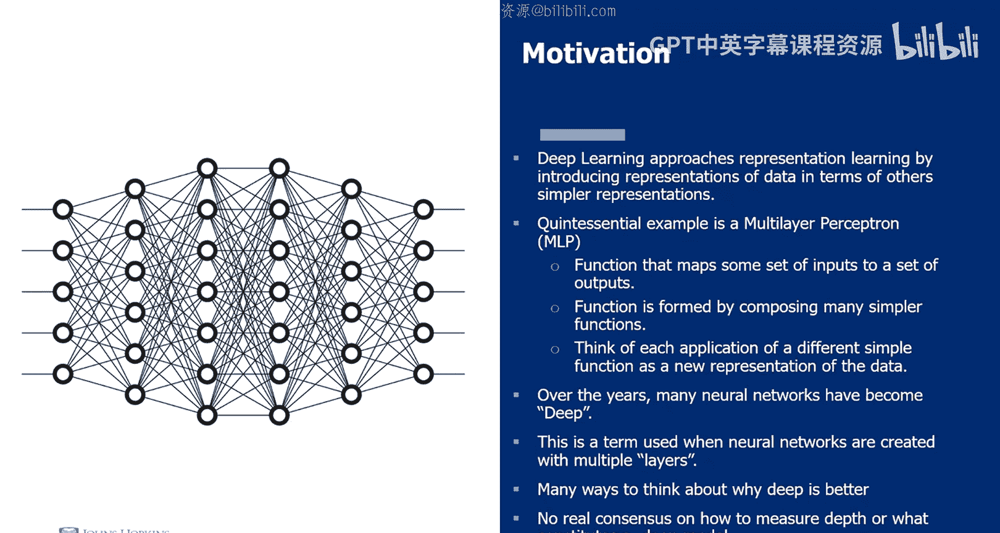

# 约翰霍普金斯大学《神经网络基础｜Foundations of Neural Networks》中英字幕 p02 1_历史概述与基础原理.zh_en -BV1w1uqzSEHZ_p2-

All right， so now I want to。Kind of give a introduction kind of a history an overview of what neural networks is。

 kind of talk about some foundation and stuff。And then even give you a sneak peek as to what kind of homework you're going to be expecting。

我课嘅。Okay， so now let's， you know， let's kind of。Build it up from my histories and kind of motivate the topic。

So the idea of AI， artificial intelligence actually dates way back from even earlier than the 1930s。

 but that was kind of when things were starting to get credited in that way right it was said that the earliest substantial work done in AI was actually done by audituring。

In 1935 he submitted an abstract that described an abstract computer with limitless memory and a capability to scan through current storage symbols to produce more symbols right and so back then there weren't even computers around and so anything that resembles even our cell phones laptops for Alan Trin is unlimited is unlimited is unlimited right so all of that stuff is kind of realized at this point and we've gone way beyond that and so machine learning is actually contained in artificial intelligence and so what we want to know and so what we see here is that machine learning is not。

Deep learning right so you kind of have these concentric cirics， you have AI。

 you have machine learning you have。Deep learning so。

De deep learning is a type of machine learning which is a type of artificial intelligence。

This is kind of important to kind of get those distinction。And so in the early days of AI。

 the field solved problems that were。Intellectually hard for humans， but actually easy for computers。

 right？😡，And they so creating algorithms that could beat humans and stuff like chess。

And so this is kind of rule based and a finite set of states。

 even though chess is a human checkers is completely solved， chess isn't。

 but this is it's still a finite state even though it's human。Okay。

 and so the true challenge of AI has been proven to actually be solving problems that's actually easy for humans but hard to describe it instead set of rules or front right and so in particularly you can think about stuff like vision or speech kind of things that our eyes do or our language。

 we kind of know that it's happened and we kind of know what we're doing but we can't really describe what's actually going。

I mean， that's what actually makes all。And so humans usually learn this by example over time。

 and so you know can kind of take it as learning from data。

 which is kind of the thing that we try to mimic。And so several AI algorithms relied on hard coded rules before based on inferencing to describe the world right and so this approach is called knowledge based learning okay。

On some tests this type of approach becomes problematic right is super super advanced or long and tedious and so a notable failure of the out based learning approach is called See CC and so inference engines out of base that were maintained by human analysts are basically they went into a out of base and put all of their knowledge inside the database。

 they had a hard time coming up with a set of rules to reason over so based on the general on。

On the the outer base that were general enough to kind of describe the whole world right so there was certain things that it was good at certain things that it wasn't generalizable enough to do right and there was an interesting story about Fred shaaving with an electric。

Raazor that actually came into so what happened was that Fred was a human。

But Fred was holding an electrical erasor。RightAnd so at some point this aobbe started to think that Fred。

Was had Fred had electrical parts intrinsic to Fred while Fred was shaping right it was an interesting weird thing going on it's actually funny if you look it up。

And so with those difficulties in Alice Bay learning。

 it started to suggest that we need some message to extract knowledge from raw data okay。

 and so this concept is a thing that we call machine learning。

And so the introduction of the relatively simple email algorithms gave computed the ability to solve world to real world problems that almost seemed subjective which was cool right and so the one of them was should a person have a cesarean delivery or a person comes in a pregnant you should you try to give that to them without a cessarean or should you try to have a cesarean as a delivery right is email spam or not spam it's another thing that seemed almost subjective。

But AI started to get really， really good。嘅。And so many of the ML algorithms depended heavily on the representation of the data。

 so the ML algorithms found correlations on extractive features of the raw data and not necessarily the rawS form that。

Okay， so if the doctor takes the MRI scan， most early M algorithms could not make correlations with pixel by pixel information of a patient。

 but would be。But would do a job。But would do the job better if the doctor kind of reported unknown information so kind of summarize the information in a report。

And so。Many ML algorithm problems can be solved this way right so if the algorithms are given the correct representation of the data right and so many tests。

But so many tags don't。Know the optimal feature to extract that right this is a conundrum that started to happen right it was you know is that the optimal feature that you're extracting out the data to put into it in an artery right and so what are some of the best features to detect a cat in an image right this is a hard question right if you start thinking about it you start you know giving me some features right a head furry whiskers。

 ears tail right you know raccoon also so face that be too right which is you know so if you start giving me things you can start asking yourself is that the optimal thing to。

And so one solution is to use email to not only inputs， the outputs。

 but also learn the best representation of the right data okay。😡。

And so this is called a representation learning and so in many applications。

 this outperforms human engineering features。Its cool and so onequi essentially example is an autoender right and so that is is a model that has an encodeder and a decoder and converts the inputs into a raw representation with the goal converting it back to older the representation while preserving as much information about the original data as possible。

And so usually this is trained so that the new representation has nice properties about it right so think about stuff like denoisy autoencors。

 you put in noisy data or autoen it denoises in some kind of way。Okay， so。Good。

E learning approaches so representation learning approaches to representation learning by introducing representation of data in terms of other simple representations that is the kind of situation way that we do it。

And so the one of the examples there is the multi layerary perceptor。

 so it functions that map some set of inputs to a set of outputs and the function is formed by composing so many simpler functions。

And so think of each application to of a different simple function as a new representation for that and so over the years so many neural networks have become deep right so we still don't have a good term for deep but it just means that things are starting to have more and more layers is what it means。

And so。There's any ways to think about why deep is better。

 but there's no real consensus as of the measure of death。or what constrains a deep model okay。

 so that was again we don't have a good definition of it。

 but the networks are starting to get extremely deep， you know thousands of layers of layers long。

We think about it。And so deep learning it has gone by so many names over the years， cyberbernetics。呃。

Connectionism， artificial neural networks， the list goes on and some of the earliest algorithms were inspired by hypothesis of what happened in the brain。

That's not so constrained anymore， mostly because we don't have a good understanding of what the brain does and so。

Deep learning popularity has increased and decreased over history。😡。

Some of this was because of the limitations of hardware， some of some of it。

Its because of the unrealistic promises made by the capabilities at the time and so people were spouting things that were not true about the capabilities in that。

Caususe it to to kind of a decrease in popularity and so e learning models have increased in size as hardware and software has improved so as our hardware has improved deep learningers started to explode。

啊，没受。Again， the reason is because the more computational power that we harness。

 the larger and more complex these models can get。And so deep learning has become more useful as the amount of the data has become increasingly available and so deep learning is trained with。

Best results on large amounts of data hypothesized on this book right here。

 the one learning book that for classification tests， about 5。

000 examples per class would get you acceptable results and at a set of size 10 million will match or exceed human results。

Okay， and so the more we rely on computers， the more things are reported which can be curated into the learning test right so over the years the amount of data has just exploded and we're able to do interesting things those。

And so。Deep learning has solved increasingly complex problems over the years and it has surpassed humans capabilities in a lot of areas。

 computer vision， joint discovery natural language process that you name it we've been kind of。

Push in the envelope there。Okay， and so I want to talk through some foundational mathmatics that would be good to know what u when you're learning。

