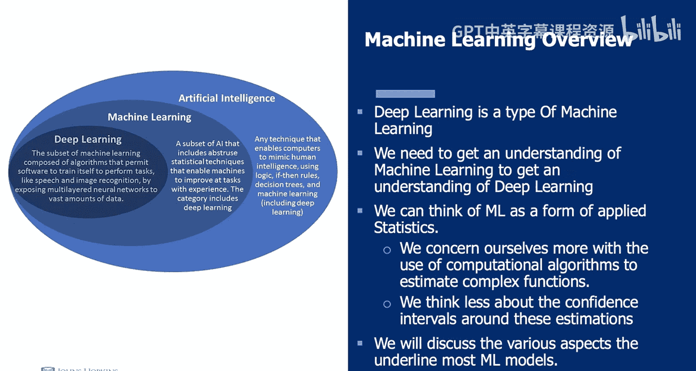
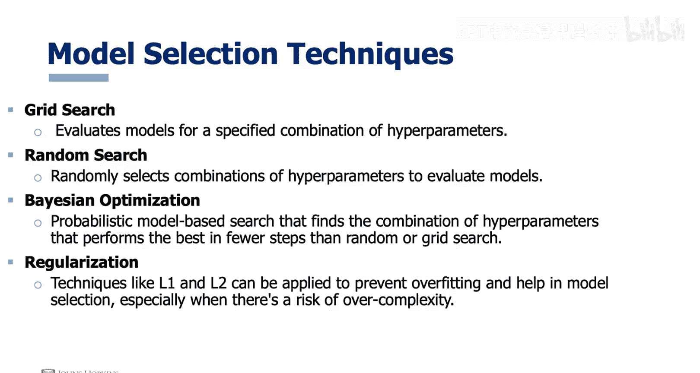

# 约翰霍普金斯大学《神经网络基础｜Foundations of Neural Networks》中英字幕 p04 3_机器学习基础.zh_en -BV1w1uqzSEHZ_p4-

All right， so let's get started。Today I wanted to kind of step back I understand that this is a course in deep learning。

 but I wanted to frame this first in a。Subset of the bigger picture which is machine learning I hope that everyone at some point has or will take my foundations of or i'm sorry my theory of machine learning course and so I wanted to step back and kind of start talking about deep learning at the part of machine learning and kind of start。

And start from that okay so I want to start by saying that deep learning is a part of machine learning it is a subset and a lot of times so what we see is we see artificial intelligence being used or we we see deep learning being used interchangeably with things like machine learning and things like artificial intelligence and what we see on the screen here is a good picture of what's actually going on it is a big。

Concentric circuit， a few concentric circuit circles。

And so I want to be clear that deep learning is a type of machine learning and so we need to get a good understanding of machine learning to get a good understanding of deep learning and so you can think of machine learning as a form apply statistics and so what we do is we concern ourselves more with the use of the computational algorithm。

To estimate these complex functions that we're trying to do to explain the world and what we do in deep learning is we think less well even in machine learning is we think less about the confidence interval intervals around these estimations and so what we'll do is we'll discuss various aspects that under the underlyingline the most machine learning let's start with learning algorithms okay and so what our learning algorithm so there are algorithms that help models learn data and make predictions or decisions without explicitly programming for the task right and so you see you know or learn I haven't really define learn I will but that is a word that is heavily used and so we'll go more into that so what's the objective when we're doing that so we want to minimize some cost function or error between the predicted and actual outputs。

And so a computer program is set to learn from experience E so with respect to some class of task T。

And performance P if the algorithm performance at task and T as measured by P improves with experience E right it's a big mouthful you'll start to understand it more as we go through it okay and so so what is a task right that was that came up right so a task is the specific capability that you want the ML algorithm to learn and so it's important to understand that learning is not necessarily it' not the task right learning is the means of getting the algorithm to perform a task。

And so some examples of some tasks that we're interested in right so the thing that we're actually trying to learn here is stuff like classification regression and anomaly detection there's a few other them there who are not even few there's a lot of other on as well。

 but these are a few examples。so what's a performance metric that was also a thing that came up right it is a quantitative measure to evaluate the abilities of the machine ironing algorithm。

 this is going to be tasked specific。Part you won't use the same so metric for doing things like regression versus classification depends on what you're doing as to the performance measure that you're going to use some examples of performance measures for classification things will be something like accuracy precision recall at one score the ROC curve that kind of thing and some examples for something like regression will be something like a mean absolute error mean squared error and r2。

And so what is an experience right that was also a thing that came up so in the context of machine learning and deep learning experience typically refers to the data from which the machine from which the model learned a lot of time you'll hear that as a training set or something like that right and so the data allows the model to adjust these parameters and refine its predictions okay and so examples of experience for supervised learning to be involving。

Itvolves providing the model with inputs and output pairs so kind of think about pairs of questions and answers right so I give it a I give us some data it gives the matching answer to it and so and those outputs are often referred to as labels those are things that we call those。

And learning algorithm adjust the model parameters to produce outputs that closely match provided like that's the whole broker with unsupervised learning right the experience。

 the model is provided the inputs but it's not explicitly provided the outputs or the language right and so the goal here is to kind of understand the underlying structure or the distribution of the model I mean of the data and kind of say we can glean things out that。

That's kind of that idea okay， now let's talk about capacity overpin and underfinning or is a thing that I think you would hear a lot。

Okay， and so what is the model capacity right the capacity refers to the model's ability to fit a wide range of functions and so。

It's closely related to the model's complexity right and so with neural networks。

Right the more neurons and layers， the higher fit capacity compared to one with pure neuro the easy is that right a linear model has a relatively small capacity right in linear fit lines and since the reason that that's true is because the assumption that we give when we are using linear models is that it is that the data is well estimated using a linear function a model with high capacity can fit trend data very very closely but you might have a problem with judge generalization and so what is that that is how it's going to perform unseen data。

Okay。And so overfitting I I want to have a good understanding of this occurs when a model with high capacity fits the training too closely and what you do is you start capturing things like the noise and the outliers which is a thing that we don't want to do and so as a result so while the model may achieve really really good and low error the training data is performance on unseen data might be poor it's a thing that we don't want to and so graphically what you see here is overfitting is observed when you have a large gap between the training and the validation set right so you kind of fit so you kind of see at the bottom here with the deep learning all the way over to your right you kind of see here a difference between your training and your validation curve and that is a telltale sign that you。

Battle fish，Underfitting is that opposite， so underfitting is when a model has too low capacity and fails to capture the underlying trends of the data structure。

And so both of the training and and the validation errors will be high indicating that the model isn't complex enough to kind of get what you see and so you kind of see what's happening here on the deep learning curve here again。

 you kind of see that the both of them are kind of not doing well and so that's kind of that's kind of this plateau that you see here to where you can kind of just see a telltson that both the training and the validations that are kind of struggling here and this training that you want to avoid as well。

Hyperparameter2ning so what is that so hyperparameters are configuration variables used to guide the training process so they influence the architecture and how the algorithm works right and some of these things that are included in hyperparameter and hyperparameter is the learning rate the number of hidden layers and units in a neural network theization parameters the number of trees in the around forest is another thing I want to be explicit in saying that you don't train so these hyperparameter don't see any of the data you actually tune these without but actually tune these with the idea of trying to fit the training data better so we'll a better understanding of that as we move。

Okay so what are some of the ways to tune the hypocr right so the first one is grid search this kind of bru force way of doing it the algorithm。

Well then， so what you do is you kind of you know brute force go through a subset set of possible hyperparameters and then the algorithm will then evaluate the model performance at each configuration and so wow this is thorough right we have to be careful about about it being so computationally expensive and also time consuming。

Especially when you have a large。then there's another way called random search right so instead of trying every combination you do third to actually test random hyperparameteritive values from a predefined distribution and so it's interesting because studies have shown that when you do this random search。

 you can find a suitable set of hyperparmeters and and fewer trials than in what we do in Great。不是。

And then you have。Baesian optimization and so this is a probabilistic auto based approach right and so it constructs right a probability model of the deor functions to suggest better。

Iperparmeter right and so the advantage here is it can find better hyper parameters and fuel trial as compared to random periods。

And then we have gradient base optimization， so if the parameters are differentiable so with respect to the objective function right。

 you can compute the gradients and optimize them using the gradient descent method so we'll understand the gradient。

I just say some method doesn't go along and so this is commonly used in neural architecture type which again is something that we will explain some then you have early stopping right and so the essence is not strictly hyperparameter tuning let it a related concept。

And so what you do is during training can monitor some models performance on the validation set and so if performance stop improving or it starts be grading kind of halt for training kind of just say stop so what this does is is it prevents overfitting and save computational resources。

嗯。Then we have something like cross source validation and so this is often used conjunction with hyperparmeter tuning to get a memorial。

But estimation of your model performance and what this does is it involves partitioning the traininger data into multiple subsets。

 the model is trained on some of these subsetss and validated on others and what you do is you kind of rotate take those subsets in and out。

And you get an average performance across all iteration and that's how you kind of assess your PR hyper parametermeter performance right and then you have things like regularization techniques right so techniques like L1 and L2 have hyperparameters that control the strength of the regularization and these can be tuned to kind of prevent overfitting as well。

And so what are some of the practical tips right so you always start with the course search and then you start refined so broad search kind of start refining better right use a combination of techniques right so start with random search then refine using thebasing optimization these are these are kind of things that we can do you want to keep in mind the computation costs this is very very important。

And you want to ensure you have a reliable validationle set to a special hyperparmeter is also very。

 very important。是。Right， now let's talk about the bias and the variant。

So the bias refers to the error due to overly。Pmpplistic assumptions and the Latin number， right？

And so a high bias might miss the relevant relations between features and targets outputs right and what that'll do is that'll lead to making them。

Dicctions that are consistently not correct， right。

And so what this does is is it results in auto underfitting。

The data meaning that it performs poorly on the training and the testing out。

And so an example of this is if you're trying to predict on a nonlinear pattern。

 have so your data is nonlinear and you're using a linear regression and so that would typically have very high five and so as you can see here if you look in the regression in case you kind of see that this model that looks like a parabola in some sense but the underfitting thing is trying to use a line in instead of the parabola and you'll see that at all severely underfi。

So about variance so variances the error into to too much complexity in the learning algorithm and right so how variance model captures noise in your data and becomes highly sensitive to fluctuationtions in the training set right and so as a result the model performs well on the training data but it actually does not generalize or it doesn't see or in other words it doesn't do well on unseen data。

And so an example here is if you use that same nu and your pattern right you have a polynomial regression and what you do is you have a very high degree right and so it'll start the whigling around in ways that will start capturing noise。

And not the underlying pattern right so if you go over on the far right right on this graph right here you kind of see that you have a parabo and you know the optimal fit here is a carra right but what you see here is you see this line that's wiggling and siggling around and what you see is you can be pretty sure that that's just noise and it's not the underlying。

FitnessSo that's caused by using too high a a of a degree in your。Plymonga people， right？

And so ideally what you actually want is you actually want a model that has both low biases has low variances。

 right， but in practice。Reducing one off the increases of right and so increasing the models complexity while decreasing。

Bas but increases the variance right and decrease the model's complexity will increase bias but decrease variance and so the bias variance trade off is going is the the that represents this kind of tension in this pursuit of a good model right and so ploting the model error against the model complexity。

Right typicallyp decreases wild variance increases and you kind of see what's going on I in this graph right here and in particular you kind of want to kind of stay in this optimal right in the middle there that's kind of going to give you kind of the lowest bias and the lowest variance。

 but you won't you won't get the lowest value for either。

And so how do you kind of so lit that tension in its tradeoff so stuff like to regularization so which we' talk about will help and so in in any regression adding things like L1 and L2 can prevent coefficients from becoming too large and adding a penalty for that complexity right cross validation is another technique where the data is split and multiple ways to train and validate the model。

 ensuring that the model performs well on various steps that that data。嗯。

All right so what are some of the roles of that right so a training set is used to train the model these these are the things that we use as we train the gap as we train these are the things that the model will see as it's getting better over time okay the validation set helps with the model helps with the model of selection。

And tune into the hyperparameters and the test set is used to evaluate that final performance of。

RightAnd so increasing the amount of training data can help to mitigate overfitting and with more data the model has a harder time getting to noise and out are this is an effect right and so it I want to be careful in saying。

Simply just adding more data a lot of times isn't feasibles bull pump it happens all the time and it doesn't always sort to solve the problem either right and so especially if the data is noisy or not so representative of the problem I don't care how much of that data you add you want to actually help with the problem。

And so。You can also do things like regularization right and so this is a technique that is used to prevent overfitting right and so regularization add penalties to the loss function with and that'll discourage the model from hitting the out too closely and so it makes it to the variance to come down and so common ones。

That we use all the time and stuff like everyone else to drop out early stopping these are the kinds of things that we use and so we'll talk more on this in the context。

 particularly in deep。All right， now let's talk about a loss function， okay？So loss functions。

 sometimes known as cost functions play this central role in machine。We use them all the time。

And so they measure the discrepancy between the predictive values and the actual values and provide a metric that optimizes algorithms and provides a metric that the optimization algorithms seek to minimize right so these are the things that's actually driving your model to be available。

Okay， and so the choice of loss function can significantly influence your performance。

 so you want to think about those as you use those and they should align to the nature of the problem that you're going to and so in particular right are you going to be training for a regression model are you going to training a classification model by ranking right these kind of。

And so optimizing a loss function。Activity changes the model's behavior。😡。

And so a model using me square error might predict average values in the presence outliers so if you have a lot of outliers that might actually badly influence your model and a model that optimizes with say so I mean absolute error might ignore those outliers and becomes more plus to those kind of things。

And so some examples of these， again， I talked about two of them already。

 that's mean square error and these are used for this is used mainly in regression problems。

And so it just calculates the average squared distance between the actual values and the predicted values。

 you can see formula on the screen。The main apps to sal error was also used for regression and it calculates the average apps。

The lute difference between actual and predictive values。Again。

 the formula is here on the screen right here， but you can actually see here that it change here is that in the mean square error we're using the square distance and the mean absolute absoluteute error we're using the absolute difference then you have the huber loss right and it's gonna be a combination of the mean square error and the mean absolute absolute error right and so it's quadra for small error values and it's linear for large error values。

 what that does is it makes it it makes it less sensitive to outliers than what you would have in the mean square error box。

嗯。Do you have cross entropy right so this is used for classification problems and so it quantifies。

The difference between two probability distributions。

 the actual class and the predicted class and the formula here is that the is on the screen as well and then you have categorical cross entropy right and so it's just an extension。

Of the log laws to multiple classes right and so you have the binary one right right which I and what you want to do is you want to classify it to say that you have more than two classes and so it measuress the again the dissimilarity between predictive probability distribution and the actual probability distribution so it's just an extension of the binary code cross Engine。

And then you have hi loss and so it's used a lot of times to support active machines but it can sometimes be used neural networks as well right and so it's designed for a binary classification where the target values are negative 1 in1 right the formula here you can see here is a max function okay？

And then we have the KL divergence right and so as。

The basis between two probabilityability distributions。

 right is often used in unsupervised learning or when transferable knowledge from one model to another is available。

 right？There's the cosine。s laws right it measures the cosine angle between two true and predictive values it's useful for understanding directionality right if that's important rather than that the magnitude。

And then you have contrastive loss and triplet loss and so these are used when you have sis or triplet networks or for earning embeddings and so what they do is they deal with similar or dissimilar pairs and triplets and how how similar similar those of those things are okay and then you have things like。

Custom launch functionss these things come up every day this is an active area of research right and so it depends on the specific problems and requirements and so practitioners they craft their own and so this allows for tailored optimization depending on what you wanted。

Right right so we have a loss function now the question is right how do we optimize it right so we're going to talk about optimization of methods and so optimization is a central aspect of training machine learning models right and so they involve finding the best parameters for a given model to minimize is loss function okay and so the choice of those optimization methods depend on the nature of your problem and the size of data sets and the specifics of your model right and so so methods like atom and RMS so well go walk through these are popular in deep learning others might be there's others and it might you prefer in different context okay and so regularly new optimization algorithm for being developed and test again this is another active area research and they're continually pushing the envelope as to what's possible in training machine。

All right， so with stochastic optimization， you have a function F that's going to depend on your parameters right and you want to and it's going to be a noisy fault。

Action that is differentable with respect to that parameter， but those parameters there。

And so we're interested in enimizing the expected value of that function with respect to his parent。

Okay， and so I'm going to denote F1 a through Ft theta as the realization of thosestochastic functions at subsequent time steps1 through t。

And so the stochity right， so why is it stochity right it'll come from the evolution at random subsles right of your deta points or arise from inherent function which right。

 the most of the time that stochity is going to come from the noise that's going to be inherent to your diet。

And so after you push those or your function， that makes the function。是。

And so let's start with what happens when you do regular stochastic radio dis right and so so we're interested in getting to the optimal solution for your loss function in this picture right here that's going to be being my P star。

Okay and so as we're using so many batches and the noisy and the noisy data right and the surface of the loss function is irregular right and so in particular is' not concave or convex or anything like that the set step is going to be noise and so because of this you might need to take smaller step size so that you don't diverge right this is the first thing right and so it'd be nice to slow down learning in that vertical direction and this picture right here is' obvious that going in the vertical direction is not serving us right and if we do that then we can speed up。

The earnning in the horizontal direction right is is are the kind of thing so they want to slow down the learning and the vertical direction speed up the learning in the horizontal direction okay。

And so this is。Is。And so。Out can ready get this tip so with moments， right？

And what it does is is that so here's the algorithm on the screen right here。

 I encourage you to play with it when you think about it and right so but so what it does is is that it smooths out the steps because it's taken exponentially because it's second exponential to moving averages of the grad right and so what that does is is that because we're not。

Going so far in the the I mean in the vertical direction anymore and we smooth that out。

 we can start taking larger steps， which is one right this is the part that we want to。嗯。

And so the question is can we do better right so outpa RMS prop which you can actually see on the screen again right and so now sort of what did it do there right it smooth out the steps even more。

By reducing the steps size by by more in the vertical direction and it makes the steps in the horizontal direction even larger right so we smoothed out that noise even more and now we're able to shoot faster right in that direction right so that was when ourMSs prop came right。

And so now the question is right so we have our mess prop and we have momentum right the question is can we combine them to make to make it even better right and that's when Adam。

😡，And so here's the algorithm again I encourage you to grab this algorithm look at it to to the paper and how it came out right and so the efficiency of algorithm one right that's at right can be improved the pump by changing the order of computation and so if you replace the last three lines in the loop with the following that you see on the screen right here。

 it'll actually make it。对。And so the algorithm it actually updates exponential moving averages of the gradient and the square the gradient right so square in the gradient actually it's actually so what we did in RMSMS prop right and so so door to moving average of both of these guys but actually going to make it smooth out even better it has a few hyperparmeter that we discussed earlier that controls that exponential decay of those moving averages right the moving averages themselves are estimates of the first moment right the mean and the second moment that's going to be the variance to uncensed variance of that gradient okay？

And so those moving averages are initialized as vectors of zeros leading to o estimations that are biased towards zero right so we have to be careful about this especially during that initial time step right when and especially when decay rates are small right and so that means that the Bays are closer。

And so S initialization bias can easily be counteracted resulting in bias as corrected asization right and so now we'll go through kind of some experiments right that you can see obviously here that Adam doing。

Better than things that were trained without it right and so you can actually see here that at is the thing that's in the light blue and it' way down at the bottom and it's doing very very well Adam is in red over in the left right there as it's training over time and it's just crushing the competition。

This is very， very exciting here's another one to where you can see Adamman。

Hoper right here that is crushing me all of these experiments came from from the at of paper so I encourage everyone to look at that it'll be available in the resources so I would definitely and again another thing that's actually just showing that Adam is doing well on a on a classification test called CF4R10 correct。

All right， so now we have a way to train， we have training data， we have cost function。

 we have a way to optimize， right， how do we evaluate and select our model the next question？

And so what is model evaluation and selection right that is the evaluation of and selections are and these are crucial steps in machine in the workflow right and so proper evaluation ensures that the selective model performs well on unseen data right and it is essential for ensuring that the chosen model generalize as well to unseen data and so using a combination of proper data splitting techniques and performance metrics align with problem type helps in selecting an optimal model for giving that。

And so there are holdout methods right and so the data is split into two parts of training in the test set is more split into a free part there's training validation and test which we talked I talked about already but that's what the books says here but I'm correcting it for you the model is trained on the training set and it is evaluated on the validation set and then it is to tune hyperparameters and then it is evaluated for performance on the test set okay and it's simple but can have areas of the data set is not larger total so when you're cur these data I should have to be careful about that kind of thing。

All right and then ass KF cross a validation and right and so this is when you divide your the data set into K subset。

 the model is trained on K minus one of those folds and tested on the remaining fold。

And so the process is repeated K times。With each fold used as a test set once and then the model performances average over over those folds over those K evaluation right and so what this does is is it helps in reducing the variance compare to the whole that method if you don't have enough if you don't have enough data it is always preferred to use the whole that method but you have to be data rich in order to do set。

Then you have leave one out across a validation right and so this is a specific realization of k4 across validation where the K is equal to the number of the data point right and so each data point serves as a test set exactly once right and but it's computationally expensive so the number of of data points you have will determine how many times you do this right and then you have bootstraping right and so this is。

Random samples with replacements a drawn from the data set and the model is trained and tested on these samples right so this provides an idea about the model。

Bas and variance when you do this and so what about for a regression right well you have stuff like mean squared error right so this averages so this is the thing that we talked about before right these are your metrics you can use that loss function as a metric the same with mean squared error right so you have meanapps of error mean square error you have R squared right these are loss functions that we said but you can use these as metrics。

And then for classification， you have things like accuracy。

 precision recall F1 score area under the curve， area under the precision curve。

 you can also use the loss function a lot of times it's across entrypy as a metric as well。

Okay you have things like this hillette score this measures the how close each point it is and for it and this is for like unsupervised things for clustering and things like that so it measures how close each point in one cluster is to the points in the neighbor cluster and then there's the Db index and so this is。

So this is a thing that you should look up as a research kind of thing。

 but the lower values indicate the better cluster。And then stuff like some some model selection techniques right and so there's things like evaluate and there's things like grid search random search and so Bayian optimization and regularization which went through already。

 these are ways that you can do some model selection of techniques。

All right， so that is the end of this overview of machine learning。

 please let me know what you think， please let me know if you have questions Im anxious to hear from all of you about so what you're learning and。

If I can help with anything， please let me know。