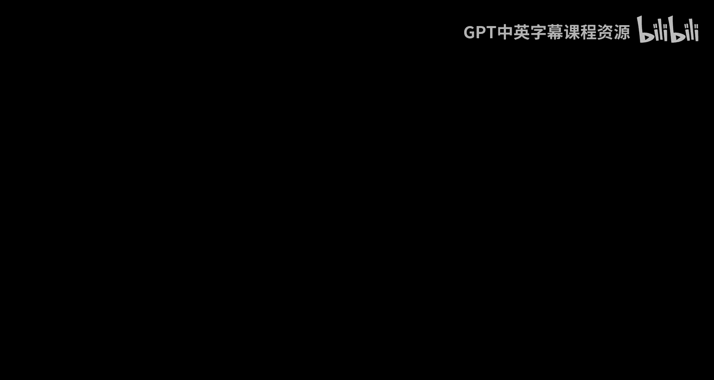
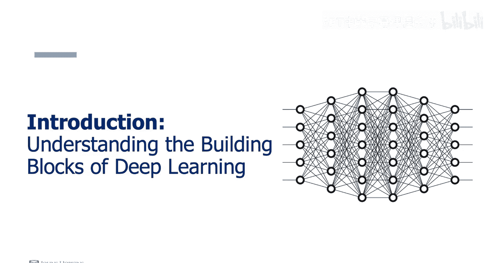
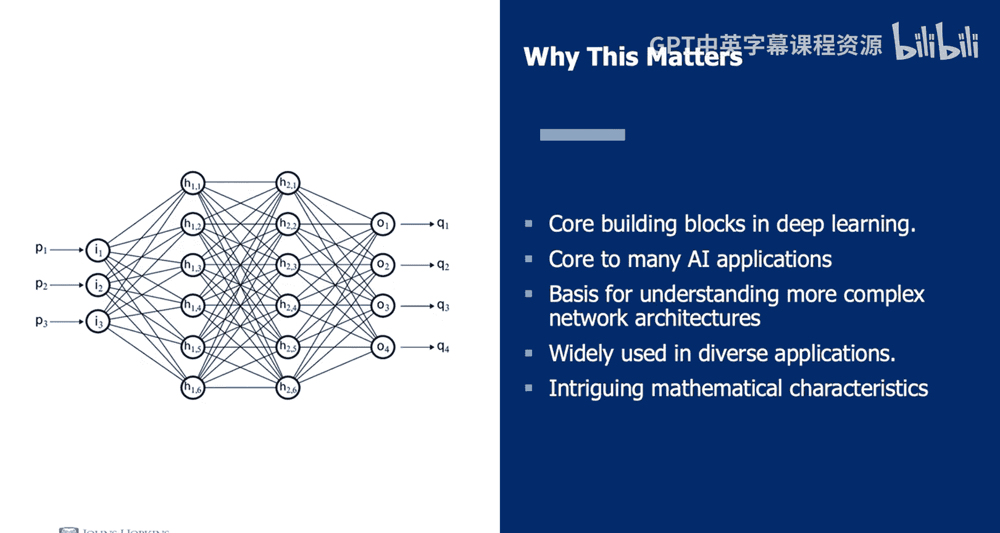
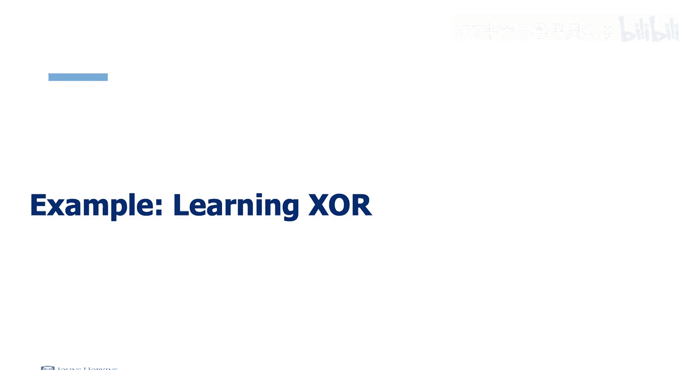
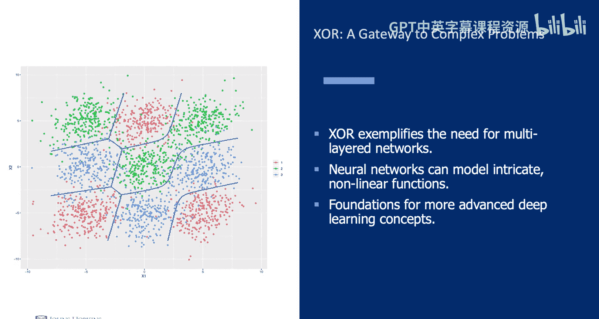
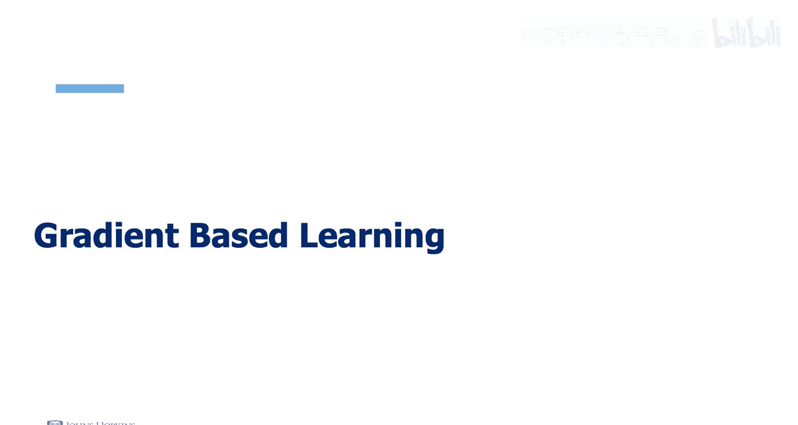
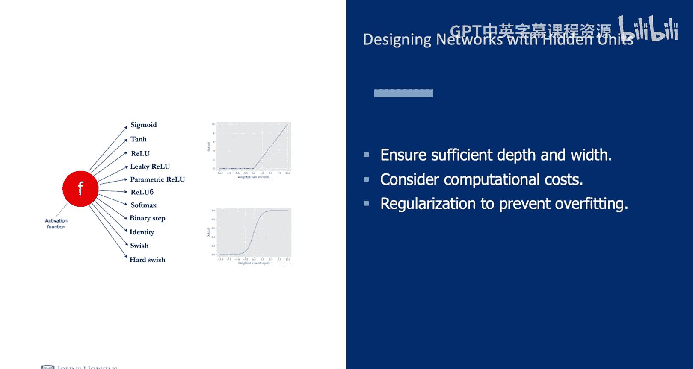
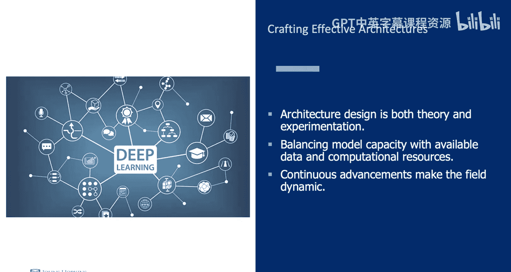
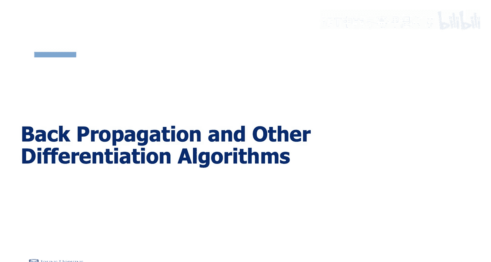
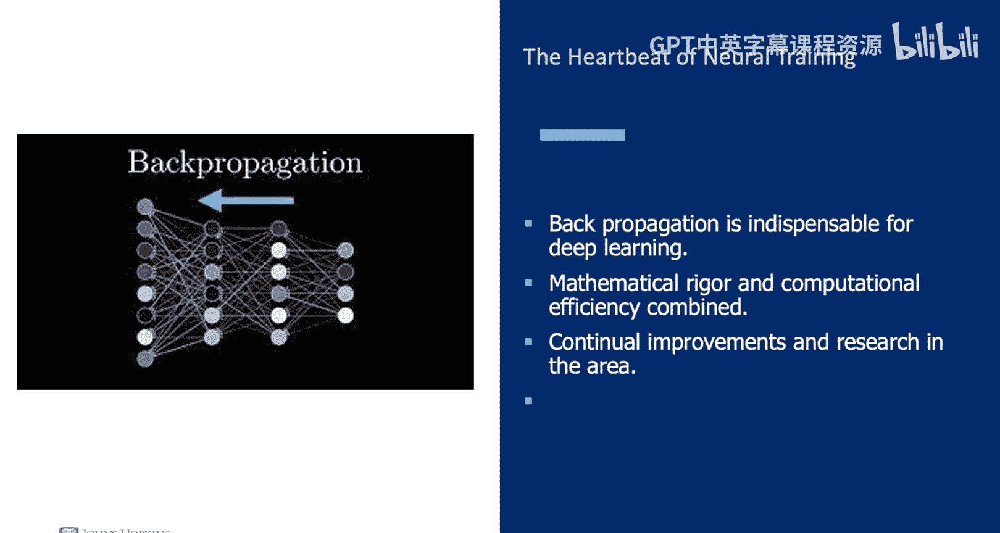

# 约翰霍普金斯大学《神经网络基础｜Foundations of Neural Networks》中英字幕 p05 4_深度前馈网络.zh_en -BV1w1uqzSEHZ_p5-

So let's start looking at kind of， you know， the purpose of or kind of the beginning of this course。

And kind of start talking about， you know， what deep feed foreign neural networks are and try to start to get an understanding of kind of so what we're doing here。

All right so deep feedback forward neural networks right so we often call them MLPs。

 they operate to approximately a function kind of from F star right and so the progress input they progress inputs through a series of layers devoid of feedback right so kind of they go forward and that's it right？

And so why does this matter right， they are the core building blocks of kind of deep learning， right。

 they are core in many AI applications right and they're the basis for understanding more complex network architectures theyre while used right and they're using and a lot of applications and you know。

 for someone like me right they're also really， really probably someone like you。

 they're also really， really intri intriguing so mathematics。

So so what are they right so what is the mathematical significance here right so they're very powerful。

Non nonlinear function approximated right and there is a pretty famous universal approximation theorem for neural networks that basically says that you know under you know so reasonable constraints。

 you can actually read the actual statement here， but under some reasonable constraints。

 a neural network can can approximate any function or arbitrary accuracy right？

And so and again another thing that's interesting is that this right here a prime example of the gradient- based optimization in action so it's a cool way to think about it right And so right the intriguing part here about this universal appxiator is that you know if you have a neural network with one hidden layer it can approximate any function that is continuous almost everywhere arbitrarily well so that's pretty cool is one of the big theorems in machine learning right and so I want to be careful here right and say that the universal approximation the administration theoretical capability of a network but it doesn't make any statements regarding theability of the of the appating function or the efficiency of the train right so in practice。

Beat networks and what do I mean by that those that have a lot of layers right have been found to approximate complex function more efficiently and shallow right so you know the approximation theorem says that like if you have one like one。

Layer of networking， you make it arbitrarily wide， it'll approximate any function and what we found in practice is that like you usually don't want to go wide you deep。

Okay。And so the theorem doesn't actually prescribe how to find the weights right in the biases or how many hidden units are needed for a given approximation。

 right？And so in like a broader context， a wider the theorem ensures that a neural network can approximate。

I a function that does it theoretically right and in practice the challenge lies and effectively trying and reduce so。

 right？

你事是。So let's jump it to an example right so we have the logical exclusive or right and so this is the binary operation within inputs right and so the output is one when the number of inputs set to one is odd right and so if you look here and the function is actually right a non linear problem you think about it right？

And so。The preceptron drawcepts will draw a millenn decision boundary right but the problem is that the exclusive ore is not a millennia right and so the precepttron actually fails to solve this problem as we can see on this graph right here。

And so with MLPs right they can capture any relationships right。

 they're composed of an input layer right a hidden layer and an output layer and they use nu in any activation function right。

 for example， we can use the sigmoid function。Okay， and so you have kind of like two input neurons。

 right， two neurons that are hidden in one output neuro， right？

So you kind of say you know the two inputs is right it' zeros and ones is the inputs the hidden layers is two hidden layers in there and then the outputs is is it true or is it not for exclusive order okay and so we use able exclusive or data as training sets and then we implemented the back propagation to adjust the weight right and so we iteratively reduce the prediction error over time。

And so what the MLP created was a nu linear your decision boundary。

 so what you see here right and the exclusive or points are correctly classified in this case。If so。

activation functions introduce the non linearity in the neural networks right and so it enable MLPs to learn non linear patterns right and so common functions are sigmoids ray losing and 10H。

And so right exclusive or is pretty it's pretty simple right someone we's talking about you know non any your functions right but it's a gateway to more complex problems right and so it shows that there's a need for multi layer networks and that。

Or you know， it shows that there are ways to where we can can use them， right and。

Neur atwards can model intricate non nonlinear any of your functions here right and so the foundations of this are lay the ground more advanced people learning concept。

Okay， and so that was just a quick you know easy example right but let's start diving into like we ra baseline learning okay。

 and so the goal here is to minimize a cost function with do gradient baseline learning right and so you use gradients to update parameters。

And so it's the core technique of training。Keep learning and operate。

And so kind of set a cost function right， what' so what's the role of cost function rates to measure the difference between the predictions and the true values。

And so some common choices here are means square error and policy andpy right you'll say it a lot and it's defined over the data set and its different。

And so how do we use the gradients to guide us right will radius indicate the direction of the steepest descent。

And so what they do is navigate is they navigate gradient points to the steep as deit and the computation use and you compute that right using the algorithm powerback obligation。

All right so what are some challenges right so gradient basis methods are kind of they are great but they are not you know perfect in particular right with the gradient this is a first moment excimation right and so you'll always have some sort problems there in particular you'll have saddle points right so you know if you blah b either from calculus it doesn't guarantee you right or you'll have an optimization it does guarantee a local optimization。

Right but like some other ones are kind of like the the vanish and and exploding gradient right and then the not comes the exitity of the deep ironing cost function right so which again is what I was talking about right which is you know I can。

You know， guaranteed that I'll find a local minimum or a maximum， but that isn't necessarily right a。

 I mean， I could be on on the saddle point， right？So， and then right so with the non conxities again。

 like you can kind of find like local minimum and not absolute minimum in maximum。

So what are some solutions and techniques right so the one of them is so so weight this action strategies which I so which will hit on a little bit and then there's also stuff like。

Bch normalization it mean skip connections you to read about skip connections and renet。

 so these are kind of techniques that we use to kind of deal with these kinds of things， right？

And so why do we use gradients right and so the reason because those。

Be Network Network has a ton of parameters。And you have to tune them off right and gradients provide a systematic way to adjust those parameters right。

 and so the gradient based methods form the backbone of many of the state of our algorithms。

Okay and so understanding gradients is a key right to using and being successful at deep learning right and so techniques evolve but principles remain the same so you'll see all kind of pretty you know evolutions of the gradient descent but its structured in the same way right and so continuous a research here for straining it for efficient and stable training is always on。

All right， and so we talked about kind of cost functions and gradient methods right so how about hitting unit right so hitting units。

Are neurons that are okay between the inputs and output layers。I mean。

 so what they do is they apply non transformations， right。

 and they are essential for enabling networks to have us a powerful representation ability。And so。😊。

You know， if you have a network right that has only linear transformations。

 it'll actually collapse into into a linear function right so in order to get that non linearity you have to have。

Those those activation function right and so what it does and so those things that they make those。

Deep learning is possible and usually we add those non lineararies into the hidden layers。Okay。

 so I talked about active division functions right there there are the things that add linearity right。

 some common choices of sigmma a 10h and relu， you can actually see them on the screen right there。

And each of them have their advantage this they side everything right and so with the sigmoid in a 10H right they bow outputs to a specific range so in particularly sigmoid go between zero and1 10H goes between negative one and one right but the problem there is that they're susceptible to vanishing the gradient problem right so in particular if you are trying to do a derivative way out close to one。

Right so why is equal to one， you'll see that the gradient there is close to zero。

And so you'll have a problem there because you won't be。

Learning much soon you're out that in that range right and so you're your're learning will slow down substantially in that way。

And so it rec file。In your unit or the Relu right it's a non output right and it helps to mitigate vanishing gradient problems which is great right the derivative of those guys are just one。

Right and some of the variants are things like leaky raylu and parametric relu and an exponential linear unit right and so you can you know these are things that they did to kind of fix these things。

 but there's also problems that with things like dead neurons and stuff like that so which you'll read about in research papers and things like that。

All right and so you know there are more than just those three activation layers again active research area and so there's a ton of them switch max out softpl right advancements and activation functionss are always continues to be added and you know like。

They are going to be， you know。Pretty correlated to the researcher that you're doing or the problem that you have right to what you're going to use okay。

 so so tons of tons of them out there you're able to kind of choose the one that you want to use。

And so how do you choose the right one right and so the answer is that it depends on the task and the at work depth right So Raylu and his variant have been really。

 really popular for。Thatworks in particular to deal with the div vanishing gradient sigma to 1x for like specific scenario in particular if you have a binary classification problem。

 those of you the in another situation and so again challenges with the raylu and stuff like dead neurons right so if it's a true raylu right if it's negative if the activation is negative becomes zero right and so that just dies and it's hard to get it to activate sometimes right and then you have exploding and gradient and vanish gradients and then overfitting with too many hidden neurons right so when you have all of these not linearities your expression of abilities become very very powerful and very capable and you're able to over the data pretty easily when you do it。

And so。You know so what are some of the things that you should do right you should actually ensure sufficient depth with right so when you're training these things you should also consider computational costs and regularization to to prevent overfitting we'll go through some regularization things later on in the course。

All right， so we talked about hidden layers and activation functions that started talking about architecture design right now。

RightAnd so structuring the layout of neurons and so how do you so what are you doing here right you're structuring the layout of neurons and the layout right and so another one is deciding right the depth right and the width of each of features of each of your layers right and so what this does is that it influences learning capabilities and computation。

when you're playing with these things， right？And so when we're thinking about depth versus width right。

 definitely increasess the model of representation power。

 but can also introduce challenges and trainings right and with can help networks learn more features but increases the computation。

😡，嗯。And so challenges with depth is things like the vanishing and exploding gradients。

 vanishing meaning that the gradients are going to zero。

 exploding means that that the gradients are starting to get huge。

 right like like very large and you also have things like increases of overfitting and over。

propagating all of the all of other knowledge through。Back from a。

Deton network is pretty computational intensive in it all。You know。

 start to make your training time longer and longer。嗯。And so there are techniques。

 right we have regularization and connection， so regularization penalizes large weights and a avoid overfintting。

Things like dropout are right pretty pretty standard for regularization techniques and you'll read about those there's also things like skip connections those things are kind of like shortcuting connections across the layers right and so you'll see that again in ressonnet and so what they do is they facilitate training in deeper models to make those easier。

And then the output layer， so those are going to depend on if you have a regression function。

 I mean a regression problem or a classification problem right if it's a regression problem you'll use a lot a lot of times you'll use a linear activation。

Or you'll use things like mean squared error with when it's a classification。

 you use things like soft Mac and crosscent。And so right so what are some of the real work constraints when you're doing this right so computation of the policy is a big one of availability of data right you have a too smaller of at of saying you have a really complex neural network you have a。

The big risk of overfitting going to avoid that and then there's also things like transfer learning which is like using pretrain architectures right so if you have a small do that out of set right and you want to train a good some model learning transfer learning is actually a good one right but that constrains the models are that you can use because you know you have to use the same sub model。

That the original model was trained on if you want to use transfer learning。

From simple MLPs to advanced architectures like resonative VTG， right。

 the state of the art architectures right， and so the evolution driven by task。

Data set and hardware rate advancements right and so the importance of stand up to date with so current research right so this stuff is moving fast and like one person right is able to keep up with all living but like having a general idea and a general trend of what's going on is really really important Okay and so how do you craft and effective model right and so architecture design is both theoretical and experimentations right so it's an art and it' and it's a science。

And so。Dlancing the model capacity and the available data and computational resources is important here。

And then like continuous advancements to make the do and so there's continuous advancements to make the feel so。

Or that that dynamic so you know， new things are coming out every day and so it's important for us again to keep up with these kinds of things。

All right， so that's the architecture right， so what about the back obligation and of the differential right？

And so the training requires gradient of loss short respect to the weights right and so you know doing this analytically with thousands and millions and trillions of。

Bunds is impractical right and so efficient computational methods are needed in order to make this work。

And so back propagation relies on on the chain rule， right。

 and so it breaks down complex derivations into simpler parts。

Right and then you have a forward pass right that makes you can compute the outputs and the loss and you have a backwards pass which propagates the gradients backwards through the network。

Right， so four paths， backward pass， four paths， backward pass and that's how you。

And then knows to represent operations right， so the edges represent data， right and。

It helps in structuring the back。Proagation process so if you want to visualize how this works right。

 that's how come we use these kind of like layer diagrams。Okay， and then so。Right。

 and so what is the back？Application algorithm， right， so you initialize your。

You're at work with weights right and so for each training sample perform a forward in the backward path and adjust the weights。

Based on the compute gradients right it's a simple concept right depends on the chain rule and so it's a pretty straightforward so way of doing it you just have to kind of like write it down and walk through it。

And so what are some of the challenges with the gradient so with the back propagation so it's all of the ones that are right present with the gradient to same plus a few more right so and it shouldn't exploit ingredients your choice of learning rates right because it's computational me learning rate。

And then ensuring rate efficient computationation is also great。

And so there are techniques like art like art。Like our prop and conjugate gradients right that are going beyond right the standard back obligationation right and they address some of the challenges of like vanilla back。

Ore and they offer speed ups or stability and。What's hard scenarios， right？

And so how do you get the most out of the vet application right so you initialize your weights wisely right there's been some research on that and particularly the Xavier initialization one of the famous ones then you consider adaptive under methods right so in particular things like Adamom and RMSMS prop and then the regularization to prevent things like overfitting。

And so right， back propagation is like one of the cornerstones of deep learning。

 right that's how we do most things。And so it's also rigorous and computationally efficient。

 which is great。And the continued improvements and research in this area every day and so with that if there is any questions。

 I'm happy to see you an email or in chat。

