# 约翰霍普金斯大学《神经网络基础｜Foundations of Neural Networks》中英字幕 p07 6_卷积神经网络.zh_en -BV1w1uqzSEHZ_p7-

All right。Let's get started。So today。We are going to start talking about convolution neural networks。

 these are some of some of my favorite neural networks。

 and so we'll do an introduction and kind of do a deep dive into see what's going with these。

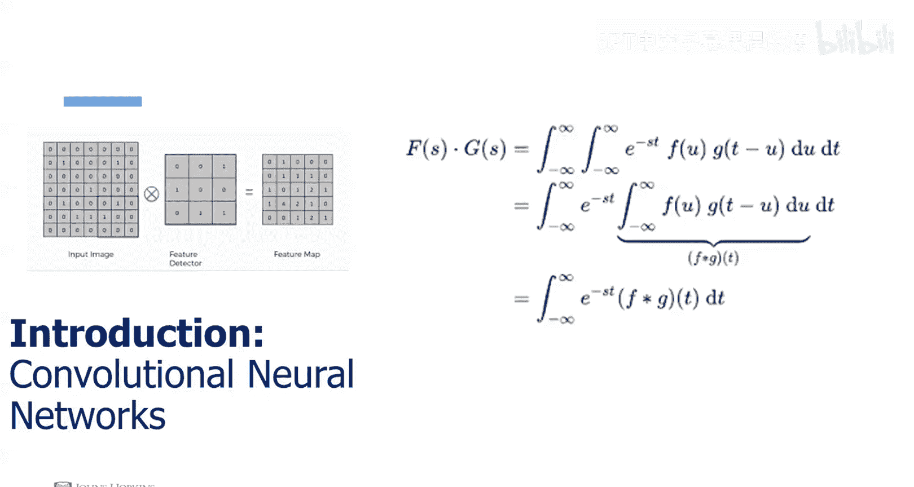

And so convolutional neural networks， so we come call them CNNNs。

 they represent one of the most transformative innovations in deep learning。

 these are things that we use all the time。They're tailored predominantly and kind of created for images and videos videos are just a series of images。

And what happens is is that these networks。They kind of use the spatial hierarchies and patterns and so and that actually sets them apart from kind of the way that we usually do traditionally feed for。

So what happens at the heart right so at the heart of a CNN is the to the convolution and so that's an mathematical operation that actually fuses two functions and produces a third one。

And so。嗯。So what it does is that it utilizes this series of filters and CNNs。Can kind of extract。

Ptures from the data kind of layer by layer， so if you've ever had a processing course think about stuff like hot demand and and low banner filters。

But with these filters， then what we do is we kind of optimize them using the gradient to send some method right so we kind of have this optimal set of filters in some sense in order to extract the painting that we're trying to extract out of。

Okay。And so I like those standard neural networks every input node connects to each output node right that's when user happens with a normal neural network that CNNN has more sparse architecture right so it's not necessarily true that every input is connected output right and so what happens when you do it this way is that it reduces the complexity of that neural network it enables the extraction of those local and global features and it reduces overfitting and kind the computational command demand that's usually going on with a regular neural network。

对。And so the revolution here is。Extends beyond the academic interest okay so from image classification facial recognition events video analytics these networks drive many of today's AI power applications so when you think about stuff like。

Ex for recognition and think about stuff like。Pification techniques with images and stuff like that there's probably a CNN at the background that that's actually happening right now so you want your phones and stuff like that as CNNs that's helping with that right now。

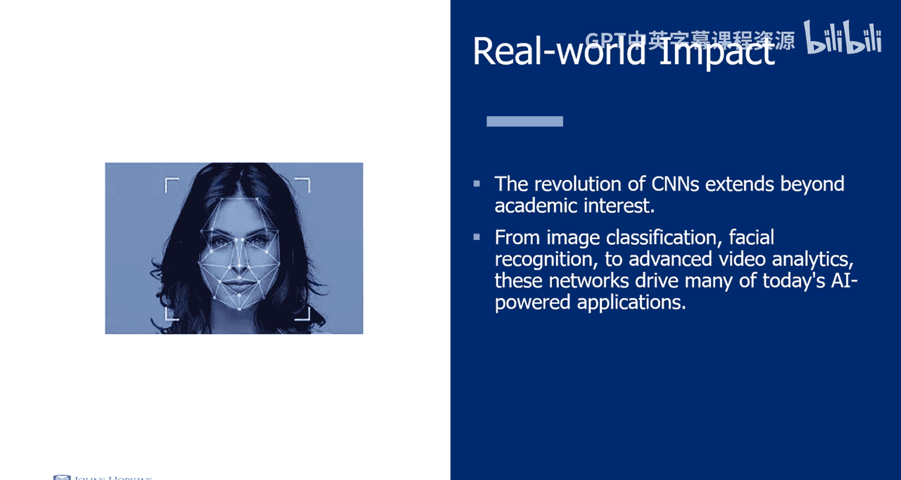

Okay now let's jump in the convolutional operator right so the convolutional operator is the core concept that drives the function citizen union it right so's some mathematical operation that and what it does is is that it mills two functions and it produces a third one right so if you ever took a real analysis it's the same as the convolutional。

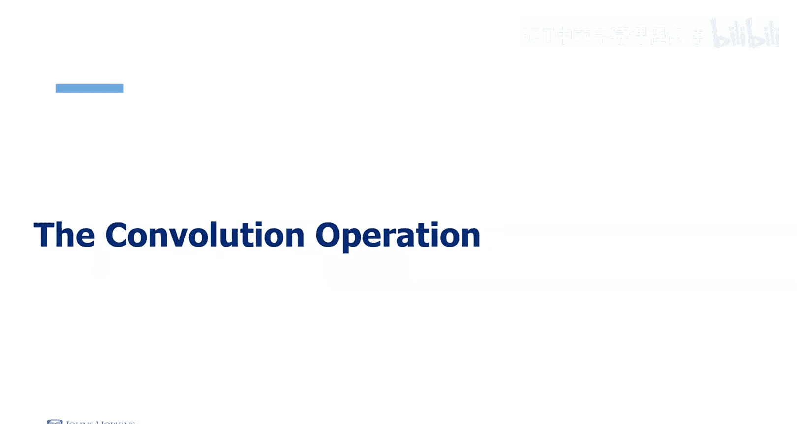

Heure that we'll see on the next screen， so in the context of CNNs it used to extract essential features from input that okay。

And so the convolutional operator for a function F and G is they're noted by F starG and and you can be defined as this right here is a wonderful function。

In a discrete form that the other integral becomes a sum， kind I assume the way we deal with it。Okay。

 so CNNs the convolution operator involves a filter right we also call them kernels and what it happens is that it slides across the input data right particularly most of the time it's the image。

And it produces a feature map right and this is going to highlight the features of that the filter believe is important okay。

And so if you see an example here then then then kind of have this four by four input you do a about three filter and you kind of slide across the screen right slide down slide across the screen right and you get an output that's four by four here right and so filters and CNNs matrices of trainable parameters right that's what I was saying sending optimal filters in some sets and when convolved with an input feature can highlight specific features such as edges and textures and colors and you kind ofball anything like that。

可。And so sometimes you don't want sometimes you want to control that how that output of feature map looks。

 okay， and so one of the ways that we do that。Is we do things like stride differently right and so this is how much the filter slides across the input at a time right or we do a thing called padding right and this also will control the spatial size by adding zeros around their input values。

Okay。And so what are some of the interface of convolutions right right so the big one is a parameter sharing so a single filter is used across all parts of the input reducing the total number of parameters。

Sparrsity of connections right and so each output element depends on a small number of input elements is great then you have things like translation invari right so if it can be recognized anywhere in the input right and so if if a cat is on you know this side of the image right。

It's still a cat if it's on the side of it。Kind of what that translation experience is。

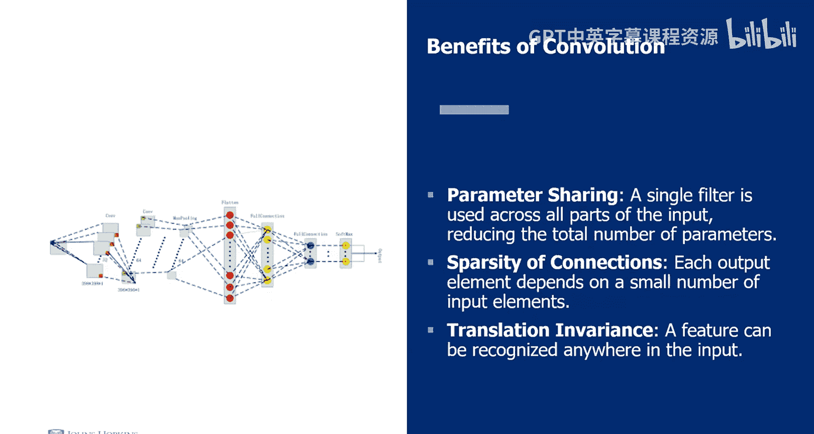

All right， so let's do some motivation as to why these came about， right？

And so as deep learning tasks become more complex， traditional feed for networks and challenges right a few of them。

 too many parameters in early connected layers and you know you know as these things get deeper and deeper to get larger and larger you have a lack of spatial hierarchy and transition variants right so again this is this if a thing moves across the screen and some of these things you get them wrong right and stuff like computational expensive for large images right so if you have things like early connected images you know it starts to get computationally expensive to push through feed forward neural network。

And so the design inspiration of CNNs comes from the human visual cortex that Iball， right？

And so neurons individual cortex have a small ochreceptive field。

Meaning that they only react to visual stimuli located in limited regions of that visual field。Okay。

And so to mimic the visual cortex， CNNs introduce the concept of the convolution okay and it focuses on local features first and then it builds up to the global features。

 so as you get backwards as you come down in the deep convolution on neural network that's when to start getting more global and global okay。

And so image to recognition。So imagine so recognizing an object right so what are some of the steps that you would take you probably would identify edges you probably would combine edges with kind of shapes that you're looking for you'll combine those shapes to identify patterns you' recognize the objects based on the patterns right these are kind of things that are the CNN is going to be replicate in this hierarchical manner。

And so instead of having separate parameters for every single input feature。

 CNs reuse the same filters across different parts of the input right so this is this massively reduces the number of parameters and guards against stuff like overfitting correct。

And so right and so it also does stuff like spatial events right so again a cat is a cat so whether it's on the left or the right of the image it a cat if it's upside down right so we can always tell it as a cats right so CNNNs through their architecture recognizes features irrespective of their low locations in the input this is one of the stronger things about there this is one of the shiny things about CNN。

可。And so due to these fundamental motivations and design choices。

 CNNs drastically improve a performance on image recognition tasks is one of the biggest things。

And they have become the de facto standard for computer vision。Okay right， so。

Think about computer vision now from cars and anything like that right CNNs are kind of the ones that are doing things okay。

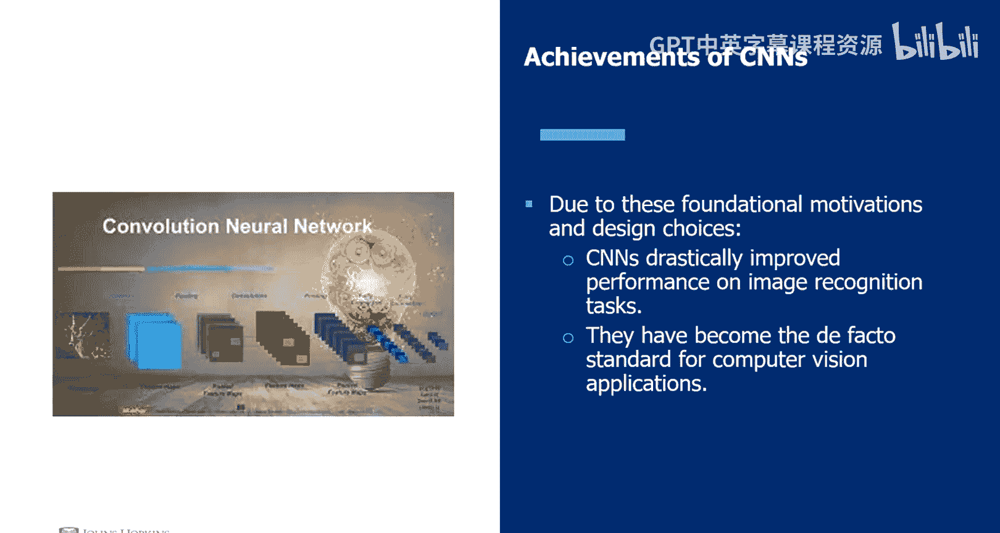

All right， so we have the convolutional neural network， the convolutional layer。

 let's actually talk about another layer which comes up a lot with CNNs and that the pooling。

Okay， so what is pooling right so pooling is this form of down sampling to reduce the spatial size of the feature maps？

Retaining essential information and making the CNN and varying over small translation。

And so so why so why do we do it right so stuff like dimension out of the reduction right so it reduces the computation and parameters thereby preventing stuff like over50。

It makes stuff translational and variantant right so it minimizes this sensitivity this slight shifts。

And distortions in the input right and it captures the dominant feature， so it emphasizes the。

Prominent features in the region that's conflict what it is。

All right and so there's a few kinds of pooling， there's max pooling which is the one that we use the most right and so it takes the maximum value from the set of values in the feature map。

There's average pooling， which averages the values in each mapping and it has's men pooling。

 which I haven't seen a lot of at all， and it takes the minimum value from the future region okay。

And so so much like convolutions pooling involves kernel sizes right the dimensions of the pooling filter it involves strides right these are the steps that it takes to that the filter goes across it right and but the interesting thing here is that for all of the ones that we just talked about no parameters are learn here during this pooling so with max min or averaging right we're just doing an average we're taking the max over're taking so there's no。

There's no。There's no learning in that situation。And so max pooling effectively captures the dominant feature I in a region right so for example。

 in an image of a face， if the pooling region contains parts of an eye right the max pooling ensures that the features is retained。

In that pool layer right so if you kind of look overhead here the picture you see for the blue region the nine is the biggest thing and the green is seven and the yellow is eight and in the red it's six right and those are the things that were passed on to the next region。

Okay so average pool in so while the max pooling captures the dominant right features the average pool provides smoother representation of the region right and so it's less aggressive and retains more general information right so you take the average of what is in blue you get the 4。

25 the same for green yellow。And so， you know， been theres been there's been talks about is pool good or is pooling that right and so advancement some aren in architectures like residual networks。

😡，Densely connected networks， dense nets often reduce spatial dimension using stride convolutions instead of the max pooling and pooling techniques right？

And so while pooling offers advantages， it also has its trade offs right so every pooling operator。

Describe like discard some data right striking the right balance between， you know。

Retaining information and gaining abstraction is key here because you don't want to lose too much information too quickly is the whole problem okay。

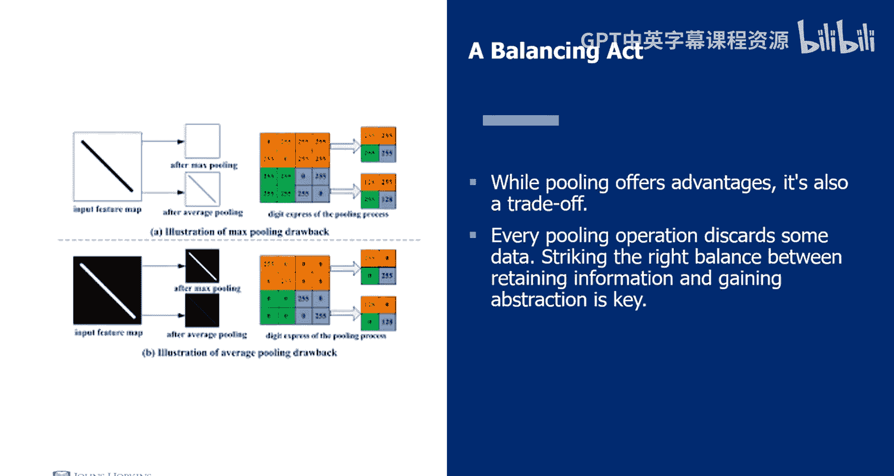

All right， so now let's actually you know dive more into addicts of convolution and pooling right and we're going to kind of think about it as an infinitely strong prior right this is another way to think about it in the mathematical sense。

Right。And so in Beijing statistics a prior provides our assumptions or belief about an unknown parameter we come in with the prior assumption and the prior helps with that kind of thing right and so in deep learning certain architectural choices can impose a strong prior and the type of function the model can model I mean the network can model okay。

😡，And so with convolution operators operations and CNNs it makes two strong assumptions right the first one is stationary right and so what that means is that the same features are useful across different parts of the inputs and the second one is locality right and so that means that nearby inputs are related and can be processed together okay。

And so why is convolution infinitely strong prior right so infinitely strong prior means it restricts the function space to a significant degree。

And so convolution effectively restricts our search to spatially invariant functions。

Making it infinitely strong prior for the image。And so pooling makes the strongest assumption about the higher a in the image。

 right？And so higher layers of the network capture more abstract representations by combining features from the lower layer right so as you get deeper in your network we are assuming that you are getting more complex and so as you're getting shallow in your network think about stuff like edges when you're getting deeper in your network and then think about you know the shape of your nose or something like that these are more。

嗯。And so。So why do we do this right so particularly so we do it because of stuff like computational computationally efficient right so it so it narrows the hypothesis space right generalization。

It vastly reduces the chance for over 50。And kind of intuitive sense， right so images。

Herarchically have spatial hierarchies and patterns。

 so this is a thing that we're trying to replicate。对。Um they're not always， you know。

 this is not as favor the thingss some things that we have to watch out for right and so for none image data right A about stuff like time series or tabular data such prize may be too straight。

And so advanced techniques sometimes relax these priors to capture more complex。

Patterns and so again， very data specific you could never try to a place。

U subjectubjectmatic expertise with these right here。

 you kind of have to understand what's going on with your data in order to make the right choices。

Great。And so what is some of the trade off right， so the pros is that it' is its efficiency is generalization capability and it。

The current is that it might be too limiting for certain tasks， okay。

 so you got to watch out for that kind。

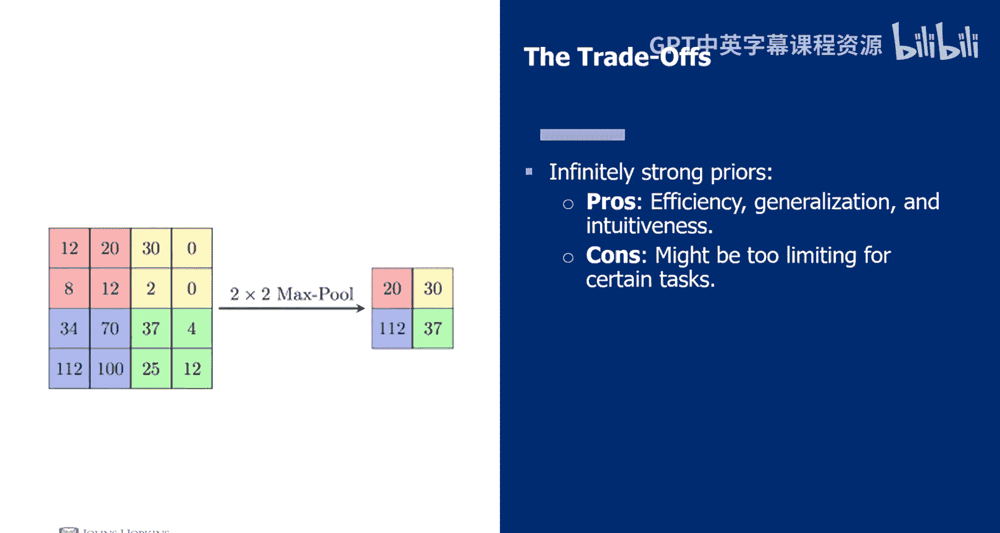

All right， now let's talk about the variance of the basic accomplishment。

So convolutions is a foundational operation in seeing right that convolutional error is the kind of reason that we call it a convolutional network right but like all foundation concepts it has evolved with variant optimization of specific tasks right so just like we did with all other neural networks。

 these things are going to evolve as well。哥。And so strideed convolutions right and so strideed convolutions defines the step size of the filters right and so these these are kind of like don't stride just one stride a bunch and so stride say two or three or four or10 right and so what this does is that it reduces spatial dimensions right again this is one of the reasons that it just wouldn't use pooling。

And then it controls computation costs right this is a great thing because it reduces that dimensionality。

嗯。Then we have these things called dilated convolutions right and so they introduce gaps between filter values to capture wider context without increasing that filter size or the computational cost。

哥。And then we have things like transpo convolutions we call those deconvolutions right so it's used to up sample the spatial dimensions。

 especially in decoder parts of an autoender or some general adversial networks。

 so these are particularly。Bing in those two and those two kinds of networks。

And then we have things like De wise and separ convolutions right so what they do is they optimize computationally efficiency so they kind of split the two operations apart。

And so with De wise convolutions， they apply a single filter for each input channel。

 and then you have separable convolutions， they combine the De wise followed by a point wise so。

I want competition。And then we have group convolutions and so these divide the input and output channels into groups。

Ands it convolved them separately right and so this is going to be inspired by the Alex andette。

 I encourage you to grab that path and look at it to fit the model into GPU right so these GPUs were starting to become hot on the scene and they were trying to figure out how to use them the best way。

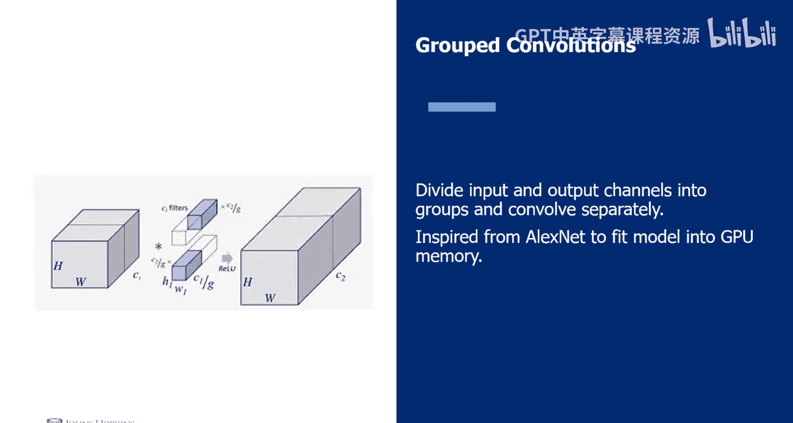

Okay。

All right， and then we have structured outputs let's kind of talk about those in the sense of seeing right so convolutional network networks are not just for image classification。

 but they can produce structure output like images and sequences in the lab。Great。

So structure outputs are multidimensional outputs with interdependencies among their elements right and so what you see here is a picture where everything is being classified right so everything in green is a human everything and let's say dark brown is that doll right the purple of trees these kind of things background that kind was rolled。

And so what are they right they pixel level tasks right so think about stuff like segmentation thats over saying on the screen think about image a generation that goes into thegenrative AI and equis predictions for like visual inputs is big there。

And so what are some of the challenges with that right and so a lot of them is the spatial hierarchy being maintained。

Alice in the global in the local context right these are hard things right and computational complexity also will come up as being hard。

All right， and so what about CNNs for segmentation， this is exactly what's on the screen right here。

 but they assign a label to every pixel。Okay， and so they utilize unit or Philip。

Convolutionary network structures for these time of tasks。

But in the research they use a lot of other things too as well， this is an activeary research again。

Right and so。Transforming the context of images while。

Preserving the structure right so this is image to image translations right and so for instance right you're turning a satellite image to a map right this is a thing we can do as well this is another hot area of research that is actively going on。

嗯。And they have to like CNN for sequence prediction right so producing sequences from images。

 for example， right so reading the text in an image or something like that。S Soreena in a image。

 something like that， right？不是。嗯。And so what are some of the loss functions for structured outputs right so determining that the discrepancy between the predicted and the structured output right that's kind of what we do with loss functions and so for example using dice laws for segmentation right so again the researches out there absolutely hope that everyone gets a chance to go and read that kind of thing。

Okay， and so。Techniques like conditional GNs for image to image translations and so what that does is that it teach is that and teacher force and enforce sequence a prediction right and so these are kind of ways that they kind of adversarily help train each other。

It's kind of the one of the ways that they train。These kinds of neural networks， okay？

And so practical applications so you know so we could go on and on about this。

 but this is a few examples of it right so medical imaging stuff like tumor segmentation think about autonomous driving right if you have a Tesla or something like that。

 very driven knows how CNNs and them or you know optical character character character recognition again very specialized places but how CNNs have shown to shine in those places。

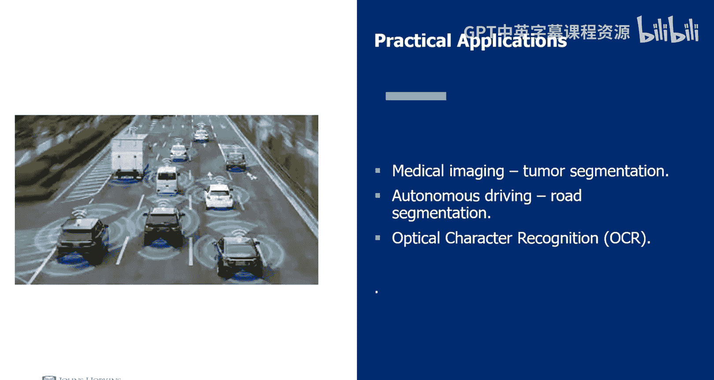

All right， now let's talk about the data types。Sure。

So convolutional networks can process a wide array of data types， not just 2D images。And so。

They can do you know the basic attypes right you kind of have the scalrs， the vectors， the matrices。

 the tensors， right the high dimensional so medical scans， CNN and panel。Right。U and so again。

 they're not commonly used for CNNs just because u， so for neural networks happiness。

You start with the scrs， but again， they can humblelo。

With vectors these are audio signals right so kind of varying intensity over time time series for stuff like finance and health and more right so in particular there's a one dimensional convolutional operator that that these things do well on there's a lot of research on that stuff so again go ahead and look out for it。

And then you have 2D images so these are things like grayscale images right so these just kind of pixel andticities and a 2D grid。

So， you know， so yeah， definitely。I've used these before。

 you can glean a lot of information just out of two dimensional images I'm sure everyone knows。

And then you have things like tenss right so these are three dimensional matrices right until you think about IGB channels。

Where each one of the channels red green blue is a matrix in itself right so you kind of this three dimensional matrix but again you could have higher dimensions as well there's stuff like some multispectral images that have higher dimensions in I't area there as well。

And so when you think about stuff like high dimensional data。

 there's stuff like some medical scans like CT scans， MRIs。

 there's videos that come as a sequence of 3D attention over time right this is also a higher form of data that CNNs actually handled。

Okay。And so so why in the world do we think about these in this complex way right。

 so different data typess capture。Diverse information。So that CNN architecture adapt。

Based on input that out of type right so mathematicalally is rich it has a richer representation and what it does is that it glans out very deep insights in the image right so it kind of。

Does the thing that our ourball does without us actually knowing what's going on with our eye。

So that's the cool thing about。All right， and so。There are a lot of challenges when it comes to this kind of data。

 right？And so you have to and so when you're doing that you have to you have to make some considerations right so you need to adjust convolutional or convolutional operator sometime。

To manage the computational educational resources， I've definitely had convolutional neural networks and when I kicked it off I realized that it was going to take weeks to train。

Nonstop right but Iison the resolution versus the depth into the I'm in the network so basically how wide versus how how long is a thing that you need to think about。

And so。So what are， you know， again where were out of time， so we honestly went over the so speech。

 think about image classification for tuning in and think about stuff like social medical diagnostics and stuff like after 3D images。

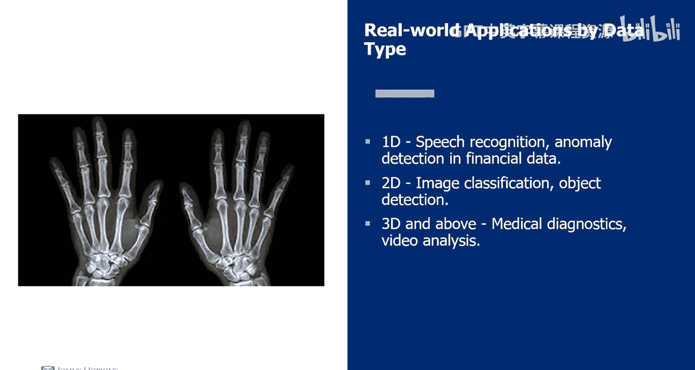

All right， so now let's talk about some efficiencies in competition。

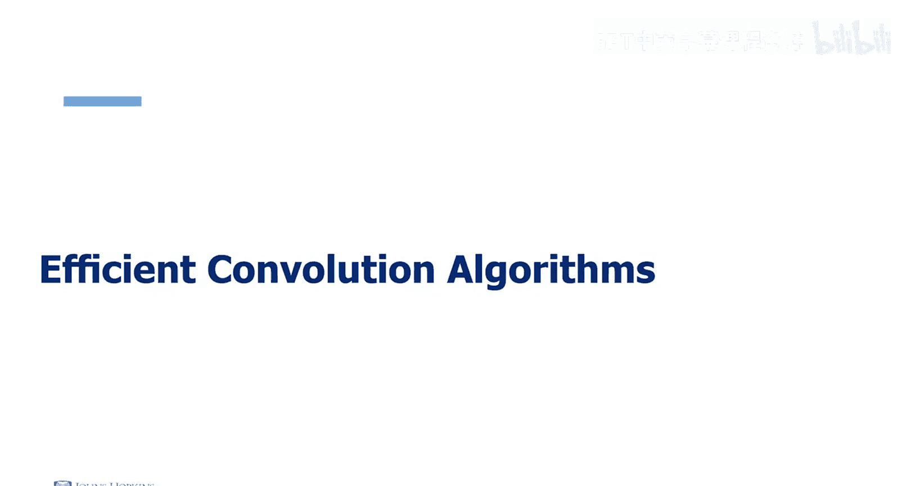

是。So convolutional layers are computationally expensive in itself， right。Um。

 the one of the things that we want to do is we want to make those faster without compromising performance。

Easy easy。And so a recap， right， convolutions is the process of applying a filter or a kernel to an input matrix to produce a feature。

是。And so you can do brute force convolutions right so this is you know direct computation to each value in the output of the feature map right and so this is kind of two times the complexity right so this is order in square at least。

For some in by N input and in by end filter。And so we we kind of want to figure out if we can do so better than this becomes in。

嗯。And so there's the FFT based convolution right and so this uses the fast Fourier transform to convert spatial data into frequency domain right and so it performs element wise a multiplication in another frequency space and then you do an inverse FFT to convert back to a spatial domain。

So we use this all the time with stuff like signal processing， stuff like that。

And so what are some of the benefits right， so it reduces the complexity to order n square login for n by n inputs and it's paraizable which is actually a game changer。

Go。And then there's image to column method and so what this does is that it reshapes parts of the input image to columns right and it transfers the convolutional into some matrix of multiplication right and so this is used in popular deep learning social frameworks that are kind of deployed and like in the mainstream。

对。And then there's the vinegargs algorithm right， and so this is a special minimal filter algorithm for certain filters in particular they like to do it on by three filter sizes and so what it does is that it reduces the multiplication at the cost of more additions。

She's always great。And then there's strideed convolutions right and so again so we talked about this the that you just ski around with your kernels right and so it requires new operations then then that。

It's convolution that kind of steps by in each pixel。And then so， you know， to highlight， right。

 this is a very active field of research it's always busy it's coming on。Fast as you can name it。です。

So it is currently being so work， is heart rate specific optimization。

 there' spre convolution there's quantization and pruning， you name it， all the that stuff still。

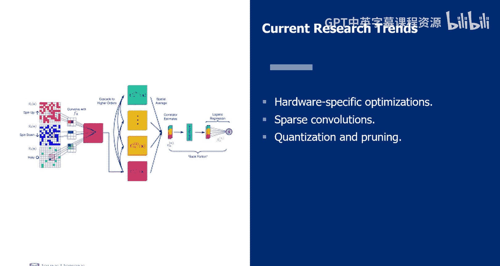

Actively being researched。So that's it， I hope that everyone enjoys the paper that they're going to read on convolution on network。

Let me know how you're getting along and kind of the questions that come up as they do。

 I look forward to seeing you in the next video。

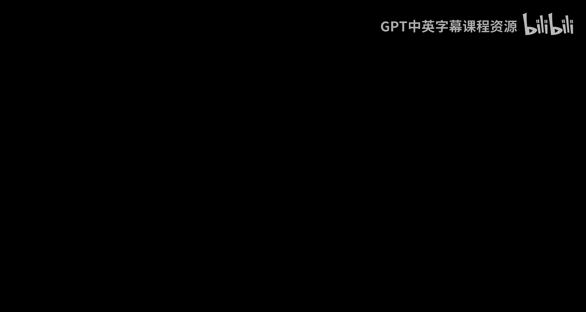